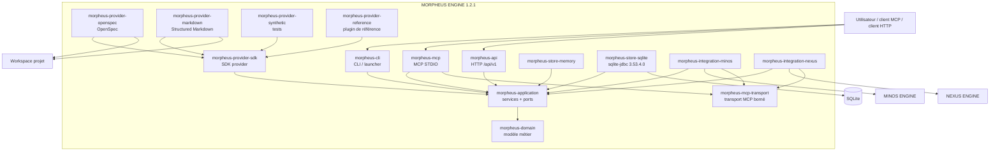
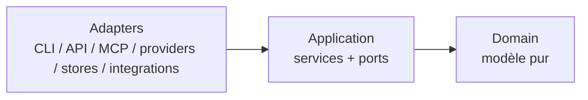
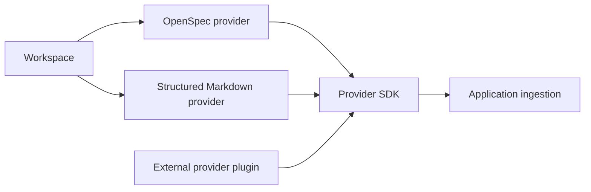
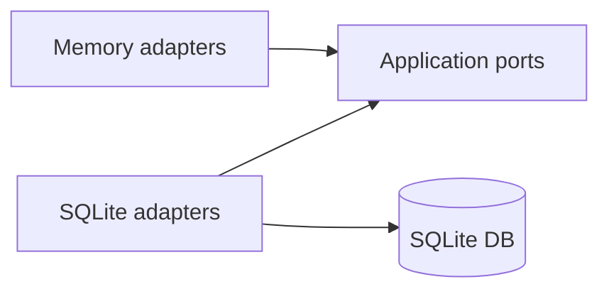

# §5 — Vue des blocs (structure statique)

> **Sources actives** : reactor `pom.xml`, POM des modules, contrats publics,
> tests d'architecture et code du HEAD `develop`.

---

## 5.1 Vue conteneurs



Le diagramme exprime les dépendances logiques, pas un ordre de démarrage. Les
providers **OpenSpec** et **Structured Markdown** lisent les formats qu'ils
supportent ; OpenSpec ne doit pas être confondu avec OpenAPI.

---

## 5.2 Reactor Maven

Le parent `morpheus-engine` agrège les modules que son `pom.xml` déclare (le
nombre se compte dans le POM, il ne s'écrit pas ici) :

| Famille | Modules | Responsabilité |
|---------|---------|----------------|
| Domaine | `morpheus-domain` | Modèle métier, value objects, invariants et state machines |
| Application | `morpheus-application` | Use cases, orchestration et ports possédés par MORPHEUS ; accès au disque local, à l'environnement et à l'horloge par des classes nommées, ni SQL, ni JSON, ni processus ([ADR-0150](../adr/ARCH-0150-ce-que-le-coeur-applicatif-peut-toucher.md)) |
| Provider SDK | `morpheus-provider-sdk`, `morpheus-provider-testkit`, `morpheus-provider-reference` | Contrats d'extension, qualification et plugin de référence |
| Providers | `morpheus-provider-openspec`, `morpheus-provider-markdown`, `morpheus-provider-synthetic` | Adaptation des sources vers les contrats MORPHEUS |
| Stores | `morpheus-store-memory`, `morpheus-store-sqlite` | Persistance derrière les ports applicatifs |
| Intégrations | `morpheus-mcp-transport`, `morpheus-integration-minos`, `morpheus-integration-nexus` | Transport MCP STDIO borné partagé et passerelles optionnelles vers les moteurs externes |
| Surfaces | `morpheus-cli`, `morpheus-mcp`, `morpheus-api` | CLI, MCP STDIO et HTTP |
| Qualification | `morpheus-architecture-tests`, `morpheus-coverage-report` | Invariants et gates d'architecture ; rapport JaCoCo agrégé, mesure canonique de couverture et gate de l'échelle agrégée |

À l'intérieur de `morpheus-api`, chaque rôle est un paquet ([ADR-0147](../adr/ARCH-0147-un-role-d-adaptateur-est-un-paquet.md)) :
`remote` (serveur remote et modèle d'identité), `local` (serveur local et ses protections), les trois
paquets de routeurs de `routes`, `transport` (plomberie partagée) et le paquet parent, qui porte les
services de l'application. Ces paquets sont sans cycle, dans cet ordre, et les autres modules
n'utilisent que six types de l'adaptateur.

`morpheus-cli` et `morpheus-mcp` séparent de même la distribution des appels et ce qui les sert
([ADR-0149](../adr/ARCH-0149-une-commande-et-un-outil-sont-servis-par-une-classe-de-capacite.md)) : le lanceur et le dispatcher de la CLI
dans `com.morpheus.cli`, au-dessus du câblage des serveurs (`launch`) et des classes de capacité (`command`) ; le
serveur MCP dans `com.morpheus.mcp.server`, au-dessus des classes de capacité de `com.morpheus.mcp`. Une commande ou
un outil est servi par la classe de sa famille du manifeste ; un dispatcher ne tient aucun cas d'usage.

Les nombres de classes, paquetages et endpoints ne sont volontairement pas
figés ici : ce sont des métriques volatiles et non des propriétés
architecturales.

---

## 5.3 Règle de dépendance



Invariants :

```text
domain -X-> application infrastructure
application -X-> adapters
application -X-> SQL / JSON library / process execution
application -> file, network, environment, clock, reflection : named classes only (ADR-0150)
provider-specific types -X-> public domain contracts
store implementation details -X-> domain
optional integration failure != local fact loss
```

Le module `morpheus-architecture-tests` vérifie ces frontières de manière
exécutable.

---

## 5.4 Providers



Le Provider SDK permet l'ajout de plugins sans exposer des types provider dans
le domaine. L'activation d'un JAR externe reste explicite et sa provenance / son
intégrité sont contrôlées par la baseline de hardening.

---

## 5.5 Stores



`morpheus-store-memory` et `morpheus-store-sqlite` implémentent les mêmes
frontières applicatives lorsque leur capacité le requiert. SQLite est le
backend persistant de la baseline 1.2.0 ; il reste encapsulé derrière des ports.

---

## 5.6 Surfaces publiques

Les trois surfaces principales sont :

```text
CLI
MCP STDIO
HTTP /api/v1
```

`contracts/public-surfaces.tsv` est la source de suivi de convergence. La
convergence signifie que les capacités métier restent cohérentes entre les
transports ; elle n'impose pas une représentation protocolaire identique.

---

## 5.7 Intégrations cross-engine

MINOS et NEXUS sont des dépendances **optionnelles** accessibles derrière des
adaptateurs. MORPHEUS conserve sa responsabilité : faits de spécification,
intentions, lifecycle, gouvernance et provenance. Une intégration externe ne
peut pas devenir implicitement la source de vérité des faits publiés.
