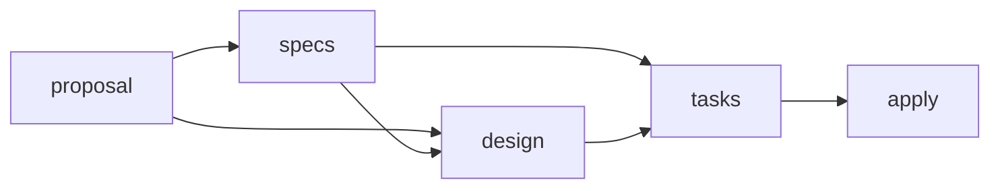

# Schéma OpenSpec `detailed-uml`

Ce guide dit comment produire une spécification avec le schéma de projet `detailed-uml`, comment le maintenir et
comment le comparer au schéma officiel dont il dérive. Il s'adresse à quiconque rédige ou relit un changement sous
`openspec/changes/`.

## Ce que le schéma fixe

| Élément | Emplacement | Rôle |
|---|---|---|
| Sélection du schéma, contexte, règles courtes | [`openspec/config.yaml`](../../openspec/config.yaml) | injectés dans chaque instruction d'artefact |
| Workflow et instructions détaillées | [`openspec/schemas/detailed-uml/schema.yaml`](../../openspec/schemas/detailed-uml/schema.yaml) | artefacts, dépendances, consignes de rédaction |
| Structure des documents | [`openspec/schemas/detailed-uml/templates/`](../../openspec/schemas/detailed-uml/templates/proposal.md) | `proposal.md`, `spec.md`, `design.md`, `tasks.md` |
| Documentation durable par capacité | [`docs/developer/specifications/`](specifications/README.md) | vue consolidée, diagrammes, traçabilité |

Le workflow garde les quatre artefacts du schéma officiel, avec une dépendance de plus : la conception attend les
specs, pour pouvoir citer les exigences qu'elle sert.



`design.md` est toujours produit. Pour une évolution fonctionnelle, transverse, de sécurité, de persistance ou de
surface publique, il est complet ; pour un changement documentaire ou local, il se réduit à quatre rubriques et une
ligne « Sans objet : raison » pour les autres. Un changement sans comportement spécifié pose `skip_specs: true` dans
son `.openspec.yaml` : OpenSpec marque alors les specs « skipped » et débloque la conception.

## Répartition des contenus

| Contenu | Où il vit |
|---|---|
| exigence et scénarios d'un comportement | spec delta du changement, puis `openspec/specs/<capacité>/spec.md` après archivage |
| conception propre au changement, alternatives, écarts constatés | `design.md` du changement (non consolidé à l'archivage) |
| vue consolidée d'une capacité, diagrammes maintenus, traçabilité | `docs/developer/specifications/<capacité>.md` |
| vision d'ensemble et vues d'architecture | `docs/architecture/arc42/` |
| décision durable, transverse et coûteuse à inverser | ADR sous `docs/architecture/adr/`, selon `.claude/rules/adr.md` |

La synchronisation et l'archivage ne recopient que les exigences. Ni `design.md` ni la documentation durable ne sont
mis à jour par OpenSpec : le modèle de tâches le prévoit explicitement dans chaque groupe.

## Conventions de rédaction

- **Langue** : tout en français, sauf les marqueurs qu'OpenSpec analyse : `## Why`, `## What Changes`,
  `## Capabilities` (et ses sous-titres) dans la proposition ; `## Purpose`, `## ADDED|MODIFIED|REMOVED|RENAMED
  Requirements`, `### Requirement:`, `#### Scenario:` et les étapes `**GIVEN**`, `**WHEN**`, `**THEN**`, `**AND**`
  dans les specs.
- **Mot normatif** : la description d'une exigence contient `SHALL` ou `MUST`. Convention : « DOIT (MUST) »,
  « NE DOIT PAS (MUST NOT) ».
- **Identifiant** : le titre exact de l'exigence, dans sa capacité, est la clé de synchronisation et de traçabilité.
  Il n'y a pas de numéro d'exigence : les titres des specs existantes n'en portent pas, et OpenSpec apparie les
  blocs MODIFIED, REMOVED et RENAMED par leur titre. Un titre ne change que par une section RENAMED.
- **Nature de l'information** : dans les propositions, les conceptions et la documentation durable, chaque
  affirmation structurante est qualifiée — exigence, `[EXISTANT VÉRIFIÉ]` avec sa preuve, `[DÉCISION]`,
  `[PROPOSITION]`, `[QUESTION]`. Le code prouve l'implémentation, pas l'intention ; un écart entre code, tests et
  spec se signale, il ne se corrige pas en réécrivant l'exigence.
- **Chiffres** : aucun seuil, budget ni compte sans sa source vivante (`.claude/skills/live-numbers`).
- **Diagrammes** : Mermaid, rendu par GitHub. Chaque diagramme suit une question écrite, distingue l'existant de la
  cible, porte une explication et cite ses exigences. `flowchart` et `erDiagram` ne sont pas de l'UML ; une vue C4
  non plus.
- **Liens dans un delta** : depuis la racine du dépôt (`/docs/...`), voir plus bas.
- **Changement actif cité ailleurs** : par son nom en code (`nom-du-changement`), pas par un lien : l'archivage
  déplace son dossier.

## Comportements d'OpenSpec 1.14.3 vérifiés

Constatés le 2026-11-03 sur des copies isolées, avec la version installée (`openspec --version`). Une version
ultérieure peut les changer : les rejouer avant de s'y fier (voir « Rejouer les vérifications »).

| Comportement | Conséquence pour le schéma |
|---|---|
| Une section `##` autre que les sections de delta, dans une spec delta, n'est pas reportée par l'archivage ; `validate --strict` échoue | les diagrammes et annexes d'un changement vont dans `design.md` ou dans la page durable |
| Une section finale ajoutée à une spec **principale** (après les exigences) survit à l'archivage, qui insère les exigences ajoutées avant elle | possible, mais le projet garde les specs principales réduites à `## Purpose` et `## Requirements`, et renvoie à la page durable depuis `## Purpose` |
| Le texte d'une exigence est recopié tel quel ; un lien relatif écrit depuis `openspec/changes/<c>/specs/<cap>/` ne résout plus dans `openspec/specs/<cap>/` | liens écrits depuis la racine (`/docs/...`), que `RepositoryDocumentationCoherenceTest` résout depuis la racine du dépôt |
| Une exigence sans `SHALL` ni `MUST` produit un avertissement, bloquant en `--strict` | convention « DOIT (MUST) » |
| Une description d'exigence de plus de 500 caractères produit un avertissement, bloquant en `--strict` | exigences atomiques, exemples dans les scénarios |
| L'archivage avertit si la proposition n'a pas exactement `## Why` et `## What Changes` | ces deux titres restent en anglais |
| Un bloc Mermaid placé dans la description d'une exigence est conservé, mais compte dans les 500 caractères | pas de diagramme dans une exigence |
| `openspec new change <nom>` lit `schema:` dans `config.yaml` ; un changement existant garde le schéma de son `.openspec.yaml` | les changements créés avant ce schéma restent en `spec-driven` |
| `skip_specs: true` marque les specs « skipped » et débloque `design` | un changement documentaire passe par une conception allégée |
| Un bloc MODIFIED qui omet un scénario de l'exigence en vigueur est une erreur de validation | un scénario ne disparaît pas par MODIFIED : on le garde sous son titre en réécrivant son contenu, ou on retire l'exigence entière (REMOVED) |
| L'archivage déplace le dossier du changement sous `openspec/changes/archive/<date>-<nom>/` | une page durable cite un changement actif par son nom en code, jamais par un lien, qui casserait à l'archivage |

## Produire la prochaine spécification

Depuis la racine du dépôt :

```bash
openspec new change <nom-du-changement>
```

```bash
openspec status --change <nom-du-changement>
```

```bash
openspec instructions proposal --change <nom-du-changement>
```

Puis, dans l'ordre que donne `openspec status` : `specs`, `design`, `tasks` (même commande en changeant l'artefact).
Les skills `openspec-propose`, `openspec-new-change` et `openspec-continue-change` font ces appels eux-mêmes.
Avant de rendre le changement :

```bash
openspec validate <nom-du-changement> --strict
```

Le nom suit l'usage du dépôt : une phrase impérative en kebab-case qui dit le comportement visé. Une capacité
nouvelle reçoit sa page durable dans le même changement, à partir du gabarit de
[`specifications/README.md`](specifications/README.md#gabarit-dune-page-de-capacité).

## Vérifier localement

Aucun workflow de CI n'exécute OpenSpec. Le contrôle reproductible est :

```bash
openspec schema validate detailed-uml
```

```bash
openspec validate --all
```

`openspec validate --all --strict` échoue sur toute spec principale dont une exigence dépasse 500 caractères ; la
liste relevée est dans [`AUDIT_SPECIFICATIONS_OPENSPEC_2026-11-03.md`](../project/audits/AUDIT_SPECIFICATIONS_OPENSPEC_2026-11-03.md),
et la commande donne la liste courante. Découper une telle exigence est un changement de spec à part entière : le
mode strict s'applique donc au changement rédigé.
Les liens de toute page Markdown du dépôt, specs comprises, sont contrôlés par
`./mvnw test -pl morpheus-architecture-tests -Dtest=RepositoryDocumentationCoherenceTest`. La syntaxe Mermaid se
contrôle au rendu (aperçu GitHub, ou un validateur Mermaid) : aucun outil du dépôt ne la vérifie.

## Maintenir le schéma

- Éditer `schema.yaml` et les modèles dans `openspec/schemas/detailed-uml/`, jamais le paquet installé.
  `openspec update` ne touche pas `openspec/schemas/`.
- Garder les règles de `config.yaml` courtes : elles entrent dans chaque prompt. Les structures vont dans les
  modèles, les consignes détaillées dans `schema.yaml`.
- Après chaque édition : `openspec schema validate detailed-uml`, puis `openspec instructions <artefact> --change
  <un changement detailed-uml>` pour relire ce que l'agent reçoit réellement. Un champ YAML mal orthographié est
  ignoré sans erreur.
- Les modèles vivent sous `openspec/`, que le contrôle de liens parcourt : pas de lien Markdown vers une cible
  fictive dans un modèle (écrire les chemins en code).

## Comparer avec le schéma officiel

Le schéma a été dérivé de `spec-driven` livré par OpenSpec **1.14.3**, par `openspec schema fork spec-driven
detailed-uml`. Empreintes SHA-256 des fichiers d'origine :

```text
b6f28f305ab7f33b061949251bba82c79de66c82424cfed60582327db3f888f2  schema.yaml
0dd70e35db5c696ba8ac3cc3a53e2d6561865c1e4e7d49db5a1eaa3e4a6ad86e  templates/proposal.md
1cccfb573f031c6352bed2a879b7035ff710bc909112fc23d10bdcfcdd8d4318  templates/spec.md
6ccc87f5017fb190e69e8759dd4e20d5ac3320cc4dabf152708bf8f2aa5205f8  templates/design.md
fa67d99fb4a93b12d702f89ea83e1838219d1cad1c90a4192c402278001cd30e  templates/tasks.md
```

Après une mise à jour d'OpenSpec :

1. `openspec schema which spec-driven` donne le dossier du schéma officiel installé ; comparer les empreintes de ses
   fichiers à celles ci-dessus. Identiques : rien à porter.
2. Sinon, comparer l'ancienne et la nouvelle version officielle (par exemple en forkant la nouvelle sous un nom
   temporaire dans une copie du dépôt, `openspec schema fork spec-driven spec-driven-<version>`), puis porter dans
   `detailed-uml` les seules différences qui touchent un format analysé (marqueurs, limites, champs de `schema.yaml`)
   ou une consigne utile.
3. Rejouer les vérifications ci-dessous, mettre à jour le tableau des comportements vérifiés et les empreintes.

## Rejouer les vérifications

Dans une copie temporaire hors du dépôt, avec un dépôt Git vide :

1. copier `openspec/` ; créer `openspec new change sonde` et vérifier que son `.openspec.yaml` porte
   `schema: detailed-uml` et que `openspec status --change sonde` montre `design` bloqué par `specs` ;
2. écrire une spec delta qui modifie une exigence existante, avec un lien `/docs/...`, et une exigence ajoutée en
   français ; `openspec validate sonde --strict` doit passer ;
3. `openspec archive sonde -y`, puis relire la spec principale : exigence modifiée complète, exigence ajoutée,
   `## Purpose` et son lien intacts ; contrôler ensuite les liens de la copie (spec principale et pages durables) ;
4. un second changement avec `skip_specs: true` doit montrer les specs « skipped » et `design` prêt.

Ne jamais faire ces essais sur un changement réel : l'archivage modifie `openspec/specs/`.
