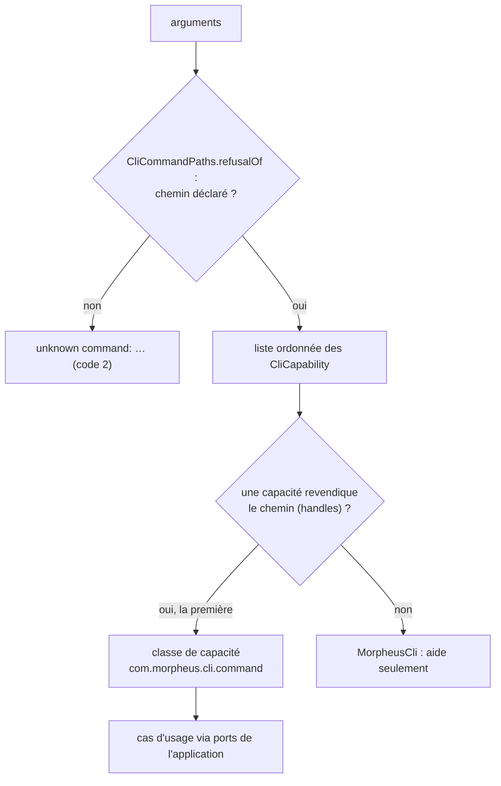
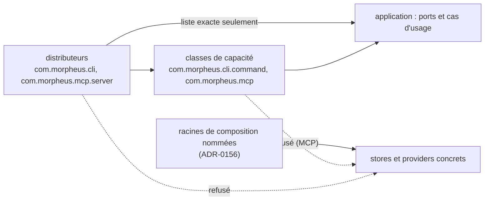

# Commandes et outils servis par des classes de capacité (`adapter-capability-decomposition`)

Spec de référence : [`openspec/specs/adapter-capability-decomposition/spec.md`](../../../openspec/specs/adapter-capability-decomposition/spec.md)
· Relevé du 2026-11-03 sur `ef006fb7`.

## Objet et périmètre

Où vit le comportement d'une commande CLI et d'un outil MCP, ce que peut contenir la classe qui distribue vers lui,
et ce qu'une extraction hors d'un distributeur doit laisser intact.

- **Acteurs** : mainteneur qui ajoute une commande ou un outil ; utilisateur de la CLI ; client MCP.
- **Inclus** : distributeurs (`com.morpheus.cli`, `com.morpheus.mcp.server`), classes de capacité
  (`com.morpheus.cli.command`, `com.morpheus.mcp`), revendication unique des mots publiés, racines de composition.
- **Exclus** : l'analyse des options et la ligne d'erreur (voir [`cli-argument-base`](cli-argument-base.md)).

## Exigences

| Alias | Exigence (titre exact) | En bref | Nature |
|---|---|---|---|
| R1 | A CLI command and an MCP tool SHALL be served by a capability class, and a dispatch class SHALL hold no use case | un distributeur ne dépend d'aucun cas d'usage hors d'une liste exacte | `[EXIGENCE]`, `[DÉCISION]` ARCH-0149 |
| R2 | Every published command word and tool name SHALL be claimed by exactly one capability class | ni mot orphelin, ni mot revendiqué deux fois ; un mot inconnu reste refusé | `[EXIGENCE]` |
| R3 | An extraction from a dispatcher SHALL change no output, no exit code, no tool name and no payload | sorties, codes, noms et schémas identiques avant et après une extraction | `[EXIGENCE]` — règle de procédure, voir écarts |
| R4 | An extraction SHALL NOT add a composition root | aucune classe MCP ne gagne l'accès à un store concret ; la CLI passe par le port provider | `[EXIGENCE]`, `[DÉCISION]` ARCH-0156 |

## Comportement détaillé

`[EXISTANT VÉRIFIÉ]` :

- **Distribution CLI** : `MorpheusMain.run` refuse d'abord un chemin non déclaré (`CliCommandPaths.refusalOf`), puis
  parcourt une liste ordonnée de capacités ; la première qui revendique le chemin le sert ; la branche par défaut
  (`MorpheusCli`) ne sert que l'aide. `api` et `mcp` sont lancés avant la distribution.
- **Distribution MCP** : `MorpheusMcpServer.toolSpecifications(...)` assemble les outils des classes de capacité ; un
  outil du catalogue servi par aucune classe, ou par deux, empêche la construction du serveur
  (`IllegalStateException`).
- **Listes exactes** : `CLI_ALLOWANCE` et `MCP_ALLOWANCE` dans `DispatchersHoldNoUseCaseArchitectureTest` (types de
  l'application qu'un distributeur peut nommer) ; `COMPOSITION_ROOTS` dans `AdapterCompositionRootArchitectureTest`.
  Lire les listes dans les tests.

## Diagrammes

### Comment un chemin de commande trouve-t-il la classe qui le sert ?

Existant vérifié (`MorpheusMain.run`). Organigramme (pas UML).

Exigences : R1 (le distributeur ne contient aucun cas d'usage), R2 (chaque chemin déclaré, sauf `help`, est revendiqué
par exactement une classe, quel que soit l'ordre de la liste). Le refus d'un chemin inconnu précède la liste.

### Que peut atteindre chaque catégorie de classe ?

Existant vérifié. Vue de composants, pas UML strict ; les flèches pleines sont permises, les pointillées refusées par
le build.

Exigences : R1 et R4.

## Écarts et questions ouvertes

- `[EXISTANT VÉRIFIÉ]` R2 dit que l'exhaustivité se juge contre « les commandes de l'aide embarquée » et « le
  catalogue d'outils » ; l'oracle réel côté CLI est `CliCommandPaths.paths()`, que `CliCommandPathsTest` relie à
  l'aide. `help` est une exception explicite (`SERVED_BY_THE_DEFAULT_BRANCH`) que la spec ne nomme pas.
- `[EXISTANT VÉRIFIÉ]` Le refus d'un outil du catalogue servi par aucune classe n'est provoqué par aucun test ; seul
  le cas « deux classes » l'est (`MorpheusMcpServerContractTest`).
- `[EXISTANT VÉRIFIÉ]` R3 et ses scénarios décrivent une extraction passée (« recorded before the move », « identical
  to what they were ») : c'est une règle de procédure pour une future extraction, prouvée aujourd'hui par les
  transcriptions de sortie. Celles-ci normalisent identifiants, instants, répertoires temporaires et version : ce n'est
  pas une égalité octet par octet. Le scénario « The contracts did not move » n'a pas de test permanent.
- `[EXISTANT VÉRIFIÉ]` Les règles sont plus larges que la spec : un distributeur ne dépend pas non plus d'un type de
  provider ou de store, et la règle des racines de composition couvre tout `com.morpheus.api..` et
  `com.morpheus.mcp..`, pas seulement les classes de capacité.

## Traçabilité

| Exigence | Scénario | Diagramme | Changement | Preuve |
|---|---|---|---|---|
| R1 | A command is added to the dispatcher | les deux | archive `2026-10-25-give-each-cli-command-and-mcp-tool-a-capability-class` | [`DispatchersHoldNoUseCaseArchitectureTest`](../../../morpheus-architecture-tests/src/test/java/com/morpheus/architecture/DispatchersHoldNoUseCaseArchitectureTest.java)`#aDispatchClassDependsOnNoGuardedTypeBesideItsAllowance`, `#aDispatchSourceNamesNoGuardedTypeBesideItsAllowance` |
| R1 | A tool is added to the server class | les deux | idem | mêmes méthodes (partie MCP) |
| R1 | An allowance that is no longer used | — | idem | `DispatchersHoldNoUseCaseArchitectureTest#everyNameOfEachListIsStillUsed` |
| R2 | A command documented by the help and claimed by no class | distribution | idem | [`CliCommandDispatchIsExhaustiveTest`](../../../morpheus-architecture-tests/src/test/java/com/morpheus/architecture/CliCommandDispatchIsExhaustiveTest.java)`#everyDeclaredPathIsClaimedByExactlyOneClassOfTheDispatch` ; lien aide ↔ déclaration : `CliCommandPathsTest#everyDeclaredPathIsInAUsageLineOfTheEmbeddedHelp` |
| R2 | Two classes claim the same word | distribution | idem | même méthode (CLI) ; [`ServedToolsAreClaimedOnceTest`](../../../morpheus-mcp/src/test/java/com/morpheus/mcp/ServedToolsAreClaimedOnceTest.java)`#everyPublishedToolIsServedByExactlyOneClass` ; [`MorpheusMcpServerContractTest`](../../../morpheus-mcp/src/test/java/com/morpheus/mcp/server/MorpheusMcpServerContractTest.java)`#aCatalogueToolServedByTwoClassesStopsTheServerFromBeingBuilt` |
| R2 | An unknown command | distribution | idem | [`CliCommandPathsTest`](../../../morpheus-cli/src/test/java/com/morpheus/cli/CliCommandPathsTest.java)`#anUnknownFirstWordAndAnUnknownOptionAreRefusedAsUnknownCommands` ; outil inconnu : [`MorpheusMcpToolCatalogTest`](../../../morpheus-mcp/src/test/java/com/morpheus/mcp/MorpheusMcpToolCatalogTest.java)`#rejectsUnknownToolName` |
| R3 | A moved command prints what it printed | — | idem | [`CliCommandTranscriptTest`](../../../morpheus-cli/src/test/java/com/morpheus/cli/CliCommandTranscriptTest.java)`#eachCommandPrintsAndRefusesAsItsTranscriptSays` ; [`McpToolTranscriptTest`](../../../morpheus-mcp/src/test/java/com/morpheus/mcp/McpToolTranscriptTest.java)`#eachToolAnswersAndRefusesAsItsTranscriptSays` (sorties normalisées) |
| R3 | A moved command refuses as it refused | — | idem | mêmes transcriptions (refus, projet absent, option inconnue) |
| R3 | The contracts did not move | — | idem | **preuve manquante** comme test permanent ; indirecte : transcriptions de l'aide et du catalogue, gates du manifeste |
| R4 | A tool class reads a store of a concrete type | composants | archive `2026-10-09-decide-adapter-composition-roots` | [`AdapterCompositionRootArchitectureTest`](../../../morpheus-architecture-tests/src/test/java/com/morpheus/architecture/AdapterCompositionRootArchitectureTest.java)`#onlyTheNamedCompositionRootsReachAConcreteStoreOrProvider` |
| R4 | A root that no longer reaches a concrete adapter | composants | idem | `AdapterCompositionRootArchitectureTest#everyNamedCompositionRootStillReachesAConcreteStoreOrProvider` |
| R4 | A CLI capability class reaches a provider outside the port | composants | idem | [`TransportsReadAProjectThroughTheProviderPortTest`](../../../morpheus-architecture-tests/src/test/java/com/morpheus/architecture/TransportsReadAProjectThroughTheProviderPortTest.java)`#aTransportReachesAProviderOnlyThroughThePort` |

## Sources

- Décisions : [ARCH-0149](../../architecture/adr/ARCH-0149-une-commande-et-un-outil-sont-servis-par-une-classe-de-capacite.md),
  [ARCH-0156](../../architecture/adr/ARCH-0156-racines-de-composition-nommees-paquets-sans-cycle-et-decisions-dans-le-domaine.md).
- Règle du dépôt : `.claude/rules/architecture.md`, section « `morpheus-cli` et `morpheus-mcp` ».
