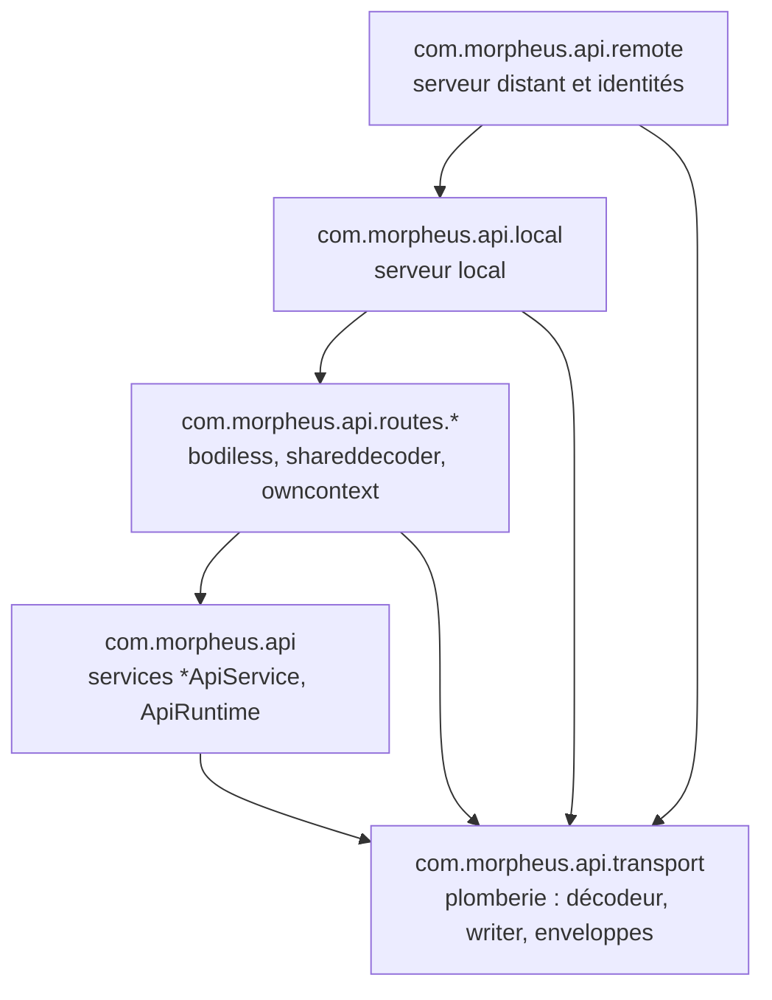
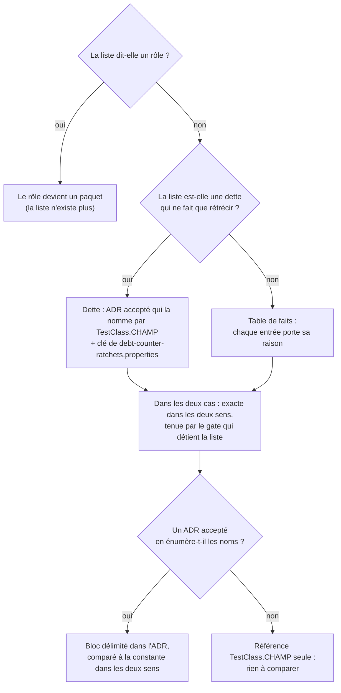

# Frontières internes d'un adaptateur de transport (`adapter-internal-boundaries`)

Spec de référence : [`openspec/specs/adapter-internal-boundaries/spec.md`](../../../openspec/specs/adapter-internal-boundaries/spec.md)
· Relevé du 2026-11-04 sur `2913fc30`, complété le 2026-11-06 (changement
`hold-every-class-list-of-a-decision-record-to-its-gate`).

## Objet et périmètre

Dans l'adaptateur HTTP (`morpheus-api`), un rôle est un paquet, et une règle d'architecture sur ce rôle choisit ses
classes par paquet, jamais par préfixe, suffixe ou liste de noms. La capacité fixe aussi ce que les autres modules
ont le droit d'utiliser de l'adaptateur, à quelles conditions une liste de noms de classes subsiste, et ce qu'un
déplacement de classes doit laisser aussi strict qu'avant.

- **Acteurs** : mainteneur qui déplace, ajoute ou range une classe de `morpheus-api` ; auteur d'un test
  d'architecture.
- **Inclus** : paquets de `morpheus-api` (`remote`, `local`, `routes.bodiless`, `routes.shareddecoder`,
  `routes.owncontext`, parent `com.morpheus.api`, `transport`) ; liste des types d'entrée ; déclaration de la sorte
  des listes de noms de classes de production ; localisation d'un source par son type ; plancher du nombre de tests
  d'architecture.
- **Exclus** : les règles internes de `morpheus-cli`, `morpheus-mcp` et `store-sqlite`, tenues par d'autres tests
  (voir [Hors spec](#comportement-vérifié-absent-de-la-spec)) ; la liste des racines de composition, citée ici
  seulement comme scénario.

## Exigences

| Alias | Exigence (titre exact) | En bref | Nature |
|---|---|---|---|
| R1 | A role inside the HTTP adapter SHALL be a package, and a rule about that role SHALL select by package | une règle sur « les routeurs », « le serveur distant », « la plomberie » choisit par paquet | `[EXIGENCE]` |
| R2 | The packages of a transport adapter SHALL form no cycle | aucun cycle entre paquets de `morpheus-api` ; exception nommée par paire de types dans l'ADR | `[EXIGENCE]` |
| R3 | What another module may use of an adapter SHALL be a closed list of types, and SHALL NOT grow by a relocation | six types d'entrée ; tout autre type, y compris une constante inlinée, est refusé | `[EXIGENCE]` |
| R4 | A selection that remains a list of class names SHALL be of a declared kind and exact in both directions | dette qui ne fait que rétrécir, ou table de faits ; exacte dans les deux sens | `[EXIGENCE]` |
| R5 | Relocating a class within its module SHALL change no gate whose subject is not its package | un gate trouve un source par le type, pas par le chemin | `[EXIGENCE]` |
| R6 | A relocation SHALL NOT lower the number of executed architecture tests nor remove a textual scan that a rule cannot replace | `architectureTestsMinimum` ne baisse pas ; la moitié textuelle reste à côté de la règle | `[EXIGENCE]` |
| R7 | Une liste de classes qu'un ADR en vigueur énumère DOIT égaler la constante du gate qui la tient | énumération délimitée dans l'ADR, comparée nom pour nom et dans les deux sens | `[EXIGENCE]` |
| R8 | Une table de faits qu'un ADR en vigueur énonce DOIT déclarer cet ADR | `ENTRY_TYPES` déclare ARCH-0155 et lui est comparée | `[EXIGENCE]` |

## Comportement détaillé

### R1 : rôle = paquet

`[EXISTANT VÉRIFIÉ]` Les rôles de l'adaptateur sont des paquets, et la couche d'application des règles est
écrite dans l'ordre `remote` > `local` > routeurs (`routes.bodiless`, `routes.shareddecoder`, `routes.owncontext`) >
services (paquet parent `com.morpheus.api`) > `transport`
(`ApiPackageCyclesArchitectureTest.LAYERED_PACKAGES`).

- Les règles ArchUnit des routeurs sélectionnent par `resideInAPackage("com.morpheus.api.routes..")`
  (`HttpRoutesFamilyArchitectureTest`) ; l'interdit sur le serveur distant vise `com.morpheus.api.remote..` en entier,
  quelle que soit la forme du nom des classes.
- Un routeur est classé en rangeant son fichier dans le paquet de son groupe
  (`HttpRoutesTransportBoundaryArchitectureTest`, constantes `ROUTERS_WITHOUT_A_BODY`,
  `ROUTERS_THROUGH_THE_SHARED_DECODER`, `ROUTERS_REGISTERING_THEIR_OWN_CONTEXT`).
- Un service `*ApiService` réside dans `com.morpheus.api` ; un autre emplacement est refusé par son nom et son paquet.
- Un routeur déclaré en source mais absent des classes importées par la suite d'architecture est nommé comme
  « échappant à toute règle ».

`[EXISTANT VÉRIFIÉ]` Le suffixe `HttpRoutes` et le suffixe `ApiService` servent encore, mais **à classer ou à
détecter** une classe mal rangée, pas à choisir le sujet d'une règle de dépendance : `routersIn(group)` et
`routersOfAnotherGroupThan(group)` (`HttpRoutesTransportBoundaryArchitectureTest`) combinent le paquet **et** le
suffixe pour `noRouterDependsOnARouterOfAnotherGroup`. Voir [Écarts](#écarts-et-questions-ouvertes).

### R2 : pas de cycle

`[EXISTANT VÉRIFIÉ]` Chaque paquet de `com.morpheus.api`, parent compris, est une tranche
(`ApiPackageCyclesArchitectureTest`, `SliceAssignment` `API_PACKAGES`). Avant d'évaluer la règle, le test vérifie que
tous les paquets de `LAYERED_PACKAGES` existent. La règle n'a aucune exception : aucun `ignoreDependency` dans le test.
Deux règles d'ordre complètent la règle de cycle sans attendre qu'un cycle se ferme
(`ApiServicesAndTransportPackagesArchitectureTest`).

### R3 : liste fermée de types d'entrée

`[EXISTANT VÉRIFIÉ]` `ApiEntryTypesArchitectureTest.ENTRY_TYPES` : `AllowedWorkspaceRoots`, `LoopbackHostPolicy`,
`MorpheusHttpServer`, `MorpheusRemoteHttpServer`, `MorpheusRemoteIdentityFile`, `MorpheusRemoteRole`. Deux moitiés :

- le bytecode : toute classe hors de `com.morpheus.api..` qui dépend d'un type de l'adaptateur autre qu'un type
  d'entrée (classes imbriquées rapportées à leur type de premier niveau) échoue ;
- le texte : un source principal hors de l'adaptateur qui nomme un autre type de l'adaptateur (motif
  `com.morpheus.api.<paquets>.<Type>`) échoue, ce qui attrape la constante de compilation que `javac` inline.

Le test exige aussi que chaque type d'entrée soit réellement atteint par un autre module (liste ni trop large ni
vacante). La règle compare le **nom simple de premier niveau**, pas le paquet : un type d'entrée déplacé dans un
sous-paquet reste accepté.

### R4 : sorte d'une liste de noms

`[EXISTANT VÉRIFIÉ]` `ProductionClassListsArchitectureTest.KINDS` déclare chaque liste du module de gates qui nomme
des classes de production, par `TestClass.CHAMP`, comme dette (`Kind.debtCounterUnder("ARCH-NNNN")`) ou table de faits
(`Kind.TABLE_OF_FACTS`). Pour une dette : l'ADR déclaré existe au registre, est `Statut : **Acceptée**` et nomme la
liste ; la taille de la liste égale sa clé de `config/debt-counter-ratchets.properties` (ni plus grande : la dette a
grossi ; ni plus petite : la clé doit baisser). L'exactitude dans les deux sens (une classe qui a la propriété sans
être nommée échoue ; une classe nommée qui ne l'a plus échoue) est portée **par le gate qui détient la liste**, par
exemple `AdapterCompositionRootArchitectureTest` pour les racines de composition.

### R7, R8 : l'énumération d'un ADR égale la constante

`[EXISTANT VÉRIFIÉ]` La sorte d'une liste dit aussi si son ADR l'**énumère** ou la **référence** seulement :
`Kind.debtCounterEnumeratedBy("ARCH-NNNN", racine)` et `Kind.tableOfFactsEnumeratedBy("ARCH-NNNN", racine)` contre
`Kind.debtCounterUnder("ARCH-NNNN")`. Une liste énumérée est écrite dans l'ADR entre `<!-- liste TestClass.CHAMP -->`
et `<!-- fin de liste -->`, chaque nom en span de code relatif à la racine de paquet déclarée (nom simple pour
`ENTRY_TYPES`). Une table famille → noms porte une ligne par classe et ses familles en deuxième colonne, prises dans un
vocabulaire fermé (`FAMILY_WORDS`). `ProductionClassListsArchitectureTest#everyListADecisionRecordEnumeratesEqualsItsEnumeration`
refuse un ADR absent, non accepté, sans bloc, un bloc vide, non fermé ou en double, une ligne sans span de code et une
famille hors vocabulaire, puis compare les noms qualifiés dans les deux sens et nomme l'ADR, la constante et chaque nom
en trop ou manquant. Listes énumérées : `ApplicationTechnologyBoundaryArchitectureTest.CONFINED_FAMILIES` et
`.REFLECTION_AND_LOADING` (ARCH-0150, table « Classes nommées »), `ApiEntryTypesArchitectureTest.ENTRY_TYPES`
(ARCH-0155 §3). Listes référencées seulement : `COMPOSITION_ROOTS` (ARCH-0156), `RUNTIME_ENTRY_POINTS` et
`RUNTIME_PUBLIC_TYPES` (ARCH-0158) ; la constante y est la source unique et rien n'est comparé.

### R5 : localisation d'un source par le type

`[EXISTANT VÉRIFIÉ]` `ProductionSources.mainSource(module, nomSimple)` parcourt tout l'arbre `src/main/java` du module
et refuse un nom absent (`no source of X under …`) ou présent deux fois (`X is ambiguous under …`, avec les deux
fichiers). Un nom n'est pas apparié par suffixe.

### R6 : plancher de tests et moitié textuelle

`[EXISTANT VÉRIFIÉ]` Le plancher est la clé `architectureTestsMinimum` de
[`config/m21-quality-ratchets.properties`](../../../config/m21-quality-ratchets.properties), comparée par
[`scripts/validate-m21.ps1`](../../../scripts/validate-m21.ps1) et `scripts/validate-d2.ps1` (jumeaux `.sh`) au compte
des exécutions déclarées du module. Pour une constante inlinée de `MorpheusRemoteHttpServer`, le texte reste à côté de
la règle (`assertNoRouterSourceMentions("MorpheusRemote")`).

### Comportement vérifié absent de la spec

- `[EXISTANT VÉRIFIÉ]` La règle de cycle de paquets existe aussi pour `morpheus-cli` et `morpheus-mcp`
  (`CliAndMcpPackageCyclesArchitectureTest`) ; elle n'est pas une exigence de cette spec.
- `[EXISTANT VÉRIFIÉ]` Les règles d'ordre `theTransportPlumbingDependsOnNoOtherPackageOfTheAdapter` et
  `theServicesDependOnNoRouterNoServerAndNotTheResponseWriter` ont chacune une moitié textuelle (constantes publiques
  inlinées des serveurs) ; la spec n'exige qu'un cycle refusé.

## Diagrammes

### Dans quel ordre les paquets de l'adaptateur peuvent-ils dépendre les uns des autres ?

Existant vérifié (`ApiPackageCyclesArchitectureTest`, `ApiServicesAndTransportPackagesArchitectureTest`,
`HttpRoutesFamilyArchitectureTest#noRouterReachesTheLocalServer`). Organigramme : une flèche est une dépendance
permise ; la remonter ferme un cycle et échoue. Exigences : R1, R2.

### Une liste de noms de classes : quelle sorte déclarer ?

Existant vérifié (`ProductionClassListsArchitectureTest`). Organigramme de décision, pas UML. Exigence : R4.

Le dernier choix (R7, R8) s'ajoute aux trois comparaisons d'une liste : au bytecode et à sa taille autorisée, tenues
par le gate et par le cliquet, et à l'ADR qui l'énumère.

## Écarts et questions ouvertes

- **Suffixe encore utilisé pour classer (R1).** La spec interdit de choisir les classes d'un rôle « par un suffixe ou un
  préfixe du nom simple ». `HttpRoutesTransportBoundaryArchitectureTest.routersIn` et `routersOfAnotherGroupThan`
  ajoutent `endsWith("HttpRoutes")` au paquet ; `everyApiServiceResidesInTheServicesPackage` et
  `theRulesSeeEveryRouterTheSourcesDeclare` détectent par suffixe. Ce sont des détections de classes mal rangées (les
  scénarios de R1 les exigent), mais `noRouterDependsOnARouterOfAnotherGroup` sélectionne bien par paquet **et**
  suffixe. `[QUESTION]` La spec doit-elle autoriser le suffixe comme détecteur, en plus du paquet ?
- **Ordre « avant toute règle de transport » (R1, scénario « A router added to the adapter »).** La spec veut un échec
  « avant » l'évaluation des règles de transport. Les tests JUnit sont indépendants :
  `everyRouterIsClassifiedIntoExactlyOneTransportGroup` nomme le routeur et son paquet, mais aucun mécanisme ne
  l'ordonne avant les autres méthodes. Preuve de l'ordre manquante.
- **Aucun rejeu synthétique du refus (R1, R3).** Pas de test qui plante une classe du préfixe absent
  (`remote` sans `MorpheusRemote`) ni un type non listé : les refus sont vérifiés par lecture de la règle et par les
  « vues en échec » de l'ADR-0155 (section Compliance), pas rejoués à chaque build. Les rejeux synthétiques existent
  pour la bijection des routeurs, le scan textuel et `ProductionSources`.
- **Justification d'un type d'entrée dans l'ADR (R3).** La spec exige qu'un type ajouté soit justifié dans l'ADR.
  `ENTRY_TYPES` est déclaré table de faits (`ProductionClassListsArchitectureTest.KINDS`), donc aucun test ne relie
  l'ajout d'un type au texte d'ADR-0155. Preuve manquante.
- **Exception de cycle nommée dans l'ADR (R2).** Aucune exception n'existe ; le mécanisme (paire de types dans l'ADR)
  n'a donc ni code ni test. Preuve manquante, sans objet tant qu'il n'y a pas d'exception.
- **Gates à chemin littéral (R5).** La spec dit que **tout** gate qui lit un source le localise par le type. Des gates
  d'autres modules gardent des chemins en dur, par exemple `UpdateTrustBoundaryContractTest`,
  `AuditHardeningWorkflowContractTest` et `ReasoningPlatformArchitectureTest` (chaînes
  `morpheus-application/src/main/java/com/morpheus/application/…`). Pour `morpheus-api`, une recherche de
  `morpheus-api/src/main/java/com/morpheus/api` ne trouve que des fixtures de `RepositoryTreeOwnershipTest` et de
  `UserDocumentationSpeaksOfTheInstalledProductTest`. Le déplacement d'une classe de `morpheus-application` lue par
  chemin littéral casserait ces gates. `[QUESTION]` Étendre R5 à tous les modules, ou le borner à `morpheus-api` ?
- **Exactitude bilatérale des tables de faits (R4).** R4 l'exige « dans les deux cas ». Elle est tenue gate par gate ;
  `ProductionClassListsArchitectureTest` ne vérifie que la déclaration de la sorte et, pour une dette, la taille.
  Preuve générique manquante pour les tables.

## Traçabilité

| Exigence | Scénario | Conception ou diagramme | Changement | Preuve |
|---|---|---|---|---|
| R1 | A remote class without the family prefix | organigramme des paquets | archive `2026-10-30-express-adapter-internal-roles-as-packages` | [`HttpRoutesFamilyArchitectureTest`](../../../morpheus-architecture-tests/src/test/java/com/morpheus/architecture/HttpRoutesFamilyArchitectureTest.java)`#noRouterReachesTheRemoteAuthorizationModel` (règle ArchUnit sur `com.morpheus.api.remote..` + texte) ; rejeu synthétique : preuve manquante |
| R1 | A router added to the adapter | idem | idem | [`HttpRoutesTransportBoundaryArchitectureTest`](../../../morpheus-architecture-tests/src/test/java/com/morpheus/architecture/HttpRoutesTransportBoundaryArchitectureTest.java)`#everyRouterIsClassifiedIntoExactlyOneTransportGroup` (bytecode) et `#theClassificationRefusesARouterLeftInTheParentPackageAndOneInAnUnnamedPackage` (rejeu) ; ordre « avant » : preuve manquante |
| R1 | An application service outside the services package | idem | idem | [`ApiServicesAndTransportPackagesArchitectureTest`](../../../morpheus-architecture-tests/src/test/java/com/morpheus/architecture/ApiServicesAndTransportPackagesArchitectureTest.java)`#everyApiServiceResidesInTheServicesPackage` (bytecode) |
| R1 | A router declared outside the imported classes | idem | idem | `HttpRoutesFamilyArchitectureTest#theRulesSeeEveryRouterTheSourcesDeclare` (texte + bytecode) et `#theRouterBijectionNamesTheEscapingAndTheSourcelessRouterEachOnItsSide` (rejeu) |
| R2 | A plumbing class reaches back to a router | organigramme des paquets | idem | [`ApiPackageCyclesArchitectureTest`](../../../morpheus-architecture-tests/src/test/java/com/morpheus/architecture/ApiPackageCyclesArchitectureTest.java)`#thePackagesOfTheHttpAdapterFormNoCycle` (ArchUnit `slices`) ; `ApiServicesAndTransportPackagesArchitectureTest#theTransportPlumbingDependsOnNoOtherPackageOfTheAdapter` |
| R2 | The rule has something to check | idem | idem | `ApiPackageCyclesArchitectureTest#thePackagesOfTheHttpAdapterFormNoCycle` (`assertTrue(packages.containsAll(LAYERED_PACKAGES))`) |
| R3 | A neighbouring module uses a class that had to become public | — | idem | [`ApiEntryTypesArchitectureTest`](../../../morpheus-architecture-tests/src/test/java/com/morpheus/architecture/ApiEntryTypesArchitectureTest.java)`#noClassOutsideTheAdapterDependsOnATypeOfTheAdapterBesideTheEntryTypes` (ArchUnit) |
| R3 | A neighbouring module reads a constant of such a class | — | idem | `ApiEntryTypesArchitectureTest#noMainSourceOutsideTheAdapterNamesATypeOfTheAdapterBesideTheEntryTypes` (texte) |
| R3 | An entry type moves to a sub-package | — | idem | même règle, qui compare le nom simple de premier niveau ; test de déplacement dédié : preuve manquante |
| R4 | A list of class names of an undeclared kind | organigramme de décision | idem | [`ProductionClassListsArchitectureTest`](../../../morpheus-architecture-tests/src/test/java/com/morpheus/architecture/ProductionClassListsArchitectureTest.java)`#everyListOfProductionClassesIsADebtCounterOrATableOfFacts` (texte) |
| R4 | A debt counter without its decision record | idem | idem | `ProductionClassListsArchitectureTest#everyDebtCounterIsNamedByTheAcceptedDecisionRecordItDeclares` (texte) |
| R4 | A debt counter grows | idem | idem | `ProductionClassListsArchitectureTest#everyDebtCounterHoldsExactlyTheSizeItsRatchetAllows` (réflexion sur les champs + [`config/debt-counter-ratchets.properties`](../../../config/debt-counter-ratchets.properties)) |
| R4 | A composition root added by a relocation | — | idem | [`AdapterCompositionRootArchitectureTest`](../../../morpheus-architecture-tests/src/test/java/com/morpheus/architecture/AdapterCompositionRootArchitectureTest.java)`#onlyTheNamedCompositionRootsReachAConcreteStoreOrProvider` (ArchUnit) et `#everyNamedCompositionRootStillReachesAConcreteStoreOrProvider` |
| R7 | Une classe ajoutée au gate et pas à l'ADR / un nom que l'ADR énumère et que le gate ne porte plus / le même nom simple dans un autre paquet / une énumération que le build ne sait pas lire | organigramme de décision | `hold-every-class-list-of-a-decision-record-to-its-gate` | `ProductionClassListsArchitectureTest#everyListADecisionRecordEnumeratesEqualsItsEnumeration` (dépôt réel) ; corpus temporaire : `#aNameAddedToTheGateAndNotToTheRecordIsNamedWithTheRecordAndTheList`, `#aNameTheRecordWritesAndTheListNoLongerHoldsIsNamed`, `#theSameSimpleNameInAnotherPackageIsNamedOnBothSides`, `#anEnumerationTheBuildCannotReadIsRefusedBySayingWhatItCouldNotRead` |
| R7 | Un ADR qui nomme la liste par sa seule référence | idem | idem | `ProductionClassListsArchitectureTest#aListItsRecordOnlyReferencesIsNotAskedForAnEnumeration` |
| R8 | Les six types d'entrée / un type d'entrée ajouté sans l'ADR | idem | idem | `ProductionClassListsArchitectureTest#everyListADecisionRecordEnumeratesEqualsItsEnumeration` (ARCH-0155 §3 réel ; violation plantée puis retirée) |
| R8 | Une table de faits déclare un ADR qui ne l'énumère pas | idem | idem | `ProductionClassListsArchitectureTest#aTableOfFactsDeclaringARecordThatDoesNotEnumerateItIsRefusedByNameAndRecord` (registre temporaire) |
| R5 | A class is moved and nothing else changes | — | idem | [`ProductionSourcesTest`](../../../morpheus-architecture-tests/src/test/java/com/morpheus/architecture/ProductionSourcesTest.java)`#aClassIsFoundWhateverPackageOfItsModuleItResidesIn` et `#theRealTreeResolvesAClassInASubPackageOfItsModule` ; gates à chemin littéral : voir Écarts |
| R5 | Two classes of one module share a simple name | — | idem | `ProductionSourcesTest#aClassDeclaredTwiceIsRefusedWithBothFiles` |
| R6 | A router reads an inlined constant of the remote server | — | idem | `HttpRoutesFamilyArchitectureTest#noRouterReachesTheRemoteAuthorizationModel` (moitié textuelle) et `#theSourceScanNamesTheRouterThatMentionsTheLiteralAndNoOther` (rejeu) ; plancher de tests : validateurs `scripts/validate-m21.*` et `scripts/validate-d2.*`, clé `architectureTestsMinimum` (pas un test JUnit) |

## Sources

- ADR : [ARCH-0155](../../architecture/adr/ARCH-0155-un-role-est-un-paquet-et-une-liste-de-classes-declare-sa-sorte.md)
  (rôle = paquet, sorte d'une liste), [ARCH-0156](../../architecture/adr/ARCH-0156-racines-de-composition-nommees-paquets-sans-cycle-et-decisions-dans-le-domaine.md)
  (racines de composition).
- Règles du dépôt : `.claude/rules/architecture.md`, sections « `morpheus-api` : un rôle, un paquet », « Règle ArchUnit ou
  assertion textuelle ».
- Pages liées : [`http-response-headers.md`](http-response-headers.md), [`adapter-capability-decomposition.md`](adapter-capability-decomposition.md),
  [`module-package-correspondence.md`](module-package-correspondence.md).
