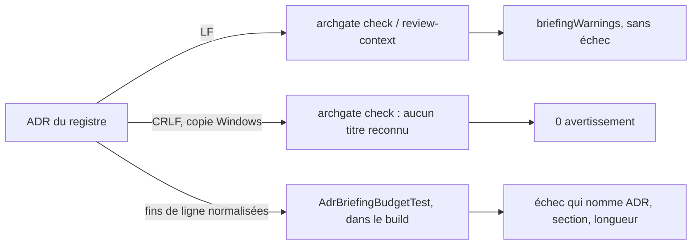

# Borne du briefing des ADR remis aux agents (`adr-briefing-budget`)

Spec de référence : `openspec/specs/adr-briefing-budget/spec.md` · Relevé du 2026-11-17 sur `de021878`.

## Objet et périmètre

`archgate review-context` remet aux agents les sections `Decision` et `Do's and Don'ts` de chaque ADR applicable, et
coupe chacune à 2 000 caractères. Le build vérifie que ces deux sections tiennent dans cette borne pour tout ADR en
vigueur, quelle que soit la plateforme.

- **Acteurs** : agent qui reçoit le briefing ; auteur d'un ADR.
- **Inclus** : les ADR en vigueur de `docs/architecture/adr/` (`{PRÉFIXE}-{NNNN}-{slug}.md`).
- **Exclus** : `docs/architecture/adr/archive/`, qu'Archgate ne lit pas ; le gabarit ; les autres sections d'un ADR.

## Exigences

| Alias | Exigence (titre exact) | En bref | Nature |
|---|---|---|---|
| R1 | Chaque section d'un ADR que le briefing remet aux agents DOIT tenir dans la borne de ce briefing | `Decision` et `Do's and Don'ts`, 2 000 caractères chacune, de la ligne `## ` à la suivante, sous-sections comprises | `[EXIGENCE]` |
| R2 | La mesure d'une section DOIT être indépendante des fins de ligne de la copie de travail | même longueur en LF et en CRLF ; section absente ou vide refusée ; registre vide refusé | `[EXIGENCE]` |

## Comportement détaillé

- **R1** `[EXISTANT VÉRIFIÉ]` ([`AdrBriefingBudgetTest`](../../../morpheus-architecture-tests/src/test/java/com/morpheus/architecture/AdrBriefingBudgetTest.java)`#everyRecordInForceKeepsEachBriefedSectionWithinTheBudget`) :
  le test liste les fichiers du registre (pas son sous-dossier `archive/`), découpe chaque ADR sur les lignes `## `,
  retire les blancs de bord de chaque section remise et compare sa longueur en unités UTF-16 à 2 000, comme
  Archgate. Le refus liste en une fois chaque ADR, chaque section et sa longueur, avec le remède : les raisons, les
  options, les diagrammes et les exemples vont dans `Context`, les règles restent dans la section.
- **R2** `[EXISTANT VÉRIFIÉ]` (même classe, `#aSectionRunsToTheNextLevelTwoHeadingAndMeasuresTheSameWhateverTheLineEndings`) :
  les fins de ligne sont normalisées avant la découpe. Archgate, lui, ne reconnaît un titre que sur une ligne terminée
  par un saut de ligne seul : sur une copie de travail Windows en CRLF, `archgate check` ne voit aucune section et ne
  signale aucun dépassement. Une section vide est refusée pour qu'une découpe qui ne trouve rien ne passe pas tout le
  registre.

## Diagrammes

### Quelle mesure tient la borne, sur quelle plateforme ?

Existant. Exigences R1 et R2.

## Écarts et questions ouvertes

- `[EXISTANT VÉRIFIÉ]` **Deux implémentations de la mesure** : Archgate et le test comptent de la même façon
  aujourd'hui (CLI 0.61.0) ; une montée de version d'Archgate qui changerait sa découpe ou son plafond se répercute
  dans le test, la règle de `.claude/rules/adr.md` et `docs/developer/ARCHGATE.md`.

## Traçabilité

| Exigence | Scénario | Conception ou diagramme | Changement | Preuve |
|---|---|---|---|---|
| R1 | Une section Decision qui dépasse la borne | organigramme | archive `2026-11-17-hold-the-adr-briefing-budget` | `AdrBriefingBudgetTest#anOverrunNamesTheRecordTheSectionAndItsLengthWhileASectionAtTheBudgetPasses` |
| R1 | Une section à la borne exacte | idem | idem | idem |
| R1 | Les sous-sections comptent | idem | idem | `AdrBriefingBudgetTest#aSectionRunsToTheNextLevelTwoHeadingAndMeasuresTheSameWhateverTheLineEndings` |
| R1 | Les sections Do's and Don'ts sont bornées aussi | idem | idem | `AdrBriefingBudgetTest#everyRecordInForceKeepsEachBriefedSectionWithinTheBudget` |
| R1 | Les ADR archivés ne sont pas lus | idem | idem | idem (seul le registre est listé) |
| R2 | Un registre extrait en CRLF | idem | idem | `AdrBriefingBudgetTest#aSectionRunsToTheNextLevelTwoHeadingAndMeasuresTheSameWhateverTheLineEndings` |
| R2 | Une section remise absente | idem | idem | `AdrBriefingBudgetTest#anOverrunNamesTheRecordTheSectionAndItsLengthWhileASectionAtTheBudgetPasses` |
| R2 | Un registre sans ADR lu | idem | idem | `AdrBriefingBudgetTest#everyRecordInForceKeepsEachBriefedSectionWithinTheBudget` |

## Sources

- Règles de dépôt : `.claude/rules/adr.md` (forme d'un ADR actif, contrôles).
- Page Archgate : [`../ARCHGATE.md`](../ARCHGATE.md).
- Gabarit : [`gabarit/template.md`](../../architecture/adr/gabarit/template.md).
