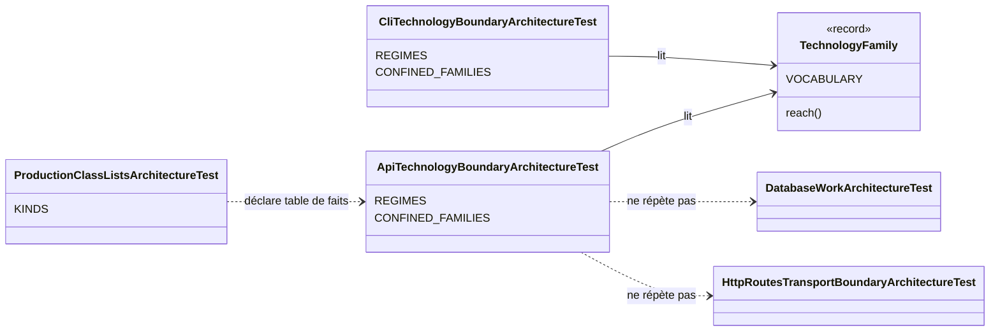

# Technologies que l'adaptateur HTTP peut toucher (`api-technology-boundary`)

Spec de référence : `openspec/specs/api-technology-boundary/spec.md`, issue du changement archivé
`confine-the-technology-families-the-cli-uses` (delta : `openspec/changes/archive/2026-11-06-confine-the-technology-families-the-cli-uses/specs/api-technology-boundary/spec.md`)
· Relevé du 2026-11-06 sur `33acc9e0`.

## Objet et périmètre

`morpheus-api` porte le serveur local et la façade remote. Comme la CLI, c'est un module de transport qui a vocation à
porter des technologies ; ce qui compte est qu'une dépendance technique n'y entre pas sans être écrite. Le gate de
l'adaptateur HTTP donne à chaque famille du vocabulaire partagé un régime, et tient exactement les classes qui
atteignent une famille confinée.

- **Acteurs** : auteur d'une classe de `morpheus-api` qui ajoute une dépendance technique ; relecteur.
- **Inclus** : les classes de production de `com.morpheus.api` et de ses sous-paquets.
- **Exclus** : la CLI ([`cli-technology-boundary.md`](cli-technology-boundary.md)) ; l'application
  ([`application-technology-boundary.md`](application-technology-boundary.md)) ; la réflexion hors de l'application
  ([`reflection-boundary.md`](reflection-boundary.md)) ; `morpheus-mcp`, les providers, les stores, les intégrations.

## Exigences

| Alias | Exigence (titre exact) | En bref | Nature |
|---|---|---|---|
| R1 | Chaque famille technologique DOIT avoir un régime déclaré pour l'adaptateur HTTP | refusée, confinée, libre ou tenue par un autre gate, avec sa raison | `[EXIGENCE]` |
| R2 | Une famille refusée DOIT l'être dans tout `com.morpheus.api` | aucune classe de l'adaptateur ne l'atteint, aucune liste ne l'admet | `[EXIGENCE]` |
| R3 | Une famille confinée DOIT n'être atteinte que par les classes que le gate de l'adaptateur HTTP nomme pour elle | une classe non nommée qui l'atteint fait échouer le build | `[EXIGENCE]` |
| R4 | Une classe nommée pour une famille confinée de l'adaptateur HTTP DOIT encore l'atteindre | la liste égale l'ensemble mesuré sur le bytecode | `[EXIGENCE]` |
| R5 | Les listes de classes du gate de l'adaptateur HTTP DOIVENT être des tables de faits déclarées | déclarée dans `ProductionClassListsArchitectureTest`, chaque entrée avec sa raison | `[EXIGENCE]` |

## Comportement détaillé

### Les régimes (R1)

`[EXISTANT VÉRIFIÉ]` `ApiTechnologyBoundaryArchitectureTest.REGIMES` donne un régime et une raison à chaque famille de
`TechnologyFamily.VOCABULARY` ; `everyFamilyOfTheVocabularyHasARegimeInTheHttpAdapter` refuse une famille sans régime
et une famille confinée sans liste.

| Régime | Familles | Raison |
|---|---|---|
| refusée | SQL, exécution de processus, environnement du processus, flux standard | la persistance passe par le runtime d'opération SQLite (ARCH-0162) ; le serveur ne lance aucun processus ; il reçoit sa configuration de la CLI, mot de passe TLS compris ; il écrit dans des échanges HTTP et journalise par le runtime opérationnel |
| confinée | bibliothèque JSON, réseau sortant, fils d'exécution, accès fichier | le décodeur strict des corps de requête ; la politique de loopback, le TLS de la façade et son proxy vers le serveur local ; les exécuteurs des deux serveurs, les workers de base (BE-0159) et les échéances de lecture et d'écriture ; les répertoires de travail qu'une requête nomme et le fichier d'identités remote |
| libre | horloge murale | l'adaptateur horodate les requêtes qu'il sert et les enregistrements qu'il écrit ; que l'application reçoive une `java.time.Clock` est tenu par le gate de l'application |
| tenue ailleurs | réflexion et chargement de classes | `ReflectionAndClassLoadingBoundaryArchitectureTest`, sur tout le produit |

`[DÉCISION]` Le refus de l'environnement du processus prolonge, pour tout le module, ce que la règle de sécurité dit du
mot de passe TLS : c'est la CLI qui lit `MORPHEUS_SERVER_TLS_PASSWORD` et le passe au serveur.

### Familles refusées et confinées (R2, R3, R4)

`[EXISTANT VÉRIFIÉ]` Les règles sont celles des gates de l'application et de la CLI, sur le bytecode importé de
`com.morpheus.api` : `aFamilyTheHttpAdapterRefusesIsReachedByNoClassOfTheAdapter` (`never(reach)` par famille
refusée), `aConfinedFamilyIsReachedOnlyByTheClassesOfTheHttpAdapterNamedForIt` (même règle sur les classes non nommées)
et `everyClassNamedForAConfinedFamilyOfTheHttpAdapterStillReachesIt` (égalité des ensembles nommés et mesurés). Une
classe imbriquée est rapportée à sa classe de premier niveau. `archRule.failOnEmptyShould` fait échouer une règle qui
ne retient aucune classe.

Les classes nommées et leurs raisons sont celles de `ApiTechnologyBoundaryArchitectureTest.CONFINED_FAMILIES` ; cette
page ne les recopie pas. La famille « réseau sortant » de la déclaration partagée compte `java.net.InetAddress` et
`javax.net.ssl` : les classes qui résolvent l'adresse de liaison, la rapportent ou restreignent les protocoles TLS y
sont donc nommées, avec leur raison, plutôt que la famille ne soit redéfinie pour ce module.

### Les règles plus fines du module

`[DÉCISION]` Ce gate dit quelles classes atteignent une famille ; il ne répète aucune règle plus fine que le module porte
déjà :

| Règle existante | Ce qu'elle tient | Ce que le gate de familles ajoute |
|---|---|---|
| `DatabaseWorkArchitectureTest` (BE-0159) | seule `DatabaseCallWorkers` construit un pool de fils de plateforme, et le travail de base ne tourne que sur elle | les autres classes qui atteignent les fils d'exécution, toutes nommées |
| `HttpRoutesTransportBoundaryArchitectureTest` | quel groupe de routeurs dépend du décodeur ; les routeurs ne dépendent pas de Jackson ; le seul `JsonMapper` est strict | aucune classe de l'adaptateur hors du décodeur, services et serveurs compris, n'atteint Jackson |

L'interdit de Jackson dans les routeurs garde sa règle et son doublon textuel : ce gate ne voit que le bytecode, où une
constante inlinable ne laisse aucune dépendance.

### Tables de faits (R5)

`[DÉCISION]` La liste du gate est une table de faits (`ProductionClassListsArchitectureTest.KINDS`) : ces classes
atteignent cette famille dans un module de transport qui a vocation à la porter, et aucun ADR n'attend qu'elle
rétrécisse. Aucune clé n'est ajoutée à [`config/debt-counter-ratchets.properties`](../../../config/debt-counter-ratchets.properties).

## Diagrammes

### Qui déclare les familles, et qui les juge ?

Existant vérifié. Diagramme de classes UML des classes de test. Exigences : R1, R5.

## Écarts et questions ouvertes

- `[DÉCISION]` Les listes de l'adaptateur HTTP sont des tables de faits, comme celles de la CLI : elles disent quelles
  classes atteignent chaque famille et ne promettent pas de rétrécir, sans ADR qui les nomme. Décidé par le mainteneur
  le 6 novembre 2026.
- `[DÉCISION]` par défaut, à confirmer : l'horloge murale est libre, comme dans la CLI, alors que l'adaptateur la lit
  aussi dans les classes du fichier d'identités remote (expiration d'un jeton). La confiner nommerait ces classes sans
  protéger de frontière.

## Traçabilité

| Exigence | Scénario | Conception ou diagramme | Changement | Preuve |
|---|---|---|---|---|
| R1 | Une famille sans régime | diagramme de classes | `confine-the-technology-families-the-cli-uses` | [`ApiTechnologyBoundaryArchitectureTest`](../../../morpheus-architecture-tests/src/test/java/com/morpheus/architecture/ApiTechnologyBoundaryArchitectureTest.java)`#everyFamilyOfTheVocabularyHasARegimeInTheHttpAdapter` |
| R1 | Le régime de chaque famille aujourd'hui | tableau des régimes | idem | `ApiTechnologyBoundaryArchitectureTest.REGIMES` (lecture) |
| R2 | Le serveur lit l'environnement du processus | — | idem | `ApiTechnologyBoundaryArchitectureTest#aFamilyTheHttpAdapterRefusesIsReachedByNoClassOfTheAdapter` (ArchUnit) |
| R2 | Une classe du serveur acquiert une dépendance SQL | — | idem | idem, famille « SQL » |
| R3 | Une classe non nommée ouvre une connexion | — | idem | `ApiTechnologyBoundaryArchitectureTest#aConfinedFamilyIsReachedOnlyByTheClassesOfTheHttpAdapterNamedForIt` (ArchUnit) |
| R3 | Un service construit son propre JsonMapper | tableau des règles plus fines | idem | idem, famille « JSON library » |
| R4 | Une classe nommée n'atteint plus sa famille | — | idem | `ApiTechnologyBoundaryArchitectureTest#everyClassNamedForAConfinedFamilyOfTheHttpAdapterStillReachesIt` |
| R5 | Une liste de l'adaptateur HTTP non déclarée | diagramme de classes | idem | [`ProductionClassListsArchitectureTest`](../../../morpheus-architecture-tests/src/test/java/com/morpheus/architecture/ProductionClassListsArchitectureTest.java)`#everyListOfProductionClassesIsADebtCounterOrATableOfFacts` |
| R5 | Aucun cliquet de dette n'est créé | — | idem | `ProductionClassListsArchitectureTest#everyDebtCounterHoldsExactlyTheSizeItsRatchetAllows` (aucune clé pour une table de faits) |

## Sources

- ADR : [ARCH-0150](../../architecture/adr/ARCH-0150-ce-que-le-coeur-applicatif-peut-toucher.md) (vocabulaire des
  familles) ; [ARCH-0162](../../architecture/adr/ARCH-0162-racines-de-composition-nommees-paquets-sans-cycle-hors-une-paire-bornee-et-decisions-dans-le-domaine.md) ;
  [BE-0159](../../architecture/adr/BE-0159-database-work-runs-on-a-bounded-pool-of-platform-threads.md) (travail de
  base sur les workers).
- Règles du dépôt : `.claude/rules/architecture.md`, section « Ce que l'application touche (ADR-0150) ».
- Pages liées : [`cli-technology-boundary.md`](cli-technology-boundary.md),
  [`application-technology-boundary.md`](application-technology-boundary.md), [`reflection-boundary.md`](reflection-boundary.md).
