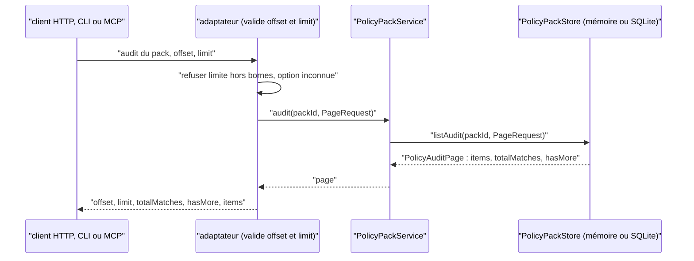
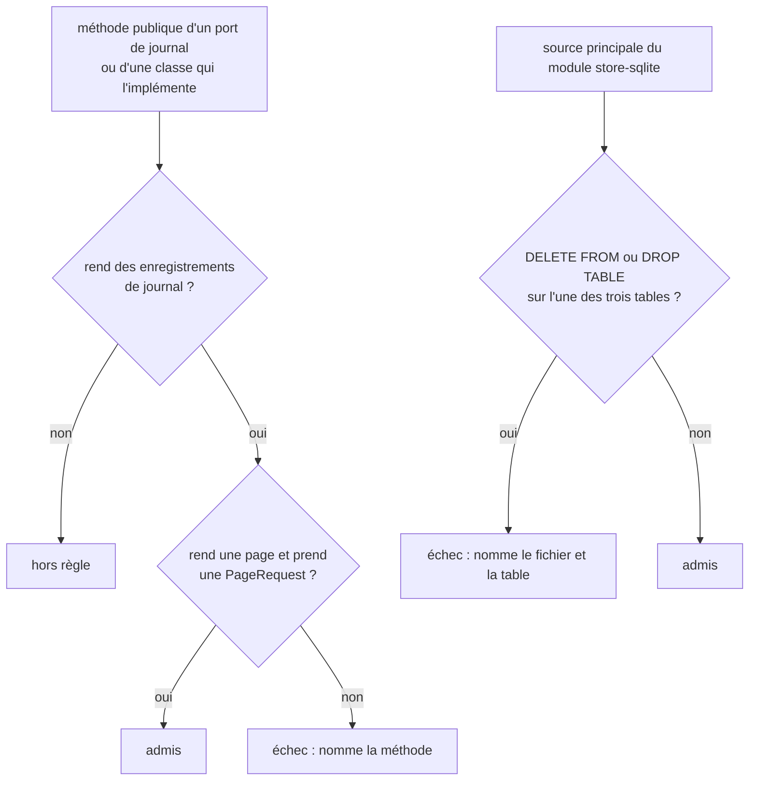

# Lecture des journaux en ajout seul (`append-only-journal-reads`)

Spec de référence : [`openspec/specs/append-only-journal-reads/spec.md`](../../../openspec/specs/append-only-journal-reads/spec.md)
· Relevé du 2026-11-04 sur `2913fc30`.

## Objet et périmètre

Trois tables ne font que croître : l'audit des policies (`policy_audit`), l'audit des mutations de cycle de vie
(`change_lifecycle_mutation_audit`) et les archives de synchronisation (`sync_source_archives`). Chacune est lue par pages,
dans un ordre total qu'un index suit, et le produit n'en supprime aucune ligne sans décision enregistrée.

- **Acteurs** : un client HTTP, CLI ou MCP (audit des policies seulement) ; les services qui lisent les deux autres journaux ;
  les stores mémoire et SQLite.
- **Inclus** : le port de chaque journal, les trois transports de l'audit des policies, l'interdiction d'une lecture entière
  et celle d'un `DELETE`.
- **Exclus** : l'ordre de l'audit des policies, décrit par [`policy-audit-order.md`](policy-audit-order.md) ; le journal
  d'accès du serveur distant ([`remote-access-journal.md`](remote-access-journal.md)), qui est un autre journal.

## Exigences

| Alias | Exigence (titre exact) | En bref | Nature |
|---|---|---|---|
| R1 | The policy audit SHALL be read from the store one page at a time | page + total, pas de lecture entière, SQLite ne construit que la page | `[EXIGENCE]` |
| R2 | Every transport SHALL page the policy audit with one vocabulary and one set of bounds | HTTP, CLI et MCP : `offset`, `limit`, page de l'ADR-0151 ; OpenAPI borné | `[EXIGENCE]` |
| R3 | A journal SHALL NOT be deleted from without a recorded decision | aucun `DELETE` sur les trois tables ; décision écrite | `[EXIGENCE]` |
| R4 | The lifecycle mutation audit and the source archives SHALL be read from the store one page at a time | page + total + `hasMore`, ordre total propre à chaque journal | `[EXIGENCE]` |
| R5 | No journal store port SHALL offer a whole journal | aucune méthode de port ou d'implémentation ne rend une collection d'enregistrements de journal | `[EXIGENCE]` |

## Comportement détaillé

`[EXISTANT VÉRIFIÉ]` Les ports et leurs pages :

| Journal | Port et lecture | Page | Ordre total | Index |
|---|---|---|---|---|
| audit des policies | `PolicyPackStore.listAudit(packId, PageRequest)` | `PolicyAuditPage` | instant (clé `at_key`), puis identité | `idx_policy_audit_pack_order` |
| audit de mutation | `ChangeLifecycleMutationStore.listAudit(projectId, changeId, PageRequest)` | `ChangeLifecycleMutationAuditPage` | révision d'arrivée, puis identité de mutation | `idx_change_lifecycle_audit_change` |
| archives de synchronisation | `SyncStateStore.listArchives(projectId, PageRequest)` | `SourceArchivePage` | instant (clé `archived_key`), chemin, raison, empreinte | `idx_sync_source_archives_project_order` |

- Une page porte `items`, la `PageRequest`, `totalMatches` et `hasMore` ; son constructeur refuse un total négatif, plus
  d'éléments que la limite et un `hasMore` incohérent. `PageRequest.MAX_LIMIT` est la borne maximale, la valeur par défaut
  de l'adaptateur HTTP est `MorpheusApiService.DEFAULT_LIMIT`.
- Le store SQLite lit le total par `COUNT(*)` et la page par `ORDER BY <clé> LIMIT ? OFFSET ?` ; il ne trie rien après la
  lecture. Le store mémoire trie la liste puis la coupe par `…Page.of`.
- **Trois transports pour l'audit des policies** : `GET /api/v1/policy-packs/{id}/audit` (paramètres `offset`, `limit` ; OpenAPI
  [`morpheus-v1-policy-m25.yaml`](../reference/openapi/morpheus-v1-policy-m25.yaml), `AuditOffsetQuery` et `AuditLimitQuery`
  avec bornes et défaut), `policy audit --id ID [--offset N] [--limit N]` et l'outil MCP `get_policy_audit`. Une limite
  hors bornes, un paramètre inconnu ou un décalage négatif est refusé avant la lecture ; un pack inconnu garde son refus
  (HTTP 400 « unknown policy pack », CLI code `NOT_FOUND`). Ligne du manifeste : `policy.audit`
  ([`contracts/public-surfaces.tsv`](../../../contracts/public-surfaces.tsv)).
- **Conservation** : [ADR BE-0151](../../architecture/adr/BE-0151-pagination-des-collections-et-journaux.md), section 6 : aucune
  instruction du produit ne supprime des trois tables ; l'ADR dit aussi qu'aucune surface publique ne lit les deux journaux
  autres que l'audit des policies, et qu'une purge exige une taille mesurée ou une obligation écrite et une décision qui
  remplace l'ADR.

## Diagrammes

### Comment une page d'audit de policy traverse-t-elle les couches ?

Existant. Exigences R1, R2.

### Quelles lectures et quelles suppressions sont refusées par le build ?

Existant (`AppendOnlyJournalReadsArchitectureTest`). Organigramme. Exigences R3, R5.

## Écarts et questions ouvertes

- `[EXISTANT VÉRIFIÉ]` L'interdit R3 est lu dans les sources de `morpheus-store-sqlite/src/main` (fichiers `.java` et `.sql`),
  pas dans tous les modules de production ; la spec dit « the product's sources ». Les stores mémoire n'ont pas de SQL.
- `[EXISTANT VÉRIFIÉ]` Le guide d'aide de la CLI imprime `policy audit --id ID` sans `[--offset N] [--limit N]`
  (`MorpheusMain`, bloc d'aide M25), alors que `MorpheusPolicyCli` accepte `id`, `offset` et `limit` pour `audit` et que
  [`docs/user/POLICY_PACKS.md`](../../user/POLICY_PACKS.md) les documente. Écart d'aide embarquée.
- `[EXISTANT VÉRIFIÉ]` Un pack inconnu est refusé de façon différente selon le transport : HTTP 400, CLI `NOT_FOUND`
  (les deux tests le fixent). La spec dit seulement « the refusal it was before ».
- Preuve manquante : R2 « The three transports agree » : aucun test ne demande la même page par HTTP, CLI et MCP et ne
  compare les trois réponses ; `PublicPayloadConvergenceTest` ne couvre pas l'audit des policies.
- Preuve manquante : R2 « A long journal stays readable through the remote server » : aucun test ne lit un journal dépassant
  `MorpheusRemoteHttpServer.MAX_PROXY_RESPONSE_BYTES` page par page ; les tests de budget de proxy ne portent pas sur ce journal.
- Preuve manquante : R2 « refused before the journal is read » : les tests vérifient le code 400 / `USAGE`, pas qu'aucune
  lecture n'a eu lieu.
- Preuve manquante : les bornes de l'OpenAPI (`maximum: 100`, `default: 50`) ne sont comparées par aucun test aux
  constantes `PageRequest.MAX_LIMIT` et `MorpheusApiService.DEFAULT_LIMIT`.
- Preuve partielle : R1 « has built no record beyond the page » : le test vérifie le nombre d'éléments rendus, et la limite
  est portée par le `LIMIT` de la requête ; aucun compteur de lignes construites.
- Preuve partielle : R4 « then mutation identity » : le test de parité du journal de mutation écrit une mutation par
  révision, donc le départage par identité n'est jamais exercé.
- `[QUESTION]` Les versions d'un pack de policies et les révisions d'une vue sont encore rendues entières sur HTTP et la CLI
  (ADR BE-0151, section 5) : décision ouverte hors périmètre de cette capacité.

## Traçabilité

Archives : `2026-10-17-read-an-append-only-journal-one-page-at-a-time` (R1, R2, R3, R5 pour l'audit des policies),
`2026-10-30-page-the-two-remaining-journals` (R4 et extension de R5).

| Exigence | Scénario | Conception ou diagramme | Changement | Preuve |
|---|---|---|---|---|
| R1 | A page of a long journal | schéma 1 | archive 2026-10-17 | [`SqlitePolicyAuditPageTest`](../../../morpheus-store-sqlite/src/test/java/com/morpheus/store/sqlite/adapter/SqlitePolicyAuditPageTest.java)`#aPageHoldsOnlyItsRecordsAndSaysHowManyFollow` (partielle, voir Écarts) |
| R1 | Pages put end to end are the journal | schéma 1 | idem | `SqlitePolicyAuditPageTest#pagesConcatenateToTheNaturalOrderAcrossEveryBoundary` ; [`PolicyAuditOrderTest`](../../../morpheus-architecture-tests/src/test/java/com/morpheus/architecture/m25/PolicyAuditOrderTest.java)`#bothStoresListTheAuditByInstantThenIdentity` |
| R1 | An offset past the end | schéma 1 | idem | `SqlitePolicyAuditPageTest#aPageHoldsOnlyItsRecordsAndSaysHowManyFollow` (offset 500) |
| R1 | An existing database is read in the same order | — | idem | [`SqlitePolicyAuditOrderKeyMigrationTest`](../../../morpheus-store-sqlite/src/test/java/com/morpheus/store/sqlite/adapter/SqlitePolicyAuditOrderKeyMigrationTest.java)`#theKeyOfARecordThatExistedBeforeTheMigrationIsTheKeyThisVersionWouldHaveWritten` |
| R2 | HTTP answers with a page | schéma 1 | idem | [`MorpheusPolicyAuditPagingHttpTest`](../../../morpheus-api/src/test/java/com/morpheus/api/MorpheusPolicyAuditPagingHttpTest.java)`#theAuditIsAPageThatSaysHowManyRecordsFollow` ; CLI : [`MorpheusPolicyAuditPagingCliTest`](../../../morpheus-cli/src/test/java/com/morpheus/cli/command/MorpheusPolicyAuditPagingCliTest.java)`#theAuditIsAPageWithTheDefaultTheNextPageAndTheLastOne` ; MCP : [`GrowingCollectionToolsPagingTest`](../../../morpheus-mcp/src/test/java/com/morpheus/mcp/GrowingCollectionToolsPagingTest.java)`#walkingThePagesReturnsTheWholeCollectionOnceInTheSameOrder` |
| R2 | The three transports agree | schéma 1 | idem | **Preuve manquante** |
| R2 | A limit out of range is refused before the journal is read | schéma 1 | idem | `MorpheusPolicyAuditPagingHttpTest#aPageOutsideTheBoundsAnUnknownParameterAndAnUnknownPackAreRefused` ; `MorpheusPolicyAuditPagingCliTest#aPageOutsideTheBoundsAndAnUnknownPackAreRefused` ; `GrowingCollectionToolsPagingTest#thePageArgumentsAreRefusedBeforeTheCollectionIsRead`, `#theBoundsAreEnforcedByTheHandlerAndAnnouncedByTheSchemaAlike` ; [`PageBoundsAgreementTest`](../../../morpheus-mcp/src/test/java/com/morpheus/mcp/PageBoundsAgreementTest.java)`#theCatalogMaximumIsTheMaximumThePageRequestEnforces` |
| R2 | An unknown pack is still unknown | schéma 1 | idem | les deux tests de refus ci-dessus |
| R2 | A long journal stays readable through the remote server | — | idem | **Preuve manquante** |
| R3 | A purge slipped into a store is refused | schéma 2 | idem | [`AppendOnlyJournalReadsArchitectureTest`](../../../morpheus-architecture-tests/src/test/java/com/morpheus/architecture/AppendOnlyJournalReadsArchitectureTest.java)`#noStatementOfTheProductDeletesFromAJournal` |
| R3 | The decision can be read | — | idem | ADR BE-0151 section 6 ; aucun test ne lit l'ADR (tenue par la revue) |
| R4 | Each journal has a total order | — | archive 2026-10-30 | `SqliteQueryPlanGuardTest#everyGuardedStatementIsServedByAnIndexOnAMigratedDatabase` ([source](../../../morpheus-store-sqlite/src/test/java/com/morpheus/store/sqlite/adapter/SqliteQueryPlanGuardTest.java), lignes `change-lifecycle-audit.*` et `sync-source-archives.*`) ; [`SourceArchivePageTest`](../../../morpheus-application/src/test/java/com/morpheus/application/sync/SourceArchivePageTest.java)`#archivesThatDifferOnlyByContentAreOrderedByFingerprint` |
| R4 | A page of a long journal | — | idem | [`ControlledLifecycleMutationContractTest`](../../../morpheus-architecture-tests/src/test/java/com/morpheus/architecture/ControlledLifecycleMutationContractTest.java)`#bothStoresReturnTheAuditOfAChangeOnePageAtATimeInRevisionOrder` ; [`MemorySyncStateStoreTest`](../../../morpheus-store-memory/src/test/java/com/morpheus/store/memory/MemorySyncStateStoreTest.java)`#archivesAreReadOnePageAtATimeWithTheirTotal` ; [`ChangeLifecycleMutationAuditPageTest`](../../../morpheus-application/src/test/java/com/morpheus/application/lifecycle/mutation/ChangeLifecycleMutationAuditPageTest.java)`#aSliceOfAnOrderedJournalSaysItsTotalAndWhetherMoreFollows` |
| R4 | Archive pages put end to end are the journal in time order | — | idem | [`SourceArchiveOrderParityTest`](../../../morpheus-architecture-tests/src/test/java/com/morpheus/architecture/SourceArchiveOrderParityTest.java)`#bothStoresCutTheSamePagesAcrossInstantsWhoseTextSortsAgainstTime` |
| R4 | An offset past the end | — | idem | `SourceArchivePageTest#aSliceOfAnOrderedJournalSaysItsTotalAndWhetherMoreFollows` |
| R4 | Existing archives are read in the same order | — | idem | [`SqliteSourceArchiveOrderKeyMigrationTest`](../../../morpheus-store-sqlite/src/test/java/com/morpheus/store/sqlite/adapter/SqliteSourceArchiveOrderKeyMigrationTest.java)`#anArchiveThatExistedBeforeTheMigrationGetsTheKeyAndIsReadInTimeOrder` |
| R5 | An unbounded journal read added to a port is refused | schéma 2 | idem | `AppendOnlyJournalReadsArchitectureTest#noJournalStoreOffersAWholeJournal`, `#theRuleRefusesAPortThatOffersAWholeJournalOrAPageWithoutABound` |
| R5 | The rule sees what it judges | schéma 2 | idem | `AppendOnlyJournalReadsArchitectureTest#theRuleJudgesThePagedReadOfEachJournalOnItsPortAndOnBothStores` |

Mesure : `M19QueryPerformanceGate#aPageOfThePolicyAuditInAJournalOfOneHundredThousandStaysWithinBudget`
([source](../../../morpheus-architecture-tests/src/test/java/com/morpheus/architecture/m19/M19QueryPerformanceGate.java), voie nocturne).

## Sources

- ADR : [BE-0151](../../architecture/adr/BE-0151-pagination-des-collections-et-journaux.md).
- Archives OpenSpec : `2026-10-17-read-an-append-only-journal-one-page-at-a-time`, `2026-10-30-page-the-two-remaining-journals`.
- Pages liées : [`policy-audit-order.md`](policy-audit-order.md), [`requirement-page-reads.md`](requirement-page-reads.md).
