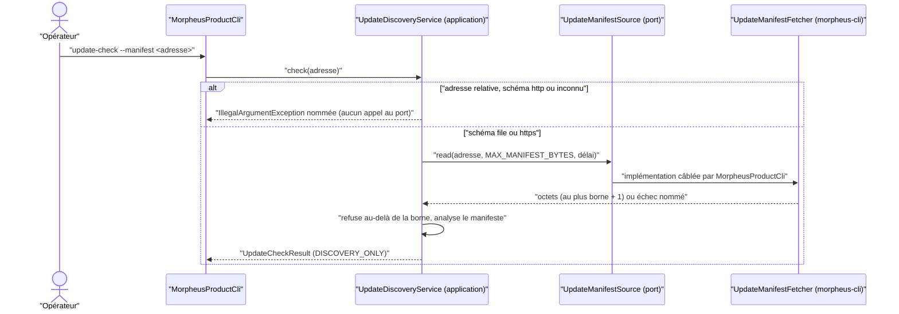
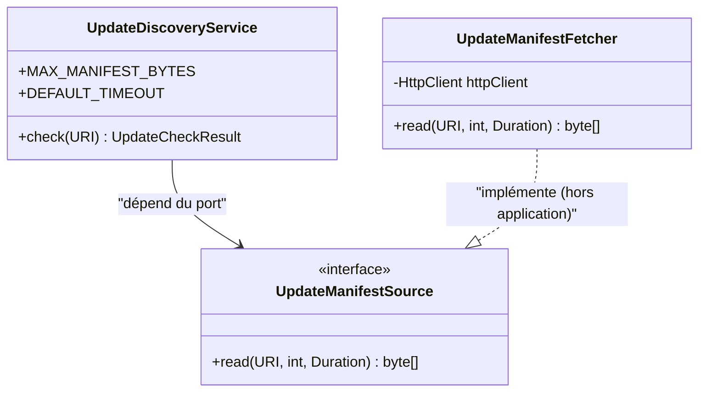

# Technologie sortie de l'application derrière un port (`application-infrastructure-ports`)

Spec de référence : [`openspec/specs/application-infrastructure-ports/spec.md`](../../../openspec/specs/application-infrastructure-ports/spec.md)
· Relevé du 2026-11-04 sur `2913fc30`.

## Objet et périmètre

Quand la décision d'architecture marque une technologie comme sortant de l'application, l'application déclare un port
qui dit ce dont le cas d'usage a besoin, un adaptateur extérieur l'implémente, et le processus câble cet adaptateur
explicitement. Ce que le cas d'usage refuse de lui-même est refusé par l'application avant tout appel au port, et le
déplacement ne change rien de ce qu'un appelant observe.

- **Acteurs** : opérateur qui lance `update-check --manifest <adresse>` ; mainteneur qui retire une classe de la liste
  nommée.
- **Inclus** : le seul cas aujourd'hui marqué « sort » par [ARCH-0150](../../architecture/adr/ARCH-0150-ce-que-le-coeur-applicatif-peut-toucher.md) :
  le transport réseau de la découverte de mise à jour (`UpdateDiscoveryService`, port `UpdateManifestSource`,
  adaptateur `UpdateManifestFetcher` de `morpheus-cli`).
- **Exclus** : l'accès fichier, environnement, horloge et réflexion, que l'ADR garde dans l'application
  ([`application-technology-boundary.md`](application-technology-boundary.md)) ; l'installation d'une mise à jour, que
  la découverte ne fait jamais (`action=none` dans la sortie de la CLI).

## Exigences

| Alias | Exigence (titre exact) | En bref | Nature |
|---|---|---|---|
| R1 | A technology marked as leaving SHALL be reached through a port the application declares | port dans `application`, technologie dans un adaptateur, câblage explicite | `[EXIGENCE]` |
| R2 | What is refused before any I/O SHALL still be refused by the application | `http:`, schéma non pris en charge, adresse relative : refusés avant d'appeler le port | `[EXIGENCE]` |
| R3 | A move SHALL change nothing a caller observes | bornes, refus, résultats et sorties identiques à ceux d'avant | `[EXIGENCE]` |
| R4 | An assertion SHALL follow the code it reads | une assertion lit la classe qui porte l'invariant ; la liste nommée perd la classe dans le même changement | `[EXIGENCE]` |

## Comportement détaillé

`[EXISTANT VÉRIFIÉ]` Le port est `com.morpheus.application.product.UpdateManifestSource`, interface fonctionnelle
`byte[] read(URI manifestUri, int byteLimit, Duration deadline)`. Son contrat (Javadoc) : au plus `byteLimit + 1`
octets, un corps distant qui n'est pas complet avant l'échéance est refusé, une redirection n'est jamais suivie, un
échec est une `IllegalArgumentException` dont le message nomme l'adresse, une lecture interrompue une
`IllegalStateException` qui conserve le drapeau d'interruption.

### Ce que l'application décide avant le port (R2)

`UpdateDiscoveryService.check` refuse, sans appeler le port :

| Entrée | Refus |
|---|---|
| adresse relative | `manifestUri must be absolute` |
| schéma `http` | `insecure update manifest scheme: http (expected file or https)` |
| autre schéma que `file`, `https` | `unsupported update manifest scheme: <schéma> (expected file or https)` |

L'application énonce les bornes : `MAX_MANIFEST_BYTES` et `DEFAULT_TIMEOUT` (constantes de `UpdateDiscoveryService`).
Un manifeste de plus de `MAX_MANIFEST_BYTES` est refusé par `update manifest exceeds <borne> bytes: <adresse>`.

### Ce que l'adaptateur fait (R1, R3)

`UpdateManifestFetcher` (`morpheus-cli`, paquet `command`) lit `file:` ou `https:`, construit son client avec
`followRedirects(NEVER)`, refuse un statut hors `2xx` par son code, borne la lecture du corps dans le temps sur un fil
virtuel, et ferme le flux avant de relever l'échéance ou l'interruption. `MorpheusProductCli` construit
`UpdateDiscoveryService` avec `new UpdateManifestFetcher()` : le câblage est explicite.

### Comportement vérifié absent de la spec

- `[EXISTANT VÉRIFIÉ]` `MorpheusProductCli.updateCheck` instancie `UpdateManifestFetcher` pour toute adresse, `file:`
  comprise ; la spec ne parle que de `https:`.
- `[EXISTANT VÉRIFIÉ]` Le refus d'un argument `--manifest` absent ou vide est celui de l'analyse d'options de la CLI
  (`CliOptionRefusalTableTest`), pas du cas d'usage ; la spec le range sous « un argument manquant ».

## Diagrammes

### Qui appelle qui quand `update-check` lit un manifeste ?

Existant vérifié. Diagramme de séquence ; le garde (`alt`) montre que le refus précède tout appel au port. Exigences :
R1, R2, R3.

### Où vit chaque responsabilité ?

Existant vérifié. Diagramme de classes réduit aux types qui portent la frontière. Exigences : R1, R4.

## Écarts et questions ouvertes

- **« Comme avant le déplacement » n'est pas comparable (R3).** Aucun test ne compare un comportement d'avant et
  d'après : les tests figent le message et la borne actuels (`ProductIntegrityTest`, `UpdateManifestFetcherTest`). La
  non-régression repose sur la reprise des mêmes assertions, pas sur une mesure d'écart. Preuve d'identité à l'état
  antérieur : manquante.
- **Refus de `http:` de bout en bout (R2).** Le refus est testé au niveau du service avec un port qui échoue s'il est
  appelé ; aucun test de la CLI ne lance `update-check --manifest http://…`. Preuve manquante au niveau CLI.
- **Assertions qui suivent le code (R4).** `UpdateTrustBoundaryContractTest` et
  `AuditHardeningWorkflowContractTest#remoteDiscoveryCannotRegressToChecksumOnlyOrClaimVerifiedTrust` lisent
  `UpdateDiscoveryService.java` par chemin littéral, et aucun gate textuel ne lit `UpdateManifestFetcher.java` pour la
  redirection refusée : cet invariant n'est tenu que par le comportement
  (`UpdateManifestFetcherTest#aRedirectIsNotFollowedAndIsRefusedByItsStatus`) et par `SilentCatchArchitectureTest` pour
  le seul `catch` de fermeture. `[QUESTION]` Un gate textuel sur `followRedirects` est-il attendu ?
- **Texte d'ADR-0150 décalé du code.** La section « Mesure » d'ARCH-0150 est une mesure datée du 25/10/2026 qui range
  encore `UpdateDiscoveryService` parmi les classes d'accès fichier et cite `security.LocalWritePermissionHardener`,
  alors que la liste en vigueur du test ne contient plus `UpdateDiscoveryService` et que la classe
  `LocalWritePermissionHardener` réside dans `com.morpheus.application.files`. La décision elle-même (section
  Decision) est cohérente avec le code.
- **Cas « le registre ne marque rien » (R1, scénario 2).** Aucun test ne le couvre : la capacité « ne s'applique pas ».
  Preuve sans objet tant que le registre marque une sortie.

## Traçabilité

| Exigence | Scénario | Conception ou diagramme | Changement | Preuve |
|---|---|---|---|---|
| R1 | The update manifest is fetched over HTTPS | séquence et classes ci-dessus | archive `2026-10-29-move-marked-technology-access-behind-application-ports` | [`UpdateManifestFetcherTest`](../../../morpheus-cli/src/test/java/com/morpheus/cli/command/UpdateManifestFetcherTest.java)`#aPromptNormalResponseSucceedsWellUnderTheDeadline` (vrai serveur TLS) ; absence de client HTTP dans l'application : [`ApplicationTechnologyBoundaryArchitectureTest`](../../../morpheus-architecture-tests/src/test/java/com/morpheus/architecture/ApplicationTechnologyBoundaryArchitectureTest.java)`#aFamilyTheApplicationDoesNotUseIsRefusedInEveryPackage` (famille « outbound network », ArchUnit) ; câblage : [`ProductionIntegrityContractTest`](../../../morpheus-architecture-tests/src/test/java/com/morpheus/architecture/m21/ProductionIntegrityContractTest.java)`#updateDiscoveryHasNoImplicitStartupEntryPoint` (texte) |
| R1 | The record marks nothing | — | idem | Preuve manquante (sans objet) |
| R2 | An insecure manifest address | séquence (branche `alt`) | idem | [`ProductIntegrityTest`](../../../morpheus-application/src/test/java/com/morpheus/application/product/ProductIntegrityTest.java)`#insecureHttpManifestIsRejectedBeforeAnyNetworkIo` (port qui échoue s'il est appelé, `FileManifestSource.refusingDiscovery`) ; aussi `#unsupportedManifestSchemesAreRejectedBeforeAnyIo`, `#aRelativeManifestAddressIsRefusedBeforeAnyIo` |
| R3 | A manifest larger than the bound | séquence | idem | `ProductIntegrityTest#oversizedManifestIsRejectedBeforeParsing`, `#theSourceIsHandedTheBoundsTheDiscoveryStates` ; côté adaptateur `UpdateManifestFetcherTest#anOversizedManifestBodyIsStillRejectedThroughTheTimedReader` |
| R3 | A redirect | — | idem | `UpdateManifestFetcherTest#aRedirectIsNotFollowedAndIsRefusedByItsStatus` |
| R4 | The invariant is removed at its new place | — | idem | `UpdateTrustBoundaryContractTest#discoveryCarriesProvenanceReferenceButCannotClaimPublisherVerification` ([`UpdateTrustBoundaryContractTest`](../../../morpheus-architecture-tests/src/test/java/com/morpheus/architecture/m21/UpdateTrustBoundaryContractTest.java), texte sur `UpdateDiscoveryService`) ; [`AuditHardeningWorkflowContractTest`](../../../morpheus-architecture-tests/src/test/java/com/morpheus/architecture/m21/AuditHardeningWorkflowContractTest.java)`#remoteDiscoveryCannotRegressToChecksumOnlyOrClaimVerifiedTrust` ; le refus de `http:` et la borne de taille sont tenus par `ProductIntegrityTest`, pas par un gate textuel |
| R4 | The name stays on the list | — | idem | `ApplicationTechnologyBoundaryArchitectureTest#everyNamedClassStillReachesItsFamily` (ArchUnit, liste exacte dans les deux sens) |

## Sources

- ADR : [ARCH-0150](../../architecture/adr/ARCH-0150-ce-que-le-coeur-applicatif-peut-toucher.md) (décisions 1 et 2, section
  Compliance and Enforcement), [ARCH-0156](../../architecture/adr/ARCH-0156-racines-de-composition-nommees-paquets-sans-cycle-et-decisions-dans-le-domaine.md).
- Risque soldé : `DT-18` dans [`../../architecture/arc42/11-risques-dette.md`](../../architecture/arc42/11-risques-dette.md).
- Pages liées : [`application-technology-boundary.md`](application-technology-boundary.md),
  [`mcp-peer-launch-command.md`](mcp-peer-launch-command.md).
