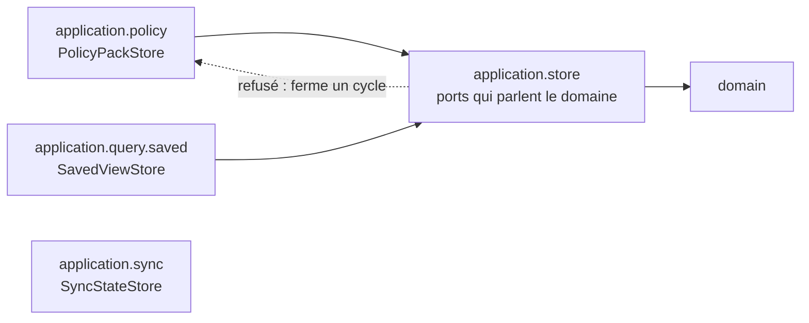
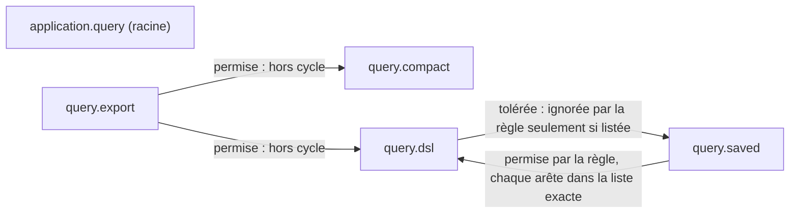
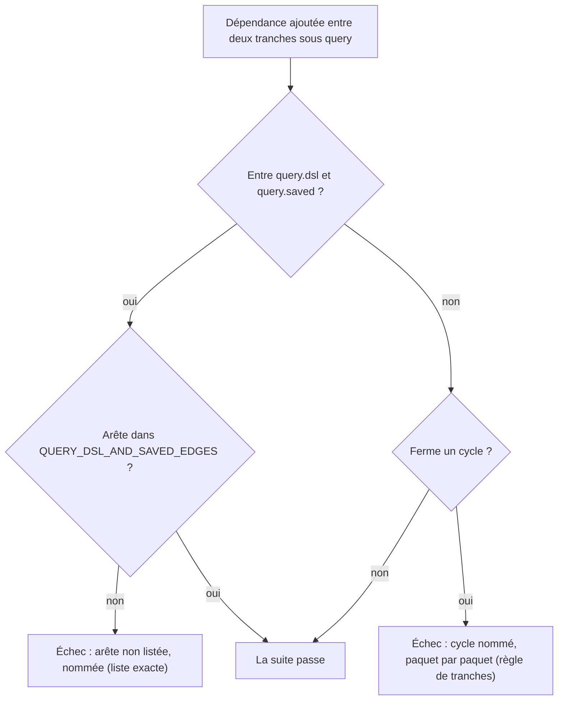

# Paquets de l'application sans cycle (`application-package-cycles`)

Spec de référence : [`openspec/specs/application-package-cycles/spec.md`](../../../openspec/specs/application-package-cycles/spec.md)
· Relevé du 2026-11-06 sur `8c038add`.

## Objet et périmètre

Aucune dépendance entre paquets de premier niveau de `com.morpheus.application` ne ferme un cycle, et la règle n'a
aucune liste de dépendances ou de composantes tolérées. Sous `com.morpheus.application.query`, les paquets de deuxième
niveau et la racine sont sans cycle, hors des arêtes de `query.dsl` vers `query.saved` qu'une liste exacte nomme ; cette
liste, qui tient les arêtes de la paire dans les deux sens, est un compteur de dette qui ne fait que rétrécir. Le paquet des ports de store (`application.store`) ne prend
part à aucun cycle, et la décision d'architecture énonce la règle avec une mesure datée plutôt qu'un nombre présenté
comme courant.

- **Acteurs** : mainteneur qui ajoute une dépendance entre paquets de l'application ; auteur d'un port de store.
- **Inclus** : la tranche `com.morpheus.application.(*)..` lue sur les classes compilées ; les tranches de deuxième
  niveau sous `application.query`, racine comprise, et la liste `QUERY_DSL_AND_SAVED_EDGES` ; le placement des ports
  (`PolicyPackStore` dans `policy`, `SavedViewStore` dans `query.saved`, `SyncStateStore` dans `sync`) ; la section
  de mesure d'ARCH-0162.
- **Exclus** : les cycles du domaine (deux exceptions nommées par paire de types, `AdapterCompositionRootArchitectureTest#domainPackagesAreFreeOfCyclesBesideTheTwoNamedOnes`) ; les cycles de `morpheus-api`
  ([`adapter-internal-boundaries.md`](adapter-internal-boundaries.md)) ; une règle de deuxième niveau sous les autres
  paquets de l'application ; la résorption du cycle `query.dsl` / `query.saved`, écartée par le mainteneur le
  2026-11-06.

## Exigences

| Alias | Exigence (titre exact) | En bref | Nature |
|---|---|---|---|
| R1 | The dependencies that lie on a cycle between application packages SHALL be named | corps : toute dépendance qui ferme un cycle est refusée, sans liste de tolérances | `[EXIGENCE]` : titre et corps divergent, voir Écarts |
| R2 | The package of the store ports SHALL take part in no cycle | `application.store` ne dépend d'aucun paquet qui dépend de lui, directement ou non | `[EXIGENCE]` |
| R3 | The architecture record SHALL state the rule and its measurement | l'ADR porte la règle, la mesure datée avec sa révision, et les déplacements | `[EXIGENCE]` |
| R4 | Les paquets sous la plateforme de requête sont sans cycle, à une paire nommée près | deuxième niveau sous `query`, racine comprise ; seules les arêtes listées `dsl → saved` sont ignorées | `[EXIGENCE]` |
| R5 | Les arêtes entre le DSL de requête et les vues enregistrées forment une liste exacte qui ne fait que rétrécir | bytecode et texte, dans les deux sens, par type de premier rang ; tout écart nommé | `[EXIGENCE]` |
| R6 | La liste des arêtes tolérées est un compteur de dette adossé à une décision acceptée | `ProductionClassListsArchitectureTest`, clé de `config/debt-counter-ratchets.properties` | `[EXIGENCE]` |
| R7 | La règle de la plateforme de requête juge chacun de ses paquets | sous-paquets des sources = tranches des classes importées | `[EXIGENCE]` |
| R8 | La décision d'architecture nomme la paire tolérée et son compteur | ARCH-0162, décision 5 et section « La paire `query.dsl` / `query.saved` » | `[EXIGENCE]` |

## Comportement détaillé

`[EXISTANT VÉRIFIÉ]` `ApplicationPackageCyclesArchitectureTest` évalue
`slices().matching("com.morpheus.application.(*)..").should().beFreeOfCycles()` sur les classes de production. Une
tranche est un paquet de **premier niveau** : `query.dsl` et `query.saved` forment une seule tranche, et une
dépendance entre elles échappe à cette règle ; la règle de deuxième niveau ci-dessous la juge. Le graphe est lu sur le bytecode : un type atteint par un appel chaîné
compte, une constante que `javac` a inlinée n'est pas une dépendance. La règle ne comporte aucun `ignoreDependency`.

`[EXISTANT VÉRIFIÉ]` Un deuxième test compare les paquets de premier niveau déclarés par les sources de
`morpheus-application` à ceux des classes importées : la règle juge tous les paquets, pas un sous-ensemble.

`[EXISTANT VÉRIFIÉ]` La règle de deuxième niveau range par `slices().assignedFrom(…)` chaque classe de
`com.morpheus.application.query.X..` dans la tranche `X` et chaque classe de la racine dans la tranche `(root)`, puis
exige `beFreeOfCycles()`. Pour chaque origine de `query.dsl` de `QUERY_DSL_AND_SAVED_EDGES`, un `ignoreDependency`
écarte ses seules cibles listées, un type imbriqué étant ramené à son type de premier rang. Le sens `saved → dsl`, sens
naturel, n'est pas ignoré : sans arête de retour il ne ferme aucun cycle, et c'est la liste qui l'empêche de grandir.

`[EXISTANT VÉRIFIÉ]` La liste est comparée à l'union de deux mesures : les dépendances directes du bytecode (ArchUnit)
et les types de l'autre paquet nommés par le texte des sources hors commentaires (import ou nom qualifié). Le bytecode
voit un type atteint par appel chaîné (`SavedViewId`, `SavedViewStatus` depuis `QueryPublicViews`) ; le texte voit une
constante inlinée (`QueryBudgets.MAX_SAVED_VIEW_NAME` dans `SavedViewDefinition`), dont ArchUnit ne compte pas
l'entrée résiduelle du pool de constantes (constaté le 2026-11-06). Un import de tout un paquet de l'autre côté est
refusé : la mesure par le texte ne saurait pas le lire. Un dernier test compare les sous-paquets déclarés par les
sources de `query` aux tranches des classes importées.

`[DÉCISION]` Un type employé par deux paquets vit dans le plus bas des deux, ou dans le domaine s'il ne parle que du
domaine ; un port se déclare dans le paquet de la capacité dont il emploie les types (ARCH-0162, décision 5 ;
`.claude/rules/architecture.md`, section « Les paquets de l'application sont sans cycle »).

`[EXISTANT VÉRIFIÉ]` Aucune règle propre à `application.store` n'existe : R2 est une conséquence de la règle de
cycle de R1 appliquée à la tranche `store`.

## Diagrammes

### Un port de store peut-il parler le vocabulaire d'une capacité ?

Existant vérifié (imports de `morpheus-application` relus le 2026-11-04 : `store` n'importe que le domaine ; `policy` et
`query.saved` importent `store` ; `sync` n'importe pas `store`). Organigramme (pas UML) : les flèches pleines sont
permises ; la flèche barrée de `store` vers une capacité ferme un cycle dès que la capacité utilise `store`. Exigences : R1, R2.



### Quelles dépendances existent entre les paquets de la requête ?

Existant vérifié (`jdeps` et ArchUnit, 2026-11-06). Organigramme (pas UML) ; l'étiquette dit ce que la règle de deuxième
niveau en fait. La racine ne dépend d'aucun sous-paquet et reste une tranche jugée. Exigences : R4, R5.



### Que se passe-t-il quand une dépendance est ajoutée sous `query` ?

Existant vérifié (`ApplicationPackageCyclesArchitectureTest`). Organigramme de décision. Une arête `dsl → saved` non
listée échoue deux fois (règle de tranches et liste), une arête `saved → dsl` non listée une fois (liste) ; une arête
listée qui disparaît échoue par la liste jusqu'à ce que l'entrée et la clé baissent. Exigences : R4, R5, R6.



### Que fait la règle de premier niveau d'une nouvelle dépendance ?

Existant vérifié (`ApplicationPackageCyclesArchitectureTest`). Organigramme de décision. Exigence : R1.

```mermaid
flowchart TD
    dep["Nouvelle dépendance entre deux paquets de premier niveau"]
    graph{"Le graphe des tranches<br/>reste-t-il acyclique ?"}
    pass["La suite passe"]
    fail["La suite échoue et nomme le cycle,<br/>paquet par paquet"]
    dep --> graph
    graph -- oui --> pass
    graph -- non --> fail
```

## Écarts et questions ouvertes

- **Titre et corps de R1 ne disent pas la même chose.** Le titre (« The dependencies that lie on a cycle … SHALL be
  named ») et le Purpose (« which dependencies … may lie on a cycle ») annoncent un ensemble de dépendances nommées
  tolérées ; le corps exige le contraire (« MUST hold no list of tolerated dependencies or components »). Code, ADR et
  tests suivent le corps : aucune exception. La spec n'est pas modifiée ici. `[QUESTION]` Titre à reformuler par le
  mainteneur lors d'un prochain changement de la capacité.
- **Le constat compte des imports, la liste compte des arêtes de premier rang (R5).** L'audit du 2026-11-06 relève
  des déclarations d'import ; la liste mesure l'union du bytecode et du texte, ce qui ajoute les cibles atteintes par
  appel chaîné et ramène les types imbriqués à leur type de premier rang. Sa taille est la clé du compteur, pas ce
  constat.
- **Pas de test propre au paquet `store` (R2).** Les deux scénarios sont couverts par la règle générale ; aucun test
  ne plante une dépendance `store` vers une capacité pour constater l'échec nommant « l'interface et le type ».
  Le message ArchUnit liste des dépendances classe à classe, ce qui nomme les deux, mais la preuve par rejeu est
  manquante.
- **Identité de comportement des deux stores (R2, scénario 2).** Aucun test ne relie le déplacement d'un port à
  l'identité de comportement ; les tests de parité existent par capacité (`PolicyPersistenceParityTest`,
  `SavedViewPersistenceParityTest`, `IncrementalSyncPersistenceContractTest`) et en tiennent lieu.
- **Contenu de la mesure d'ADR (R3).** L'ADR-0162 porte un tableau « Date, révision / Tranches / Dépendances sur un
  cycle / Composantes cycliques », et un second pour la paire `query.dsl` / `query.saved` : lus à la main le
  2026-11-06. Aucun test ne vérifie que l'ADR contient une mesure datée
  ni que la page de règles ne présente pas un nombre de cycles comme courant. Preuve manquante.

## Traçabilité

| Exigence | Scénario | Conception ou diagramme | Changement | Preuve |
|---|---|---|---|---|
| R1 | A new dependency closes a cycle | organigramme de décision | archives `2026-10-29-let-application-package-cycles-only-decrease` puis `2026-10-30-free-the-application-packages-of-cycles` | [`ApplicationPackageCyclesArchitectureTest`](../../../morpheus-architecture-tests/src/test/java/com/morpheus/architecture/ApplicationPackageCyclesArchitectureTest.java)`#theApplicationPackagesAreFreeOfCycles` (ArchUnit `slices`) |
| R1 | A new dependency between two packages already in a cycle | idem | idem | même test : la règle est sans exception, aucune dépendance d'un cycle n'est tolérée |
| R1 | A dependency outside any cycle | idem | idem | même test (la suite passe sur l'arbre acyclique) |
| R1 | The rule is proven on a known cycle | idem | idem | `ApplicationPackageCyclesArchitectureTest#theCycleRuleRefusesTwoPackagesThatDependOnEachOther` (fixtures `com.morpheus.architecture.cycles.fixture.alpha` et `.beta`) ; `#theCycleRuleSeesEveryFirstLevelPackageOfTheApplicationSources` pour la complétude |
| R2 | A store port speaks the vocabulary of a capability | organigramme des ports | idem | règle générale ci-dessus ; test propre : preuve manquante |
| R2 | The port lives with its capability | idem | idem | règle générale ; identité des stores : [`PolicyPersistenceParityTest`](../../../morpheus-architecture-tests/src/test/java/com/morpheus/architecture/m25/PolicyPersistenceParityTest.java)`#memoryAndSqliteExposeSameVersionActivationOverrideAndAuditSemantics`, [`SavedViewPersistenceParityTest`](../../../morpheus-architecture-tests/src/test/java/com/morpheus/architecture/m24/SavedViewPersistenceParityTest.java)`#memoryAndSqlitePreserveSameCurrentAndVersionHistory`, [`IncrementalSyncPersistenceContractTest`](../../../morpheus-architecture-tests/src/test/java/com/morpheus/architecture/IncrementalSyncPersistenceContractTest.java)`#memoryAndSqliteProduceSamePlansStateInventoryArchivesAndFreshness` |
| R4 | Un cycle nouveau entre deux sous-paquets de la requête ; une arête `dsl → saved` hors de la liste ; un cycle par la racine | organigrammes de la requête | `bound-the-cycle-between-the-query-dsl-and-saved-views` | `ApplicationPackageCyclesArchitectureTest#theQueryCycleRuleRefusesTwoSecondLevelPackagesThatDependOnEachOther`, `#theQueryCycleRuleIgnoresTheListedReturnEdgesAndRefusesAnUnlistedOne`, `#theQueryCycleRuleRefusesACycleThroughTheRootPackage` (fixtures `com.morpheus.architecture.cycles.query`) ; violation plantée sur la production le 2026-11-06 (tâche 2.4) |
| R4 | Le code en vigueur passe ; la règle est prouvée sur une paire connue | idem | idem | `#theQueryPlatformPackagesAreFreeOfCyclesBesideTheListedReturnEdges` ; `#theQueryCycleRuleRefusesTwoSecondLevelPackagesThatDependOnEachOther` |
| R5 | Arête ajoutée ; arête disparue ; constante inlinée ; type imbriqué | organigramme de décision | idem | `#theEdgesBetweenTheQueryDslAndTheSavedViewsAreExactlyTheListedOnes`, `#theEdgeMeasurementSeesAnInlinedConstantByTheTextAndCountsANestedTypeAsItsTopLevelType`, `#theEdgeMeasurementRefusesAWholePackageImport` |
| R6 | Liste qui grandit ou rétrécit sans la clé ; décision non acceptée | — | idem | [`ProductionClassListsArchitectureTest`](../../../morpheus-architecture-tests/src/test/java/com/morpheus/architecture/ProductionClassListsArchitectureTest.java)`#everyDebtCounterHoldsExactlyTheSizeItsRatchetAllows`, `#everyListIsNamedByTheAcceptedDecisionRecordItDeclares` |
| R7 | Sous-paquet ajouté ; classes non importées | — | idem | `#theQueryCycleRuleSeesEverySecondLevelPackageOfTheQuerySources` |
| R8 | Un lecteur cherche pourquoi la paire est tolérée | — | idem | revue seule : ARCH-0162, décision 5 et section « La paire `query.dsl` / `query.saved` » ; `AdrIndexCoherenceTest` pour l'index |
| R3 | A reader looks for the current number of cycles | — | idem | revue seule : [ARCH-0162](../../architecture/adr/ARCH-0162-racines-de-composition-nommees-paquets-sans-cycle-hors-une-paire-bornee-et-decisions-dans-le-domaine.md), section « Cycles de paquets » ; preuve automatique manquante |

## Sources

- ADR : [ARCH-0162](../../architecture/adr/ARCH-0162-racines-de-composition-nommees-paquets-sans-cycle-hors-une-paire-bornee-et-decisions-dans-le-domaine.md)
  (décision 5, section Compliance and Enforcement).
- Règles du dépôt : `.claude/rules/architecture.md`, section « Les paquets de l'application sont sans cycle ».
- Pages liées : [`application-technology-boundary.md`](application-technology-boundary.md),
  [`module-package-correspondence.md`](module-package-correspondence.md).
