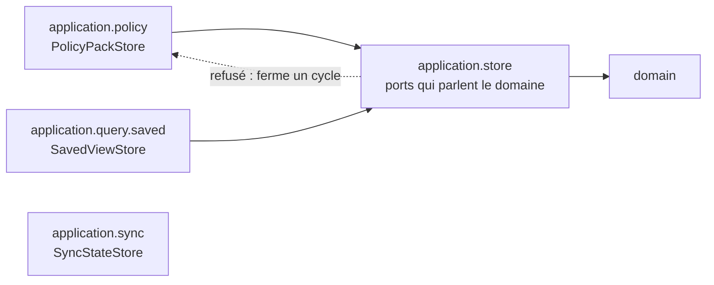

# Paquets de l'application sans cycle (`application-package-cycles`)

Spec de référence : [`openspec/specs/application-package-cycles/spec.md`](../../../openspec/specs/application-package-cycles/spec.md)
· Relevé du 2026-11-04 sur `2913fc30`.

## Objet et périmètre

Aucune dépendance entre paquets de premier niveau de `com.morpheus.application` ne ferme un cycle, et la règle n'a
aucune liste de dépendances ou de composantes tolérées. Le paquet des ports de store (`application.store`) ne prend
part à aucun cycle, et la décision d'architecture énonce la règle avec une mesure datée plutôt qu'un nombre présenté
comme courant.

- **Acteurs** : mainteneur qui ajoute une dépendance entre paquets de l'application ; auteur d'un port de store.
- **Inclus** : la tranche `com.morpheus.application.(*)..` lue sur les classes compilées ; le placement des ports
  (`PolicyPackStore` dans `policy`, `SavedViewStore` dans `query.saved`, `SyncStateStore` dans `sync`) ; la section
  de mesure d'ARCH-0156.
- **Exclus** : les cycles du domaine (deux exceptions nommées par paire de types, `AdapterCompositionRootArchitectureTest#domainPackagesAreFreeOfCyclesBesideTheTwoNamedOnes`) ; les cycles de `morpheus-api`
  ([`adapter-internal-boundaries.md`](adapter-internal-boundaries.md)).

## Exigences

| Alias | Exigence (titre exact) | En bref | Nature |
|---|---|---|---|
| R1 | The dependencies that lie on a cycle between application packages SHALL be named | corps : toute dépendance qui ferme un cycle est refusée, sans liste de tolérances | `[EXIGENCE]` : titre et corps divergent, voir Écarts |
| R2 | The package of the store ports SHALL take part in no cycle | `application.store` ne dépend d'aucun paquet qui dépend de lui, directement ou non | `[EXIGENCE]` |
| R3 | The architecture record SHALL state the rule and its measurement | l'ADR porte la règle, la mesure datée avec sa révision, et les déplacements | `[EXIGENCE]` |

## Comportement détaillé

`[EXISTANT VÉRIFIÉ]` `ApplicationPackageCyclesArchitectureTest` évalue
`slices().matching("com.morpheus.application.(*)..").should().beFreeOfCycles()` sur les classes de production. Une
tranche est un paquet de **premier niveau** : `query.dsl` et `query.saved` forment une seule tranche, et une
dépendance entre elles échappe à la règle. Le graphe est lu sur le bytecode : un type atteint par un appel chaîné
compte, une constante que `javac` a inlinée n'est pas une dépendance. La règle ne comporte aucun `ignoreDependency`.

`[EXISTANT VÉRIFIÉ]` Un deuxième test compare les paquets de premier niveau déclarés par les sources de
`morpheus-application` à ceux des classes importées : la règle juge tous les paquets, pas un sous-ensemble.

`[DÉCISION]` Un type employé par deux paquets vit dans le plus bas des deux, ou dans le domaine s'il ne parle que du
domaine ; un port se déclare dans le paquet de la capacité dont il emploie les types (ARCH-0156, décision 5 ;
`.claude/rules/architecture.md`, section « Les paquets de l'application sont sans cycle »).

`[EXISTANT VÉRIFIÉ]` Aucune règle propre à `application.store` n'existe : R2 est une conséquence de la règle de
cycle de R1 appliquée à la tranche `store`.

## Diagrammes

### Un port de store peut-il parler le vocabulaire d'une capacité ?

Existant vérifié (imports de `morpheus-application` relus le 2026-11-04 : `store` n'importe que le domaine ; `policy` et
`query.saved` importent `store` ; `sync` n'importe pas `store`). Organigramme (pas UML) : les flèches pleines sont
permises ; la flèche barrée de `store` vers une capacité ferme un cycle dès que la capacité utilise `store`. Exigences : R1, R2.



### Que fait la règle d'une nouvelle dépendance ?

Existant vérifié (`ApplicationPackageCyclesArchitectureTest`). Organigramme de décision. Exigence : R1.

```mermaid
flowchart TD
    dep["Nouvelle dépendance entre deux paquets de premier niveau"]
    graph{"Le graphe des tranches<br/>reste-t-il acyclique ?"}
    pass["La suite passe"]
    fail["La suite échoue et nomme le cycle,<br/>paquet par paquet"]
    dep --> graph
    graph -- oui --> pass
    graph -- non --> fail
```

## Écarts et questions ouvertes

- **Titre et corps de R1 ne disent pas la même chose.** Le titre (« The dependencies that lie on a cycle … SHALL be
  named ») et le Purpose (« which dependencies … may lie on a cycle ») annoncent un ensemble de dépendances nommées
  tolérées ; le corps exige le contraire (« MUST hold no list of tolerated dependencies or components »). Code, ADR et
  tests suivent le corps : aucune exception. La spec n'est pas modifiée ici. `[QUESTION]` Titre à reformuler par le
  mainteneur lors d'un prochain changement de la capacité.
- **Pas de test propre au paquet `store` (R2).** Les deux scénarios sont couverts par la règle générale ; aucun test
  ne plante une dépendance `store` vers une capacité pour constater l'échec nommant « l'interface et le type ».
  Le message ArchUnit liste des dépendances classe à classe, ce qui nomme les deux, mais la preuve par rejeu est
  manquante.
- **Identité de comportement des deux stores (R2, scénario 2).** Aucun test ne relie le déplacement d'un port à
  l'identité de comportement ; les tests de parité existent par capacité (`PolicyPersistenceParityTest`,
  `SavedViewPersistenceParityTest`, `IncrementalSyncPersistenceContractTest`) et en tiennent lieu.
- **Contenu de la mesure d'ADR (R3).** L'ADR-0156 porte un tableau « Date, révision / Tranches / Dépendances sur un
  cycle / Composantes cycliques » : lu à la main le 2026-11-04. Aucun test ne vérifie que l'ADR contient une mesure datée
  ni que la page de règles ne présente pas un nombre de cycles comme courant. Preuve manquante.

## Traçabilité

| Exigence | Scénario | Conception ou diagramme | Changement | Preuve |
|---|---|---|---|---|
| R1 | A new dependency closes a cycle | organigramme de décision | archives `2026-10-29-let-application-package-cycles-only-decrease` puis `2026-10-30-free-the-application-packages-of-cycles` | [`ApplicationPackageCyclesArchitectureTest`](../../../morpheus-architecture-tests/src/test/java/com/morpheus/architecture/ApplicationPackageCyclesArchitectureTest.java)`#theApplicationPackagesAreFreeOfCycles` (ArchUnit `slices`) |
| R1 | A new dependency between two packages already in a cycle | idem | idem | même test : la règle est sans exception, aucune dépendance d'un cycle n'est tolérée |
| R1 | A dependency outside any cycle | idem | idem | même test (la suite passe sur l'arbre acyclique) |
| R1 | The rule is proven on a known cycle | idem | idem | `ApplicationPackageCyclesArchitectureTest#theCycleRuleRefusesTwoPackagesThatDependOnEachOther` (fixtures `com.morpheus.architecture.cycles.fixture.alpha` et `.beta`) ; `#theCycleRuleSeesEveryFirstLevelPackageOfTheApplicationSources` pour la complétude |
| R2 | A store port speaks the vocabulary of a capability | organigramme des ports | idem | règle générale ci-dessus ; test propre : preuve manquante |
| R2 | The port lives with its capability | idem | idem | règle générale ; identité des stores : [`PolicyPersistenceParityTest`](../../../morpheus-architecture-tests/src/test/java/com/morpheus/architecture/m25/PolicyPersistenceParityTest.java)`#memoryAndSqliteExposeSameVersionActivationOverrideAndAuditSemantics`, [`SavedViewPersistenceParityTest`](../../../morpheus-architecture-tests/src/test/java/com/morpheus/architecture/m24/SavedViewPersistenceParityTest.java)`#memoryAndSqlitePreserveSameCurrentAndVersionHistory`, [`IncrementalSyncPersistenceContractTest`](../../../morpheus-architecture-tests/src/test/java/com/morpheus/architecture/IncrementalSyncPersistenceContractTest.java)`#memoryAndSqliteProduceSamePlansStateInventoryArchivesAndFreshness` |
| R3 | A reader looks for the current number of cycles | — | idem | revue seule : [ARCH-0156](../../architecture/adr/ARCH-0156-racines-de-composition-nommees-paquets-sans-cycle-et-decisions-dans-le-domaine.md), section « Cycles de paquets » ; preuve automatique manquante |

## Sources

- ADR : [ARCH-0156](../../architecture/adr/ARCH-0156-racines-de-composition-nommees-paquets-sans-cycle-et-decisions-dans-le-domaine.md)
  (décision 5, section Compliance and Enforcement).
- Règles du dépôt : `.claude/rules/architecture.md`, section « Les paquets de l'application sont sans cycle ».
- Pages liées : [`application-technology-boundary.md`](application-technology-boundary.md),
  [`module-package-correspondence.md`](module-package-correspondence.md).
