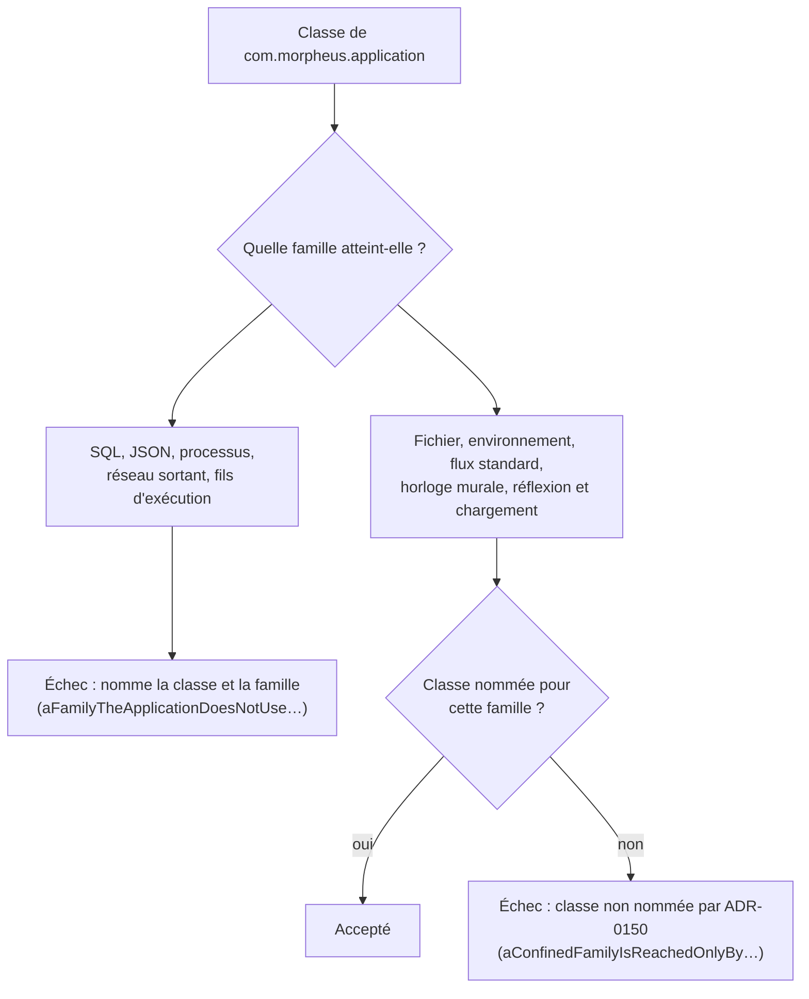
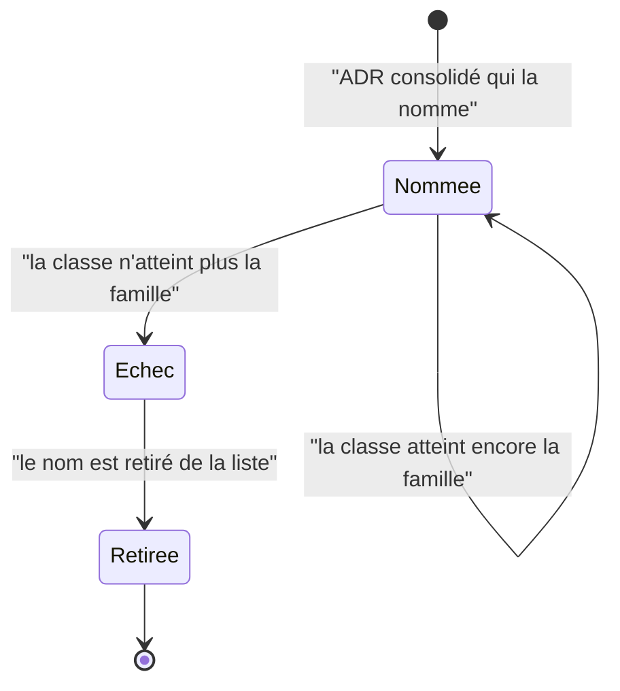

# Technologies que la couche application peut toucher (`application-technology-boundary`)

Spec de référence : [`openspec/specs/application-technology-boundary/spec.md`](../../../openspec/specs/application-technology-boundary/spec.md)
· Relevé du 2026-11-04 sur `2913fc30`, complété le 2026-11-06 (changement
`hold-every-class-list-of-a-decision-record-to-its-gate`).

## Objet et périmètre

La couche `com.morpheus.application` définit les ports ; elle n'est pas pour autant sans technologie. Une décision
d'architecture dit, famille par famille, ce qu'elle peut atteindre : une famille qu'elle n'emploie pas est refusée
dans tous ses paquets, une famille qu'elle emploie est confinée à des classes nommées, et les descriptions du dépôt
disent ce que le build impose.

- **Acteurs** : auteur d'une classe de `morpheus-application` ; relecteur ; lecteur des règles du dépôt.
- **Inclus** : les familles réseau sortant, accès fichier, environnement du processus, flux standard, fils
  d'exécution, SQL, bibliothèque JSON, exécution de processus, réflexion et chargement de classes (et l'horloge murale,
  voir [Hors spec](#comportement-vérifié-absent-de-la-spec)) ; les listes nommées ; les descriptions de la couche.
- **Exclus** : le placement d'un port quand une technologie sort ([`application-infrastructure-ports.md`](application-infrastructure-ports.md)) ;
  la réflexion hors de l'application ([`reflection-boundary.md`](reflection-boundary.md)).

## Exigences

| Alias | Exigence (titre exact) | En bref | Nature |
|---|---|---|---|
| R1 | The architecture record SHALL say what the application layer may touch | l'ADR répond par famille et nomme chaque classe actuelle avec son sort (reste, sort) | `[EXIGENCE]` |
| R2 | A technology the application does not use SHALL be refused in all of its packages | une famille non employée est refusée pour toute classe de `com.morpheus.application` | `[EXIGENCE]` |
| R3 | A technology the application does use SHALL be confined to named classes | l'ensemble nommé est exactement l'ensemble qui atteint la famille ; il rétrécit | `[EXIGENCE]` |
| R4 | The descriptions of the application layer SHALL say what is enforced | aucune description ne présente comme sans technologie une couche qui fait de l'I/O | `[EXIGENCE]` |
| R5 | Une classe que le registre de la frontière technologique nomme par un nom qualifié DOIT exister à ce nom | tout nom `paquet.Classe` d'ARCH-0150 résout dans `morpheus-application` | `[EXIGENCE]` |
| R6 | Le registre de la frontière technologique NE DOIT PAS porter de mesure périssable de ses classes nommées | ni longueur, ni total, ni numéro de ligne dans l'ADR ; la mesure datée vit dans un relevé | `[EXIGENCE]` |

## Comportement détaillé

### Familles et tenue par le build (R1, R2, R3)

`[EXISTANT VÉRIFIÉ]` `ApplicationTechnologyBoundaryArchitectureTest` décrit chaque famille par un ensemble de types,
d'appels (`CallMatcher`) et de champs de `System`, lus sur le bytecode importé de `com.morpheus.application` :

| Régime | Familles (`UNUSED_FAMILIES` / `CONFINED_FAMILIES`) | Règle |
|---|---|---|
| refusée partout | SQL, bibliothèque JSON, exécution de processus, réseau sortant, fils d'exécution | `aFamilyTheApplicationDoesNotUseIsRefusedInEveryPackage` |
| confinée à des classes nommées | accès fichier, environnement du processus, flux standard, horloge murale, réflexion et chargement de classes | `aConfinedFamilyIsReachedOnlyByTheClassesNamedForIt` et `everyNamedClassStillReachesItsFamily` |

Les ensembles de noms sont ceux du test (`CONFINED_FAMILIES`, `REFLECTION_AND_LOADING`), déclarés dette qui ne fait que
rétrécir sous ARCH-0150 (`ProductionClassListsArchitectureTest.KINDS`, clés de
[`config/debt-counter-ratchets.properties`](../../../config/debt-counter-ratchets.properties)). Un nom ajouté exige un ADR
consolidé qui remplace ARCH-0150.

`[EXISTANT VÉRIFIÉ]` L'ADR écrit les mêmes noms, qualifiés depuis `com.morpheus.application`, dans la table « Classes
nommées » de sa section Compliance and Enforcement, entre `<!-- liste ApplicationTechnologyBoundaryArchitectureTest.CONFINED_FAMILIES -->`
et `<!-- fin de liste -->` (et un second bloc pour `REFLECTION_AND_LOADING`).
`ProductionClassListsArchitectureTest#everyListADecisionRecordEnumeratesEqualsItsEnumeration` compare ces blocs aux
constantes, famille par famille et dans les deux sens ; la décision 2 renvoie à cette table au lieu de recopier les
noms, ce qui garde la section `Decision` courte.

### Noms qualifiés et mesure datée (R5, R6)

`[EXISTANT VÉRIFIÉ]` `ApplicationTechnologyBoundaryArchitectureTest#everyClassTheDecisionRecordNamesByAQualifiedNameExistsAtThatName`
lit ARCH-0150 entier, retient chaque span de code `paquet(.paquet)*.Classe` dont le premier paquet est un paquet de
`com.morpheus.application`, et exige le fichier source à ce nom ; un ADR qui n'en nomme aucun est refusé aussi. Il voit
un nom écrit hors du bloc comparé ; un nom simple périmé hors du bloc reste à la revue.

`[EXISTANT VÉRIFIÉ]` La mesure du 25/10/2026 (`b60a9286`), qui a fondé l'option C, est conservée telle qu'elle a été
écrite dans [`docs/project/research/mesure-frontiere-technologique-application-2026-10-25.md`](../../project/research/mesure-frontiere-technologique-application-2026-10-25.md) ;
l'ADR y renvoie. R6 est tenue par la revue : aucun test ne cherche une longueur ou un total dans l'ADR.

`[EXISTANT VÉRIFIÉ]` Un jumeau textuel,
`noApplicationSourceNamesReflectionOrLoadingUnlessItsClassIsNamed`, attrape le type qui ne figure que dans le
descripteur `invokedynamic` d'une lambda, que le bytecode ne voit pas.

`[EXISTANT VÉRIFIÉ]` `java.nio.file.Path` n'est pas un accès : `aPathUsedAsAValueIsNotAnAccess` exige que
`read.ProviderReadRequest` et `provider.SpecificationProvider` (ports qui portent un `Path`) n'atteignent aucune
famille.

### Cœurs déterministes (R2, scénario 2)

`[EXISTANT VÉRIFIÉ]` Les interdits textuels, plus stricts parce qu'ils refusent une simple mention, restent dans
`ReasoningPlatformArchitectureTest#reasoningCoreContainsNoTransportPersistenceOrProcessExecution` et
`PolicyPlatformArchitectureTest#policyModelContainsNoScriptSqlOrReflectionExecutionContract`.

### Descriptions (R4)

`[EXISTANT VÉRIFIÉ]` Relues à la main le 2026-11-04 : `.claude/CLAUDE.md` (« Ce n'est pas une couche sans
technologie (ADR-0150) »), `.claude/rules/architecture.md` (section « Ce que l'application touche (ADR-0150) »),
`docs/architecture/arc42/05-vue-blocs.md` (ligne Application du tableau des blocs et ligne des invariants).

### Comportement vérifié absent de la spec

- `[EXISTANT VÉRIFIÉ]` La famille **horloge murale** (`java.time.*.now()`, `Clock.system*`, `System.currentTimeMillis`)
  est confinée par le test et décidée par ARCH-0150 ; l'énumération de R1 ne la cite pas.
- `[EXISTANT VÉRIFIÉ]` Le réseau sortant et les fils d'exécution ne sont plus confinés mais **refusés** dans toute
  l'application (le transport de `update-check` est un adaptateur de `morpheus-cli`).

## Diagrammes

### Par quel régime chaque famille passe-t-elle ?

Existant vérifié. Organigramme (pas UML) : une classe de l'application qui atteint une famille est jugée par le
régime de cette famille. Exigences : R2, R3.

### Que devient un nom de la liste quand la classe change ?

Existant vérifié (`everyNamedClassStillReachesItsFamily`). Diagramme d'états d'une entrée de liste. Exigence : R3.

## Écarts et questions ouvertes

- **Scénario de R3 « A second class opens an outbound connection » (réseau sortant).** Le scénario suppose le réseau
  sortant en famille confinée et attend le message « la classe n'est pas nommée par l'ADR ». Aujourd'hui le réseau
  sortant est une famille **refusée partout** (`UNUSED_FAMILIES`) : l'échec existe, mais son message est
  « the application uses no outbound network » et non « not named by the record ». Le comportement (échec nommant la
  classe) est conforme ; le libellé du scénario décrit un état antérieur. `[QUESTION]` Reformuler le scénario avec une
  famille confinée, par exemple l'accès fichier ?
- **`arc42/05-vue-blocs.md`, ligne des invariants, contredit la décision.** La ligne `application -> file, network,
  environment, clock, reflection : named classes only (ADR-0150)` range le réseau parmi les familles atteintes par des
  classes nommées, alors que la ligne précédente et ARCH-0150 (décision 1) le refusent partout. Aucun test ne lit ce
  fichier. Preuve manquante pour R4 sur ce document.
- **Descriptions (R4) sans contrôle automatique.** Aucun test ne lit `.claude/CLAUDE.md`, la page de règles ni la vue
  des blocs pour y chercher une formule « sans technologie » ; la tenue de R4 repose sur la revue. Preuve manquante.
- **Pas d'ADR par famille exigé par test (R1).** `ProductionClassListsArchitectureTest` vérifie que l'ADR nomme la liste
  `TestClass.CHAMP` ; aucun test ne vérifie que l'ADR répond pour chacune des neuf familles de la spec. Preuve manquante.

## Traçabilité

| Exigence | Scénario | Conception ou diagramme | Changement | Preuve |
|---|---|---|---|---|
| R1 | A reader asks whether a use case may open a file | tableau des régimes | archive `2026-10-29-decide-what-technology-the-application-core-may-touch` | [ARCH-0150](../../architecture/adr/ARCH-0150-ce-que-le-coeur-applicatif-peut-toucher.md) (décision 2, accès fichier) ; revue seule : preuve automatique manquante |
| R1 | A class that does I/O has no decision | organigramme des régimes | idem | [`ApplicationTechnologyBoundaryArchitectureTest`](../../../morpheus-architecture-tests/src/test/java/com/morpheus/architecture/ApplicationTechnologyBoundaryArchitectureTest.java)`#aConfinedFamilyIsReachedOnlyByTheClassesNamedForIt` (ArchUnit) |
| R2 | A use case acquires a database dependency | organigramme des régimes | idem | `ApplicationTechnologyBoundaryArchitectureTest#aFamilyTheApplicationDoesNotUseIsRefusedInEveryPackage` (ArchUnit, famille SQL) |
| R2 | The stricter bans of the deterministic cores still hold | — | idem | [`ReasoningPlatformArchitectureTest`](../../../morpheus-architecture-tests/src/test/java/com/morpheus/architecture/m27/ReasoningPlatformArchitectureTest.java)`#reasoningCoreContainsNoTransportPersistenceOrProcessExecution` et [`PolicyPlatformArchitectureTest`](../../../morpheus-architecture-tests/src/test/java/com/morpheus/architecture/m25/PolicyPlatformArchitectureTest.java)`#policyModelContainsNoScriptSqlOrReflectionExecutionContract` (texte) |
| R3 | A second class opens an outbound connection | organigramme des régimes | idem | `ApplicationTechnologyBoundaryArchitectureTest#aFamilyTheApplicationDoesNotUseIsRefusedInEveryPackage` (famille « outbound network » : voir Écarts sur le libellé) |
| R3 | A named class no longer reaches the family | diagramme d'états | idem | `ApplicationTechnologyBoundaryArchitectureTest#everyNamedClassStillReachesItsFamily` (ArchUnit) |
| R3 | A path is not an access | — | idem | `ApplicationTechnologyBoundaryArchitectureTest#aPathUsedAsAValueIsNotAnAccess` |
| R5 | Une classe déplacée dans un autre paquet / retirée des sources / le contrôle a lu des noms | — | `hold-every-class-list-of-a-decision-record-to-its-gate` | `ApplicationTechnologyBoundaryArchitectureTest#everyClassTheDecisionRecordNamesByAQualifiedNameExistsAtThatName` (texte, dépôt réel) et `#aQualifiedNameThatResolvesToNoSourceIsRefusedAndASilentRecordToo` (corpus temporaire) |
| R6 | La mesure du 25/10/2026 quitte le registre / une famille refusée n'est attribuée à aucune classe / chaque ligne de la décision nomme ses classes | — | idem | revue seule : relecture d'ARCH-0150 ; R5 et la comparaison du bloc couvrent la part vérifiable ; preuve automatique manquante |
| R4 | The record allows local file access | — | idem | revue seule : `.claude/CLAUDE.md`, `.claude/rules/architecture.md`, [`arc42/05-vue-blocs.md`](../../architecture/arc42/05-vue-blocs.md) ; preuve automatique manquante |

## Sources

- ADR : [ARCH-0150](../../architecture/adr/ARCH-0150-ce-que-le-coeur-applicatif-peut-toucher.md) (décisions 1 à 4, section
  Compliance and Enforcement) ; l'ADR remplace ADR-0148 (archive).
- Règles du dépôt : `.claude/rules/architecture.md`, sections « Ce que l'application touche (ADR-0150) » et « Cœurs purs ».
- Pages liées : [`application-infrastructure-ports.md`](application-infrastructure-ports.md),
  [`reflection-boundary.md`](reflection-boundary.md), [`application-package-cycles.md`](application-package-cycles.md).
