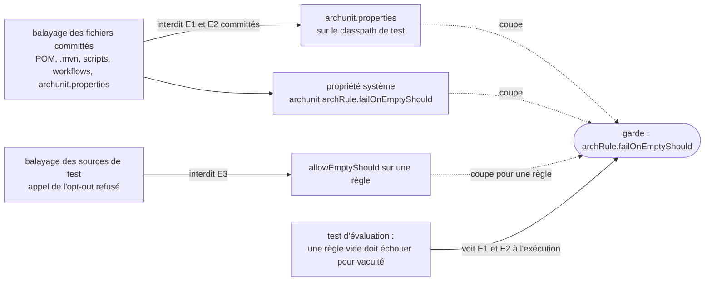

# Garde contre les règles d'architecture vides (`architecture-rule-vacuity-guard`)

Spec de référence : [`openspec/specs/architecture-rule-vacuity-guard/spec.md`](../../../openspec/specs/architecture-rule-vacuity-guard/spec.md)
· Relevé du 2026-11-04 sur `2913fc30`.

## Objet et périmètre

Une règle ArchUnit dont la sélection ne retient aucune classe passe, sauf si ArchUnit la refuse. La suite d'architecture
garantit que ce refus est actif, et refuse tout ce qui permettrait de l'éteindre : sans cela, le paquet visé par une règle
pourrait se vider ou être renommé sans que rien n'échoue.

- **Acteurs** : `AnEmptyArchitectureRuleFailsTest` (module `morpheus-architecture-tests`) ; tout mainteneur qui ajoute un
  réglage de moteur de règles, un POM, un validateur ou un workflow.
- **Inclus** : la preuve par évaluation d'une règle vide, l'interdit de l'opt-out par règle, l'interdit d'un réglage
  committé qui éteint la garde pour une invocation des gates.
- **Exclus** : le choix du mécanisme d'enforcement (voir [`enforcement-mechanism-accounting.md`](enforcement-mechanism-accounting.md)) ;
  les règles des filesystem (la garde ne les couvre pas, d'où les assertions de population non vide de chaque règle de
  fichier de la suite).

## Exigences

| Alias | Exigence (titre exact) | En bref | Nature |
|---|---|---|---|
| R1 | A rule of the architecture suite that retains no class SHALL fail, and the suite SHALL prove it by evaluating one | une règle vide est évaluée dans la configuration des gates, et le test n'accepte que l'échec pour vacuité | `[EXIGENCE]` |
| R2 | No rule of the suite SHALL opt out of failing when it retains no class | aucun appel de l'opt-out par règle dans les sources de test | `[EXIGENCE]` |
| R3 | No committed setting SHALL disable the guard for any invocation of the gates | aucun fichier committé ne met la garde à `false` | `[EXIGENCE]` |

## Comportement détaillé

### Les trois entrées du réglage

`[EXISTANT VÉRIFIÉ]` Dans ArchUnit (la version est celle de la propriété `archunit.version` du POM racine, qui relève de
`.claude/rules/build.md`), la garde `archRule.failOnEmptyShould` se coupe par le fichier `archunit.properties` à la racine du
classpath de test, par la propriété système `archunit.archRule.failOnEmptyShould`, ou par l'appel `allowEmptyShould(true)` sur
une règle. Seule la valeur `false`, quelle que soit la casse, coupe la garde. Le test couvre les trois entrées :

- la première (évaluer une règle vide) tient contre les deux entrées globales et contre un changement du défaut de la bibliothèque ;
- la deuxième (balayer le code) tient contre l'opt-out par règle ;
- la troisième (balayer les fichiers committés) tient contre un réglage global qui ne s'appliquerait qu'à une autre invocation.

### R1 : preuve par évaluation

`[EXISTANT VÉRIFIÉ]` `aRuleThatSelectsNoClassFailsForHavingCheckedNone` importe `com.morpheus.domain`, vérifie que l'import n'est
pas vide, évalue une règle sur un paquet inexistant et exige une `AssertionError` dont le message contient
`failed to check any classes`. Le texte n'est pas une API de la bibliothèque : le commentaire de la classe demande de relire
`ArchRule.SimpleArchRule#verifyNoEmptyShouldIfEnabled` quand `archunit.version` change.

### R2 : opt-out par règle

`[EXISTANT VÉRIFIÉ]` Le balayage lit tous les `.java` de `morpheus-architecture-tests/src/test/java` après avoir blanchi les
commentaires et les littéraux, et refuse un appel `.allowEmptyShould(` en nommant `fichier:ligne`.

### R3 : réglages committés

`[EXISTANT VÉRIFIÉ]` Les fichiers balayés (hors sorties générées, par `RepositoryTree`) sont : tout `archunit.properties`, tout
`pom.xml`, `.mvn/`, `scripts/` et `.github/workflows/`. Pour un `archunit.properties`, la ligne
`archRule.failOnEmptyShould` doit valoir `true` ; pour les autres, la propriété système `archunit.archRule.failOnEmptyShould`
passée en `-D…=` ou écrite comme élément `<…>` ne doit jamais valoir autre chose que `true`. Le dépôt ne contient aucun
`archunit.properties` : le balayage n'en trouve donc aucun à juger ; les fixtures prouvent qu'il refuserait `false`, accepterait
`true` et un autre réglage.

## Diagrammes

### Par où la garde peut-elle être éteinte, et qui la défend ?

Existant vérifié, lu dans `AnEmptyArchitectureRuleFailsTest`. Organigramme. Exigences R1, R2, R3.

Le test d'évaluation voit les deux entrées globales à l'exécution mais pas l'opt-out par règle ni un réglage qui ne vaudrait que
pour une autre invocation : ce sont les deux balayages (R2, R3) qui les ferment.

## Écarts et questions ouvertes

1. **Fichiers balayés plus larges que la spec.** `[EXISTANT VÉRIFIÉ]` R3 nomme « a configuration file of the architecture rule
   engine, a POM, a validator or a workflow ». Le balayage lit aussi `.mvn/`. Un dossier de réglages de Maven est une
   invocation des gates, donc l'extension est cohérente, mais elle n'est pas dans la spec.
2. **Le scénario « A validator passes the setting on its command line » est joué sur des chaînes.** Aucun script ou workflow
   réel ne porte le réglage ; `theSettingScanRefusesOffAndAcceptsTrueAndOtherProperties` prouve le balayage sur des textes
   fabriqués, `noCommittedSettingTurnsTheGuardOffForAnyInvocationOfTheGates` le lance sur le dépôt réel.
3. **Aucun `archunit.properties` committé.** `[EXISTANT VÉRIFIÉ]` Le scénario « A property file for another setting » (réglage
   `cycles.maxNumberToDetect`) n'est exercé que par une chaîne ; il n'existe pas de fichier réel qui le serve.
4. **Garde du test contre la dérive de message.** Le test d'évaluation dépend du texte `failed to check any classes`. Un
   changement de texte de la bibliothèque le fait échouer avec la consigne de relire la méthode ArchUnit. Aucun écart de
   comportement, mais un couplage à un message tiers.
5. **« The guard is disabled globally ».** Aucun test ne positionne la propriété système ni ne dépose un fichier de réglage
   pour constater l'échec attendu ; la preuve est la configuration réelle des gates qui laisse la garde active.
6. **Hors périmètre de la garde.** La garde ne s'applique pas aux règles de fichier : chaque règle de fichier de la suite
   doit donc affirmer elle-même que sa population n'est pas vide (voir `GateReachabilityArchitectureTest` par exemple).

## Traçabilité

Archive : `2026-10-29-prove-that-an-empty-architecture-rule-fails`. Fichier de test :
[`AnEmptyArchitectureRuleFailsTest`](../../../morpheus-architecture-tests/src/test/java/com/morpheus/architecture/AnEmptyArchitectureRuleFailsTest.java).

| Exigence | Scénario | Conception ou diagramme | Preuve |
|---|---|---|---|
| R1 | The guard is active | organigramme | `#aRuleThatSelectsNoClassFailsForHavingCheckedNone` |
| R1 | The guard is disabled globally | idem | même méthode (message d'échec « a rule that selects nothing now passes ») ; entrée globale jouée : **preuve manquante** (Écart 5) |
| R1 | The vacuous rule fails for another reason | idem | même méthode (vérifie que l'import n'est pas vide et que le message contient la vacuité) |
| R2 | A rule is allowed to be empty | idem | `#noRuleOfTheSuiteOptsOutOfFailingWhenItSelectsNothing` (nomme `fichier:ligne`) |
| R2 | The opt-out is only mentioned | idem | `#anOptOutNamedInACommentOrALiteralIsNotACall` |
| R3 | A property file turns the guard off | idem | `#noCommittedSettingTurnsTheGuardOffForAnyInvocationOfTheGates` ; refus joué : `#theSettingScanRefusesOffAndAcceptsTrueAndOtherProperties` |
| R3 | A validator passes the setting on its command line | idem | mêmes deux méthodes (Écart 2) |
| R3 | A property file for another setting | idem | `#theSettingScanRefusesOffAndAcceptsTrueAndOtherProperties` (`cycles.maxNumberToDetect=50`, Écart 3) |

## Sources

- Règles du dépôt : `.claude/rules/architecture.md` (garde `archRule.failOnEmptyShould` à ne pas désactiver),
  `.claude/rules/build.md`.
- Pages liées : [`enforcement-mechanism-accounting.md`](enforcement-mechanism-accounting.md),
  [`refusal-test-evidence.md`](refusal-test-evidence.md).
- Archive OpenSpec : `2026-10-29-prove-that-an-empty-architecture-rule-fails`.
