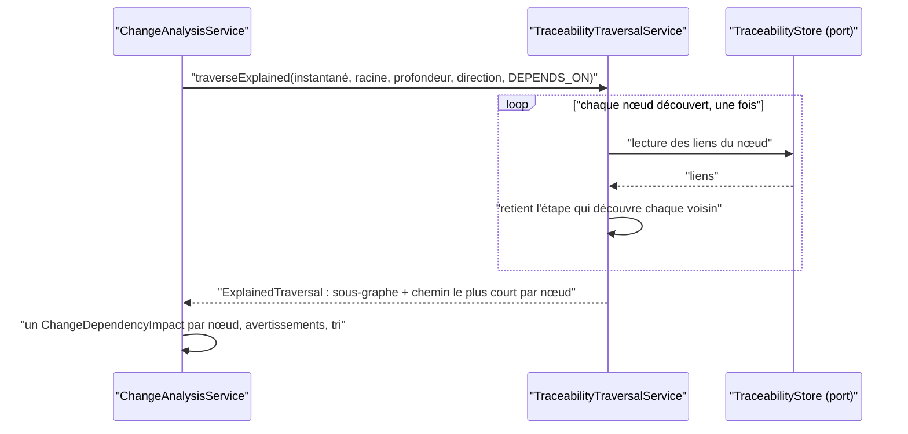
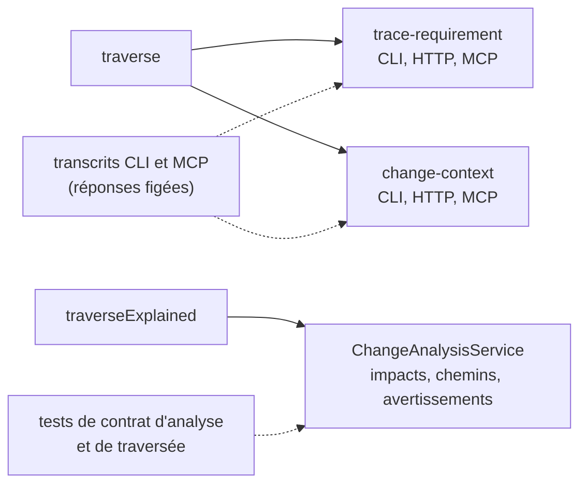

# Coût de l'explication des dépendances d'un changement (`change-analysis-traversal-cost`)

Spec de référence : [`openspec/specs/change-analysis-traversal-cost/spec.md`](../../../openspec/specs/change-analysis-traversal-cost/spec.md)
· Relevé du 2026-11-04 sur `2913fc30`.

## Objet et périmètre

L'analyse d'un changement (`ChangeAnalysisService`) liste, pour chaque exigence modifiée ou retirée, les exigences dont
elle dépend et celles qui en dépendent, avec le chemin le plus court qui les relie. La capacité fixe ce que coûte cette
explication en lectures du store de traçabilité, et que l'explication ne change pas.

- **Acteurs** : `ChangeAnalysisService`, `TraceabilityTraversalService` (`traverse`, `traverseExplained`),
  `ExplainedTraversal`, le port `TraceabilityStore`.
- **Inclus** : le nombre de lectures du store par exigence et par direction, l'égalité des impacts, chemins, ordre et
  avertissements, l'identité des réponses de `trace-requirement` et `change-context`.
- **Exclus** : le coût d'une lecture du store (filtre de relation, requête de preuve par lien, côté SQLite), les bornes
  de nœuds et de liens elles-mêmes, l'exposition HTTP ou MCP de l'analyse.

## Exigences

| Alias | Exigence (titre exact) | En bref | Nature |
|---|---|---|---|
| R1 | Explaining the dependencies of a change SHALL cost no more store reads than finding them | lectures du store au plus proportionnelles aux nœuds découverts, sans nouvelle recherche par nœud | `[EXIGENCE]` |
| R2 | The analysis of a change SHALL return what it returned | impacts, chemins, ordre et avertissements identiques pour un même instantané, une même proposition et une même profondeur | `[EXIGENCE]` |
| R3 | Answers that embed a traversal SHALL NOT change shape | les réponses de `trace-requirement` et `change-context` restent identiques sur chaque transport | `[EXIGENCE]` |

## Comportement détaillé

- `[EXISTANT VÉRIFIÉ]` Pour chaque delta et chaque direction (`DEPENDENCY` sortante, `DEPENDENT` entrante),
  `ChangeAnalysisService.collectDependencyDirection` appelle `TraceabilityTraversalService.traverseExplained` **une fois**,
  limité à la relation `DEPENDS_ON`. `ExplainedTraversal` rend le sous-graphe et, pour chaque nœud atteint, le chemin
  le plus court reconstruit en mémoire à partir de l'étape qui l'a découvert. Plus aucun appel de recherche de chemin
  par nœud n'existe dans le code de production (`findPath` n'existe plus).
- `[EXISTANT VÉRIFIÉ]` Chaque impact est un `ChangeDependencyImpact` (exigence d'origine, direction, entité atteinte,
  chemin). Un chemin dont une étape n'est pas `RESOLVED` ajoute l'avertissement `TRACEABILITY_PATH_PARTIALLY_RESOLVED`
  (détails : direction, profondeur, cible, instantané). Une traversée arrêtée par un budget ajoute
  `TRACEABILITY_TRAVERSAL_TRUNCATED` avec la raison de troncature de la traversée.
- `[EXISTANT VÉRIFIÉ]` Les impacts sont triés (exigence d'origine, direction, entité atteinte, profondeur) avant
  d'être rendus.
- `[EXISTANT VÉRIFIÉ]` Bornes de la traversée : `TraceabilityTraversalService.MAX_NODES` et `MAX_LINKS` ; raisons
  `NODE_BUDGET_REACHED:<n>`, `LINK_BUDGET_REACHED:<n>`, `DEPTH_BUDGET_REACHED:<profondeur>`.
- `[EXISTANT VÉRIFIÉ]` `trace-requirement` (`TraceRequirementService`) et `change-context`
  (`ChangeContextQueryService`) appellent `traverse`, pas `traverseExplained` ; seule l'analyse utilise la variante qui
  explique.
- `[EXISTANT VÉRIFIÉ]` Le budget de temps est tenu hors du build ordinaire, par la voie nocturne M19
  (`M19TraceabilityPerformanceGate`) ; la borne est écrite dans
  [`M19_PERFORMANCE_BUDGETS.md`](../../project/roadmap/M19_PERFORMANCE_BUDGETS.md) (constante `ANALYSIS_BUDGET_NANOS`).

## Diagrammes

### Combien de fois l'analyse interroge-t-elle le store pour une exigence et une direction ?

Existant vérifié par lecture de `ChangeAnalysisService` et de `TraceabilityTraversalService`. Exigence R1.

Les lectures suivent les nœuds découverts ; les chemins sont reconstruits en mémoire, sans relire le store (R1).

### Quelles réponses publiques dépendent de la traversée, et lesquelles sont figées ?

Existant vérifié. Exigences R2 et R3. Organigramme, pas UML.

Les flèches pleines sont des appels de production, les pointillées des preuves.

## Écarts et questions ouvertes

- `[EXISTANT VÉRIFIÉ]` **Troncature par le budget de liens, côté analyse.** Le scénario « A truncated traversal still
  explains what it found » vise les deux budgets. Les tests de l'analyse posent la troncature par profondeur
  (`ChangeAnalysisServiceTest#aDependencyChainDeeperThanTheRequestedDepthIsReportedAsTruncated`), et la traversée
  expliquée n'est testée que contre le budget de nœuds
  (`TraceabilityTruncationContractTest#anExplainedTraversalPastItsNodeBudgetSaysSoAndExplainsOnlyTheNodesItReported`).
  **Preuve manquante** pour le budget de liens d'une traversée expliquée et pour l'avertissement
  `TRACEABILITY_TRAVERSAL_TRUNCATED` à la raison de nœuds ou de liens dans l'analyse.
- `[EXISTANT VÉRIFIÉ]` **Réponses par transport.** R3 vise « every transport ». Le CLI et le MCP sont figés par des
  transcrits (`CliCommandTranscriptTest`, `McpToolTranscriptTest`) ; côté HTTP, la route `trace` n'est exercée que par
  des tests d'intégration qui ne comparent pas la réponse à une référence
  (`MorpheusApiProjectSyncIntegrationTest#registersSyncsQueriesAndReopensEntireHeadlessSurface`). **Preuve manquante**
  pour une référence figée HTTP, et pour `change-context` en HTTP.
- `[EXISTANT VÉRIFIÉ]` Les formulations « same as before » de R2 et R3 comparent à un état antérieur que le dépôt ne
  conserve que par ses tests ; l'égalité de chemins entre l'ancienne recherche par nœud et la reconstruction n'est plus
  rejouable (l'ancienne recherche n'existe plus). `[QUESTION]` Reformuler ces exigences en propriétés
  (« le chemin est le plus court, départagé par l'ordre canonique des entités ») ou conserver les références figées.
- `[EXISTANT VÉRIFIÉ]` Le gate de temps (scénario « The time is held by the budget ») ne tourne pas dans `clean verify` ;
  il est porté par la voie nocturne (`.claude/rules/testing.md`, budgets M19).

## Traçabilité

| Exigence | Scénario | Conception ou diagramme | Changement | Preuve |
|---|---|---|---|---|
| R1 | Twice the dependencies, at most twice the reads | séquence | archive `2026-10-17-explain-every-dependency-from-one-traversal` | [`ChangeAnalysisTraversalCostTest`](../../../morpheus-architecture-tests/src/test/java/com/morpheus/architecture/ChangeAnalysisTraversalCostTest.java)`#doublingTheDependencyChainAtMostDoublesTheStoreReadsOfTheAnalysis` |
| R1 | The count is checked on every build | séquence | idem | même test (message d'échec : les deux comptes comparés) ; ne tourne pas hors du module d'architecture |
| R1 | The time is held by the budget | séquence | idem | [`M19TraceabilityPerformanceGate`](../../../morpheus-architecture-tests/src/test/java/com/morpheus/architecture/m19/M19TraceabilityPerformanceGate.java)`#changeAnalysisOverDependencyMeshesAtTheNodeBudgetStaysWithinBudget` (voie nocturne) |
| R2 | Two shortest paths lead to one entity | organigramme | idem | [`TraceabilityTraversalContractTest`](../../../morpheus-architecture-tests/src/test/java/com/morpheus/architecture/TraceabilityTraversalContractTest.java)`#anExplainedTraversalChoosesADeterministicShortestPath` ; [`ChangeAnalysisContractTest`](../../../morpheus-architecture-tests/src/test/java/com/morpheus/architecture/ChangeAnalysisContractTest.java)`#sqliteReopenAndCompactJsonRemainByteDeterministic` |
| R2 | A path through an unresolved link is still reported | organigramme | idem | `ChangeAnalysisContractTest#expandsOnlyExplicitDependsOnAndKeepsShortestBoundedExplanationPaths` (avertissement `TRACEABILITY_PATH_PARTIALLY_RESOLVED`) |
| R2 | A truncated traversal still explains what it found | organigramme | idem | nœuds : [`TraceabilityTruncationContractTest`](../../../morpheus-architecture-tests/src/test/java/com/morpheus/architecture/TraceabilityTruncationContractTest.java)`#anExplainedTraversalPastItsNodeBudgetSaysSoAndExplainsOnlyTheNodesItReported` ; profondeur : [`ChangeAnalysisServiceTest`](../../../morpheus-application/src/test/java/com/morpheus/application/analysis/ChangeAnalysisServiceTest.java)`#aDependencyChainDeeperThanTheRequestedDepthIsReportedAsTruncated` ; liens : **preuve manquante** |
| R3 | The trace of a requirement is unchanged | organigramme | idem | CLI : [`CliCommandTranscriptTest`](../../../morpheus-cli/src/test/java/com/morpheus/cli/CliCommandTranscriptTest.java)`#eachCommandPrintsAndRefusesAsItsTranscriptSays` (cas `trace-requirement-*`, `change-context-*`) ; MCP : [`McpToolTranscriptTest`](../../../morpheus-mcp/src/test/java/com/morpheus/mcp/McpToolTranscriptTest.java)`#eachToolAnswersAndRefusesAsItsTranscriptSays` ; HTTP : **preuve manquante** pour une référence figée |

## Sources

- Archive OpenSpec : `2026-10-17-explain-every-dependency-from-one-traversal` (conception : décisions 1 à 5 ; la tâche
  de référence par transport y est notée non réalisée).
- Budgets : [`M19_PERFORMANCE_BUDGETS.md`](../../project/roadmap/M19_PERFORMANCE_BUDGETS.md).
- ADR : [ADR-0108](../../architecture/adr/archive/0108-a-response-says-what-it-could-not-observe.md), archivé, cité par la conception archivée (bornes de traversée).
- Pages liées : [`public-surface-convergence.md`](public-surface-convergence.md).
