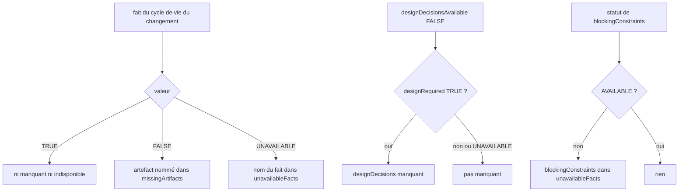
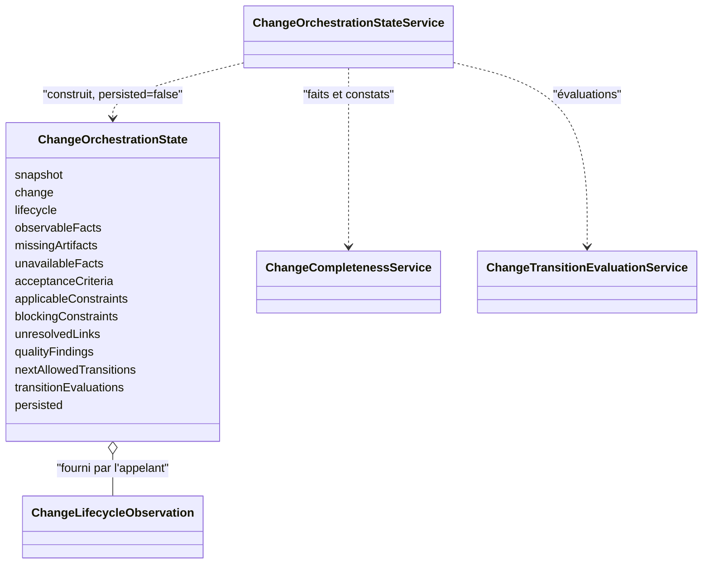

# État d'orchestration d'un changement (`change-orchestration-state`)

Spec de référence : [`openspec/specs/change-orchestration-state/spec.md`](../../../openspec/specs/change-orchestration-state/spec.md)
· Relevé du 2026-11-04 sur `2913fc30`.

## Objet et périmètre

MORPHEUS expose à JARVIS et aux autres consommateurs d'orchestration une observation compacte, en lecture seule, du
snapshot publié : un fait inconnu reste distinct d'une absence réelle, et rien n'est inventé.

- **Acteurs** : JARVIS (consommateur) ; appelant CLI, MCP ou HTTP qui fournit éventuellement l'état de cycle de vie.
- **Inclus** : construction de `ChangeOrchestrationState` à partir du snapshot `ACTIVE`, faits observables, artefacts
  manquants, critères d'acceptation, contraintes, liens non résolus, évaluation des transitions.
- **Exclus** : mutation du cycle de vie (`WRITE_CHANGE` + confirmation + CAS, autre capacité) ; le verdict d'une seule
  transition (`evaluate_change_transition`, route `transition-check`).

## Exigences

| Alias | Exigence (titre exact) | En bref | Nature |
|---|---|---|---|
| R1 | The orchestration state is a read-only observation of the active snapshot | construit du seul snapshot `ACTIVE`, `persisted=false`, aucune mutation | `[EXIGENCE]` |
| R2 | The orchestration state exposes a fixed set of fields | quatorze champs exacts ; neuf faits en `TRUE`, `FALSE` ou `UNAVAILABLE` | `[EXIGENCE]` |
| R3 | A missing artifact is a fact that is FALSE, never one that is unavailable | `missingArtifacts` seulement pour un fait `FALSE` ; `UNAVAILABLE` va dans `unavailableFacts` | `[EXIGENCE]` |
| R4 | Acceptance criteria are counted from explicit criteria only | un `Scenario` n'est pas un critère ; l'état de vérification n'est pas une sémantique de blocage | `[EXIGENCE]` |
| R5 | Constraints are qualified by their explicit blocking semantics | contraintes triées par identité ; `UNKNOWN` jamais bloquant | `[EXIGENCE]` |
| R6 | The blocking status SHALL say how much of the blocking semantics is known | `AVAILABLE`, `PARTIALLY_AVAILABLE` ou `UNKNOWN`, avec un compte observé | `[EXIGENCE]` |
| R7 | Unresolved links are listed without a live resolution | liens et références externes non `RESOLVED`, triés par type puis identité, sans résolveur | `[EXIGENCE]` |
| R8 | Transitions are evaluated from the supplied lifecycle state | état fourni par l'appelant, jamais inféré ; seules les évaluations `ALLOWED` sont retenues | `[EXIGENCE]` |

## Comportement détaillé

`[EXISTANT VÉRIFIÉ]` (`ChangeOrchestrationStateService.active`, `ChangeOrchestrationState`) :

- **R1** : `active(projectId, changeId, lifecycle)` rend `Optional.empty()` sans snapshot actif. Un changement absent du
  snapshot actif lève `KnowledgeStoreException("change not found in ACTIVE snapshot: <id>")`. Le constructeur compact
  de l'enregistrement refuse `persisted=true`, et le service passe toujours `false`.
- **R2** : le record porte exactement `snapshot`, `change`, `lifecycle`, `observableFacts`, `missingArtifacts`,
  `unavailableFacts`, `acceptanceCriteria`, `applicableConstraints`, `blockingConstraints`, `unresolvedLinks`,
  `qualityFindings`, `nextAllowedTransitions`, `transitionEvaluations`, `persisted`. Les neuf clés de `observableFacts`
  sont celles de la spec.
- **R3** : `missingArtifacts` nomme `requirements`, `criticalConstraints`, `acceptanceCriteria`, `implementationPlan`
  pour un fait `FALSE`, et `designDecisions` seulement si `designRequired` est `TRUE` et `designDecisionsAvailable` est
  `FALSE`. `unavailableFacts` reprend les faits `UNAVAILABLE`, ajoute `blockingConstraints` quand son statut n'est pas
  `AVAILABLE`, sans doublon, trié.
- **R4** : `acceptanceCriteria` a toujours le statut `AVAILABLE`, `observedCount` compte les critères explicites du
  changement dans le contenu du snapshot ; la raison diffère selon que le compte est nul ou non.
- **R5 et R6** : contraintes triées par identité textuelle. Statut : aucune contrainte -> `AVAILABLE`, 0 ; toutes
  explicites -> `AVAILABLE` ; certaines inconnues -> `PARTIALLY_AVAILABLE` ; toutes inconnues -> `UNKNOWN`, 0. Le
  compte vient de `Constraint.isViolatedExplicitBlockingPolicy` ; l'inconnu vient de `hasKnownBlocking` (décision de
  blocage écrite sur le domaine, ADR-0082).
- **R7** : liens sortants du changement dont la résolution n'est pas `RESOLVED` (`kind=TRACEABILITY`) et références
  externes dont `findByOwner` n'est pas résolu (`kind=EXTERNAL_REFERENCE`) ; tri par type puis identité.
- **R8** : sans état fourni (`ChangeLifecycleObservation.unavailable()`), `transitionEvaluations` et
  `nextAllowedTransitions` sont vides. Sinon chaque autre état est évalué sous `ChangeLifecyclePolicy.forwardOnly()` par
  `ChangeTransitionEvaluationService.evaluateActive` et seuls les `ALLOWED` sont retenus.
- **Hors spec, vérifié** : un snapshot publié sans projection de contenu métier est un échec de store ; une
  observation `ABANDONED` exige une raison ; les adaptateurs transforment l'absence de snapshot actif en
  `project has no ACTIVE snapshot: <projet>` (API, CLI, MCP).

## Diagrammes

### Comment le service classe-t-il un fait ?

Existant vérifié (`missingArtifacts`, `unavailableFacts`). Exigences : R3, R6.

### Que contient l'état et d'où vient chaque partie ?

Existant vérifié (`ChangeOrchestrationState`). Exigences : R1, R2.

## Écarts et questions ouvertes

- `[EXISTANT VÉRIFIÉ]` **Exigence de plus de 500 caractères.** Le brief du lot signale que
  `openspec validate --strict` échoue sur quatre specs pour une exigence trop longue. Sur ce relevé, la commande
  `openspec validate --specs --strict` passe pour `change-orchestration-state` ; rien n'est corrigé ici.
- `[EXISTANT VÉRIFIÉ]` **Preuve manquante : refus de `persisted=true`.** Aucun test ne construit un
  `ChangeOrchestrationState` avec `persisted=true` pour observer le refus (le message n'apparaît que dans la source).
- `[EXISTANT VÉRIFIÉ]` **Preuve manquante : les trois scénarios de R3 sur des faits précis.** Seul le cas
  `acceptanceCriteria` `FALSE` -> manquant est prouvé (`JarvisOrchestrationContractTest`) ; aucun test ne couvre
  `requirements` manquant, `planPresent` `UNAVAILABLE` hors de `missingArtifacts`, ni `designDecisions` quand
  `designRequired` est `UNAVAILABLE`.
- `[EXISTANT VÉRIFIÉ]` Preuve partielle pour « Every lifecycle fact is reported » : les tests lisent quelques clés ou
  vérifient que la carte n'est pas vide, aucun n'asserte les neuf clés exactes.
- `[EXISTANT VÉRIFIÉ]` « A change with scenarios but no explicit criterion » : le compte 0 est asserté sur des fixtures
  sans critère explicite ; aucun test ne place des `Scenario` OpenSpec dans le snapshot pour prouver qu'ils ne sont pas
  comptés.
- `[EXISTANT VÉRIFIÉ]` « An unknown evaluation is not an allowed transition » : prouvé sur le service d'évaluation
  (`unknownConstraintNeverBecomesBlockedOrSilentlyAllowed`) mais pas sur l'état d'orchestration qui filtre les
  évaluations ; aucun test d'état n'asserte qu'une cible `UNKNOWN` figure dans `transitionEvaluations` et pas dans
  `nextAllowedTransitions`.
- `[EXISTANT VÉRIFIÉ]` « A persisted orchestration state... building it MUST NOT mutate the snapshot » : aucun test ne
  compare le snapshot avant et après ; le service ne dépend que de ports de lecture (`SpecificationKnowledgeStore`,
  magasins de contenu, de traçabilité, de références).
- `[EXISTANT VÉRIFIÉ]` « no resolver is called » (R7) : le service n'a aucune dépendance de résolveur ; aucun test ne
  l'asserte autrement que par cette absence de dépendance.
- `[EXISTANT VÉRIFIÉ]` Écart de forme entre la spec (« no orchestration state is returned ») et les surfaces
  publiques : l'API, la CLI et l'outil MCP rendent un échec nommé `project has no ACTIVE snapshot` au lieu d'une
  réponse vide.
- `[QUESTION]` L'origine de la capacité est le jalon M14 (`docs/project/roadmap/M14_EXECUTION.md`) et l'ADR archivé
  `docs/architecture/adr/archive/0079-nondestructive-change-orchestration-state.md` ; aucun changement OpenSpec archivé
  ne porte cette spec.

## Traçabilité

| Exigence | Scénario | Conception ou diagramme | Changement | Preuve |
|---|---|---|---|---|
| R1 | No active snapshot | classes | jalon M14, pas de changement archivé | [`ChangeOrchestrationStateServiceTest`](../../../morpheus-application/src/test/java/com/morpheus/application/orchestration/ChangeOrchestrationStateServiceTest.java)`#withoutAnActiveSnapshotThereIsNoStateAndAnUnknownChangeIsRefusedByName` |
| R1 | A change absent from the active snapshot | classes | idem | même test (préfixe du message `change not found in ACTIVE snapshot`) |
| R1 | A persisted orchestration state is refused | classes | idem | Preuve manquante ; `persisted=false` asserté par `ChangeOrchestrationStateServiceTest#aChangeWithoutConstraintsHasNothingBlockingAndNoTransitionWithoutAnObservedState` |
| R2 | Every lifecycle fact is reported | classes | idem | [`JarvisOrchestrationContractTest`](../../../morpheus-architecture-tests/src/test/java/com/morpheus/architecture/JarvisOrchestrationContractTest.java)`#stateNeverInfersLifecycleAndKeepsUnknownConstraintSemanticsExplicit` (preuve partielle) |
| R3 | An established absence | organigramme des faits | idem | `JarvisOrchestrationContractTest#stateNeverInfersLifecycleAndKeepsUnknownConstraintSemanticsExplicit` pour `acceptanceCriteria` ; `requirements` : preuve manquante |
| R3 | An unknown fact | idem | idem | Preuve manquante (`planPresent`) ; `unavailableFacts` sans `acceptanceCriteriaDefined` asserté par le test ci-dessus |
| R3 | Design decisions when the design requirement is unknown | idem | idem | Preuve manquante |
| R4 | A change with scenarios but no explicit criterion | classes | idem | `ChangeOrchestrationStateServiceTest#aChangeWithoutConstraintsHasNothingBlockingAndNoTransitionWithoutAnObservedState` (compte 0) ; scénarios OpenSpec dans le snapshot : preuve manquante |
| R5 | An unknown semantics is listed and not counted as blocking | organigramme des faits | idem | `ChangeOrchestrationStateServiceTest#explicitConstraintsCountTheViolatedBlockingOnesAndUnknownSemanticsAreNeverBlocking` ; `JarvisOrchestrationContractTest#stateExposesConstraintPolicySeverityAndEvidence` |
| R6 | No constraint | idem | idem | `ChangeOrchestrationStateServiceTest#aChangeWithoutConstraintsHasNothingBlockingAndNoTransitionWithoutAnObservedState` |
| R6 | Constraints without semantics | idem | idem | `ChangeOrchestrationStateServiceTest#explicitConstraintsCountTheViolatedBlockingOnesAndUnknownSemanticsAreNeverBlocking` ; `JarvisOrchestrationContractTest#stateNeverInfersLifecycleAndKeepsUnknownConstraintSemanticsExplicit` (`blockingConstraints` dans `unavailableFacts`) |
| R6 | A violated explicit blocking constraint | idem | idem | `ChangeOrchestrationStateServiceTest#explicitConstraintsCountTheViolatedBlockingOnesAndUnknownSemanticsAreNeverBlocking` |
| R7 | An unresolved external reference | classes | idem | `JarvisOrchestrationContractTest#stateExposesConstraintPolicySeverityAndEvidence` (types et ordre) ; `ChangeOrchestrationStateServiceTest#anUnresolvedLinkOfTheChangeIsListedAndAResolvedOneIsNot` (liens de traçabilité) ; absence d'appel de résolveur : preuve manquante |
| R8 | No lifecycle state supplied | classes | idem | `JarvisOrchestrationContractTest#stateNeverInfersLifecycleAndKeepsUnknownConstraintSemanticsExplicit` ; [`MorpheusJarvisOrchestrationApiContractTest`](../../../morpheus-api/src/test/java/com/morpheus/api/MorpheusJarvisOrchestrationApiContractTest.java)`#orchestrationStateKeepsLifecycleAndLegacyConstraintPolicyUnavailableUnlessCallerSuppliesLifecycle` ; [`MorpheusJarvisOrchestrationCliTest`](../../../morpheus-cli/src/test/java/com/morpheus/cli/command/MorpheusJarvisOrchestrationCliTest.java)`#stateCommandKeepsLifecycleAndLegacyConstraintPolicyUnavailableUnlessExplicitlySupplied` |
| R8 | An unknown evaluation is not an allowed transition | classes | idem | `JarvisOrchestrationContractTest#unknownConstraintNeverBecomesBlockedOrSilentlyAllowed` (service d'évaluation) ; filtrage de l'état : preuve manquante |

Surface publique : lignes `orchestration.state` et `orchestration.transition` de
[`contracts/public-surfaces.tsv`](../../../contracts/public-surfaces.tsv).

## Sources

- ADR : [BE-0119](../../architecture/adr/BE-0119-cycle-de-vie-des-changements-et-transition-tri-etat.md).
- Plan du jalon : [`../../project/roadmap/M14_EXECUTION.md`](../../project/roadmap/M14_EXECUTION.md).
- Contrat HTTP : [`../reference/openapi/morpheus-v1.yaml`](../reference/openapi/morpheus-v1.yaml) (opération `getChangeOrchestrationState`).
