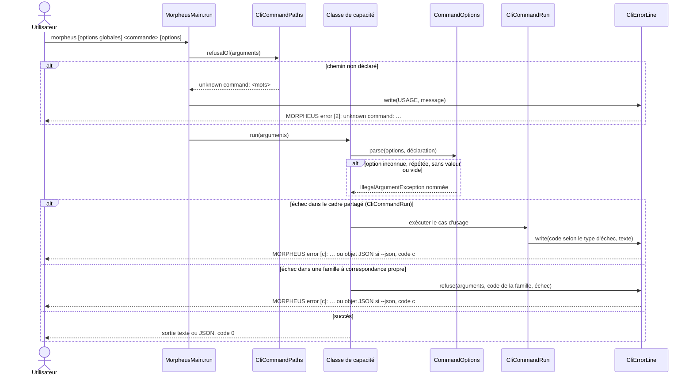

# Base d'arguments de la CLI (`cli-argument-base`)

Spec de référence : [`openspec/specs/cli-argument-base/spec.md`](../../../openspec/specs/cli-argument-base/spec.md)
· Relevé du 2026-11-03 sur `ef006fb7`, avec le changement OpenSpec `report-every-cli-failure-through-one-error-line`
(actif, implémenté dans l'arbre de travail, non archivé).

## Objet et périmètre

Ce que toutes les sous-commandes de la CLI partagent quand elles lisent leurs arguments et rapportent un échec, et
ce qui refuse une sous-commande qui en garde sa propre copie.

- **Acteurs** : utilisateur de la CLI `morpheus` ; script qui lit son code de sortie ou sa sortie JSON.
- **Inclus** : jeton de commande, analyse des options, ligne d'erreur et code de sortie, interdits d'architecture.
- **Exclus** : le contenu des réponses de chaque commande ; la liste des chemins de commande (voir
  [`public-surface-convergence`](public-surface-convergence.md)).

## Exigences

| Alias | Exigence (titre exact) | En bref | Nature |
|---|---|---|---|
| R1 | Every CLI failure SHALL be reported through one error line | une ligne, un format, un écrivain, lanceurs compris ; texte = message, ou nom du type si le message est vide ; codes de sortie inchangés | `[EXIGENCE]` ; texte modifié par le changement actif |
| R2 | The command token SHALL be read in one place | premier argument qui n'est ni une option globale ni sa valeur, lu par un seul lecteur | `[EXIGENCE]` |
| R3 | A sub-command SHALL declare its options to one shared parser | options déclarées à `CommandOptions` ; refus nommés de l'option inconnue, répétée, sans valeur, vide | `[EXIGENCE]` |
| R4 | The same malformed input SHALL be refused the same way by every sub-command | même refus partout, sauf différence déclarée et testée | `[EXIGENCE]` |
| R5 | A private copy of the argument base SHALL be refused | le build refuse une copie des aides, une seconde écriture du format, un analyseur privé | `[EXIGENCE]` |
| R6 | Aucune commande n'écrit son propre préfixe d'erreur | le build refuse un littéral `"MORPHEUS …error…` hors de `CliErrorLine.java` | `[PROPOSITION]` ajoutée par le changement actif |

## Comportement détaillé

`[EXISTANT VÉRIFIÉ]` (`morpheus-cli/src/main/java/com/morpheus/cli/command/`) :

- **Ligne d'erreur** (`CliErrorLine`) : texte `MORPHEUS error [<code>]: <message>` ; avec `--json`, un objet
  `{"exitCode":…,"code":"…","message":"…"}`. Le texte d'un échec est son message, ou le nom simple de son type si le
  message est absent ou blanc (`CliErrorLine.failureText`), y compris pour une `CliFailure`.
- **Familles à correspondance propre** : `version`, `product-info`, `update-check`, `reason`, `provider-plugins`,
  `server`, les familles de gouvernance (`policy`, `portfolio`, `query`, `views`, `export`, `lifecycle`…) et les
  lanceurs `api`, `api --remote`, `mcp` gardent leur table entre type d'échec et code de sortie, mais écrivent la ligne
  par `CliErrorLine.refuse(args, err, code, échec)`, qui choisit la forme JSON quand les arguments portent `--json`.
  Un démarrage refusé d'un lanceur s'écrit `MORPHEUS error [10]: MCP startup failed: …` (de même `API`, `remote API`).
- **Codes de sortie** (`CliExitCode`) : `SUCCESS` 0, `USAGE` 2, `NOT_FOUND` 3, `STATE_ERROR` 4, `IO_ERROR` 5,
  `INTERNAL_ERROR` 10.
- **Cadre d'exécution** (`CliCommandRun`) : `CliFailure` → son propre code ; `IllegalArgumentException` → `USAGE` ;
  `KnowledgeStoreException` ou `IllegalStateException` → `STATE_ERROR` ; autre `RuntimeException` → `INTERNAL_ERROR`.
- **Options globales** (`GlobalArgs`) : `--json`, `--data-dir`, `--config-dir`, `--db` ; une option de disposition
  répétée est refusée, `--json` répété est admis.
- **Analyseur partagé** (`CommandOptions`) : refus, dans cet ordre, de `unexpected positional argument: X`,
  `unknown option: --x`, `duplicate option: --x`, `--x requires a value`, puis
  `--x requires a non-blank value; omit the option to leave it unset`. Une sous-commande n'obtient des options
  analysées qu'en passant sa déclaration (`Declared`) à `parse`.

## Diagrammes

### Comment une invocation est-elle lue, et par où passe un refus ?

Existant vérifié (`MorpheusMain.run`, `CliCommandRun`, `CommandOptions`, `CliErrorLine`). Séquence UML ; la classe de
capacité désigne la sous-commande qui revendique le chemin (voir
[`adapter-capability-decomposition`](adapter-capability-decomposition.md)).

Exigences : R1 (ligne d'erreur unique, quelle que soit la table de codes), R2 (`CliCommandPaths` et `GlobalArgs`
lisent le jeton), R3 et R4 (analyseur partagé). Les deux branches d'échec aboutissent au même écrivain ; seule la
correspondance entre type d'échec et code de sortie diffère.

## Écarts et questions ouvertes

- `[DÉCISION]` L'unification des lignes d'erreur (choix du mainteneur, 2026-11-03) est portée par le changement
  `report-every-cli-failure-through-one-error-line` : spec modifiée, code et tests dans l'arbre de travail. Tant
  qu'il n'est pas archivé, la spec principale garde la clause « The format and the exit codes MUST NOT change ».
- `[EXISTANT VÉRIFIÉ]` Comportements testés absents de la spec principale : la table des codes de sortie, le refus
  d'un argument positionnel.
- `[EXISTANT VÉRIFIÉ]` La détection de `--json` par `CliErrorLine.refuse` lit les arguments bruts : un `--json` employé
  comme valeur d'une option serait pris pour la demande de sortie JSON, comme pour le refus d'un chemin non déclaré.

## Traçabilité

| Exigence | Scénario | Diagramme | Changement | Preuve |
|---|---|---|---|---|
| R1 | Two sub-commands, the same kind of failure | séquence | archive `2026-10-29-share-one-argument-base-across-cli-subcommands` ; changement actif `report-every-cli-failure-through-one-error-line` | [`CliOptionRefusalTableTest`](../../../morpheus-cli/src/test/java/com/morpheus/cli/CliOptionRefusalTableTest.java)`#everyCellOfTheTableIsWhatTheSubCommandAnswers` (toutes les cellules au format unique) |
| R1 | A failure without a message | séquence | idem | [`CliErrorLineTest`](../../../morpheus-cli/src/test/java/com/morpheus/cli/command/CliErrorLineTest.java)`#aFailureWithoutAMessageIsWordedByItsTypeName`, `#aCommandRefusalWithoutAMessageIsWordedByItsTypeName` ; `CliArgumentBaseArchitectureTest#noCliTypeButTheOwnerTurnsAFailureIntoText` |
| R1 | The format after the change | — | idem | suites de `morpheus-cli` |
| R1 | A command family that answered with its own prefix | séquence | changement actif | [`OneErrorLineForEveryFamilyTest`](../../../morpheus-cli/src/test/java/com/morpheus/cli/OneErrorLineForEveryFamilyTest.java)`#aRefusalWithoutJsonIsTheOneTextLineForEveryFamily` ; `CliOptionRefusalTableTest` |
| R1 | A refused launch of a server | — | changement actif | `OneErrorLineForEveryFamilyTest#aRefusedLaunchOfEveryServerIsTheOneErrorLineWithTheUsageCode` |
| R1 | A refusal under the JSON output | séquence | changement actif | `OneErrorLineForEveryFamilyTest#aRefusalUnderTheJsonOutputIsOneJsonObjectWithTheSameExitCode` ; `CliErrorLineTest#aRefusalIsTheTextLineUnlessTheInvocationAsksForJson` |
| R6 | Un préfixe propre réintroduit ; Une ligne d'information n'est pas un préfixe d'erreur | — | changement actif | [`CliArgumentBaseArchitectureTest`](../../../morpheus-architecture-tests/src/test/java/com/morpheus/architecture/CliArgumentBaseArchitectureTest.java)`#noCliSourceButTheWriterOfTheErrorLineSpellsAnErrorPrefix`, `#aFamilyPrefixIsAnErrorPrefixAndAnInformationLineIsNot` |
| R2 | Global flags before the command | séquence | idem | **partielle** : [`BlankOptionValueRefusalTest`](../../../morpheus-cli/src/test/java/com/morpheus/cli/BlankOptionValueRefusalTest.java)`#aNonBlankLayoutIsStillAcceptedByEveryParser` ; `CliArgumentBaseArchitectureTest#noCliTypeButTheOwnerReadsTheCommandTokenFromTheRawArguments` ; aucun test unitaire de `GlobalArgs` |
| R3 | An undeclared option | séquence | idem | [`CommandOptionsTest`](../../../morpheus-cli/src/test/java/com/morpheus/cli/command/CommandOptionsTest.java)`#anUndeclaredOptionIsRefusedByNameBeforeItsValueIsRead` ; `CliOptionRefusalTableTest` |
| R3 | An option given twice | séquence | idem | `CommandOptionsTest#aSingleValuedOptionOrAFlagGivenTwiceIsRefused` ; `DuplicateOptionRefusalTest#aRepeatedCommandOptionIsRefusedNamingIt` |
| R3 | A flag and a value option on the same sub-command | — | idem | `CommandOptionsTest#aFlagAndAValueOptionAreReadWithoutAParserOfTheSubCommand` |
| R3 | (sans valeur, valeur vide) | — | idem | `CommandOptionsTest#aValueOptionWithoutAValueIsRefused`, `#aBlankValueIsRefusedByTheOneDefinition` ; `BlankOptionValueRefusalTest#aBlankValueIsRefusedNamingItsOptionBeforeAnythingIsWritten` |
| R4 | A value that looks like an option | — | idem | `CliOptionRefusalTableTest` (colonne `dash-value`) |
| R4 | A declared difference | — | idem | `CliOptionRefusalTableTest#everyDeclaredDifferenceIsWhatTheSubCommandAnswers` (`DECLARED_DIFFERENCES`) |
| R5 | A new sub-command pastes the helpers | — | idem | [`CliArgumentBaseArchitectureTest`](../../../morpheus-architecture-tests/src/test/java/com/morpheus/architecture/CliArgumentBaseArchitectureTest.java)`#noCliTypeButTheOwnerTurnsAFailureIntoText`, `#noCliTypeButTheOwnerReadsTheCommandTokenFromTheRawArguments`, `#noCliTypeButTheOwnerWritesTheErrorLine` |
| R5 | A second spelling of the format | — | idem | `CliArgumentBaseArchitectureTest#theErrorLineFormatIsSpelledInOneSourceFile` |
| R5 | A private option parser | — | idem | [`CliOptionParsingRefusesUnknownOptionsTest`](../../../morpheus-architecture-tests/src/test/java/com/morpheus/architecture/CliOptionParsingRefusesUnknownOptionsTest.java)`#theOptionTokensOfEverySubCommandAreParsedByTheSharedParserOrANamedException` |

## Sources

- Décision : [ARCH-0149](../../architecture/adr/ARCH-0149-une-commande-et-un-outil-sont-servis-par-une-classe-de-capacite.md).
- Règle du dépôt : `.claude/rules/architecture.md`, section « `morpheus-cli` et `morpheus-mcp` ».
