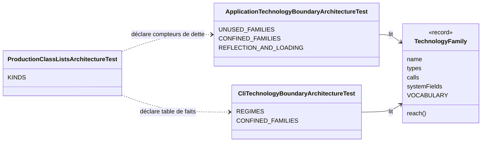
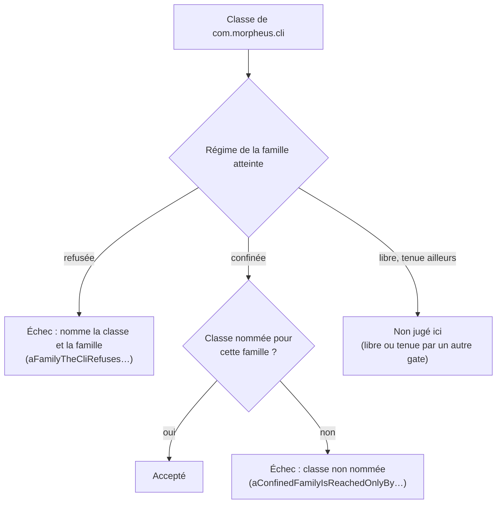

# Technologies que la CLI peut toucher (`cli-technology-boundary`)

Spec de référence : `openspec/specs/cli-technology-boundary/spec.md`, écrite à l'archivage du changement
`confine-the-technology-families-the-cli-uses` (delta : `openspec/changes/confine-the-technology-families-the-cli-uses/specs/cli-technology-boundary/spec.md`)
· Relevé du 2026-11-06 sur `8c038add`.

## Objet et périmètre

`morpheus-cli` câble le processus et porte le transport qu'ARCH-0150 a sorti du cœur applicatif : la lecture du
manifeste de mise à jour. Un module de transport a vocation à porter des technologies ; ce qui compte est qu'une
dépendance technique n'y entre pas sans être écrite. Le gate de la CLI donne à chaque famille du vocabulaire partagé un
régime, et tient exactement les classes qui atteignent une famille confinée.

- **Acteurs** : auteur d'une classe de `morpheus-cli` qui ajoute une dépendance technique ; relecteur.
- **Inclus** : les classes de production de `com.morpheus.cli` ; la déclaration partagée des familles
  (`TechnologyFamily`, tests d'architecture).
- **Exclus** : `morpheus-api`, qui porte déjà des règles par famille et par groupe (fils d'exécution, bibliothèque
  JSON) à réconcilier dans un changement à part ; `morpheus-mcp`, les providers, les stores, les intégrations ; les
  familles de l'application ([`application-technology-boundary.md`](application-technology-boundary.md)) ; la réflexion
  hors de l'application ([`reflection-boundary.md`](reflection-boundary.md)).

## Exigences

| Alias | Exigence (titre exact) | En bref | Nature |
|---|---|---|---|
| R1 | Chaque famille technologique DOIT avoir un régime déclaré pour la CLI | refusée, confinée, libre ou tenue par un autre gate, avec sa raison | `[EXIGENCE]` |
| R2 | Une famille refusée DOIT l'être dans tout `com.morpheus.cli` | aucune classe de la CLI ne l'atteint, aucune liste ne l'admet | `[EXIGENCE]` |
| R3 | Une famille confinée DOIT n'être atteinte que par les classes que le gate de la CLI nomme pour elle | une classe non nommée qui l'atteint fait échouer le build | `[EXIGENCE]` |
| R4 | Une classe nommée pour une famille confinée DOIT encore l'atteindre | la liste égale l'ensemble mesuré sur le bytecode | `[EXIGENCE]` |
| R5 | Les listes de classes du gate de la CLI DOIVENT être des tables de faits déclarées | déclarée dans `ProductionClassListsArchitectureTest`, chaque entrée avec sa raison | `[EXIGENCE]` |

## Comportement détaillé

### Les régimes (R1)

`[EXISTANT VÉRIFIÉ]` `CliTechnologyBoundaryArchitectureTest.REGIMES` donne un régime et une raison à chaque famille de
`TechnologyFamily.VOCABULARY` ; `everyFamilyOfTheVocabularyHasARegimeInTheCli` refuse une famille sans régime et une
famille confinée sans liste. Le gate de l'application porte la même exhaustivité
(`ApplicationTechnologyBoundaryArchitectureTest#everyFamilyOfTheVocabularyHasARegimeInTheApplication`).

| Régime | Familles | Raison |
|---|---|---|
| refusée | SQL, bibliothèque JSON, exécution de processus | la persistance passe par le runtime d'opération SQLite (ARCH-0162) ; le JSON imprimé vient de l'application ; les pairs MCP sont lancés par les intégrations |
| confinée | réseau sortant, fils d'exécution, accès fichier, environnement du processus, flux standard | le transport de la découverte de mise à jour et le câblage du processus |
| libre | horloge murale | la CLI est la racine de composition qui donne son heure à une commande ; que l'application reçoive une `java.time.Clock` est tenu par le gate de l'application |
| tenue ailleurs | réflexion et chargement de classes | `ReflectionAndClassLoadingBoundaryArchitectureTest`, sur tout le produit |

### Familles refusées et confinées (R2, R3, R4)

`[EXISTANT VÉRIFIÉ]` Les règles sont celles du gate de l'application, sur le bytecode importé de `com.morpheus.cli` :
`aFamilyTheCliRefusesIsReachedByNoClassOfTheCli` (`never(reach)` par famille refusée),
`aConfinedFamilyIsReachedOnlyByTheClassesOfTheCliNamedForIt` (même règle sur les classes non nommées) et
`everyClassNamedForAConfinedFamilyStillReachesIt` (égalité des ensembles nommés et mesurés). Une classe imbriquée est
rapportée à sa classe de premier niveau. `archRule.failOnEmptyShould` fait échouer une règle qui ne retient aucune
classe.

Les classes nommées et leurs raisons sont celles de `CliTechnologyBoundaryArchitectureTest.CONFINED_FAMILIES` ; cette
page ne les recopie pas. Deux cas y sont nommés plutôt que traités en vocabulaire, pour garder la définition de la
famille fichier de l'application : l'ouverture de la sortie standard par son descripteur
(`new FileOutputStream(FileDescriptor.out)`) et la lecture de `File.pathSeparator`.

### Déclaration partagée des familles

`[EXISTANT VÉRIFIÉ]` `TechnologyFamily` (record du paquet `com.morpheus.architecture` des tests) définit chaque famille
une fois — types atteints, appels, champs de `System` lus — et les deux gates la lisent. Une famille ajoutée au
vocabulaire fait échouer les deux tant qu'elle n'a pas de régime dans chacun.

### Tables de faits (R5)

`[DÉCISION]` La liste du gate est une table de faits (`ProductionClassListsArchitectureTest.KINDS`) : ces classes
atteignent cette famille dans un module de transport qui a vocation à la porter, et aucun ADR n'attend qu'elle
rétrécisse. Aucune clé n'est ajoutée à [`config/debt-counter-ratchets.properties`](../../../config/debt-counter-ratchets.properties).
Une table de faits peut grandir, mais pas en silence : l'exactitude dans les deux sens oblige à écrire le nom et sa
raison dans le test.

## Diagrammes

### Qui déclare les familles, et qui les juge ?

Existant vérifié. Diagramme de classes UML des classes de test. Exigences : R1, R5.

### Par quel régime une classe de la CLI passe-t-elle ?

Existant vérifié. Organigramme (pas UML). Exigences : R2, R3.

## Écarts et questions ouvertes

- `[QUESTION]` Le mainteneur veut-il que les listes de la CLI ne fassent que rétrécir ? Elles deviendraient des
  compteurs de dette, ce qui exige un ADR accepté qui les nomme (un ADR consolidé qui remplace ARCH-0150, ou un ADR des
  modules de transport). Elles sont tables de faits par défaut.
- `morpheus-api` reste sans gate de familles ; un changement à part doit réconcilier ses règles par groupe avec la
  déclaration partagée. Le constat `AUD-ARC-18` reste partiel pour ce volet.

## Traçabilité

| Exigence | Scénario | Conception ou diagramme | Changement | Preuve |
|---|---|---|---|---|
| R1 | Une famille ajoutée au vocabulaire | diagramme de classes | `confine-the-technology-families-the-cli-uses` | [`CliTechnologyBoundaryArchitectureTest`](../../../morpheus-architecture-tests/src/test/java/com/morpheus/architecture/CliTechnologyBoundaryArchitectureTest.java)`#everyFamilyOfTheVocabularyHasARegimeInTheCli` |
| R1 | Le régime de chaque famille aujourd'hui | tableau des régimes | idem | `CliTechnologyBoundaryArchitectureTest.REGIMES` (lecture) |
| R2 | Une commande acquiert une dépendance SQL | organigramme | idem | `CliTechnologyBoundaryArchitectureTest#aFamilyTheCliRefusesIsReachedByNoClassOfTheCli` (ArchUnit) |
| R2 | Une commande écrit son JSON avec Jackson | organigramme | idem | idem, famille « JSON library » |
| R3 | Une seconde classe ouvre une connexion | organigramme | idem | `CliTechnologyBoundaryArchitectureTest#aConfinedFamilyIsReachedOnlyByTheClassesOfTheCliNamedForIt` (ArchUnit) |
| R3 | Une commande démarre ses propres fils | organigramme | idem | idem, famille « threads » |
| R3 | Une commande écrit sur la sortie standard du processus | organigramme | idem | idem, famille « standard streams » |
| R4 | La lecture du manifeste quitte la CLI | — | idem | `CliTechnologyBoundaryArchitectureTest#everyClassNamedForAConfinedFamilyStillReachesIt` |
| R4 | La règle a quelque chose à juger | — | idem | `archRule.failOnEmptyShould`, prouvé par [`AnEmptyArchitectureRuleFailsTest`](../../../morpheus-architecture-tests/src/test/java/com/morpheus/architecture/AnEmptyArchitectureRuleFailsTest.java) |
| R5 | Une liste de la CLI non déclarée | diagramme de classes | idem | [`ProductionClassListsArchitectureTest`](../../../morpheus-architecture-tests/src/test/java/com/morpheus/architecture/ProductionClassListsArchitectureTest.java)`#everyListOfProductionClassesIsADebtCounterOrATableOfFacts` |
| R5 | Aucun cliquet de dette n'est créé | — | idem | `ProductionClassListsArchitectureTest#everyDebtCounterHoldsExactlyTheSizeItsRatchetAllows` (aucune clé pour une table de faits) |

## Sources

- ADR : [ARCH-0150](../../architecture/adr/ARCH-0150-ce-que-le-coeur-applicatif-peut-toucher.md) (décision 1 : le
  transport de la découverte de mise à jour dans `morpheus-cli`) ; [ARCH-0162](../../architecture/adr/ARCH-0162-racines-de-composition-nommees-paquets-sans-cycle-hors-une-paire-bornee-et-decisions-dans-le-domaine.md).
- Règles du dépôt : `.claude/rules/architecture.md`, section « Ce que l'application touche (ADR-0150) ».
- Pages liées : [`application-technology-boundary.md`](application-technology-boundary.md),
  [`reflection-boundary.md`](reflection-boundary.md).
