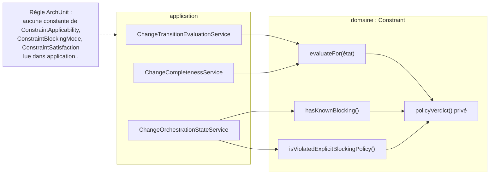
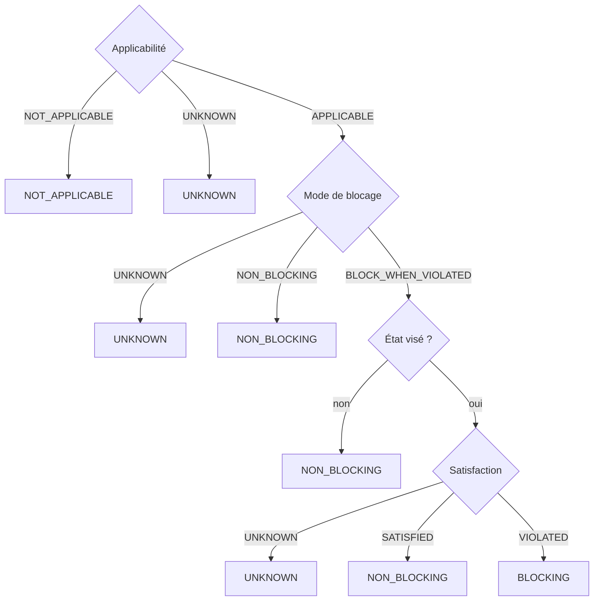

# Décision de blocage d'une contrainte (`constraint-blocking-decision`)

Spec de référence : [`openspec/specs/constraint-blocking-decision/spec.md`](../../../openspec/specs/constraint-blocking-decision/spec.md)
· Relevé du 2026-11-04 sur `2913fc30`.

## Objet et périmètre

Qu'une contrainte bloque ou non un état de cycle de vie est décidé à **un seul endroit**, le type `Constraint` du
domaine. Les services de l'application (évaluation d'une transition, état d'orchestration, requêtes) interrogent cette
décision et ne comparent jamais eux-mêmes l'applicabilité, le mode de blocage ou la satisfaction.

- **Acteurs** : `ChangeTransitionEvaluationService`, `ChangeCompletenessService` (appelants de `evaluateFor`),
  `ChangeOrchestrationStateService` (appelant de `hasKnownBlocking` et `isViolatedExplicitBlockingPolicy`) ; les
  surfaces CLI, MCP et HTTP qui rendent le résultat.
- **Inclus** : `Constraint.evaluateFor`, `Constraint.hasKnownBlocking`, `Constraint.isViolatedExplicitBlockingPolicy`,
  `Constraint.hasKnownApplicabilityAndSeverity`, la règle ArchUnit qui interdit à l'application de lire les constantes
  d'entrée de la décision.
- **Exclus** : la sémantique tri-état de la politique elle-même (ADR `BE-0119`, `ARCH-0093`) ; la décision de transition
  de cycle de vie ([`domain-value-decisions.md`](domain-value-decisions.md)).

## Exigences

| Alias | Exigence (titre exact) | En bref | Nature |
|---|---|---|---|
| R1 | The domain model SHALL decide whether a constraint blocks a lifecycle state | état (non applicable, inconnu, non bloquant, bloquant) et raison produits par le domaine ; l'application les obtient | `[EXIGENCE]` |
| R2 | Unknown SHALL never be decided as blocking | applicabilité inconnue, mode inconnu, ou satisfaction inconnue pour un état visé : évaluation inconnue, jamais bloquante | `[EXIGENCE]` |
| R3 | The answers about one constraint SHALL agree | « blocage connu » et « politiques bloquantes violées » de l'état d'orchestration dérivent de la même décision que les évaluations | `[EXIGENCE]` |
| R4 | Moving the decision SHALL change no answer | états, textes de raison et textes de disponibilité de la CLI, du MCP et de HTTP identiques à ceux d'avant le déplacement | `[EXIGENCE]` |

## Comportement détaillé

### Les huit issues de `evaluateFor(état)` (R1, R2)

`[EXISTANT VÉRIFIÉ]` dans l'ordre de `Constraint.policyVerdict()` puis `targetedVerdict(état)` (module domaine) :

| Condition (dans l'ordre) | État | Raison |
|---|---|---|
| applicabilité `NOT_APPLICABLE` | `NOT_APPLICABLE` | `Constraint is explicitly not applicable` |
| applicabilité `UNKNOWN` | `UNKNOWN` | `Constraint applicability is unknown` |
| mode de blocage `UNKNOWN` | `UNKNOWN` | `Constraint blocking policy is unknown` |
| mode `NON_BLOCKING` | `NON_BLOCKING` | `Constraint policy is explicitly non-blocking` |
| la politique ne vise pas l'état | `NON_BLOCKING` | `Constraint blocking policy does not target lifecycle state <état>` |
| visé, satisfaction `UNKNOWN` | `UNKNOWN` | `Constraint satisfaction is unknown for targeted blocking policy` |
| visé, satisfaction `SATISFIED` | `NON_BLOCKING` | `Constraint is satisfied` |
| visé, satisfaction `VIOLATED` | `BLOCKING` | `Constraint is violated and explicitly blocks lifecycle state <état>` |

La gravité ne joue aucun rôle (Javadoc de `evaluateFor`). Les textes de raison sont des réponses publiques : la CLI, les
outils MCP et les routes HTTP les rendent.

### Les deux réponses de l'état d'orchestration (R3)

`[EXISTANT VÉRIFIÉ]` `hasKnownBlocking()` vaut vrai si la politique décide seule (verdict autre qu'inconnu) ou si le mode
bloque quand violé **et** que la satisfaction est connue. `isViolatedExplicitBlockingPolicy()` vaut vrai si la politique
est applicable, bloque quand violée, et que la satisfaction est `VIOLATED`, quels que soient les états visés.
`ChangeOrchestrationStateService.blockingAvailability` les compte et choisit parmi quatre disponibilités : `AVAILABLE`
sans contrainte, `AVAILABLE` quand toutes sont connues, `PARTIALLY_AVAILABLE` quand certaines seulement, `UNKNOWN`
quand aucune ; le compte observé est celui des politiques bloquantes violées, `0` dans le cas `UNKNOWN`.

`[EXISTANT VÉRIFIÉ]` Un état non visé par la politique rend une évaluation non bloquante **même si** la satisfaction est
inconnue, là où `hasKnownBlocking()` reste faux : les deux questions sont distinctes (Javadoc de `hasKnownBlocking`).

## Diagrammes

### Qui décide, et qui l'interroge ?

Existant vérifié. Il répond à R1, R3 et R4 : les appelants de l'application n'ont qu'une flèche vers le domaine.

### Dans quel ordre la décision se prend-elle ?

Existant vérifié (R1, R2). Un résultat `UNKNOWN` n'aboutit jamais à `BLOCKING`.

## Écarts et questions ouvertes

- `[EXISTANT VÉRIFIÉ]` **Exception nommée.** Le scénario « An application service restates the decision » dit que la
  suite échoue « unless the suite names it as an exception with its reason ». La règle
  [`ConstraintDecisionInTheDomainArchitectureTest`](../../../morpheus-architecture-tests/src/test/java/com/morpheus/architecture/ConstraintDecisionInTheDomainArchitectureTest.java)
  n'a **aucun mécanisme d'exception** (sa Javadoc : « The rule has no exception »), conformément à
  `.claude/rules/architecture.md`. La spec est plus permissive que le code. `[QUESTION]` Retirer la clause d'exception du
  scénario, ou prévoir le mécanisme ?
- `[EXISTANT VÉRIFIÉ]` **Étendue de la règle.** Elle interdit la lecture d'une constante des trois énumérations ; elle ne
  voit pas une lecture par accesseur (`constraint.applicability().name()`), que sa Javadoc dit non concernée. Un
  `switch` sur l'énumération lit les constantes et est vu.
- **Preuve manquante pour R4 sur MCP.** Les textes de raison de blocage sont asserts côté HTTP
  ([`MorpheusConstraintSemanticsApiContractTest`](../../../morpheus-api/src/test/java/com/morpheus/api/MorpheusConstraintSemanticsApiContractTest.java))
  et CLI
  ([`MorpheusConstraintSemanticsCliTest`](../../../morpheus-cli/src/test/java/com/morpheus/cli/command/MorpheusConstraintSemanticsCliTest.java)),
  pas côté MCP ; les sept autres textes de raison ne sont lus que par la table du domaine (recherche des textes dans tous les tests, 2026-11-04). La comparaison « avant/après » est
  portée par la table du domaine, qui a été produite sur le commit antérieur au déplacement (tâche 2.1 archivée) : elle
  ne se rejoue pas contre l'ancien code.
- **Preuve partielle pour le scénario « A constraint reported as known » (R3).** Le test du domaine parcourt tous les
  états de cycle de vie
  (`ConstraintBlockingDecisionTest#aConstraintWhoseBlockingIsKnownHasNoUnknownEvaluationForAnyState`) ; le test du
  service d'orchestration vérifie les disponibilités et les comptes sur trois jeux de contraintes, sans parcourir
  chaque état.
- `[EXISTANT VÉRIFIÉ]` `ConstraintPolicyEvaluationService` et son paquet ont disparu (recherche dans les sources
  courantes, 2026-11-04) ; son test a rejoint le domaine sous le nom `ConstraintEvaluateForTest`.

## Traçabilité

| Exigence | Scénario | Conception ou diagramme | Changement | Preuve |
|---|---|---|---|---|
| R1 | A violated constraint that blocks the target state | arbre de décision | archive `2026-10-29-decide-constraint-blocking-in-the-domain` | [`ConstraintEvaluateForTest`](../../../morpheus-domain/src/test/java/com/morpheus/domain/constraint/ConstraintEvaluateForTest.java)`#targetedViolatedConstraintBlocksWithEvidenceAndReason` |
| R1 | A policy that does not target the state | idem | idem | `ConstraintEvaluateForTest#criticalSeverityDoesNotBlockOutsideExplicitTarget` (état) ; texte de la raison : [`ConstraintBlockingDecisionTest`](../../../morpheus-domain/src/test/java/com/morpheus/domain/constraint/ConstraintBlockingDecisionTest.java)`#everyCombinationIsDecidedAsTheTableSays` |
| R1 | An application service restates the decision | flux des appelants | idem | `ConstraintDecisionInTheDomainArchitectureTest#noApplicationClassReadsAConstantOfAConstraintsBlockingInputs` (sans exception : voir Écarts) |
| R2 | Unknown satisfaction for a targeted state | arbre de décision | idem | `ConstraintEvaluateForTest#targetedUnknownSatisfactionRemainsUnknown` ; raison : `ConstraintBlockingDecisionTest#everyCombinationIsDecidedAsTheTableSays` |
| R2 | Every combination | idem | idem | `ConstraintBlockingDecisionTest#everyCombinationIsDecidedAsTheTableSays` et `#anUnknownInputTheDecisionNeededIsNeverBlocking` (48 lignes) |
| R3 | A constraint reported as known | flux des appelants | idem | `ConstraintBlockingDecisionTest#aConstraintWhoseBlockingIsKnownHasNoUnknownEvaluationForAnyState` ; [`ChangeOrchestrationStateServiceTest`](../../../morpheus-application/src/test/java/com/morpheus/application/orchestration/ChangeOrchestrationStateServiceTest.java)`#explicitConstraintsCountTheViolatedBlockingOnesAndUnknownSemanticsAreNeverBlocking` (preuve partielle) |
| R3 | A blocking evaluation | idem | idem | `ConstraintBlockingDecisionTest#aConstraintThatBlocksSomeStateIsCountedAsAViolatedExplicitBlockingPolicy` |
| R4 | The same snapshot queried before and after | flux des appelants | idem | table littérale de `ConstraintBlockingDecisionTest` ; CLI et HTTP pour la raison de blocage ; **preuve manquante** côté MCP et pour les autres textes (voir Écarts) |

## Sources

- ADR : `DATA-0082` ([sémantique explicite et politique de blocage](../../architecture/adr/DATA-0082-explicit-constraint-semantics-and-blocking-policy.md)), `BE-0119` ([tri-état](../../architecture/adr/BE-0119-cycle-de-vie-des-changements-et-transition-tri-etat.md)), `ARCH-0093` ([politique neutre](../../architecture/adr/ARCH-0093-provider-neutral-policy-packs-governance-automation.md)).
- Règle du dépôt : [`.claude/rules/architecture.md`](../../../.claude/rules/architecture.md), section « Une décision sur une seule valeur du domaine est écrite sur son type ».
- Changement archivé : `2026-10-29-decide-constraint-blocking-in-the-domain` (tâches 1.3, 2.1 à 3.3).
- Page voisine : [`domain-value-decisions.md`](domain-value-decisions.md).
