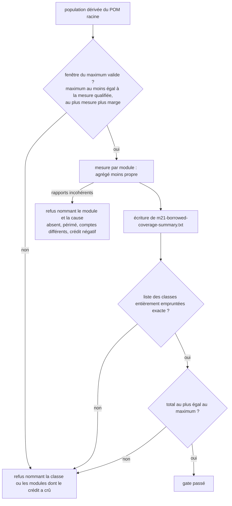
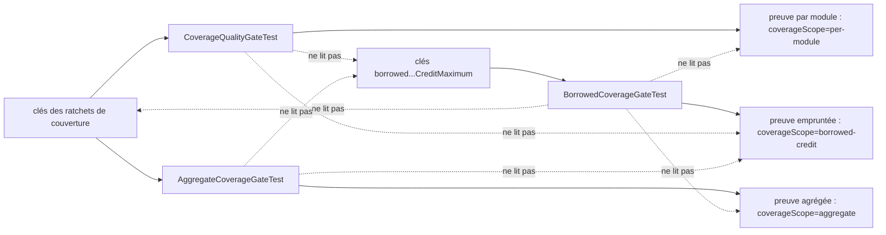

# Crédit de couverture emprunté (`coverage-attribution-gap`)

Spec de référence : [`openspec/specs/coverage-attribution-gap/spec.md`](../../../openspec/specs/coverage-attribution-gap/spec.md)
· Relevé du 2026-11-04 sur `2913fc30`.

## Objet et périmètre

Les deux échelles de couverture du dépôt (par module et agrégée) ne créditent pas une ligne par les mêmes exécutions.
Cette capacité mesure l'écart sous une forme qui ne confond pas les deux : pour chaque module, les lignes et les
branches que le rapport agrégé couvre et que son propre rapport ne couvre pas, soit ce que sa couverture doit aux tests
d'un autre module. Cette quantité est enregistrée, bornée par un maximum qui ne fait que baisser, et ne gouverne ni
n'est gouvernée par aucune des deux échelles.

- **Acteurs** : `BorrowedCoverageGateTest` (module `morpheus-coverage-report`), exécuté en phase `verify` après tous les
  autres modules ; `CoverageScaleSeparationTest` (suite d'architecture) ; CI qui publie la preuve.
- **Inclus** : mesure par module, preuve à portée propre, refus de rapports incohérents, liste exacte des classes
  entièrement empruntées, maximum, qualification du maximum, séparation d'avec les deux échelles.
- **Exclus** : les ratchets et plafonds des deux échelles (voir
  [`coverage-qualification-evidence.md`](coverage-qualification-evidence.md)) ; la péremption d'un rapport par module
  (voir [`gate-verdict-currency.md`](gate-verdict-currency.md)), dont la comparaison est ici recopiée.

La décision est [ADR-0166](../../architecture/adr/GEN-0166-deux-echelles-de-couverture-un-seuil-par-module-a-marge-proportionnelle-et-le-credit-emprunte.md).

## Exigences

| Alias | Exigence (titre exact) | En bref | Nature |
|---|---|---|---|
| R1 | The gap between the two coverage scales SHALL be measured as borrowed credit, per module | lignes et branches, par module, avec leur somme ; jamais une différence de ratios | `[EXIGENCE]` |
| R2 | The measurement SHALL be recorded in evidence that names its own scope | fichier distinct, première ligne d'une portée qui n'est ni l'une ni l'autre échelle, publié avec la preuve d'intégrité | `[EXIGENCE]` |
| R3 | The measurement SHALL refuse two reports that do not describe the same code | module sans rapport, rapport périmé, comptes différents, crédit négatif : refus nommé | `[EXIGENCE]` |
| R4 | A class credited only by other modules' tests SHALL be named, and the list SHALL only shrink | liste exacte des classes entièrement empruntées | `[EXIGENCE]` |
| R5 | The total borrowed credit SHALL NOT exceed a recorded maximum that is only lowered | maximum lu dans la configuration des ratchets, jamais relevé pour passer | `[EXIGENCE]` |
| R6 | The maximum SHALL be qualified on the highest measurement of both platforms | maximum au-dessus de la plus haute mesure des deux plateformes, marge dimensionnée sur la dispersion | `[EXIGENCE]` |
| R7 | The borrowed credit SHALL NOT govern, or be governed by, either coverage scale | aucune lecture croisée de clés ni de preuve entre les trois portes | `[EXIGENCE]` |

## Comportement détaillé

### Mesure (R1, R3)

`[EXISTANT VÉRIFIÉ]` La population est dérivée du POM racine : tout module qui porte une classe sous `src/main/java`.
Pour chaque module, `BorrowedCoverageGateTest` lit le rapport propre (`target/site/jacoco/jacoco.xml`) et le rapport agrégé
(`morpheus-coverage-report/target/site/jacoco-aggregate/jacoco.xml`). Le crédit d'un module vaut, séparément en lignes
et en branches, le couvert de l'agrégé moins le couvert propre. La mesure refuse, en nommant le module : un rapport propre
absent (`never built`, ou `built but emitted no report`), un rapport plus ancien que les sources (`stale`, avec
`./mvnw clean verify`), un module absent de l'agrégé, des comptes de lignes ou de branches différents entre les deux
rapports (`do not count the same lines`), et un crédit négatif (`covers more than the aggregate`), jamais ramené à zéro.

### Preuve (R2)

`[EXISTANT VÉRIFIÉ]` Le fichier est `morpheus-architecture-tests/target/m21-borrowed-coverage-summary.txt`. Sa première ligne
est `coverageScope=borrowed-credit`. Il porte le total, le maximum lu, la mesure qualifiée, le nombre de classes entièrement
empruntées, une ligne `module.<nom>=` par module (lignes, branches, couverts propre et agrégé, crédit) et une ligne
`whollyBorrowed=` par classe. [`ci.yml`](../../../.github/workflows/ci.yml) le publie dans l'artefact `m21-integrity-<OS>` des
deux plateformes.

### Classes entièrement empruntées (R4)

`[EXISTANT VÉRIFIÉ]` Une classe est entièrement empruntée si elle a des lignes exécutables, que son module n'en couvre
aucune et que l'agrégé en couvre au moins une. La liste exacte est la ressource
[`wholly-borrowed-classes.txt`](../../../morpheus-coverage-report/src/test/resources/wholly-borrowed-classes.txt), triée, sans
doublon (`theListIsSortedAndCarriesNoDuplicate`). Une classe non listée échoue en nommant la classe et son module ; une classe
listée qui n'est plus entièrement empruntée échoue jusqu'au retrait de son entrée.

### Maximum (R5, R6)

`[EXISTANT VÉRIFIÉ]` Les clés sont `borrowedLineCreditMaximum` et `borrowedBranchCreditMaximum` dans
[`config/m21-quality-ratchets.properties`](../../../config/m21-quality-ratchets.properties) ; une clé absente est nommée.
La mesure qualifiée (la plus haute des deux plateformes, ligne et branche) et les marges (trois fois la dispersion de
référence de 24 lignes et 11 branches) sont des constantes de `BorrowedCoverageGateTest` (`QUALIFIED_BORROWED_LINES`,
`QUALIFIED_BORROWED_BRANCHES`, `MAXIMUM_MARGIN_LINES`, `MAXIMUM_MARGIN_BRANCHES`), commentées avec le commit et les runs de la
qualification. Aucun chiffre n'est repris ici. Un dépassement nomme les modules dont le crédit a crû, relativement à
`QUALIFIED_BY_MODULE`.

## Diagrammes

### Comment la mesure arrive-t-elle à un verdict ?

Existant vérifié, ordre de `borrowedCreditIsMeasuredPerModuleAndStaysUnderItsMaximumWithEveryWhollyBorrowedClassNamed`.
Organigramme. Exigences R1, R3, R4, R5, R6.

### Qui peut lire quelle clé ou quelle preuve ?

Existant vérifié, `CoverageScaleSeparationTest`. Organigramme. Exigence R7. Les flèches pointillées sont les lectures
**interdites**.

## Écarts et questions ouvertes

1. **« A module covered only by its own tests borrows nothing ».** `[EXISTANT VÉRIFIÉ]` Le cas est présent dans la
   fabrication de `theMeasurementRefusesTwoReportsThatDoNotDescribeTheSameCode` (module `tooling`, mêmes comptes sur les deux
   rapports) et son crédit nul est implicite dans la somme asserée (3 lignes, celles de `product`), mais aucune assertion
   ne nomme le crédit nul de ce module. Preuve indirecte.
2. **« Every module of the population has its row » : contenu des lignes.** `[EXISTANT VÉRIFIÉ]` La ligne de preuve est écrite
   par `Measurement.evidence`, mais aucun test ne lit le fichier produit pour vérifier chaque champ de chaque ligne ; le
   gate l'écrit puis ne le relit pas. Preuve indirecte (écriture de l'état mesuré).
3. **« The evidence is retrievable for both platforms ».** `[EXISTANT VÉRIFIÉ]` Le pas d'envoi de `ci.yml` liste le fichier
   mais déclare `if-no-files-found: warn` : l'absence du fichier n'échoue pas le job. Aucune règle de la suite ne lit ce
   pas. Preuve manquante pour « chaque plateforme contient la preuve ».
4. **Qualification du maximum non conservée dans `config/coverage-qualification/`.** `[EXISTANT VÉRIFIÉ]` Les résumés que
   conserve ce dossier sont ceux des deux échelles de couverture ; la mesure qualifiée du crédit emprunté ne vit que dans des
   constantes et un commentaire du test. La spec (R6) demande qu'elle soit « cited with its commit and runs where the gate
   holds it », ce qui est vrai ; aucun test ne compare le commentaire aux constantes.
5. **Même comparaison de péremption, troisième copie.** Voir [`gate-verdict-currency.md`](gate-verdict-currency.md), Écart 2.
6. **« Reducing the credit moves no coverage threshold ».** Le scénario décrit un effet sur un changement (des tests
   ajoutés font baisser le crédit, les quatre ratchets et les deux plafonds restent). Aucun test ne compare avant et
   après ; la propriété tient parce que le gate ne lit ni n'écrit ces clés (R7). Preuve indirecte.

## Traçabilité

Archive : `2026-10-30-shrink-the-coverage-a-module-borrows-from-its-neighbours`. Le fichier de test principal est
[`BorrowedCoverageGateTest`](../../../morpheus-coverage-report/src/test/java/com/morpheus/coverage/BorrowedCoverageGateTest.java).

| Exigence | Scénario | Conception ou diagramme | Preuve |
|---|---|---|---|
| R1 | Every module of the population has its row | organigramme 1 | `BorrowedCoverageGateTest#borrowedCreditIsMeasuredPerModuleAndStaysUnderItsMaximumWithEveryWhollyBorrowedClassNamed` (population dérivée, preuve écrite) ; contenu des lignes : Écart 2 |
| R1 | A module covered only by its own tests borrows nothing | idem | `#theMeasurementRefusesTwoReportsThatDoNotDescribeTheSameCode` (module `tooling`) ; Écart 1 |
| R2 | The evidence cannot be taken for a coverage proof | organigramme 2 | [`CoverageScaleSeparationTest`](../../../morpheus-architecture-tests/src/test/java/com/morpheus/architecture/m21/CoverageScaleSeparationTest.java)`#theScopeGuardRefusesPerModuleEvidenceAndAcceptsAggregateEvidence` (cas `coverageScope=borrowed-credit` refusé par les deux gardes) et `#eachGateStampsItsOwnScaleOnTheFirstLineOfItsEvidence` |
| R2 | The evidence is retrievable for both platforms | idem | `ci.yml`, pas « Upload M21 integrity evidence » ; **preuve manquante** dans la suite (Écart 3) |
| R3 | A negative credit is refused, not clamped | organigramme 1 | `BorrowedCoverageGateTest#theMeasurementRefusesTwoReportsThatDoNotDescribeTheSameCode` (message `covers more than the aggregate`) |
| R3 | A partial reactor is refused under the cause the coverage gates already name | idem | même méthode (`never built`, `built but emitted no report`, `absent from the aggregate report`, `stale`, `do not count the same lines`) |
| R4 | A new class tested only through an adapter is refused | organigramme 1 | `#anUnlistedWhollyBorrowedClassAndAListedOneThatGainedATestAreBothRefused` ; liste réelle : `#borrowedCreditIsMeasuredPerModuleAndStaysUnderItsMaximumWithEveryWhollyBorrowedClassNamed` |
| R4 | A listed class that gained a test of its own must leave the list | idem | même méthode `#anUnlistedWhollyBorrowedClassAndAListedOneThatGainedATestAreBothRefused` ; `#theListIsSortedAndCarriesNoDuplicate` |
| R5 | Credit that grows past the maximum fails the build | idem | `#creditOverTheMaximumIsRefusedWithTheModulesWhoseCreditGrew` (comptes mesuré et permis, modules nommés) ; clé manquante : `#aMissingMaximumKeyNamesItself` |
| R6 | A maximum one platform cannot meet is refused | idem | `#aMaximumUnderTheQualifiedMeasurementOrRaisedPastItsMarginIsRefused` (message `needs a new measurement on both platforms`) |
| R7 | The separation is enforced on the three gates | organigramme 2 | `CoverageScaleSeparationTest#theBorrowedCreditGateReadsNoCoverageKeyAndNeitherCoverageGateReadsIt` |
| R7 | Reducing the credit moves no coverage threshold | idem | propriété indirecte (Écart 6) ; `CoverageScaleSeparationTest#theRatchetConfigurationDeclaresBothScalesAndNoSharedCoverageKey` |

## Sources

- Règles du dépôt : `.claude/rules/testing.md` (« Le crédit emprunté »), `.claude/rules/meta.md`.
- Décision : [ADR-0166](../../architecture/adr/GEN-0166-deux-echelles-de-couverture-un-seuil-par-module-a-marge-proportionnelle-et-le-credit-emprunte.md).
- Guide développeur : [`BUILD_AND_TEST.md`](../BUILD_AND_TEST.md) (remède : un test dans le module qui porte la ligne).
- Pages liées : [`coverage-qualification-evidence.md`](coverage-qualification-evidence.md),
  [`gate-verdict-currency.md`](gate-verdict-currency.md).
- Archive OpenSpec : `2026-10-30-shrink-the-coverage-a-module-borrows-from-its-neighbours`.
