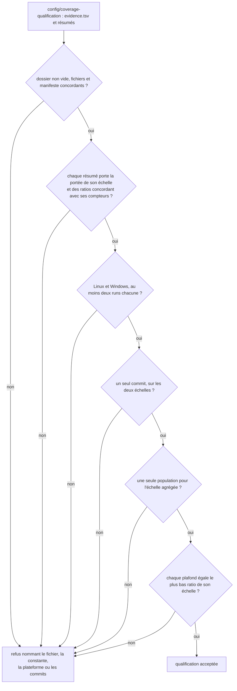
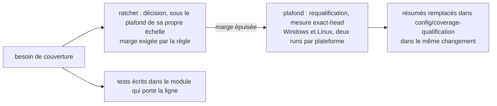

# Preuve de qualification d'un plafond de couverture (`coverage-qualification-evidence`)

Spec de référence : [`openspec/specs/coverage-qualification-evidence/spec.md`](../../../openspec/specs/coverage-qualification-evidence/spec.md)
· Relevé du 2026-11-04 sur `2913fc30`, complété le 2026-11-06 sur `a7bc8571` pour R6 et R7, ajoutées par le changement
`thresh-every-module-coverage-on-its-own-floor` (spec delta jusqu'à son archivage).

## Objet et périmètre

Un plafond de couverture qualifié repose sur une preuve gardée avec le code, mesurée sur les deux plateformes à un seul
commit, et le plafond égale ce que cette preuve montre. Les artefacts de workflow expirent ; sans preuve gardée, un plafond
ne serait qu'une valeur écrite dans un test.

- **Acteurs** : mainteneur qui requalifie un plafond ; `CoverageQualificationEvidenceTest` qui juge ; gates de couverture
  qui portent les constantes `*_QUALIFIED_*_RATIO`.
- **Inclus** : le dossier [`config/coverage-qualification/`](../../../config/coverage-qualification/evidence.tsv) (manifeste
  `evidence.tsv` et un résumé par run et par échelle), l'égalité plafond / plus basse mesure, la complétude de la
  qualification, l'unité de tête entre les deux échelles, les compteurs de chaque module dans la preuve de l'échelle
  par module et la dispersion d'un module, le guide développeur.
- **Exclus** : les valeurs des plafonds et des ratchets (relire les constantes et
  [`config/m21-quality-ratchets.properties`](../../../config/m21-quality-ratchets.properties) ; elles ne sont jamais
  recopiées ici) ; le crédit emprunté (voir [`coverage-attribution-gap.md`](coverage-attribution-gap.md)) ; la
  déclaration et l'application des seuils par module (voir [`per-module-coverage-floor.md`](per-module-coverage-floor.md)).

## Exigences

| Alias | Exigence (titre exact) | En bref | Nature |
|---|---|---|---|
| R1 | The evidence of a qualified cap SHALL be kept in the repository while the cap is in force | résumés de chaque échelle gardés avec plateforme, run et commit | `[EXIGENCE]` |
| R2 | A qualified cap SHALL equal the lowest measurement of its scale in the kept evidence | ligne et branche de chaque échelle égalent le plus bas ratio conservé | `[EXIGENCE]` |
| R3 | A qualification SHALL be complete before it backs a cap | au moins deux runs par plateforme, un commit, une population | `[EXIGENCE]` |
| R4 | The developer guide SHALL distinguish a raise by decision from a requalification without stating a margin | le guide distingue relèvement par décision et requalification, sans chiffrer la distance restante | `[EXIGENCE]` |
| R5 | Every scale of a qualification SHALL be measured at the same head | preuves agrégée et par module nomment un seul commit | `[EXIGENCE]` |
| R6 | La preuve de l'échelle par module porte les compteurs de chaque module | lignes `module.<artifactId>.*` dont les sommes font les totaux, même ensemble de modules dans chaque résumé | `[EXIGENCE]` (spec delta) |
| R7 | La dispersion d'un module se lit dans la preuve conservée | plus grande de l'écart observé pour le module et de la référence de l'échelle rapportée à la part du module, jamais saisie à la main | `[EXIGENCE]` (spec delta) |

## Comportement détaillé

### Le dossier de preuve

`[EXISTANT VÉRIFIÉ]` [`evidence.tsv`](../../../config/coverage-qualification/evidence.tsv) a pour en-tête
`scale	platform	run	commit	file` ; chaque ligne désigne un fichier sous `per-module/` ou `aggregate/` nommé
`<plateforme>-<run>.txt`. Chaque résumé est celui qu'écrit le gate de son échelle (première ligne `coverageScope=…`,
compteurs et ratios, et, pour l'agrégé, la population).

### Les quatre plafonds

`[EXISTANT VÉRIFIÉ]` Les constantes sont `PER_MODULE_QUALIFIED_LINE_RATIO` et `PER_MODULE_QUALIFIED_BRANCH_RATIO` dans
[`CoverageQualityGateTest`](../../../morpheus-architecture-tests/src/test/java/com/morpheus/architecture/m21/CoverageQualityGateTest.java),
`AGGREGATE_QUALIFIED_LINE_RATIO` et `AGGREGATE_QUALIFIED_BRANCH_RATIO` dans
[`AggregateCoverageGateTest`](../../../morpheus-coverage-report/src/test/java/com/morpheus/coverage/AggregateCoverageGateTest.java).
Le test de preuve lit ces constantes **dans le texte** des deux gates (elles sont privées et vivent dans deux modules
différents), les compare au plus bas ratio de leur échelle, à la précision du résumé (écart d'arrondi à six chiffres
toléré), et refuse un résumé dont le ratio ne correspond pas à ses compteurs.

### Complétude

`[EXISTANT VÉRIFIÉ]` Plateformes attendues : `Linux` et `Windows`, au moins deux runs chacune (`MINIMUM_RUNS_PER_PLATFORM`).
Un seul commit pour toute la qualification, une seule population par échelle agrégée (population, nombre de modules et
nombre de rapports). Un fichier gardé hors manifeste, un fichier du manifeste absent, un dossier vide et un résumé de
l'autre échelle sont refusés.

### Les compteurs de chaque module

`[EXISTANT VÉRIFIÉ]` Le gate de l'échelle par module écrit, après ses totaux, quatre lignes par module de la population :
`module.<artifactId>.lineCovered`, `.lineMissed`, `.branchCovered`, `.branchMissed`. Dans la preuve conservée, le test
refuse un résumé dont les sommes par module diffèrent des totaux (il nomme le fichier et les deux valeurs), un résumé
qui omet un module qu'un autre résumé porte, deux résumés qui portent des ensembles de modules différents, et un
résumé sans lignes par module quand un autre en porte. Une preuve dont aucun résumé ne porte de lignes par module
reste acceptée : elle ne qualifie alors aucun seuil de module au-dessus du plancher D2.

### La dispersion d'un module

`[EXISTANT VÉRIFIÉ]` Pour une grandeur d'un module, la dispersion retenue est la plus grande de l'écart, en lignes ou en
branches couvertes, entre les résumés conservés pour ce module, et de sa dispersion de référence : celle de l'échelle
(`REFERENCE_LINE_SPREAD`, `REFERENCE_BRANCH_SPREAD`) multipliée par la part du module dans la population de la grandeur,
lue dans le même résumé, arrondie à l'unité supérieure. Un module stable n'a donc jamais une marge nulle : au moins
trois lignes ou trois branches. Les ratchets et les plafonds d'échelle gardent la référence entière. Le seuil d'un
module au-dessus du plancher D2 doit garder trois fois cette dispersion sous la plus basse mesure conservée du module ;
la règle et ses refus sont décrits dans [`per-module-coverage-floor.md`](per-module-coverage-floor.md).

### Une règle voisine, hors spec

`[EXISTANT VÉRIFIÉ]` La même classe porte aussi `everyCoverageRatchetKeepsThreeTimesTheSpreadUnderTheLowestKeptMeasurement` :
le ratchet de chaque clé doit rester à au moins trois fois la plus grande dispersion (celle des runs conservés, ou la
référence de 24 lignes et 11 branches) sous la plus basse mesure conservée. La spec de cette capacité ne l'exige pas ;
le guide la décrit et l'attribue à ce test. Elle est documentée dans `.claude/rules/testing.md`.

## Diagrammes

### Quand un plafond est-il accepté ?

Existant vérifié, `CoverageQualificationVerifier#verify` et les cas fabriqués de `CoverageQualificationEvidenceTest`. Organigramme. Exigences R1, R2, R3, R5.

L'ordre des contrôles du diagramme est celui du récit de la page, pas nécessairement celui de la méthode `verify` : la spec
ne fixe pas d'ordre, seulement l'ensemble des refus.

### Qui relève quoi ?

Existant vérifié par le guide [`BUILD_AND_TEST.md`](../BUILD_AND_TEST.md) (section « Relever un ratchet, ou relever un
plafond »). Organigramme. Exigence R4.

## Écarts et questions ouvertes

1. **Guide : scénarios R4 sans preuve.** `[EXISTANT VÉRIFIÉ]` Aucun test ne lit la section « Relever un ratchet, ou relever un
   plafond » de `BUILD_AND_TEST.md`. `RepositoryDocumentationCoherenceTest` compare le guide aux ratchets (valeurs
   verrouillées, règle de baisse) mais pas à ces deux scénarios. Preuve manquante pour « A developer wants to raise a
   ratchet » et « The guide holds no headroom figure ».
2. **Le guide cite 24 lignes, 11 branches et « trois fois ».** Ce sont les paramètres de la règle (dispersion de référence),
   pas la distance restante sous un plafond. `[QUESTION]` La lecture stricte de « states no number of lines, of branches or
   of points remaining under a cap » les tolère-t-elle ? Le texte du guide dit explicitement que la distance « ne s'écrit
   pas dans cette page ».
3. **« A requalification replaces the evidence in the same change ».** C'est une règle de procédure d'un changement. La suite
   en voit la conséquence (plafond et preuve concordants, un commit unique) mais ne peut pas voir qu'un relèvement et le
   remplacement ont lieu dans le même diff. Preuve par la revue.
4. **Constantes lues dans le texte.** `[EXISTANT VÉRIFIÉ]` Le lien plafond / preuve passe par une lecture textuelle des
   constantes des gates ; un renommage d'une constante sans mise à jour de `Scale` dans le test échoue en nommant la
   constante. Intention : la propriété porte sur des constantes privées de deux modules et sur des données, que ArchUnit ne
   voit pas.
5. **Preuve conservée avec compteurs par module.** `[EXISTANT VÉRIFIÉ]` La qualification du 2026-11-07 mesure les
   deux échelles à une seule tête (`dbd65062`, deux runs par plateforme) : les résumés de
   `config/coverage-qualification/per-module/` portent les compteurs de chaque module, et R6 et R7 s'appliquent à la
   mesure réelle.
6. **Précision de comparaison.** `[EXISTANT VÉRIFIÉ]` L'égalité tolère `RATIO_PRECISION` et l'arrondi à six chiffres des
   résumés ; la spec dit « to the precision the summaries carry ».

## Traçabilité

Archives : `2026-10-21-keep-the-evidence-a-coverage-cap-was-qualified-on` et
`2026-11-04-record-the-sprint-15-medium-decisions` (R5). Fichier de test :
[`CoverageQualificationEvidenceTest`](../../../morpheus-architecture-tests/src/test/java/com/morpheus/architecture/m21/CoverageQualificationEvidenceTest.java)
(classe `@CoherenceCheck`), qui juge avec
[`CoverageQualificationVerifier`](../../../morpheus-architecture-tests/src/test/java/com/morpheus/architecture/m21/CoverageQualificationVerifier.java).

| Exigence | Scénario | Conception ou diagramme | Preuve |
|---|---|---|---|
| R1 | The evidence outlives the workflow artifact | organigramme 1 | `#everyCapEqualsTheLowestMeasurementOfItsScaleInTheKeptEvidence` (lit le dossier versionné) |
| R1 | A requalification replaces the evidence in the same change | idem | procédure de revue (Écart 3) ; concordance plafond / preuve : `#evidenceReplacedWithoutTheConstantIsRefusedAndNamesTheConstant` |
| R1 | A summary of the other scale is refused | idem | `#aSummaryOfTheOtherScaleKeptAsEvidenceIsRefusedAndNamesTheFile` |
| R2 | A cap typed above the measurement | idem | `#aCapAboveTheLowestKeptMeasurementIsRefusedAndNamed` |
| R2 | A cap qualified on the best platform | idem | `#aCapQualifiedOnTheBestPlatformIsRefused` |
| R2 | Evidence replaced without the cap | idem | `#evidenceReplacedWithoutTheConstantIsRefusedAndNamesTheConstant` |
| R2 | The caps in force pass | idem | `#everyCapEqualsTheLowestMeasurementOfItsScaleInTheKeptEvidence` |
| R3 | A qualification from one platform | idem | `#aQualificationThatLacksAPlatformIsRefusedAndNamesIt`, `#aPlatformMeasuredOnlyOnceIsRefused` |
| R3 | Summaries of two commits | idem | `#summariesOfTwoCommitsAreRefusedAndNameBoth` |
| R3 | Two populations | idem | `#twoPopulationsOnTheAggregateScaleAreRefused` |
| R4 | A developer wants to raise a ratchet | organigramme 2 | [`BUILD_AND_TEST.md`](../BUILD_AND_TEST.md) ; **preuve manquante** (Écart 1) |
| R4 | The guide holds no headroom figure | idem | idem ; **preuve manquante** (Écarts 1 et 2) |
| R5 | The scales were qualified at two heads | organigramme 1 | `#twoScalesQualifiedAtDifferentHeadsAreRefusedAndNameBothHeads` |
| R5 | A requalification of one scale only | idem | même méthode (deux échelles à deux têtes refusées) |
| R6 | Un résumé conservé sans les compteurs d'un module | — | `#aKeptSummaryThatOmitsAModuleIsRefusedAndNamesTheFileAndTheModule` |
| R6 | Des compteurs par module qui ne font pas le total | — | `#keptModuleCountersThatMakeTheTotalsAreAcceptedAndOnesThatDoNotAreRefusedWithBothValues` |
| R6 | Deux résumés d'une qualification nomment des modules différents | — | `#twoKeptSummariesThatNameDifferentModulesAreRefusedAndNameTheDifference` |
| R6 | La preuve écrite par le gate porte ses lignes par module | séquence de [`per-module-coverage-floor.md`](per-module-coverage-floor.md) | écriture dans `CoverageQualityGateTest#perModuleCoverageDoesNotRegressBelowQualifiedBaseline` ; lignes `module.*` de la preuve réelle relues par `CoverageQualificationEvidenceTest#everyModuleFloorStaysInsideItsQualifiedWindow` (Écart 5) |
| R7 | Un module plus instable que la référence | — | `#aModuleLessStableThanTheReferenceIsSizedAgainstItsOwnSpread` |
| R7 | Un module stable | — | `#aStableModuleIsSizedAgainstItsShareOfTheReferenceSpreadNeverAgainstZero` |
| R7 | Un petit module stable | — | `#aSmallStableModuleKeepsAMarginOfThreeUnitsAndARefusalNamesItsShare` |
| R7 | Les plafonds et les ratchets ne changent pas de marge | — | `#everyCoverageRatchetKeepsThreeTimesTheSpreadUnderTheLowestKeptMeasurement` |

Contrôles du test hors scénarios de la spec : `#aSummaryWhoseRatioDisagreesWithItsCountsIsRefused`,
`#aFileKeptOutsideTheManifestAndAManifestedFileThatIsAbsentAreRefused`, `#anEmptyEvidenceDirectoryIsRefusedBecauseTheCapsRestOnNothing`,
`#everyCoverageRatchetKeepsThreeTimesTheSpreadUnderTheLowestKeptMeasurement`,
`#aRatchetAtExactlyThreeTimesTheSpreadIsAcceptedAndOneThousandthMoreIsRefused`,
`#aSpreadNarrowerThanTheReferenceIsSizedAgainstTheReference`.

## Sources

- Règles du dépôt : `.claude/rules/testing.md` (« Pourquoi le ratchet plafonne sous la mesure réelle »),
  `.claude/rules/meta.md`.
- Décision : [ADR-0167](../../architecture/adr/GEN-0167-deux-echelles-de-couverture-un-seuil-par-module-tenu-dans-une-bande-et-le-credit-emprunte.md).
- Guide développeur : [`BUILD_AND_TEST.md`](../BUILD_AND_TEST.md).
- Pages liées : [`per-module-coverage-floor.md`](per-module-coverage-floor.md),
  [`coverage-attribution-gap.md`](coverage-attribution-gap.md),
  [`gate-verdict-currency.md`](gate-verdict-currency.md).
- Archives OpenSpec : `2026-10-21-keep-the-evidence-a-coverage-cap-was-qualified-on`,
  `2026-11-04-record-the-sprint-15-medium-decisions` ; changement actif `thresh-every-module-coverage-on-its-own-floor`
  (R6, R7).
