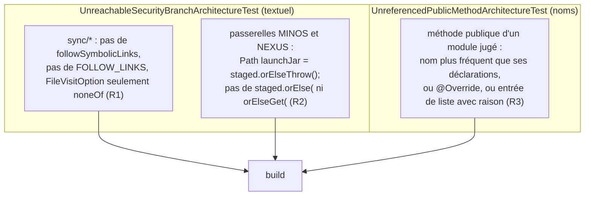
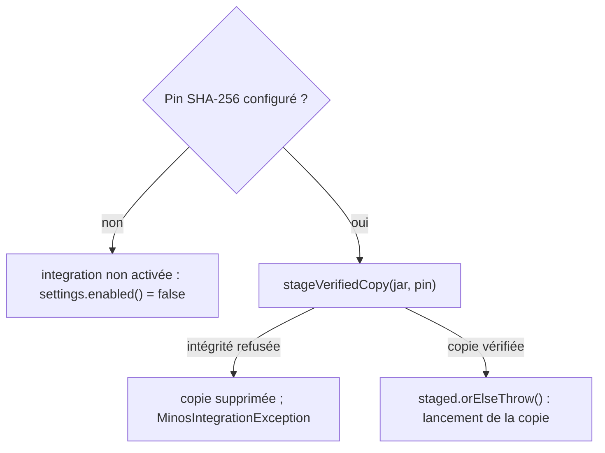

# Refus du code mort et des branches inatteignables (`dead-code-refusal`)

Spec de référence : [`openspec/specs/dead-code-refusal/spec.md`](../../../openspec/specs/dead-code-refusal/spec.md)
· Relevé du 2026-11-04 sur `2913fc30`.

## Objet et périmètre

Le produit ne porte ni méthode publique que rien ne référence, ni, sur un chemin de sécurité, une branche qu'un
constructeur ou une garde rend inatteignable. Une branche que personne ne peut atteindre est une branche que personne ne
teste : elle est sûre tant qu'une garde tient, et à une garde relâchée de ne plus l'être. Le build refuse les deux.

- **Acteurs** : auteur d'un service applicatif ou d'une passerelle ; relecteur ; les passerelles MCP MINOS et NEXUS ; le
  scanneur d'inventaire de sources.
- **Inclus** : `SourceScanPolicy`, `LocalSourceInventoryScanner`, `MinosMcpCodeGateway`, `NexusMcpContextGateway`, deux
  portes d'architecture (`UnreachableSecurityBranchArchitectureTest`, `UnreferencedPublicMethodArchitectureTest`).
- **Exclus** : l'API publiée du SDK de plugins ; le refus de lire à travers un lien dans la lecture de contenu
  (ADR `SEC-0157`).

## Exigences

| Alias | Exigence (titre exact) | En bref | Nature |
|---|---|---|---|
| R1 | A source scan SHALL never follow symbolic links, and no parameter SHALL offer to | aucun réglage de parcours de liens dans `SourceScanPolicy` ; le scanneur refuse sans condition une racine, un répertoire ou un fichier symboliques | `[EXIGENCE]` |
| R2 | An MCP peer SHALL be launched from the verified copy of its JAR or not at all | les passerelles lancent la copie vérifiée et ne portent aucun chemin qui nomme le JAR d'origine | `[EXIGENCE]` |
| R3 | A public method of a product module SHALL be referenced or excused by name | toute méthode publique d'un module du produit est appelée, redéfinit un supertype, ou figure sur une liste avec sa raison ; le SDK publié est hors règle ; sinon le build échoue | `[EXIGENCE]` |

## Comportement détaillé

### Pas de parcours de liens (R1)

`[EXISTANT VÉRIFIÉ]` `SourceScanPolicy` est un record de six composantes (noms de répertoires ignorés, profondeur,
répertoires, fichiers, octets par fichier, octets agrégés) : aucune ne concerne les liens symboliques. Sa Javadoc dit
qu'un paramètre qui ne pourrait être que faux serait une branche prête à être réactivée sans test.
[`UnreachableSecurityBranchArchitectureTest`](../../../morpheus-architecture-tests/src/test/java/com/morpheus/architecture/UnreachableSecurityBranchArchitectureTest.java)
lit toutes les sources du paquet `sync` de l'application : `followSymbolicLinks` est interdit ; `FOLLOW_LINKS` non précédé
de `NO` aussi ; `FileVisitOption` ne peut apparaître que sous la forme `EnumSet.noneOf(FileVisitOption.class)` (le type
n'a qu'une constante, tout autre ensemble suit les liens). Le scanneur doit contenir au moins trois appels à
`Files.isSymbolicLink(` (racine, répertoire, fichier).

### Pas de lancement hors de la copie vérifiée (R2)

`[EXISTANT VÉRIFIÉ]` Dans `MinosMcpCodeGateway.launch`, la copie est obtenue par
`settings.jarSha256().map(pin -> ExternalJarIntegrity.stageVerifiedCopy(jar, pin))`, puis `Path launchJar = staged.orElseThrow();`
fournit le seul chemin passé à `-cp`. Un JAR sans empreinte épinglée rend `settings.enabled()` faux avant toute
passerelle. Un échec d'intégrité supprime la copie et lève `MinosIntegrationException`. La passerelle NEXUS suit la même forme.

### Aucune méthode publique orpheline (R3)

`[EXISTANT VÉRIFIÉ]`
[`UnreferencedPublicMethodArchitectureTest`](../../../morpheus-architecture-tests/src/test/java/com/morpheus/architecture/UnreferencedPublicMethodArchitectureTest.java)
lit les sources Java de tous les modules `morpheus-*` (tests compris), blanchit chaînes, commentaires et blocs de texte,
puis compte les occurrences d'identifiant. Une méthode publique de `src/main/java` d'un module jugé est « nommée
ailleurs » quand son nom apparaît plus souvent qu'il n'est déclaré ; un `@Override` et le `main` statique ne sont pas
jugés. `PUBLIC_AND_NAMED_NOWHERE_ELSE` (table `fichier#méthode` vers raison) est vide. L'exécution compte plus de 300
méthodes examinées, sinon elle échoue.

## Diagrammes

### Que garantit chaque porte, et à quel niveau ?

Existant vérifié. Il répond à R1, R2 et R3 : deux portes textuelles ciblées sur la sécurité, une porte par nom sur toute la
surface publique.

### Comment le lancement d'un pair MCP se décide-t-il ?

Existant vérifié (R2). Il n'existe pas de branche vers le JAR d'origine.

## Écarts et questions ouvertes

- **Preuve manquante : la passerelle NEXUS sous le test d'exécution non épinglée (R2).** La spec nomme
  `MinosUnpinnedExecutionTest#existingUnpinnedJarIsNeverExecutable` « and its NEXUS counterpart ». Seul le test MINOS existe
  (`morpheus-integration-minos`) ; il ne vérifie que `settings.enabled()` faux pour un JAR sans empreinte, pas un lancement. Aucun
  test de ce nom ni de cette forme n'existe dans `morpheus-integration-nexus`. Les tests voisins sont
  `NexusIntegrationRuntimeTest#aPinnedJarThatWasSubstitutedYieldsAnUnavailableObservationBeforeLaunch` et
  `NexusIntegrationSettingsTest#aPinnedJarThatStillMatchesPassesTheIntegrityCheckAndIsLaunched`.
- **Portée de la preuve textuelle (R1, R2).** La porte de R1 ne lit que le paquet `sync` de l'application ; elle ne couvre
  pas un autre scanneur éventuel. La porte de R2 cherche la forme `staged.orElse(` ; un chemin écrit avec un autre nom de
  variable ne serait pas vu. Le garde sur les trois `Files.isSymbolicLink(` est un compte de texte, pas un comportement :
  le comportement est tenu par les tests de scan (platform-dépendants, ils portent « WhenPlatformSupportsLinks »).
- **La règle est plus étroite que son énoncé (R3).** La spec dit que la méthode doit être « called by a class of the repository ».
  La porte compte les **noms** : une méthode morte qui partage son nom avec une méthode vivante (`status()`, `parse()`) n'est
  jamais vue, ce que la Javadoc du test déclare (« The known limit is what remains, and it is wide »). La forme bytecode,
  essayée d'abord, a été abandonnée parce que le module d'architecture ne voit pas les tests des autres modules.
- **Modules exclus.** La spec exclut « the published plugin SDK ». La porte exclut cinq modules (`NOT_JUDGED` : le SDK, le
  testkit, la référence de plugin, les tests d'architecture et le rapport de couverture). Les quatre autres sont de l'outillage,
  non nommés par la spec. Aucun test ne démontre que le SDK n'est pas jugé (« The plugin SDK is not judged by MORPHEUS's own
  calls ») : c'est une conséquence du jeu `NOT_JUDGED`.
- **Preuve manquante : « An excuse without a reason, or for a method that is called, fails ».** Le code de la porte vérifie
  la raison non vide et la péremption de chaque entrée, mais la liste est vide : aucune exécution n'exerce ces branches, et aucun
  test ne construit une liste non vide pour les prouver.
- **« The sixteen methods ».** Le nombre de la spec est celui de l'audit. Le changement archivé relève après revue **dix-sept**
  méthodes (la porte corrigée a trouvé `MinosIntegrationRuntime.disabled()`) ; la spec garde seize.
- **Preuve manquante : « The misleading peer environment is gone ».** Aucun test ne fige l'absence de `processEnvironment` dans
  `MinosIntegrationSettings`. Une recherche des sources (2026-11-04) ne la trouve nulle part ; la porte R3 ne la verrait revenir
  que si elle n'était référencée nulle part.
- `[DÉCISION]` Un mécanisme voisin existe pour la lecture de contenu à travers un lien : ADR `SEC-0157`
  ([registre](../../architecture/adr/SEC-0157-aucun-contenu-n-est-lu-a-travers-un-lien-ni-hors-de-l-espace-de-travail.md)).
- `[EXISTANT VÉRIFIÉ]` `SourceScanPolicySymlinkTest` a été supprimé avec le paramètre qu'il testait (tâche 3.1 du changement
  archivé) : le scénario « Links are still refused » est tenu par les tests de scan conservés, cités plus bas.

## Traçabilité

| Exigence | Scénario | Conception ou diagramme | Changement | Preuve |
|---|---|---|---|---|
| R1 | The flag is gone | portes textuelles | archive `2026-10-30-remove-unreachable-and-unreferenced-code` | `UnreachableSecurityBranchArchitectureTest#aSourceScanCannotBeAskedToFollowSymbolicLinks` |
| R1 | Links are still refused | portes textuelles | idem | [`LocalSourceInventorySecurityTest`](../../../morpheus-application/src/test/java/com/morpheus/application/sync/LocalSourceInventorySecurityTest.java)`#safeDefaultDoesNotTraverseExternalSymbolicLinkWhenPlatformSupportsLinks`, `#rejectsSourceRootThatIsItselfASymbolicLinkWithoutTraversingItsTarget`, `#replacementBySymbolicLinkDuringScanProducesNoInventoryWhenLinksAreSupported` ; [`IntermediateSymlinkBoundaryTest`](../../../morpheus-application/src/test/java/com/morpheus/application/sync/IntermediateSymlinkBoundaryTest.java)`#scannerRejectsRootWhoseIntermediateComponentEscapesWorkspace` |
| R2 | The launch cannot name the unverified JAR | arbre de lancement | idem | `UnreachableSecurityBranchArchitectureTest#anMcpPeerIsLaunchedFromItsVerifiedCopyOrNotAtAll` |
| R2 | An unpinned JAR is still never executed | arbre de lancement | idem | [`MinosUnpinnedExecutionTest`](../../../morpheus-integration-minos/src/test/java/com/morpheus/integration/minos/MinosUnpinnedExecutionTest.java)`#existingUnpinnedJarIsNeverExecutable` ; homologue NEXUS : **preuve manquante** ; lancement d'une copie épinglée : [`MinosIntegrationSettingsTest`](../../../morpheus-integration-minos/src/test/java/com/morpheus/integration/minos/MinosIntegrationSettingsTest.java)`#aPinnedJarThatStillMatchesPassesTheIntegrityCheckAndIsLaunched` et [`NexusIntegrationSettingsTest`](../../../morpheus-integration-nexus/src/test/java/com/morpheus/integration/nexus/NexusIntegrationSettingsTest.java)`#aPinnedJarThatStillMatchesPassesTheIntegrityCheckAndIsLaunched` |
| R3 | The sixteen methods are gone | porte par noms | idem | `UnreferencedPublicMethodArchitectureTest#everyPublicMethodOfAProductModuleIsNamedSomewhereElseOrSaysWhy` |
| R3 | A new uncalled public method fails the build | porte par noms | idem | même test ; la forme du refus : `#aMethodNamedOnlyByItsOwnDeclarationIsReportedAndACallerClearsIt`, `#overloadsNothingCallsDoNotVouchForEachOther`, `#aMentionInACommentInDocumentationOrInAStringIsNotAReference` |
| R3 | The plugin SDK is not judged by MORPHEUS's own calls | porte par noms | idem | **preuve manquante** dédiée (voir Écarts) |
| R3 | An excuse without a reason, or for a method that is called, fails | porte par noms | idem | **preuve manquante** (liste vide) |
| R3 | The misleading peer environment is gone | — | idem | **preuve manquante** dédiée |

## Sources

- Changement archivé : `2026-10-30-remove-unreachable-and-unreferenced-code` (tâches 1.2, 2.1, 2.2, 3.1 à 3.4 et revues du 2026-10-12 et 2026-10-13).
- ADR : `SEC-0157` (lecture à travers un lien).
- Règles du dépôt : [`.claude/rules/security.md`](../../../.claude/rules/security.md), section « Processus MCP externes » ; [`.claude/rules/code-style.md`](../../../.claude/rules/code-style.md), « Jamais de code mort ».
- Pages liées : [`mcp-peer-launch-command.md`](mcp-peer-launch-command.md), [`record-construction.md`](record-construction.md).
