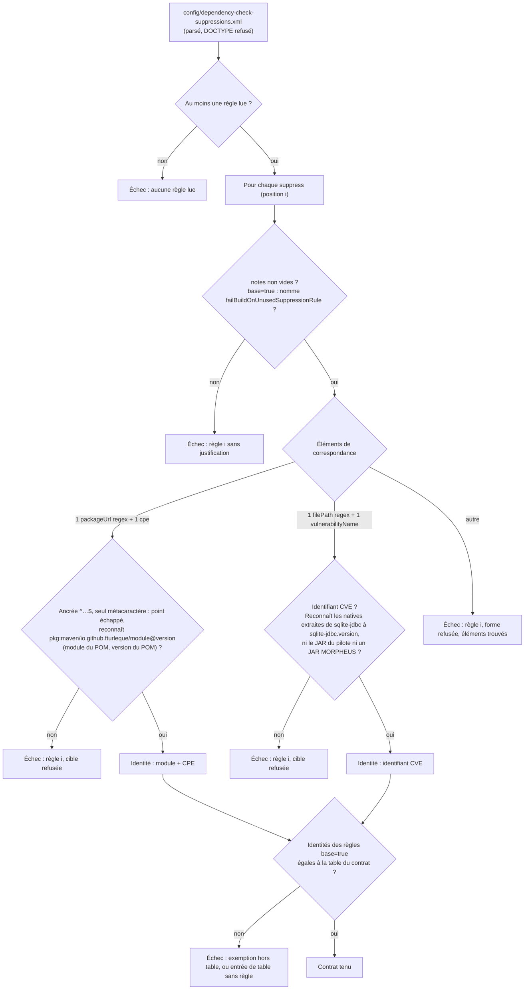

# Contrat du fichier de suppressions du gate CVE (`dependency-check-suppression-contract`)

Spec de référence : `openspec/specs/dependency-check-suppression-contract/spec.md`, créée à l'archivage du changement
`hold-the-dependency-check-suppressions-to-a-contract` (d'ici là, sa spec delta dans le dossier du changement)
· Relevé du 2026-11-06 sur `8c038add`.

## Objet et périmètre

[`config/dependency-check-suppressions.xml`](../../../config/dependency-check-suppressions.xml) désactive des détections
du gate CVE (OWASP Dependency-Check). La capacité garantit qu'une règle de ce fichier ne retire que ce qu'elle déclare,
sur une cible ancrée, avec sa raison écrite : l'élargissement d'une suppression fait échouer le build au lieu de
reposer sur la seule relecture.

- **Acteurs** : mainteneur qui ajoute ou modifie une suppression ; relecteur de PR ; CI (suite d'architecture).
- **Inclus** : la forme, la cible et la justification de chaque règle ; leur concordance avec le POM racine (modules,
  `<version>`, `<sqlite-jdbc.version>`) ; la liste exacte des règles exemptées de `failBuildOnUnusedSuppressionRule`.
- **Exclus** : le seuil CVSS et le câblage du fichier dans les profils `d2-security` et `d2-security-tests` (tenus par
  `D2RepositoryHardeningArchitectureTest` et `scripts/validate-d2.*`) ; le fichier d'indices (tenu par
  `DependencyCheckWorkflowContractTest`) ; le sens d'une suppression sur le moteur SQLite, dit par la capacité
  [`vulnerability-feed-freshness`](vulnerability-feed-freshness.md) (R5).

## Exigences

| Alias | Exigence (titre exact) | En bref | Nature |
|---|---|---|---|
| R1 | Chaque règle de suppression prend une des deux formes admises | association (`packageUrl` + `cpe`) ou vulnérabilité nommée (`filePath` + `vulnerabilityName`), rien d'autre ; un fichier vide échoue | `[EXIGENCE]` |
| R2 | Une règle d'association vise exactement un module MORPHEUS à la version du réacteur | expression ancrée, seul métacaractère le point échappé, chaîne reconnue égale à `pkg:maven/io.github.fturleque/<module>@<version>` | `[EXIGENCE]` |
| R3 | Une règle de vulnérabilité nommée vise un seul CVE sur les bibliothèques extraites du pilote | identifiant CVE ; reconnaît les natives Windows et Linux extraites de `sqlite-jdbc`, ni le JAR du pilote ni un JAR MORPHEUS | `[EXIGENCE]` |
| R4 | Chaque règle de suppression porte sa justification | `<notes>` non vide ; une règle `base="true"` nomme `failBuildOnUnusedSuppressionRule` | `[EXIGENCE]` |
| R5 | Les règles exemptées du contrôle des règles inutilisées sont exactement celles que le contrat nomme | égalité d'ensembles avec la table `EXEMPTIONS` du test | `[EXIGENCE]` |

## Comportement détaillé

`DependencyCheckSuppressionContractTest` (suite d'architecture, paquet `d2`, `@CoherenceCheck`) parse le fichier avec
`disallow-doctype-decl`, lit le POM racine et calcule la liste des problèmes du document ; la méthode sur le fichier
réel exige une liste vide. Les problèmes sont accumulés : un changement qui casse deux règles voit les deux. Chaque
problème nomme la règle par sa position (`rule #N`) et, quand elle est classée, par sa cible.

- **Forme (R1)** `[EXISTANT VÉRIFIÉ]` : hors `<notes>`, les éléments d'une règle sont exactement `[packageUrl, cpe]` ou
  `[filePath, vulnerabilityName]`, dans cet ordre ; toute autre liste (`gav`, `sha1`, `cvssBelow`, deux `cpe`,
  `vulnerabilityName` à côté d'un `packageUrl`…) est refusée en nommant les éléments trouvés. Seuls les attributs `base`
  et `until` sont admis sur `<suppress>` ; `until` n'est pas exigé. Un fichier sans règle échoue
  (« no suppression rule was read »).
- **Association (R2)** `[EXISTANT VÉRIFIÉ]` : `<packageUrl regex="true">` commence par `^` et finit par `$` ; entre les
  deux, `\.` vaut un point et tout autre métacaractère est refusé en le nommant ; la chaîne obtenue doit être
  `pkg:maven/io.github.fturleque/<module>@<version>` avec un `<module>` du POM racine et sa `<version>`, lue dans le POM,
  jamais dans un littéral du test. Une version restée à la précédente est refusée en nommant les deux.
- **CPE d'une association** `[DÉCISION]` (prise à l'implémentation, dans le cadre de « un seul `<cpe>` ») : le `<cpe>`
  n'a pas d'attribut et a la forme `cpe:/a:<fournisseur>:<produit>` ; un CPE plus large (`cpe:/a:github`, une expression)
  est refusé, parce que Dependency-Check compare un `<cpe>` de suppression comme un préfixe.
- **Vulnérabilité nommée (R3)** `[EXISTANT VÉRIFIÉ]` : `<vulnerabilityName>` a la forme `CVE-AAAA-NNNN…` ;
  `<filePath regex="true">` doit reconnaître (correspondance complète, comme Dependency-Check) une `sqlitejdbc.dll`
  extraite sous Windows et une `libsqlitejdbc.so` extraite sous Linux du JAR `sqlite-jdbc-<sqlite-jdbc.version>.jar`, et
  ne reconnaître ni ce JAR, ni le JAR d'un module du réacteur, ni une bibliothèque native rangée dans le JAR d'un module.
  C'est la forme bornée retenue par AUD-DEP-27, que ce contrôle empêche d'élargir.
- **Justification (R4)** `[EXISTANT VÉRIFIÉ]` : exactement un `<notes>` non vide après retrait des blancs ; les notes d'une
  règle `base="true"` contiennent `failBuildOnUnusedSuppressionRule`. Le contrat prouve qu'une raison a pu être écrite,
  pas qu'elle est juste : la revue la lit.
- **Exemptions (R5)** `[EXISTANT VÉRIFIÉ]` : la cible d'une règle est « module CPE » pour une association, l'identifiant
  CVE pour une vulnérabilité nommée, sans la version du réacteur. L'ensemble des cibles des règles `base="true"` doit
  égaler la constante `EXEMPTIONS` du test : une exemption hors table ou une entrée de table sans règle exemptée échoue.
  C'est une table de faits, qui ne nomme aucune classe de production ; elle ne grandit que par un diff du test, fichier
  de gouvernance dont la PR justifie la modification. Deux règles sur la même cible sont refusées.

## Diagrammes

### Comment le contrat classe-t-il une règle, et à quel moment échoue-t-il ?

Existant vérifié (`DependencyCheckSuppressionContractTest`). Exigences R1 à R5.

Les problèmes ne s'arrêtent pas au premier : la justification, la forme et la cible d'une même règle sont jugées
toutes, puis la table des exemptions.

## Écarts et questions ouvertes

- **Question (mainteneur)** : exiger un attribut `until` sur une règle de vulnérabilité nommée, que sa note dit
  provisoire. Le contrat l'admet sans l'exiger.
- **Passage de version** : les deux règles d'association portent la version du réacteur dans leur `packageUrl` ; un
  changement de `<version>` du POM sans ce fichier échoue au build (R2). Le fichier fait partie du lot indivisible du
  passage de version (`.claude/rules/governance.md`).
- **`.claude/rules/build.md`** dit que la justification d'une suppression va dans ses `<notes>`, tenue par ce test.

## Traçabilité

Test : [`DependencyCheckSuppressionContractTest`](../../../morpheus-architecture-tests/src/test/java/com/morpheus/architecture/d2/DependencyCheckSuppressionContractTest.java) (DCS).
Changement : `hold-the-dependency-check-suppressions-to-a-contract`.

| Exigence | Scénario | Conception ou diagramme | Tâche | Preuve |
|---|---|---|---|---|
| R1 | Le fichier actuel est admis | diagramme | 1.1 | DCS `#theSuppressionFileOfTheRevisionHoldsToTheContract` |
| R1 | Une règle sans CPE retire toutes les vulnérabilités d'un paquet | diagramme (forme) | 1.2 | DCS `#aRuleWithoutCpeIsRefusedAsAnUnadmittedForm` |
| R1 | Une forme non admise | idem | 1.2 | DCS `#everyOtherMatchingElementOfTheSchemaIsRefusedAsAnUnadmittedForm`, `#anAttributeOtherThanBaseAndUntilIsRefused`, `#untilIsAdmittedWithoutBeingRequired` |
| R1 | Un fichier vide ne passe pas à vide | diagramme (première décision) | 1.2 | DCS `#aFileWithoutAnyRuleDoesNotPassEmpty` |
| R2 | Une expression élargie | diagramme (association) | 1.2, 1.3 | DCS `#aWidenedPackageUrlIsRefusedNamingTheMetacharacter` ; violation plantée dans le vrai fichier puis retirée |
| R2 | Une expression non ancrée | idem | 1.2 | DCS `#anUnanchoredPackageUrlIsRefused` |
| R2 | Une dépendance tierce visée | idem | 1.2 | DCS `#aPackageUrlOfAThirdPartyOrOfAnUndeclaredModuleIsRefusedNamingTheCoordinate` ; CPE : `#aCpeBroaderThanOneVendorAndOneProductIsRefused` |
| R2 | La version du réacteur change sans la règle | idem | 1.2 | DCS `#aPackageUrlLeftAtAnotherVersionThanTheReactorIsRefusedNamingBoth` |
| R3 | Un chemin qui reconnaît tout | diagramme (vulnérabilité nommée) | 1.2 | DCS `#aFilePathThatMatchesEverythingIsRefusedNamingTheJarItWronglyMatches`, `#aFilePathThatMissesTheExtractedLibrariesIsRefused` |
| R3 | Un nom de vulnérabilité qui n'est pas un CVE | idem | 1.2 | DCS `#aVulnerabilityNameThatIsNotACveIsRefusedNamingTheValue` |
| R4 | Une règle sans note | diagramme (justification) | 1.2 | DCS `#aRuleWithoutNotesOrWithBlankNotesIsRefused` |
| R4 | Une exemption sans raison | idem | 1.2 | DCS `#anExemptionWhoseNotesDoNotSayWhyIsRefused` |
| R5 | Une exemption ajoutée en passant | diagramme (table) | 1.2, 1.3 | DCS `#anExemptionOutsideTheTableIsRefusedNamingTheRule` ; `base="true"` posé sur la règle de `morpheus-cli` dans le vrai fichier puis retiré |
| R5 | Une exemption retirée sans la table | idem | 1.2 | DCS `#anEntryOfTheTableLeftWithoutAnExemptedRuleIsRefusedNamingTheEntry` |

Admission des deux formes sur un corpus fabriqué : DCS `#theFabricatedCorpusOfBothFormsIsAdmitted` ; deux règles sur la
même cible : DCS `#twoRulesOnTheSameTargetAreRefused`.

## Sources

- Règle de dépôt : `.claude/rules/build.md` (« Justifier toute suppression CVE »).
- Pages liées : [`vulnerability-feed-freshness.md`](vulnerability-feed-freshness.md) (R5, suppression sur le moteur
  SQLite) ; registre des risques, RT-13 dans [`../../architecture/risks/register.md`](../../architecture/risks/register.md).
