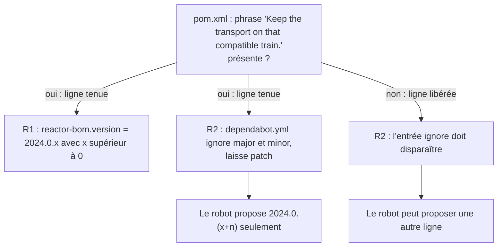

# Dépendance tenue sur une ligne de versions (`dependency-line-currency`)

Spec de référence : [`openspec/specs/dependency-line-currency/spec.md`](../../../openspec/specs/dependency-line-currency/spec.md)
· Relevé du 2026-11-04 sur `2913fc30`.

## Objet et périmètre

Le POM racine tient le BOM Reactor sur la ligne de versions sur laquelle le SDK MCP est construit. Une dépendance tenue
volontairement sur une ligne reçoit les correctifs de cette ligne, et le robot de mises à jour propose ces correctifs,
jamais un changement de ligne : sans cela, le robot ne proposait que la ligne suivante, qu'on refusait, et Reactor restait
refusé en bloc, correctifs compris.

- **Acteurs** : mainteneur qui change le SDK MCP ou la ligne ; Dependabot ; build.
- **Inclus** : la propriété `reactor-bom.version` du POM racine, son commentaire, l'entrée `ignore` de
  `.github/dependabot.yml`.
- **Exclus** : le choix de la ligne, qui suit une montée du SDK MCP et se décide avec elle ; les autres BOM.

## Exigences

| Alias | Exigence (titre exact) | En bref | Nature |
|---|---|---|---|
| R1 | Reactor SHALL be on a patched release of the line the MCP SDK is built on | `reactor-bom.version` est de la ligne du SDK, et n'est pas la première version de cette ligne | `[EXIGENCE]` |
| R2 | The update bot SHALL propose the patches of a held line and nothing else | `ignore` des mises à jour majeures et mineures de `io.projectreactor:reactor-bom`, jamais des correctifs ; l'entrée et la ligne tenue vont ensemble | `[EXIGENCE]` |

## Comportement détaillé

`[EXISTANT VÉRIFIÉ]` ([`DependencyLineCurrencyTest`](../../../morpheus-architecture-tests/src/test/java/com/morpheus/architecture/d2/DependencyLineCurrencyTest.java), classe de cohérence).

- **Valeur tenue** : la propriété `reactor-bom.version` du [POM racine](../../../pom.xml), valeur à lire là. Le BOM est
  importé dans `<dependencyManagement>` sous le commentaire « MCP SDK … is built on the Reactor 2024.0.x/3.7.x line. Keep
  the transport on that compatible train. ».
- **R1** : le test exige une version à trois parties, la présence de la phrase « Keep the transport on that compatible
  train. », la ligne `2024.0` (écrite en dur dans le test) et un troisième nombre supérieur à zéro.
- **R2** : le test lit `.github/dependabot.yml`. Si le POM tient la ligne (la phrase est présente), l'entrée
  `dependency-name: "io.projectreactor:reactor-bom"` doit exister, lister `version-update:semver-major` et
  `version-update:semver-minor`, et ne pas lister `version-update:semver-patch`. Si le POM ne tient plus la ligne, l'entrée
  doit disparaître, sinon le robot ne proposerait jamais de nouvelle ligne.

## Diagrammes

### Que décident le POM et le robot ensemble ?

Existant vérifié. Exigences R1 et R2.

## Écarts et questions ouvertes

- `[EXISTANT VÉRIFIÉ]` **Ligne écrite en dur** : R1 dit « the line the POM states the MCP SDK requires » ; le test compare à
  la chaîne `2024.0` plutôt que de la dériver du commentaire du POM. Un changement de ligne exige donc de modifier le
  test avec le POM (le message du test le dit : « follows an MCP SDK upgrade »).
- `[EXISTANT VÉRIFIÉ]` **« while later ones exist »** : le test ne consulte aucun dépôt de versions ; il refuse seulement un
  troisième nombre égal à zéro.
- **Preuve manquante (R1, « The transport still works on it »)** : aucun test ne porte ce scénario par son nom ; la
  preuve archivée est l'exécution, dans les checks requis de la pull request, des tests du transport STDIO avec
  processus réel, par exemple
  [`BoundedStdioClientTransportTest`](../../../morpheus-mcp-transport/src/test/java/com/morpheus/transport/mcp/BoundedStdioClientTransportTest.java)`#exchangesJsonRpcFramesOverRealStdioProcess`
  et [`PeerOperationDeadlineTest`](../../../morpheus-mcp-transport/src/test/java/com/morpheus/transport/mcp/PeerOperationDeadlineTest.java)`#anOperationStillRunningAtItsDeadlineIsAbortedOnce`.
  Les « MCP client timeout tests » de la spec ne sont pas nommés ; le fichier qui configure `requestTimeout` est
  `BoundedStdioClientTransportTest`.

## Traçabilité

| Exigence | Scénario | Conception ou diagramme | Changement | Preuve |
|---|---|---|---|---|
| R1 | The shipped Reactor is a patched one | organigramme | archive `2026-10-30-keep-reactor-on-its-patched-line` | [`DependencyLineCurrencyTest`](../../../morpheus-architecture-tests/src/test/java/com/morpheus/architecture/d2/DependencyLineCurrencyTest.java)`#reactorIsOnAPatchedReleaseOfTheLineThePomHolds` |
| R1 | The transport still works on it | — | idem | **Preuve manquante** par test nommé ; voir Écarts |
| R2 | The ignore entry exists with both update types | organigramme | idem | `DependencyLineCurrencyTest#theUpdateBotProposesThePatchesOfTheHeldLineAndNothingElse` |
| R2 | Removing the entry while the line is held fails the build | idem | idem | `DependencyLineCurrencyTest#theUpdateBotProposesThePatchesOfTheHeldLineAndNothingElse` (rupture jouée dans la tâche archivée 3.4) |
| R2 | Releasing the line removes the entry | idem | idem | `DependencyLineCurrencyTest#theUpdateBotProposesThePatchesOfTheHeldLineAndNothingElse` (branche « ligne libérée », non exercée tant que la phrase est présente) |

## Sources

- Règle de dépôt : `.claude/rules/build.md` (versions pilotées par propriété, couplage `reactor-bom` / `mcp-sdk`).
- Configuration : [`.github/dependabot.yml`](../../../.github/dependabot.yml).
- Pages liées : [`dependency-version-management.md`](dependency-version-management.md).
