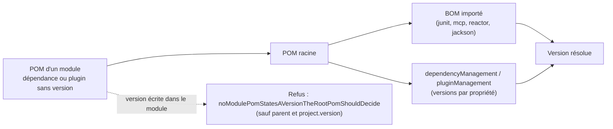
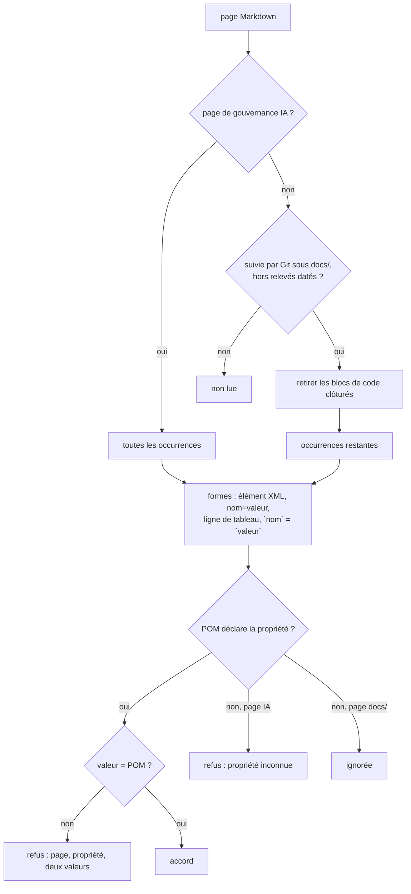

# Gestion des versions de dépendances et de plugins (`dependency-version-management`)

Spec de référence : [`openspec/specs/dependency-version-management/spec.md`](../../../openspec/specs/dependency-version-management/spec.md)
· Relevé du 2026-11-04 sur `2913fc30` ; R4 relevé le 2026-11-06 sur `8c038add` ; R5 et R6 relevés le 2026-11-11 sur `d90592e4`.

## Objet et périmètre

La version d'une dépendance tierce ou d'un plugin de build se décide à un seul endroit, le POM racine, soit par un BOM
importé, soit par une entrée gérée (`<dependencyManagement>`, `<pluginManagement>`). Une version écrite dans un POM de
module l'emporte sans bruit sur celle du POM racine : le build la refuse.

- **Acteurs** : auteur d'un POM de module ; mainteneur du POM racine ; build.
- **Inclus** : les POM de tous les modules déclarés dans le POM racine ; la règle de build qui décrit le mécanisme ; les
  versions que les pages de gouvernance IA et les pages vivantes de `docs/` écrivent sous la forme d'une propriété du POM.
- **Exclus** : les versions épinglées du POM racine (`D2RepositoryHardeningArchitectureTest#dependencyAndQualityBaselineIsPinned`),
  l'hygiène `dependency:analyze`, la politique des CVE.

## Exigences

| Alias | Exigence (titre exact) | En bref | Nature |
|---|---|---|---|
| R1 | A module POM SHALL state no dependency or plugin version | aucun `<version>` sauf celle du `<parent>` et `${project.version}` ; module nouveau jugé sans autre changement | `[EXIGENCE]` |
| R2 | Every third-party version SHALL be decided in the root POM | toute version tierce vient d'un BOM importé ou d'une entrée gérée ; un plugin vient de `pluginManagement` | `[EXIGENCE]` |
| R3 | The build rule SHALL describe the mechanism as enforced | la règle de build énonce les deux formes admises et cite le test | `[EXIGENCE]` |
| R4 | Une version qu'une page de gouvernance IA écrit sous la forme d'une propriété du POM DOIT égaler la valeur de cette propriété | élément XML ou affectation de propriété, sur toute page de gouvernance IA, comparé au POM racine ; propriété inconnue et scan vide refusés | `[EXIGENCE]` |
| R5 | Une version qu'une page vivante de `docs/` écrit sous la forme d'une propriété du POM DOIT égaler la valeur de cette propriété | toute page Markdown suivie par Git sous `docs/`, hors relevés datés et blocs de code clôturés ; seule une propriété que le POM déclare est comparée | `[EXIGENCE]` |
| R6 | Une version écrite en ligne de tableau ou en égalité de spans de code est une version écrite sous la forme d'une propriété | ligne de tableau (cellule du nom, puis cellule de la valeur, en spans de code) et `` `nom.version` = `valeur` `` ; un tableau qui nomme la propriété sans valeur n'est pas lu | `[EXIGENCE]` |

## Comportement détaillé

- **R1** `[EXISTANT VÉRIFIÉ]` ([`D2RepositoryHardeningArchitectureTest`](../../../morpheus-architecture-tests/src/test/java/com/morpheus/architecture/d2/D2RepositoryHardeningArchitectureTest.java)) :
  le test lit les `<module>` du POM racine (il échoue s'il n'en lit aucun), puis le POM de chacun. Il blanchit les
  commentaires XML et le bloc `<parent>`, puis rapporte chaque `<version>` dont le contenu n'est pas exactement
  `${project.version}`, sous la forme `<module>/pom.xml:<ligne> <version>…</version>`. Une version littérale et une
  version par propriété (`${autre.propriété}`) échouent de la même façon. Un module ajouté au POM racine est lu sans autre
  changement.
- **R2** `[EXISTANT VÉRIFIÉ]` : mécanisme, non test. Le POM racine importe des BOM (JUnit, SDK MCP, Reactor, Jackson) et gère
  par propriété les dépendances qu'aucun BOM ne couvre ; un module référence sans version. Exemple : `slf4j-api` est géré
  par la propriété `slf4j.version` du POM racine, avec un commentaire qui l'aligne sur le backend que la CLI emballe, et
  le POM de `morpheus-cli` le déclare sans version. Les valeurs sont à lire dans le POM racine, non ici.
- **R3** `[EXISTANT VÉRIFIÉ]` : `.claude/rules/build.md`, section « JAMAIS », énonce les deux formes admises (version du
  `<parent>`, `${project.version}` pour un module frère) et cite
  `D2RepositoryHardeningArchitectureTest#noModulePomStatesAVersionTheRootPomShouldDecide`.
- **R4** `[EXISTANT VÉRIFIÉ]` ([`GovernanceSurfaceCoherenceTest`](../../../morpheus-architecture-tests/src/test/java/com/morpheus/architecture/GovernanceSurfaceCoherenceTest.java)`#everyVersionAGovernancePageWritesAsAPomPropertyEqualsThePom`) :
  sur chaque page de gouvernance IA (`.claude/CLAUDE.md`, `.github/AI_GOVERNANCE.md`, `.claude/rules/`,
  `.claude/commands/`, `.claude/agents/`, les `SKILL.md` de `.claude/skills/`), le test lit les deux formes d'une
  propriété de version du POM, l'élément XML et l'affectation, et compare chaque occurrence à la propriété de même nom
  du premier bloc `<properties>` du POM racine. Il échoue en nommant la page, la propriété et les deux valeurs, ou la
  propriété que le POM ne déclare pas ; il échoue aussi quand il ne lit aucune version. Aucune liste de propriétés n'est
  tenue. Une version écrite en prose n'est pas lue : `.claude/rules/build.md` cite la propriété plutôt que sa valeur.
- **R5** `[EXISTANT VÉRIFIÉ]` (`GovernanceSurfaceCoherenceTest#everyVersionALivingDocumentationPageWritesAsAPomPropertyEqualsThePom`) :
  le test lit chaque page `.md` que `RepositoryTree.files` rend sous `docs/` et que `git ls-files` liste (classe
  `TrackedFiles` des tests d'architecture), hors `docs/project/audits/`, `docs/project/validation/`,
  `docs/project/roadmap/` et `docs/user/release-notes/`. Il retire le texte des blocs de code clôturés (au sens de CommonMark ; un bloc jamais fermé est refusé), lit les quatre
  formes, ne garde que les propriétés que le POM racine déclare et échoue en nommant la page, la propriété et les deux
  valeurs. Une page vivante peut n'écrire aucune version : le scan est tenu par le nombre de pages lues, qui ne peut être
  nul. Hors d'un dépôt Git ou sans `git`, le test est ignoré avec sa raison, et échoue en CI.
- **R6** `[EXISTANT VÉRIFIÉ]` : `statedVersions` lit, sur toute page, en plus de l'élément XML et de l'affectation, une
  ligne de tableau dont une cellule est exactement le span de code d'un nom `*.version` et une cellule suivante
  exactement le span de code d'une valeur commençant par un chiffre, et deux spans de code joints par `=`.

## Diagrammes

### D'où vient la version qu'un module utilise ?

Existant. Exigences R1 et R2.

### Quelle occurrence d'une page est comparée ?

Existant. Exigences R4, R5 et R6.

## Écarts et questions ouvertes

- `[EXISTANT VÉRIFIÉ]` **`${project.version}` admis partout** : la spec réserve `${project.version}` à un module du même
  reactor ; le test l'accepte sur n'importe quel `<version>`, y compris celle d'une dépendance tierce. Le gate ne vérifie
  pas que la cible est un module frère.
- `[EXISTANT VÉRIFIÉ]` **Éléments lus** : seuls les éléments `<version>` sont vus. Le test ne vérifie pas qu'une dépendance sans
  version d'un module a bien une entrée gérée au POM racine (c'est Maven qui échoue alors, pas ce gate).
- **Preuve manquante (R2)** : aucun test ne compare l'arbre de dépendances ou le SBOM aux versions du POM racine (scénario
  « A module resolves the version the root POM manages ») ; aucun test ne change `slf4j.version` pour constater que
  l'API et le backend de la CLI suivent (scénario « The logging backend follows the logging API »). Le test
  `ProductReleaseContractTest#releaseScriptsEnforcePerUserInstallExactTagChecksumsAndVerifiedToolBootstrap` vérifie seulement que le POM de la CLI déclare `slf4j-api` et n'embarque pas `slf4j-nop`.
- `[DÉCISION]` **R5, clé inconnue ignorée** : dans `docs/`, une propriété retirée du POM et restée sur une page n'est
  plus vue ; `docs/` décrit légitimement des clés d'autres artefacts (`data.version` de Dependency-Check, manifeste de
  plugin). Un relevé daté rangé hors des quatre dossiers de relevés est lu : il écrit la propriété en prose ou dans un
  bloc clôturé.
- **Preuve manquante (R3)** : aucun test ne lit `.claude/rules/build.md` pour y chercher la phrase et le nom du test ;
  la concordance est tenue par la revue.

## Traçabilité

| Exigence | Scénario | Conception ou diagramme | Changement | Preuve |
|---|---|---|---|---|
| R1 | A literal version in a module fails the build | organigramme | archive `2026-10-29-manage-every-dependency-version-in-the-root-pom` | [`D2RepositoryHardeningArchitectureTest`](../../../morpheus-architecture-tests/src/test/java/com/morpheus/architecture/d2/D2RepositoryHardeningArchitectureTest.java)`#theModuleVersionRuleSeesALiteralAndAPropertyButNeitherACommentNorTheParent` ; `#noModulePomStatesAVersionTheRootPomShouldDecide` |
| R1 | A property-backed version in a module fails the build | idem | idem | `D2RepositoryHardeningArchitectureTest#theModuleVersionRuleSeesALiteralAndAPropertyButNeitherACommentNorTheParent` |
| R1 | A sibling module is referenced by the project version | idem | idem | `D2RepositoryHardeningArchitectureTest#theModuleVersionRuleSeesALiteralAndAPropertyButNeitherACommentNorTheParent` (cas `${project.version}`) |
| R1 | A newly declared module is judged | idem | idem | `D2RepositoryHardeningArchitectureTest#noModulePomStatesAVersionTheRootPomShouldDecide` (liste dérivée du POM racine) |
| R2 | A module resolves the version the root POM manages | idem | idem | **Preuve manquante** |
| R2 | The logging backend follows the logging API | idem | idem | **Preuve manquante** ; contexte : [`ProductReleaseContractTest`](../../../morpheus-architecture-tests/src/test/java/com/morpheus/architecture/m20/ProductReleaseContractTest.java)`#releaseScriptsEnforcePerUserInstallExactTagChecksumsAndVerifiedToolBootstrap` (POM de la CLI) |
| R3 | The rule page and the POMs agree | — | idem | **Preuve manquante** (revue) ; la phrase est dans `.claude/rules/build.md` |
| R4 | La version de JaCoCo restée en arrière | — | `compare-every-document-that-states-a-fact-to-its-source` | `GovernanceSurfaceCoherenceTest#everyVersionAGovernancePageWritesAsAPomPropertyEqualsThePom` (vu rouge sur `jacoco.version` avant correction) |
| R4 | Un bump qui ne touche que le POM | — | idem | idem |
| R4 | Les deux formes sont lues | — | idem | `GovernanceSurfaceCoherenceTest#bothShapesOfAVersionAreComparedAndAPropertyThePomDoesNotDeclareIsRefused` |
| R4 | Une propriété que le POM ne déclare plus | — | idem | idem |
| R4 | Le contrôle a trouvé des versions à comparer | — | idem | `GovernanceSurfaceCoherenceTest#aVersionScanThatReadsNothingFailsInsteadOfPassing` |
| R5 | Un bump qui ne touche que le POM | organigramme des occurrences | archive `2026-11-11-compare-every-living-developer-page-to-the-pom-properties` | `GovernanceSurfaceCoherenceTest#everyVersionALivingDocumentationPageWritesAsAPomPropertyEqualsThePom` (violation plantée dans `docs/developer/CODE_AUDIT.md`, vue rouge, retirée) ; `#onlyALivingTrackedPageOfDocsIsComparedAndOnlyOnAPropertyThePomDeclares` |
| R5 | Un relevé daté n'est pas lu | idem | idem | `#onlyALivingTrackedPageOfDocsIsComparedAndOnlyOnAPropertyThePomDeclares` |
| R5 | Une transcription dans un bloc de code clôturé | idem | idem | idem |
| R5 | La clé d'un autre artefact | idem | idem | idem |
| R5 | Un fichier local non suivi | idem | idem | idem |
| R6 | La ligne de tableau d'origine du constat | idem | idem | `GovernanceSurfaceCoherenceTest#aTableRowAndAnEqualityOfCodeSpansAreReadWhileATableThatNamesThePropertyIsNot` (vu rouge avant les deux formes) |
| R6 | L'égalité de deux spans de code | idem | idem | idem |
| R6 | Un tableau qui nomme les propriétés sans valeur | idem | idem | idem |

## Sources

- Règle de dépôt : `.claude/rules/build.md` (« JAMAIS », « `dependencyManagement` — le mécanisme concret »).
- Pages liées : [`dependency-line-currency.md`](dependency-line-currency.md),
  [`reactor-module-documentation.md`](reactor-module-documentation.md).
