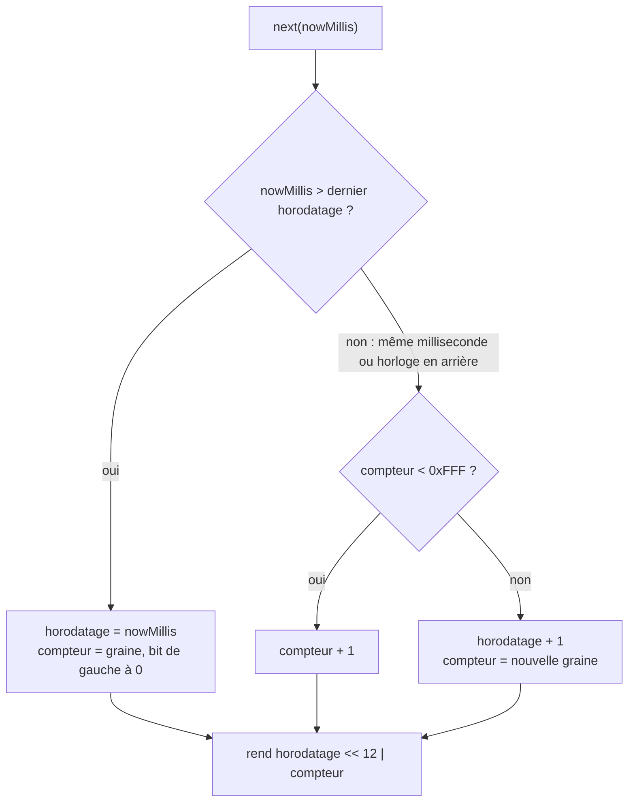

# Ordre des identités de domaine générées (`domain-identity-generation`)

Spec de référence : [`openspec/changes/generate-domain-identities-in-order/specs/domain-identity-generation/spec.md`](../../../openspec/changes/generate-domain-identities-in-order/specs/domain-identity-generation/spec.md),
spec du changement en cours ; elle rejoint `openspec/specs/domain-identity-generation/` à son archivage.

## Objet et périmètre

Deux identités de domaine générées par un même processus se comparent dans l'ordre de leur génération, y compris dans
la même milliseconde. Toute liste triée par identité rend donc le même ordre à chaque exécution.

- **Acteurs** : tout lecteur d'une liste triée par identité (CLI, MCP, HTTP) ; les stores mémoire et SQLite.
- **Inclus** : `DomainIdentity.generate()` et la séquence qui fournit l'horodatage et le compteur.
- **Exclus** : l'ordre entre deux processus dans la même milliseconde ; le format, la persistance et la résolution des
  identités ([ADR-0168](../../architecture/adr/DATA-0168-identite-de-domaine-generee-dans-l-ordre.md)).

## Exigences

| Alias | Exigence (titre exact) | En bref | Nature |
|---|---|---|---|
| R1 | Identities generated by one process compare in the order of generation | ordre de génération par `compareTo` et par le texte, dans la milliseconde, au débordement et quand l'horloge recule ; UUIDv7 inchangé | `[EXIGENCE]` |

## Comportement détaillé

`[EXISTANT VÉRIFIÉ]`

- Le UUIDv7 porte l'horodatage milliseconde (48 bits), la version, `rand_a` (12 bits), la variante et `rand_b`
  (62 bits). `rand_a` est un compteur, `rand_b` reste tiré d'un `SecureRandom` (RFC 9562, section 6.2, méthode 1).
- [`MonotonicTimestampSequence`](../../../morpheus-domain/src/main/java/com/morpheus/domain/identity/MonotonicTimestampSequence.java),
  une instance par processus, tenue par [`DomainIdentity`](../../../morpheus-domain/src/main/java/com/morpheus/domain/identity/DomainIdentity.java),
  rend pour chaque appel une valeur strictement plus grande que la précédente. Sa méthode `next` est `synchronized`.
- Une nouvelle milliseconde réensemence le compteur avec son bit de gauche à 0, ce qui laisse au moins 2048 incréments.
  La même milliseconde, ou une horloge qui recule, incrémente le compteur sur le dernier horodatage rendu. Un compteur
  qui déborde fait avancer l'horodatage d'une milliseconde avec une nouvelle graine.
- Le constructeur compact de `DomainIdentity` refuse toujours une valeur hors version 7 et variante 2 ; les identités
  persistées sont relues telles quelles.

## Diagrammes

### Que rend la séquence selon l'horloge ?

Existant. Exigence R1.

## Écarts et questions ouvertes

- `[EXISTANT VÉRIFIÉ]` L'ordre de deux identités créées par deux processus dans la même milliseconde n'est pas garanti.
  Aucune liste n'en dépend : les identités d'une ingestion sont générées par un seul processus, puis persistées.

## Traçabilité

| Exigence | Scénario | Conception ou diagramme | Changement | Preuve |
|---|---|---|---|---|
| R1 | Identities generated within one millisecond | organigramme | `generate-domain-identities-in-order` | [`DomainIdentityTest`](../../../morpheus-domain/src/test/java/com/morpheus/domain/identity/DomainIdentityTest.java)`#identitiesGeneratedInOneMillisecondCompareInTheOrderOfGeneration` ; `CliCommandTranscriptTest` (transcription `analyze-change-json`) |
| R1 | Counter overflow within one millisecond | organigramme | idem | [`MonotonicTimestampSequenceTest`](../../../morpheus-domain/src/test/java/com/morpheus/domain/identity/MonotonicTimestampSequenceTest.java)`#aCounterThatOverflowsMovesToTheNextMillisecondWithAFreshSeed` |
| R1 | System clock that goes back | organigramme | idem | `MonotonicTimestampSequenceTest#aClockThatGoesBackContinuesOnTheLastTimestamp` |
| R1 | A value that is not a UUIDv7 is still refused | — | idem | `DomainIdentityTest#rejectsNonUuidV7Values` |

## Sources

- ADR : [DATA-0168](../../architecture/adr/DATA-0168-identite-de-domaine-generee-dans-l-ordre.md).
- RFC 9562, section 6.2 (*Monotonicity and Counters*).
