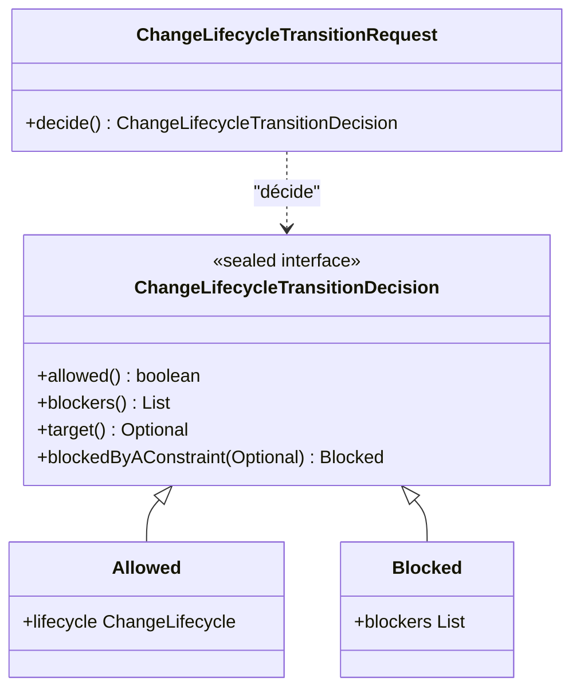
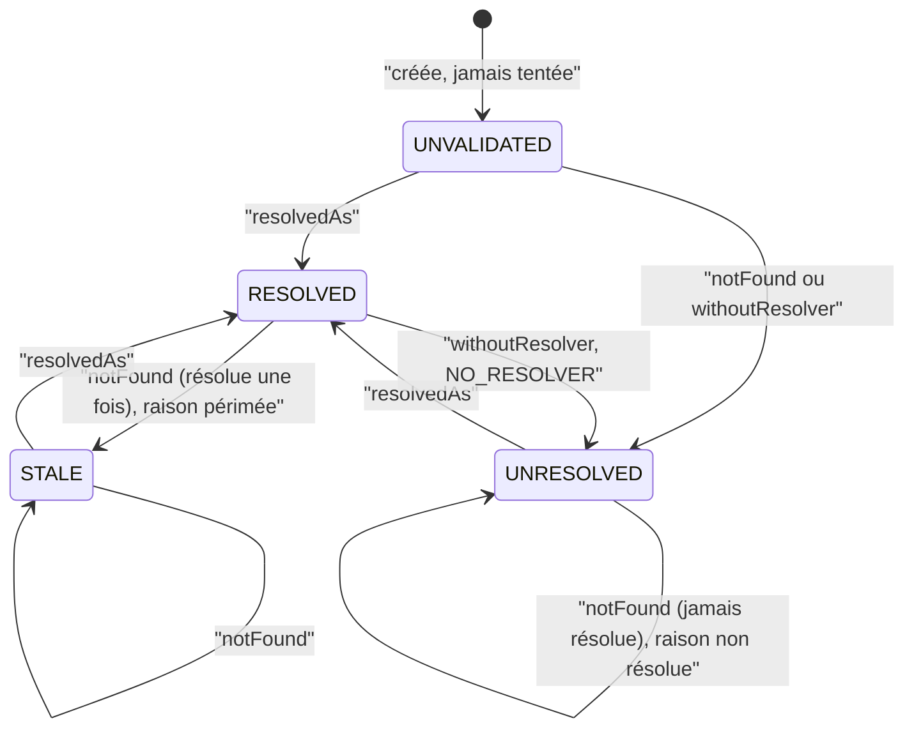

# Décisions sur une valeur du domaine (`domain-value-decisions`)

Spec de référence : [`openspec/specs/domain-value-decisions/spec.md`](../../../openspec/specs/domain-value-decisions/spec.md)
· Relevé du 2026-11-04 sur `2913fc30`.

## Objet et périmètre

Deux décisions qui ne portent que sur une valeur du domaine sont écrites sur son type, dans `morpheus-domain`, et aucune
classe de l'application ne les refait : la transition d'un cycle de vie de changement, et l'état de résolution d'une
référence externe. La troisième décision de ce genre, le blocage d'une contrainte, a sa propre page :
[`constraint-blocking-decision.md`](constraint-blocking-decision.md).

- **Acteurs** : service applicatif qui demande une transition (`ChangeLifecycleQualityService`,
  `ChangeTransitionEvaluationService`) ; service qui résout une référence externe
  (`ExternalReferenceResolutionService`) ; relecteur d'un diff.
- **Inclus** : `ChangeLifecycleTransitionRequest.decide()`, la famille scellée `ChangeLifecycleTransitionDecision`,
  `ExternalReference` (`resolvedAs`, `withoutResolver`, `notFound`), les règles ArchUnit qui interdisent à
  l'application de les refaire.
- **Exclus** : le contenu des faits et de la politique d'une transition (voir la machine d'états du cycle de vie, ADR
  `BE-0119`) ; les résolveurs eux-mêmes (ports d'intégration).

## Exigences

| Alias | Exigence (titre exact) | En bref | Nature |
|---|---|---|---|
| R1 | The domain model SHALL decide a lifecycle transition | le domaine décide, résultat dans une famille fermée (autorisée vers un cycle de vie cible, ou bloquée par des bloqueurs nommés) ; l'application l'obtient, ne la reformule pas | `[EXIGENCE]` |
| R2 | The domain model SHALL move the resolution state of an external reference | introuvable : `STALE` si la référence a déjà été résolue, sinon `UNRESOLVED`, avec la raison correspondante, choisis par le domaine | `[EXIGENCE]` |

## Comportement détaillé

### La décision de transition (R1)

`[EXISTANT VÉRIFIÉ]` `ChangeLifecycleTransitionRequest.decide()` (module domaine) rend un
`ChangeLifecycleTransitionDecision`, interface **scellée** qui ne permet que `Allowed(lifecycle)` et `Blocked(blockers)`.
`Allowed` ne porte aucun bloqueur ; `Blocked` en exige au moins un.
`ChangeLifecycleTransitionDecision.blockedByAConstraint(Optional<decision>)` assemble le cas d'une contrainte
bloquante : les bloqueurs de la décision de cycle de vie, s'il y en a une, puis `BLOCKING_CONSTRAINT` **une seule fois**.
`awaitsAnAbandonmentReason()` est vrai quand `ABANDONMENT_REASON_REQUIRED` est présent. L'application appelle
`decide()` depuis `ChangeLifecycleQualityService` et la fabrique `blockedByAConstraint` depuis
`ChangeTransitionEvaluationService` ; elle ne construit jamais `Allowed` ni `Blocked`.

### L'état de résolution d'une référence externe (R2)

`[EXISTANT VÉRIFIÉ]` `ExternalReference` offre trois mouvements : `resolvedAs(cible, instant)` (état `RESOLVED`),
`withoutResolver(instant)` (état `UNRESOLVED`, raison `NO_RESOLVER`, même après une résolution passée) et
`notFound(raisonNonRésolue, raisonPérimée, instant)`. Ce dernier calcule `hasBeenResolved()` (résolue ou périmée
maintenant, ou résolue une fois dans l'historique) et choisit l'état et la raison. `ExternalReferenceResolutionService`
(application) ne fait que passer au domaine, selon le statut du résolveur, le couple de raisons possibles. Une
référence périmée dont la cible reste introuvable reste `STALE`. Le lien de traçabilité enregistre une référence
périmée comme partiellement résolue, jamais comme heuristique (`ExternalReferenceResolutionState.traceabilityResolution`).

`[EXISTANT VÉRIFIÉ]` `withoutResolver` n'est pas dans le texte de R2 (qui parle d'un résolveur qui ne trouve pas la
cible) : c'est un comportement vérifié, signalé comme tel, pas une exigence.

## Diagrammes

### Quels types portent la décision de transition ?

Existant vérifié (domaine). Il répond à R1.

### Comment une référence externe change-t-elle d'état ?

Existant vérifié (`ExternalReference`). Il répond à R2 ; la transition `withoutResolver` figure parce qu'elle est
vérifiée, pas parce que R2 la demande.

## Écarts et questions ouvertes

- `[EXISTANT VÉRIFIÉ]` **Étendue de l'interdit.** La règle d'architecture interdit un **constructeur** de
  `ChangeLifecycleTransitionDecision` hors du domaine ; elle n'interdit pas la fabrique statique
  `blockedByAConstraint`, que l'application appelle (`ChangeTransitionEvaluationService`). La spec dit « a class outside
  the domain builds a transition decision » : lue strictement, cet appel construit une décision. Le résultat reste
  assemblé par le domaine. `[QUESTION]` Le scénario vise-t-il aussi les fabriques ?
- `[EXISTANT VÉRIFIÉ]` `ExternalReference.transition` reste `public` ; seul l'appel depuis l'extérieur du domaine est
  refusé (règle de bytecode). Aucun écart avec R2.
- `[EXISTANT VÉRIFIÉ]` Aucune exception dans les deux règles, comme l'annonce `.claude/rules/architecture.md`.
- `[EXISTANT VÉRIFIÉ]` Aucun changement archivé n'est dédié à cette capacité dans `openspec/changes/archive/` ; la
  décision est consignée par l'ADR `ARCH-0162` (et, pour la contrainte, `DATA-0082`).
- Le scénario « A target found once and lost » dit qu'un lien de traçabilité enregistre la référence comme
  « partially resolved » : cela est prouvé dans le domaine
  (`ExternalReferenceResolutionTest#aTraceabilityLinkRecordsAStaleReferenceAsPartiallyResolvedAndNeverAsHeuristic`), pas
  par un test qui passe par le service de résolution jusqu'à un lien persisté.

## Traçabilité

| Exigence | Scénario | Conception ou diagramme | Changement | Preuve |
|---|---|---|---|---|
| R1 | A transition blocked by a violated constraint | diagramme de classes | ADR `ARCH-0162` (pas de changement archivé dédié) | [`ChangeLifecycleTransitionDecisionTest`](../../../morpheus-domain/src/test/java/com/morpheus/domain/change/lifecycle/ChangeLifecycleTransitionDecisionTest.java)`#aBlockingConstraintAddsItsBlockerOnceAfterTheLifecycleBlockers` |
| R1 | An application service restates the decision | idem | idem | [`LifecycleTransitionDecisionInTheDomainArchitectureTest`](../../../morpheus-architecture-tests/src/test/java/com/morpheus/architecture/LifecycleTransitionDecisionInTheDomainArchitectureTest.java)`#noApplicationClassReadsAConstantOfALifecycleBlocker` et `#onlyTheDomainBuildsALifecycleTransitionDecision` ; famille fermée : `#aLifecycleTransitionDecisionIsAllowedOrBlockedAndNothingElse` |
| R2 | A target found once and lost | diagramme d'états | idem | [`ExternalReferenceResolutionTest`](../../../morpheus-domain/src/test/java/com/morpheus/domain/reference/ExternalReferenceResolutionTest.java)`#aTargetFoundOnceAndLostIsStaleWithTheStaleReason` et `#aTraceabilityLinkRecordsAStaleReferenceAsPartiallyResolvedAndNeverAsHeuristic` ; côté service : [`ExternalReferenceResolutionServiceTest`](../../../morpheus-application/src/test/java/com/morpheus/application/reference/ExternalReferenceResolutionServiceTest.java)`#previouslyResolvedTargetBecomesStaleWhenRemoved` |
| R2 | A class outside the domain chooses the next state | idem | idem | `LifecycleTransitionDecisionInTheDomainArchitectureTest#onlyTheDomainMovesTheResolutionStateOfAnExternalReference` |

## Sources

- ADR : `ARCH-0162` (décisions dans le domaine, [registre](../../architecture/adr/ARCH-0162-racines-de-composition-nommees-paquets-sans-cycle-hors-une-paire-bornee-et-decisions-dans-le-domaine.md)), `BE-0119` (cycle de vie et tri-état, [ADR](../../architecture/adr/BE-0119-cycle-de-vie-des-changements-et-transition-tri-etat.md)).
- Règle du dépôt : [`.claude/rules/architecture.md`](../../../.claude/rules/architecture.md), section « Une décision sur une seule valeur du domaine est écrite sur son type ».
- Page voisine : [`constraint-blocking-decision.md`](constraint-blocking-decision.md).
