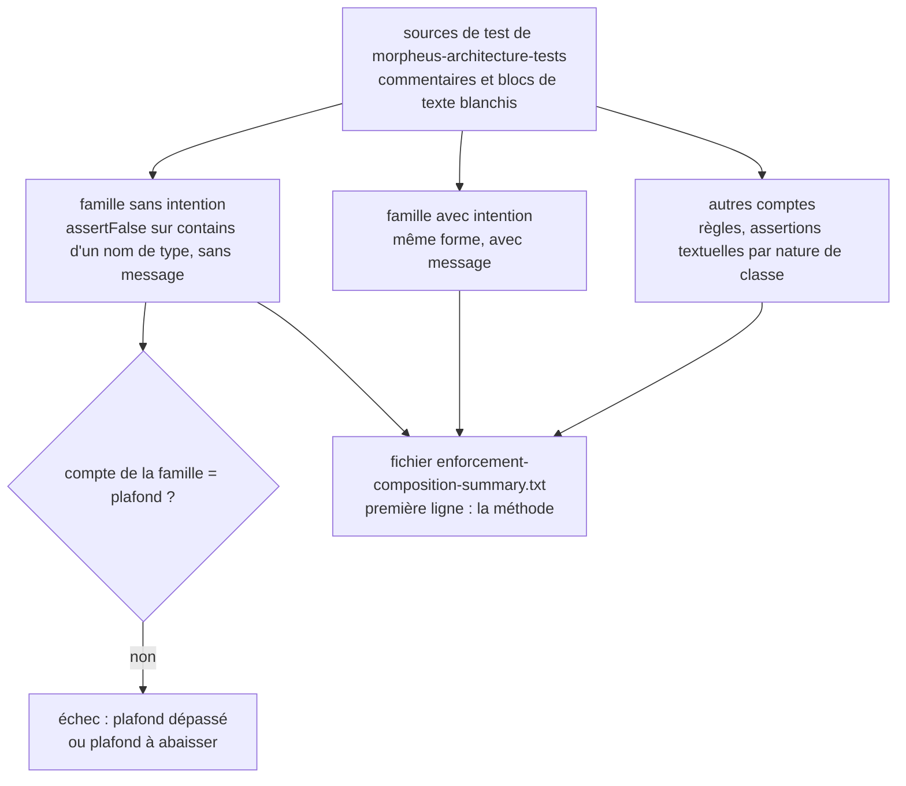
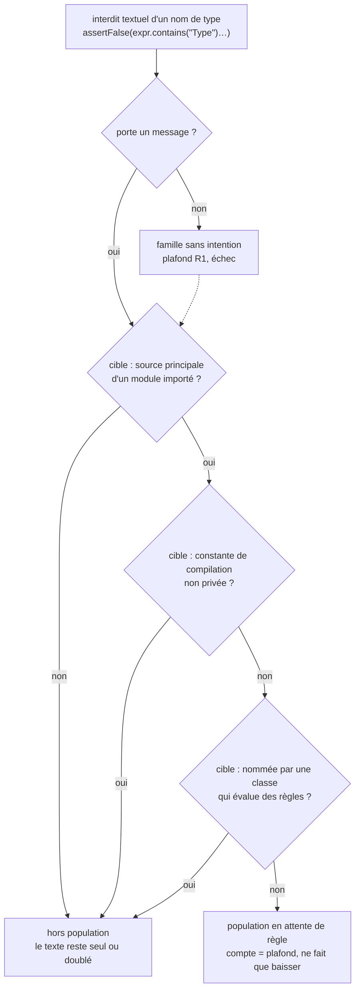
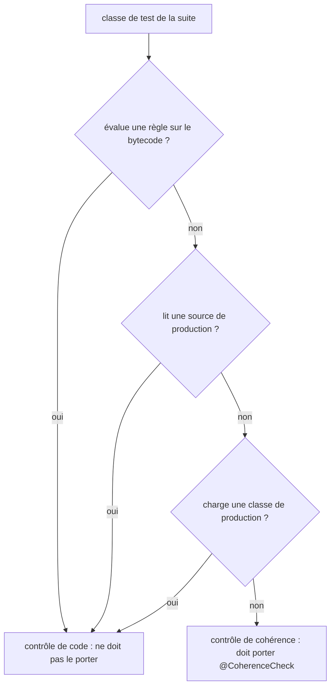

# Décompte des mécanismes d'enforcement (`enforcement-mechanism-accounting`)

Spec de référence : [`openspec/specs/enforcement-mechanism-accounting/spec.md`](../../../openspec/specs/enforcement-mechanism-accounting/spec.md)
· Relevé du 2026-11-04 sur `2913fc30`.

## Objet et périmètre

La suite d'architecture mesure de quoi son propre enforcement est fait : règles sur le bytecode, assertions textuelles,
interdits textuels de type. Une seule population est plafonnée et ne fait que rétrécir (les interdits textuels de type qui
n'énoncent pas leur intention) ; le reste est publié sans jamais faire échouer la suite. Une classe de test qui ne lit que des
documents est distinguée d'une classe qui juge du code. Une seconde population plafonnée, tenue par une classe à part,
compte les interdits textuels de type qui attendent une règle sur le bytecode.

- **Acteurs** : `EnforcementMechanismAccountingTest`, `TypeBansAwaitingABytecodeRuleTest`, `CoherenceCheckMarkerTest`, le marqueur `@CoherenceCheck`
  (étiquette JUnit `coherence`), la CI qui publie le fichier de preuve.
- **Inclus** : le plafond de la famille « sans intention », l'obligation d'un message pour tout nouvel interdit textuel de
  type, la publication de la composition, le marquage des contrôles de cohérence.
- **Exclus** : le choix entre règle ArchUnit et assertion textuelle (voir `.claude/rules/architecture.md` et le skill
  `enforcement-choice`) ; la part textuelle globale, volontairement non plafonnée.

## Exigences

| Alias | Exigence (titre exact) | En bref | Nature |
|---|---|---|---|
| R1 | The textual bans of a type that state no intent SHALL be a measured population that only shrinks | compte mesuré égal à un plafond déclaré, jamais relevé, abaissé avec chaque membre retiré | `[EXIGENCE]` |
| R2 | A new textual ban of a type SHALL state which proposition it enforces | message qui dit ce qui est refusé (la mention ou la dépendance) | `[EXIGENCE]` |
| R3 | The architecture suite SHALL publish the composition of its own enforcement by one stated method | fichier de preuve à méthode nommée en première ligne ; aucun échec sur ces comptes | `[EXIGENCE]` |
| R4 | A test class that reads only non-compiled artefacts SHALL be marked as a coherence check and SHALL stay in the gate module | marqueur dérivé de la source de la classe, dans les deux sens ; la classe reste dans le module | `[EXIGENCE]` |
| R5 | Les interdits textuels de type qui attendent une règle sur le bytecode forment une population qui ne fait que rétrécir | interdits dont la cible permet une règle et qu'aucune classe de règles ne nomme ; compte égal à un plafond jamais relevé | `[EXIGENCE]` |
| R6 | Une règle qui remplace ou double un interdit textuel est livrée avec sa violation plantée | violation, échec qui nomme la classe, retour arrière, consignés hors du build | `[EXIGENCE]` |

## Comportement détaillé

### La famille plafonnée (R1, R2)

`[EXISTANT VÉRIFIÉ]` La famille « non expliquée » est définie par une expression tenue dans
[`EnforcementMechanismAccountingTest`](../../../morpheus-architecture-tests/src/test/java/com/morpheus/architecture/EnforcementMechanismAccountingTest.java)
(`UNEXPLAINED_TYPE_BAN`) : un `assertFalse` dont l'unique argument est `<identifiant>.contains("<NomDeType>")` avec un
littéral qui commence par une majuscule, lu dans le **code** des sources de test du module (commentaires, blocs de texte et
littéraux de caractère blanchis). Son compte doit **égaler** `UNEXPLAINED_TYPE_BAN_CEILING` (constante du test ; la valeur
se lit là, pas dans cette page). Un membre ajouté fait échouer la suite avec le compte mesuré, le plafond, la phrase qui
dit qu'un interdit textuel de type énonce son intention comme message de l'assertion, et les membres par fichier ; un membre
retiré fait échouer jusqu'à l'abaissement du plafond dans le même changement. La famille complémentaire (même forme avec
un message) est comptée à part (`EXPLAINED_TYPE_BAN`).

### La population en attente de règle (R5, R6)

`[EXISTANT VÉRIFIÉ]` [`TypeBansAwaitingABytecodeRuleTest`](../../../morpheus-architecture-tests/src/test/java/com/morpheus/architecture/TypeBansAwaitingABytecodeRuleTest.java)
lit le code des classes de test de la suite (commentaires et blocs de texte blanchis, littéraux de chaîne gardés) et y
cherche `assertFalse(<expression>.contains("<NomDeType>")` suivi de `)` ou de `,` : avec ou sans message, quel que soit le
récepteur. Un interdit est **en attente de règle** quand sa cible :

- est un fichier `<NomDeType>.java` sous `src/main/java` d'un module que `morpheus-architecture-tests/pom.xml` déclare en
  dépendance (un nom présent dans deux modules compte s'il qualifie dans l'un) ;
- ne déclare aucun champ `static final` non privé de type `String` ou primitif (tout champ de ce type dans une interface) :
  une telle constante serait inlinée par `javac`, et une règle ne la verrait pas ;
- n'est nommée par aucune classe de la suite qui évalue des règles sur le bytecode : nom simple en mot entier dans son code,
  littéraux de chaîne compris et littéraux de ses propres `.contains(...)` exclus, ou préfixe passé à
  `haveSimpleNameStartingWith(...)`.

Les trois lectures sur-approchent ce qui est tenu : une approximation laisse le texte seul, jamais n'oblige à une règle qui
raterait une constante inlinée. Le compte doit **égaler** `AWAITING_A_RULE_CEILING` (constante du test ; la valeur se lit
là). Au-dessus, l'échec donne le compte, le plafond, les membres par fichier et dit d'écrire la règle dans le
`*ArchitectureTest` de l'intention ; au-dessous, il demande d'abaisser le plafond dans le même changement. La classe lit les
sources des cibles, donc ne porte pas `@CoherenceCheck`. Une règle qui remplace ou double un interdit consigne sa
violation plantée dans la Javadoc de sa méthode (R6) ; le build ne lit pas cette trace.

### La composition publiée (R3)

`[EXISTANT VÉRIFIÉ]` Chaque exécution écrit `morpheus-architecture-tests/target/enforcement-composition-summary.txt`. Sa première
ligne est la constante `METHOD`. Les lignes suivantes, dans un ordre stable, sont les onze clés de `PROOF_KEYS` : classes de
test, déclarations de test, classes qui évaluent des règles sur le bytecode, classes qui lisent une source de production,
classes de cohérence, règles évaluées, assertions textuelles par nature de classe (qui lit une source de production ; de
cohérence ; autres) et les deux familles d'interdits de type (sans et avec intention). Les comptes ne sont pas des seuils ;
[`ci.yml`](../../../.github/workflows/ci.yml) publie le fichier dans l'artefact d'intégrité.

### Le marqueur de cohérence (R4)

`[EXISTANT VÉRIFIÉ]` [`CoherenceCheckMarkerTest`](../../../morpheus-architecture-tests/src/test/java/com/morpheus/architecture/CoherenceCheckMarkerTest.java)
dérive pour chaque classe de la suite, depuis sa source (et celle des classes de la suite qu'elle nomme), la propriété « n'évalue
aucune règle sur le bytecode, ne lit aucune source de production, ne charge aucune classe de production ». Le marqueur
[`@CoherenceCheck`](../../../morpheus-architecture-tests/src/test/java/com/morpheus/architecture/CoherenceCheck.java) doit
être présent exactement quand la propriété est vraie ; le désaccord est refusé dans les deux sens, avec le chemin de la classe.
La sélection s'obtient par `./mvnw test -pl morpheus-architecture-tests -Dgroups=coherence`.

## Diagrammes

### Que compte la suite de ses propres tests, et qu'est-ce qui peut la faire échouer ?

Existant vérifié, lu dans `EnforcementMechanismAccountingTest`. Organigramme. Exigences R1, R2, R3.

Seul le plafond de la famille sans intention peut faire échouer la suite ; tous les autres comptes vont au fichier de
preuve et à rien d'autre (R3).

### Quand un interdit textuel de type attend-il une règle sur le bytecode ?

Existant vérifié, lu dans `TypeBansAwaitingABytecodeRuleTest` et `EnforcementMechanismAccountingTest`. Organigramme.
Exigences R1, R5.

La flèche pointillée : un interdit sans message est refusé par la famille R1 et compté aussi dans la population R5.

### Quand une classe de test est-elle un contrôle de cohérence ?

Existant vérifié, lu dans `CoherenceCheckMarkerTest` et `ArchitectureSuiteSources`. Organigramme. Exigence R4.

La suite suit aussi les classes qu'une classe nomme : une lecture de code faite par un assistant d'une autre classe de la
suite rend la première non cohérente.

## Écarts et questions ouvertes

1. **« No document of the repository restates the ceiling's value ».** `[EXISTANT VÉRIFIÉ]` La spec l'interdit, et
   `.claude/rules/architecture.md` ne recopie la valeur d'aucun des deux plafonds. Aucun test ne scrute les documents à la
   recherche de ces valeurs : l'exigence est tenue par la discipline.
2. **Découpage « autres artefacts ».** `[EXISTANT VÉRIFIÉ]` La spec demande « the textual assertions over another artefact ».
   Le code publie trois comptes d'assertions textuelles (`inClassesReadingAProductionSource`, `inCoherenceClasses`,
   `inOtherClasses`), classés par la nature de la classe qui les écrit, pas par la nature du fichier lu. La correspondance
   n'est pas un-pour-un.
3. **« The ban fails » : preuve.** `[EXISTANT VÉRIFIÉ]` La famille « avec intention » est comptée, mais aucun test ne fait
   échouer un interdit à message pour lire son rendu : le message est affiché par JUnit. Preuve manquante pour la lecture du
   rendu ; la propriété « chaque interdit porte un message » est tenue par le plafond à 0.
4. **« A count changes » : aucune preuve ne fait varier un compte.** Le test vérifie la présence des onze clés et leur forme
   numérique, non qu'une hausse d'un compte laisse la suite passer. Preuve par construction (aucune assertion sur ces
   comptes).
5. **« The build selects the coherence checks ».** `[EXISTANT VÉRIFIÉ]` Aucun test ne lance la suite avec `-Dgroups=coherence`
   ni ne vérifie qu'au moins une classe est sélectionnée par l'étiquette. `everyTestClassThatReadsNoCodeIsMarkedAndNoOtherIs`
   affirme seulement qu'au moins une classe porte le marqueur. Preuve manquante pour la sélection.
6. **« SHALL stay in the gate module ».** Aucune règle n'interdit de sortir une classe marquée de `morpheus-architecture-tests` ;
   la conséquence (baisse de `architectureTestsMinimum`) serait refusée par le validateur de présence, pas par cette capacité.
7. **Dépendance d'une règle écrite.** `[EXISTANT VÉRIFIÉ]` L'expression de la famille ne voit pas un interdit écrit
   `assertTrue(!…)`, par assistant ou en boucle ; la Javadoc de la classe le dit (« a debt counter, not a census »).
8. **Récepteurs qualifiés.** `[EXISTANT VÉRIFIÉ]` Les deux familles R1 n'acceptent qu'un identifiant avant `.contains(` :
   `assertFalse(Files.readString(p).contains("Type"), …)` leur échappe. La population R5 accepte tout récepteur ; les
   expressions R1 ne sont pas modifiées.
9. **Nommée pour une autre raison.** Un nom simple cité par une classe de règles pour une autre raison (message d'un
   `because`, assertion) sort l'interdit de la population R5 ; la revue tient ce cas. `[QUESTION]` Étendre la population
   aux interdits d'un nom de paquet, ou aux cibles d'une bibliothèque jugées sur le bytecode importé ?

## Traçabilité

Archive : `2026-10-29-let-unexplained-textual-enforcement-only-shrink`. Tests principaux :
[`EnforcementMechanismAccountingTest`](../../../morpheus-architecture-tests/src/test/java/com/morpheus/architecture/EnforcementMechanismAccountingTest.java)
et [`CoherenceCheckMarkerTest`](../../../morpheus-architecture-tests/src/test/java/com/morpheus/architecture/CoherenceCheckMarkerTest.java) ;
changement `write-every-dependency-ban-as-a-bytecode-rule` pour R5 et R6.

| Exigence | Scénario | Conception ou diagramme | Preuve |
|---|---|---|---|
| R1 | A textual ban is added without its intent | organigramme 1 | `EnforcementMechanismAccountingTest#theTextualBansOfATypeThatStateNoIntentDoNotGrow` (échec à compte dépassé, message d'intention) ; refus joué sur un ajout réel : **preuve manquante** (la suite lit le dépôt courant) |
| R1 | A member is removed and the ceiling is left as it was | idem | même méthode (`assertEquals` du plafond au compte mesuré) |
| R1 | The expression is proved in both directions | idem | `EnforcementMechanismAccountingTest#theFamilyCountsOnlyABanOfATypeWrittenInCodeWithNoMessage` (membre, même interdit avec message, littéral en minuscule, commentaire, chaîne, bloc de texte : compte égal à 1) |
| R2 | The ban fails | idem | plafond à 0 (`UNEXPLAINED_TYPE_BAN_CEILING`) ; lecture du rendu : **preuve manquante** (Écart 3) |
| R3 | The proof file after a build | organigramme 1 | `EnforcementMechanismAccountingTest#theSuitePublishesTheCompositionOfItsEnforcementByOneStatedMethod` (méthode en première ligne, onze clés dans l'ordre, toutes numériques) ; lecture du code seul : `#theCompositionCountsReadCodeOnly` |
| R3 | A count changes | idem | aucune assertion sur ces comptes (Écart 4) |
| R4 | A documentation check without its marker | organigramme 2 | `CoherenceCheckMarkerTest#everyTestClassThatReadsNoCodeIsMarkedAndNoOtherIs` ; fixture : `#aClassThatReadsOnlyDocumentsIsACoherenceCheck` |
| R4 | A marked class starts reading a production source | idem | même méthode (sens inverse) ; fixtures : `#aClassThatReadsAProductionSourceOrLoadsAProductionClassOrEvaluatesARuleIsNot`, `#aProductionPathNamedOnlyInACommentIsNotARead`, `#aClassThatReadsCodeThroughAHelperOfAnotherClassOfTheSuiteIsFollowed` |
| R5 | Un interdit textuel est ajouté sur une cible qui permet une règle | organigramme « Quand un interdit textuel de type attend-il une règle sur le bytecode ? » | `TypeBansAwaitingABytecodeRuleTest#theTextualBansOfATypeAwaitingARuleOnTheBytecodeDoNotGrow` (échec au-dessus du plafond, membres par fichier) |
| R5 | La cible déclare une constante inlinable | idem | `TypeBansAwaitingABytecodeRuleTest#aNonPrivateStaticFinalFieldOfAStringOrPrimitiveTypeIsAnInlinableConstant` ; exemple `PublicConstant` de `#theExpressionCountsABanWhoseTargetPermitsARuleThatNoRuleClassNames` |
| R5 | Une règle est écrite et le plafond est laissé tel quel | idem | `#theTextualBansOfATypeAwaitingARuleOnTheBytecodeDoNotGrow` (`assertEquals` du plafond au compte mesuré) |
| R5 | L'expression est prouvée dans les deux sens | idem | `#theExpressionCountsABanWhoseTargetPermitsARuleThatNoRuleClassNames` (membre, constante non privée, constante privée seule, cible hors du dépôt, cible nommée, cible d'une règle de famille, commentaire et chaîne, récepteur qualifié) |
| R6 | Une règle migrée sans trace de violation | — | tenu par la revue (le build ne lit pas la trace) |
| R6 | Une règle migrée qui ne voit aucune classe | — | `AnEmptyArchitectureRuleFailsTest` |
| R4 | The build selects the coherence checks | idem | [`CoherenceCheck`](../../../morpheus-architecture-tests/src/test/java/com/morpheus/architecture/CoherenceCheck.java) (`@Tag("coherence")`) ; **preuve manquante** de la sélection (Écart 5) |

## Sources

- Règles du dépôt : `.claude/rules/architecture.md` (« Règle ArchUnit ou assertion textuelle », « Un interdit textuel de type
  écrit son intention »), `.claude/rules/testing.md` (`architectureTestsMinimum`), skill `enforcement-choice`.
- Pages liées : [`architecture-rule-vacuity-guard.md`](architecture-rule-vacuity-guard.md),
  [`refusal-test-evidence.md`](refusal-test-evidence.md).
- Archive OpenSpec : `2026-10-29-let-unexplained-textual-enforcement-only-shrink`.
