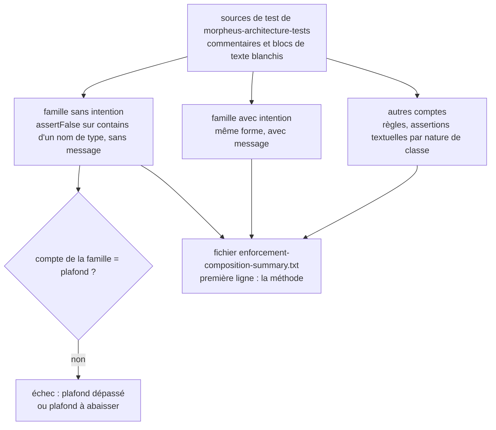
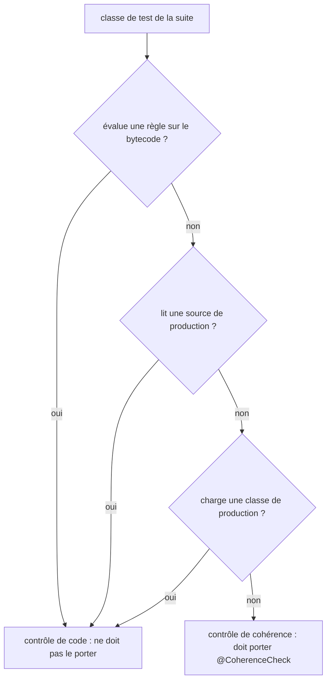
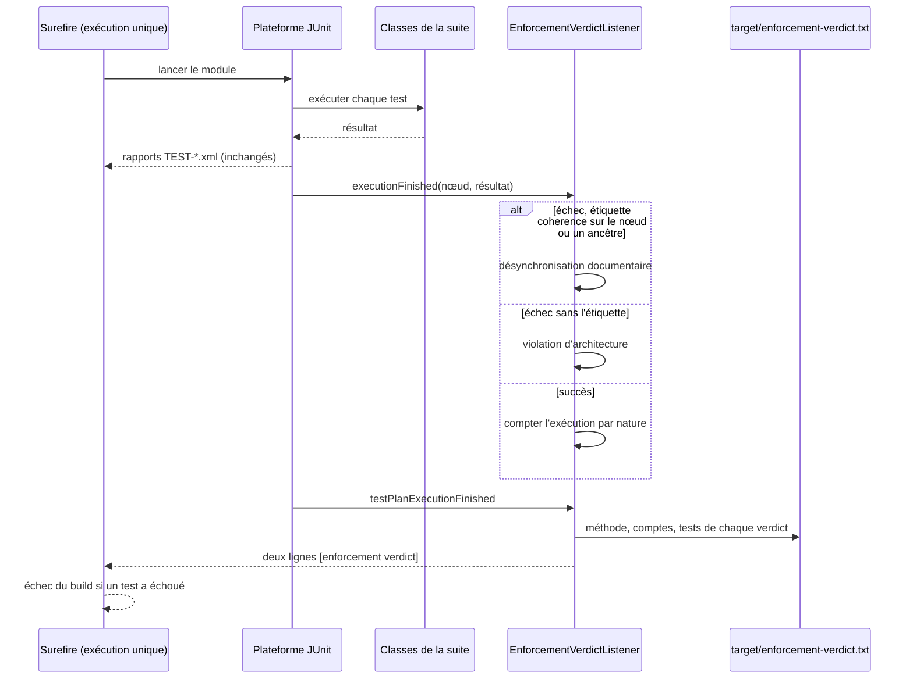

# Décompte des mécanismes d'enforcement (`enforcement-mechanism-accounting`)

Spec de référence : [`openspec/specs/enforcement-mechanism-accounting/spec.md`](../../../openspec/specs/enforcement-mechanism-accounting/spec.md)
· Relevé du 2026-11-04 sur `2913fc30`.

## Objet et périmètre

La suite d'architecture mesure de quoi son propre enforcement est fait : règles sur le bytecode, assertions textuelles,
interdits textuels de type. Une seule population est plafonnée et ne fait que rétrécir (les interdits textuels de type qui
n'énoncent pas leur intention) ; le reste est publié sans jamais faire échouer la suite. Une classe de test qui ne lit que des
documents est distinguée d'une classe qui juge du code.

- **Acteurs** : `EnforcementMechanismAccountingTest`, `CoherenceCheckMarkerTest`, le marqueur `@CoherenceCheck`
  (étiquette JUnit `coherence`), l'écouteur `EnforcementVerdictListener`, la CI qui publie les fichiers de preuve.
- **Inclus** : le plafond de la famille « sans intention », l'obligation d'un message pour tout nouvel interdit textuel de
  type, la publication de la composition, le marquage des contrôles de cohérence, le verdict qui sépare un échec de
  cohérence d'une violation d'architecture.
- **Exclus** : le choix entre règle ArchUnit et assertion textuelle (voir `.claude/rules/architecture.md` et le skill
  `enforcement-choice`) ; la part textuelle globale, volontairement non plafonnée.

## Exigences

| Alias | Exigence (titre exact) | En bref | Nature |
|---|---|---|---|
| R1 | The textual bans of a type that state no intent SHALL be a measured population that only shrinks | compte mesuré égal à un plafond déclaré, jamais relevé, abaissé avec chaque membre retiré | `[EXIGENCE]` |
| R2 | A new textual ban of a type SHALL state which proposition it enforces | message qui dit ce qui est refusé (la mention ou la dépendance) | `[EXIGENCE]` |
| R3 | The architecture suite SHALL publish the composition of its own enforcement by one stated method | fichier de preuve à méthode nommée en première ligne ; aucun échec sur ces comptes | `[EXIGENCE]` |
| R4 | A test class that reads only non-compiled artefacts SHALL be marked as a coherence check and SHALL stay in the gate module | marqueur dérivé de la source de la classe, dans les deux sens ; la classe reste dans le module | `[EXIGENCE]` |
| R5 | Un échec d'un contrôle de cohérence est rapporté comme une désynchronisation documentaire | deux verdicts sur la sortie et dans un fichier de preuve, chacun avec ses tests ; nombre d'exécutions de chaque nature | `[EXIGENCE]` |
| R6 | Le verdict distinct ne change ni la sélection ni le compte des exécutions | une seule exécution Surefire, un seul répertoire de rapports ; `-Dtest` et `-Dgroups` inchangés | `[EXIGENCE]` |

## Comportement détaillé

### La famille plafonnée (R1, R2)

`[EXISTANT VÉRIFIÉ]` La famille « non expliquée » est définie par une expression tenue dans
[`EnforcementMechanismAccountingTest`](../../../morpheus-architecture-tests/src/test/java/com/morpheus/architecture/EnforcementMechanismAccountingTest.java)
(`UNEXPLAINED_TYPE_BAN`) : un `assertFalse` dont l'unique argument est `<identifiant>.contains("<NomDeType>")` avec un
littéral qui commence par une majuscule, lu dans le **code** des sources de test du module (commentaires, blocs de texte et
littéraux de caractère blanchis). Son compte doit **égaler** `UNEXPLAINED_TYPE_BAN_CEILING` (constante du test ; la valeur
se lit là, pas dans cette page). Un membre ajouté fait échouer la suite avec le compte mesuré, le plafond, la phrase qui
dit qu'un interdit textuel de type énonce son intention comme message de l'assertion, et les membres par fichier ; un membre
retiré fait échouer jusqu'à l'abaissement du plafond dans le même changement. La famille complémentaire (même forme avec
un message) est comptée à part (`EXPLAINED_TYPE_BAN`).

### La composition publiée (R3)

`[EXISTANT VÉRIFIÉ]` Chaque exécution écrit `morpheus-architecture-tests/target/enforcement-composition-summary.txt`. Sa première
ligne est la constante `METHOD`. Les lignes suivantes, dans un ordre stable, sont les onze clés de `PROOF_KEYS` : classes de
test, déclarations de test, classes qui évaluent des règles sur le bytecode, classes qui lisent une source de production,
classes de cohérence, règles évaluées, assertions textuelles par nature de classe (qui lit une source de production ; de
cohérence ; autres) et les deux familles d'interdits de type (sans et avec intention). Les comptes ne sont pas des seuils ;
[`ci.yml`](../../../.github/workflows/ci.yml) publie le fichier dans l'artefact d'intégrité.

### Le marqueur de cohérence (R4)

`[EXISTANT VÉRIFIÉ]` [`CoherenceCheckMarkerTest`](../../../morpheus-architecture-tests/src/test/java/com/morpheus/architecture/CoherenceCheckMarkerTest.java)
dérive pour chaque classe de la suite, depuis sa source (et celle des classes de la suite qu'elle nomme), la propriété « n'évalue
aucune règle sur le bytecode, ne lit aucune source de production, ne charge aucune classe de production ». Le marqueur
[`@CoherenceCheck`](../../../morpheus-architecture-tests/src/test/java/com/morpheus/architecture/CoherenceCheck.java) doit
être présent exactement quand la propriété est vraie ; le désaccord est refusé dans les deux sens, avec le chemin de la classe.
La sélection s'obtient par `./mvnw test -pl morpheus-architecture-tests -Dgroups=coherence`.

### Le verdict distinct (R5, R6)

`[EXISTANT VÉRIFIÉ]` [`EnforcementVerdictListener`](../../../morpheus-architecture-tests/src/test/java/com/morpheus/architecture/EnforcementVerdictListener.java),
écouteur de la plateforme JUnit enregistré comme service dans les ressources de test du module
(`META-INF/services/org.junit.platform.launcher.TestExecutionListener`), lit chaque nœud terminé de l'exécution Surefire
unique. [`EnforcementVerdict`](../../../morpheus-architecture-tests/src/test/java/com/morpheus/architecture/EnforcementVerdict.java)
range un nœud parmi les contrôles de cohérence quand lui ou l'un de ses ancêtres porte l'étiquette `coherence` (une méthode
ou un test généré hérite de sa classe) : un échec de cohérence est une **désynchronisation documentaire**, tout autre échec
une **violation d'architecture** ; un conteneur en échec est nommé sous le verdict de sa nature. En fin de plan, succès
compris, l'écouteur écrit `morpheus-architecture-tests/target/enforcement-verdict.txt` — la méthode en première ligne
(sélection comprise), le nombre de classes de test, le nombre d'exécutions de chaque nature, puis chaque verdict avec ses
tests triés — et imprime deux lignes `[enforcement verdict]` avant la ligne d'échec de Maven. Le verdict ne décide rien :
Surefire fait toujours échouer le build. Il ne change ni la sélection, ni l'ordre, ni les rapports
(`target/surefire-reports/`) ; une exécution restreinte par `-Dtest` ou `-Dgroups` écrit le verdict de sa seule sélection.
[`ci.yml`](../../../.github/workflows/ci.yml) publie le fichier dans l'artefact d'intégrité.

## Diagrammes

### Que compte la suite de ses propres tests, et qu'est-ce qui peut la faire échouer ?

Existant vérifié, lu dans `EnforcementMechanismAccountingTest`. Organigramme. Exigences R1, R2, R3.

Seul le plafond de la famille sans intention peut faire échouer la suite ; tous les autres comptes vont au fichier de
preuve et à rien d'autre (R3).

### Quand une classe de test est-elle un contrôle de cohérence ?

Existant vérifié, lu dans `CoherenceCheckMarkerTest` et `ArchitectureSuiteSources`. Organigramme. Exigence R4.

La suite suit aussi les classes qu'une classe nomme : une lecture de code faite par un assistant d'une autre classe de la
suite rend la première non cohérente.

### Comment un échec devient-il un verdict ?

Existant vérifié, lu dans `EnforcementVerdictListener` et `EnforcementVerdict`. Séquence. Exigences R5, R6.

L'échec du build reste décidé par Surefire ; le verdict le précède et le nomme.

## Écarts et questions ouvertes

1. **« No document of the repository restates the ceiling's value ».** `[EXISTANT VÉRIFIÉ]` La spec l'interdit. Le fichier
   `.claude/rules/architecture.md` (sous « Un interdit textuel de type écrit son intention ») écrit « La famille est vide et
   le plafond vaut 0 ». Aucun test ne scrute les documents à la recherche de cette valeur : l'exigence R1 est tenue en partie
   par la discipline. `[QUESTION]` Faut-il corriger la règle (qui est une copie) ou la spec ?
2. **Découpage « autres artefacts ».** `[EXISTANT VÉRIFIÉ]` La spec demande « the textual assertions over another artefact ».
   Le code publie trois comptes d'assertions textuelles (`inClassesReadingAProductionSource`, `inCoherenceClasses`,
   `inOtherClasses`), classés par la nature de la classe qui les écrit, pas par la nature du fichier lu. La correspondance
   n'est pas un-pour-un.
3. **« The ban fails » : preuve.** `[EXISTANT VÉRIFIÉ]` La famille « avec intention » est comptée, mais aucun test ne fait
   échouer un interdit à message pour lire son rendu : le message est affiché par JUnit. Preuve manquante pour la lecture du
   rendu ; la propriété « chaque interdit porte un message » est tenue par le plafond à 0.
4. **« A count changes » : aucune preuve ne fait varier un compte.** Le test vérifie la présence des onze clés et leur forme
   numérique, non qu'une hausse d'un compte laisse la suite passer. Preuve par construction (aucune assertion sur ces
   comptes).
5. **« The build selects the coherence checks ».** `[EXISTANT VÉRIFIÉ]` Aucun test ne lance la suite avec `-Dgroups=coherence`
   ni ne vérifie qu'au moins une classe est sélectionnée par l'étiquette. `everyTestClassThatReadsNoCodeIsMarkedAndNoOtherIs`
   affirme seulement qu'au moins une classe porte le marqueur. Preuve manquante pour la sélection. Le fichier de verdict
   (`executions.coherence`) prouve, à chaque exécution du module, que l'étiquette est lue par la plateforme ; la commande
   `-Dgroups=coherence` a été rejouée une fois à la livraison du verdict (relevé du changement
   `report-documentation-drift-apart-from-architecture-violations`), aucun build ne la lance.
8. **Sortir les contrôles de cohérence du module.** `[QUESTION]` Écarté par le mainteneur le 06/11/2026 ; le verdict distinct
   (R5) répond au besoin de lecture sans déplacement. Aucune tâche n'en dépend.
6. **« SHALL stay in the gate module ».** Aucune règle n'interdit de sortir une classe marquée de `morpheus-architecture-tests` ;
   la conséquence (baisse de `architectureTestsMinimum`) serait refusée par le validateur de présence, pas par cette capacité.
7. **Dépendance d'une règle écrite.** `[EXISTANT VÉRIFIÉ]` L'expression de la famille ne voit pas un interdit écrit
   `assertTrue(!…)`, par assistant ou en boucle ; la Javadoc de la classe le dit (« a debt counter, not a census »).

## Traçabilité

Archive : `2026-10-29-let-unexplained-textual-enforcement-only-shrink` ; changement
`report-documentation-drift-apart-from-architecture-violations` (R5, R6). Tests principaux :
[`EnforcementMechanismAccountingTest`](../../../morpheus-architecture-tests/src/test/java/com/morpheus/architecture/EnforcementMechanismAccountingTest.java)
et [`CoherenceCheckMarkerTest`](../../../morpheus-architecture-tests/src/test/java/com/morpheus/architecture/CoherenceCheckMarkerTest.java).

| Exigence | Scénario | Conception ou diagramme | Preuve |
|---|---|---|---|
| R1 | A textual ban is added without its intent | organigramme 1 | `EnforcementMechanismAccountingTest#theTextualBansOfATypeThatStateNoIntentDoNotGrow` (échec à compte dépassé, message d'intention) ; refus joué sur un ajout réel : **preuve manquante** (la suite lit le dépôt courant) |
| R1 | A member is removed and the ceiling is left as it was | idem | même méthode (`assertEquals` du plafond au compte mesuré) |
| R1 | The expression is proved in both directions | idem | `EnforcementMechanismAccountingTest#theFamilyCountsOnlyABanOfATypeWrittenInCodeWithNoMessage` (membre, même interdit avec message, littéral en minuscule, commentaire, chaîne, bloc de texte : compte égal à 1) |
| R2 | The ban fails | idem | plafond à 0 (`UNEXPLAINED_TYPE_BAN_CEILING`) ; lecture du rendu : **preuve manquante** (Écart 3) |
| R3 | The proof file after a build | organigramme 1 | `EnforcementMechanismAccountingTest#theSuitePublishesTheCompositionOfItsEnforcementByOneStatedMethod` (méthode en première ligne, onze clés dans l'ordre, toutes numériques) ; lecture du code seul : `#theCompositionCountsReadCodeOnly` |
| R3 | A count changes | idem | aucune assertion sur ces comptes (Écart 4) |
| R4 | A documentation check without its marker | organigramme 2 | `CoherenceCheckMarkerTest#everyTestClassThatReadsNoCodeIsMarkedAndNoOtherIs` ; fixture : `#aClassThatReadsOnlyDocumentsIsACoherenceCheck` |
| R4 | A marked class starts reading a production source | idem | même méthode (sens inverse) ; fixtures : `#aClassThatReadsAProductionSourceOrLoadsAProductionClassOrEvaluatesARuleIsNot`, `#aProductionPathNamedOnlyInACommentIsNotARead`, `#aClassThatReadsCodeThroughAHelperOfAnotherClassOfTheSuiteIsFollowed` |
| R4 | The build selects the coherence checks | idem | [`CoherenceCheck`](../../../morpheus-architecture-tests/src/test/java/com/morpheus/architecture/CoherenceCheck.java) (`@Tag("coherence")`) ; **preuve manquante** de la sélection par un build (Écart 5) |
| R5 | Seul un contrôle de cohérence échoue | séquence 3 | `EnforcementVerdictTest#onlyAFailedCoherenceCheckIsDocumentationDrift`, `#aTestInheritsTheCoherenceTagOfItsClassAtAnyDepth` ; violation plantée une fois et relevée à la livraison |
| R5 | Une règle sur le code échoue | idem | `EnforcementVerdictTest#onlyAFailedCodeCheckIsAnArchitectureViolation` ; violation plantée une fois et relevée à la livraison |
| R5 | Les deux natures échouent dans la même exécution | idem | `EnforcementVerdictTest#bothNaturesFailingTogetherGiveTwoVerdictsEachWithItsOwnTestsSorted` |
| R5 | Aucun échec | idem | `EnforcementVerdictTest#aGreenRunWritesTwoEmptyVerdictsAndCountsTheExecutionsOfEachNature` ; fichier lu après une exécution verte |
| R6 | Le compte des validateurs de présence | idem | relevé avant/après dans `target/surefire-reports/`, à la livraison ; tenu ensuite par `architectureTestsMinimum` |
| R6 | Une seule classe marquée sélectionnée par -Dtest | idem | commande rejouée à la livraison |

## Sources

- Règles du dépôt : `.claude/rules/architecture.md` (« Règle ArchUnit ou assertion textuelle », « Un interdit textuel de type
  écrit son intention »), `.claude/rules/testing.md` (`architectureTestsMinimum`), skill `enforcement-choice`.
- Pages liées : [`architecture-rule-vacuity-guard.md`](architecture-rule-vacuity-guard.md),
  [`refusal-test-evidence.md`](refusal-test-evidence.md).
- Archive OpenSpec : `2026-10-29-let-unexplained-textual-enforcement-only-shrink`.
