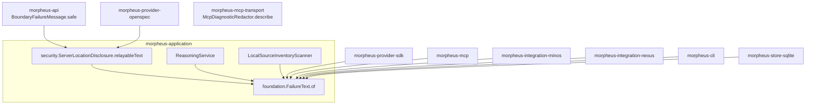
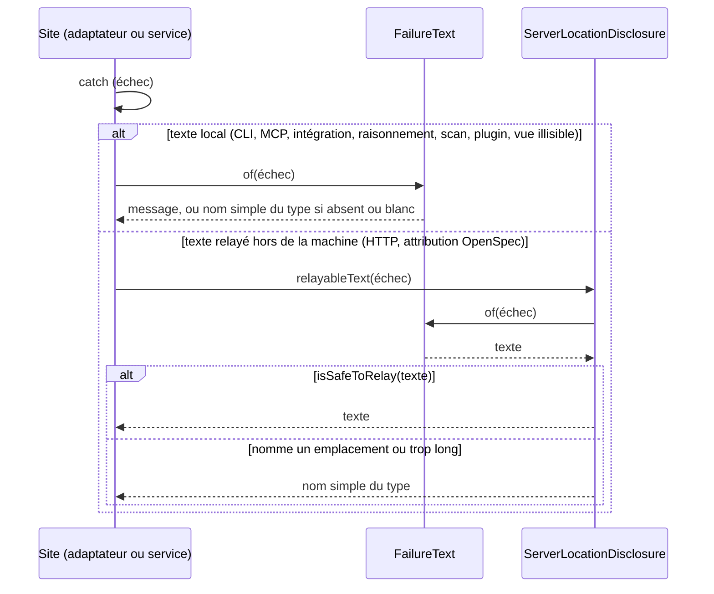

# Texte d'un échec formé par un seul propriétaire (`failure-text-ownership`)

Spec de référence : `openspec/specs/failure-text-ownership/spec.md`, créée à l'archivage du changement
`turn-every-failure-into-text-through-one-owner` (spec delta dans ce changement) · Relevé du 2026-11-06 sur `8c038add`.

## Objet et périmètre

Qui forme le texte d'un échec, filtré ou non, dans toutes les classes de production de MORPHEUS, et ce qui refuse une
copie de cette conversion.

- **Acteurs** : mainteneur et CI (règle d'architecture) ; indirectement, tout appelant qui lit le texte d'un échec
  (ligne d'erreur de la CLI, résultat d'un outil MCP, statut d'une intégration MINOS ou NEXUS, diagnostic d'un scan ou
  d'un plugin, réponse HTTP).
- **Inclus** : les méthodes de production de `com.morpheus..` qui prennent un échec et rendent son texte, les copies
  écrites en ligne ou dans une lambda, dans tout `src/main/java` du dépôt.
- **Exclus** : le filtrage des chemins dans les textes locaux (aucun filtre ajouté ni retiré) ;
  `McpDiagnosticRedactor.describe` (`morpheus-mcp-transport`), qui forme un diagnostic (type et message expurgé) dans un
  module qui ne voit aucun type MORPHEUS ; les méthodes `failureType`, qui ne rendent que le nom du type.

## Exigences

| Alias | Exigence (titre exact) | En bref | Nature |
|---|---|---|---|
| R1 | Le texte d'un échec a un seul propriétaire | message, ou nom simple du type si le message est absent ou blanc, par `FailureText.of` | `[EXIGENCE]` |
| R2 | Le texte relayé d'un échec a un seul propriétaire | texte de `FailureText.of`, remplacé par le nom du type quand `isSafeToRelay` le refuse, par `ServerLocationDisclosure.relayableText` | `[EXIGENCE]` |
| R3 | Une copie de la conversion d'un échec en texte est refusée par sa signature | un paramètre assignable à `Throwable`, une `String` rendue : refusé hors des propriétaires et des méthodes nommées | `[EXIGENCE]` |
| R4 | Le corps de la conversion n'est écrit que chez ses propriétaires | un membre qui lit le message et le nom simple du type est refusé, hors des fichiers nommés | `[EXIGENCE]` |

## Comportement détaillé

`[EXISTANT VÉRIFIÉ]` :

- **`FailureText.of(Throwable)`** (`morpheus-application/src/main/java/com/morpheus/application/foundation/`) rend
  `getMessage()`, ou `getClass().getSimpleName()` si le message est `null` ou blanc. Un message est rendu tel quel,
  espaces et chemins compris. Le paramètre est `Throwable` : un appelant qui tient une `Exception` ou une
  `RuntimeException` l'appelle sans conversion.
- **`ServerLocationDisclosure.relayableText(Throwable)`** (`application.security`) rend le texte de `FailureText.of` s'il
  passe `isSafeToRelay` (longueur bornée par `MAX_RELAYED_LENGTH`, aucun emplacement du serveur), sinon le nom simple du
  type. Le paquet `security` dépend de `foundation`, jamais l'inverse.
- **Appelants** : la CLI (`CliErrorLine.refuse`, `CliCommandRun`, et les lanceurs de `MorpheusMain` par
  `CliErrorLine.refuse(args, err, code, contexte, échec)`), le MCP (`McpToolFailure.result`), les intégrations
  (`MinosIntegrationRuntime`, `NexusMcpTechnicalContextProvider`), le raisonnement (`ReasoningService`), le scan
  (`LocalSourceInventoryScanner`), le SDK de provider (`ProviderPluginService`, `ProviderPluginDiscovery`), le store
  SQLite (`SqliteSavedViewStore`, raison d'une vue illisible) ; pour la forme relayée, l'adaptateur HTTP
  (`BoundaryFailureMessage.safe`, réduit à un appel) et le provider OpenSpec (`OpenSpecSourceAttribution`,
  `OpenSpecSourceText`, `OpenSpecSpecificationContentReader`).
- **Textes inchangés**, sauf un : la raison d'une vue enregistrée illisible dont l'échec porte un message blanc est le
  nom du type, là où la copie en ligne de `SqliteSavedViewStore` gardait des espaces.

## Diagrammes

### Où vit chaque conversion, et par quelle dépendance chaque module l'atteint-il ?

Existant vérifié. Organigramme des dépendances de modules ; chaque flèche est une dépendance déjà déclarée dans le
`pom.xml` du module. Exigences : R1, R2.

`morpheus-mcp-transport` reste à l'écart : il ne dépend d'aucun autre paquet MORPHEUS, et son `describe` forme un autre
texte.

### Quel chemin suit le texte d'un échec selon qu'il reste local ou sort de la machine ?

Existant vérifié. Séquence UML. Exigences : R1, R2.

## Écarts et questions ouvertes

- `[QUESTION]` Le texte rendu à un client MCP par `McpToolFailure.result`, et celui du raisonnement, ne sont pas
  filtrés ; [`mcp-tool-failure-contract`](mcp-tool-failure-contract.md) exige qu'un résultat d'outil ne nomme aucun
  chemin du serveur. Un chemin y passe : un refus de l'application qui le nomme (`SafeWorkspaceFileResolver`,
  `LocalSourceInventoryScanner`, `SourcePath`), le plus souvent le chemin que l'appelant a lui-même fourni.
  [`McpToolFailureTest`](../../../morpheus-mcp/src/test/java/com/morpheus/mcp/McpToolFailureTest.java)`#aRefusalThatNamesAPathReachesTheClientUnfiltered`
  fige ce comportement : le texte arrive tel quel, là où `ServerLocationDisclosure.relayableText` le remplacerait par
  le nom du type. Filtrer rendrait au client local, sous le compte du serveur, `IllegalArgumentException` au lieu du
  refus qui dit quoi corriger ; ne pas filtrer contredit la lettre de l'exigence MCP. L'arbitrage revient au
  mainteneur ; ce point est hors de cette capacité, qui n'ajoute ni ne retire aucun filtre.
- `[DÉCISION]` La raison d'une vue illisible à message blanc est le nom du type de l'échec : R1 l'exige de toute classe
  de production, et ce nom est stable et ne porte aucune donnée. La copie en ligne de `SqliteSavedViewStore` ne
  retombait sur le type que pour un message `null` : un message blanc donnait une raison faite d'espaces, et le refus de
  `find` disait `cannot be read (   )`. Aucun refus du décodage (`QueryDefinitionCodec`, `requireStoredScope`) ne porte
  de message blanc ; le cas n'est atteignable que par une exception sans texte, et sa forme est celle que
  `FailureTextTest` prouve chez le propriétaire.
- `[EXISTANT VÉRIFIÉ]` Le scan textuel est une heuristique : une copie qui lit le message par un intermédiaire lui
  échappe ; la règle par signature la voit si elle est déclarée.

## Traçabilité

| Exigence | Scénario | Conception ou diagramme | Changement ou tâche | Preuve |
|---|---|---|---|---|
| R1 | Un échec qui porte un message ; Un échec sans message ou à message blanc | séquence | `turn-every-failure-into-text-through-one-owner`, 2.1 à 2.5 | [`FailureTextTest`](../../../morpheus-application/src/test/java/com/morpheus/application/foundation/FailureTextTest.java) ; [`CliErrorLineTest`](../../../morpheus-cli/src/test/java/com/morpheus/cli/command/CliErrorLineTest.java) |
| R1 | Aucun filtre ajouté ni retiré | séquence | idem, 1.4 | `FailureTextTest#aMessageThatNamesAServerLocationIsKeptAsItIs` |
| R2 | Un message qui nomme un emplacement du serveur ; Un message écrit par MORPHEUS | séquence | idem, 2.4 | [`ServerLocationDisclosureTest`](../../../morpheus-application/src/test/java/com/morpheus/application/security/ServerLocationDisclosureTest.java)`#theRelayedText…` ; `ExtensionRoutesFailureDisclosureTest`, `HttpFailureDisclosureArchitectureTest` |
| R3 | Une copie sous un autre nom ; Une méthode d'autre usage ; Une exception devenue sans objet | organigramme | idem, 1.1, 2.6, 2.7 | [`FailureTextOwnershipArchitectureTest`](../../../morpheus-architecture-tests/src/test/java/com/morpheus/architecture/FailureTextOwnershipArchitectureTest.java)`#noProductionMethodButTheTwoOwnersTurnsAFailureIntoText`, `#everyMethodNamedForAnotherPurposeStillTakesOneFailureAndReturnsAString` |
| R4 | Une copie écrite dans une lambda ou en ligne ; Un module hors du classpath | — | idem, 1.2, 2.7 | `FailureTextOwnershipArchitectureTest#noMainSourceButTheOwnersSpellsTheConversion`, `#aCopyInALambdaOrInLineIsASpellingAndACommentOrAMessageAloneIsNot` |

## Sources

- Constat `AUD-QUA-19` de l'audit [`2026-10-09`](../../project/audits/2026-10-09/findings.md).
- Pages liées : [`cli-argument-base`](cli-argument-base.md), [`http-failure-disclosure`](http-failure-disclosure.md),
  [`mcp-tool-failure-contract`](mcp-tool-failure-contract.md).
- Aucun ADR : une aide partagée tenue par un test se renverse sans coût (filtre de `.claude/rules/adr.md`).
