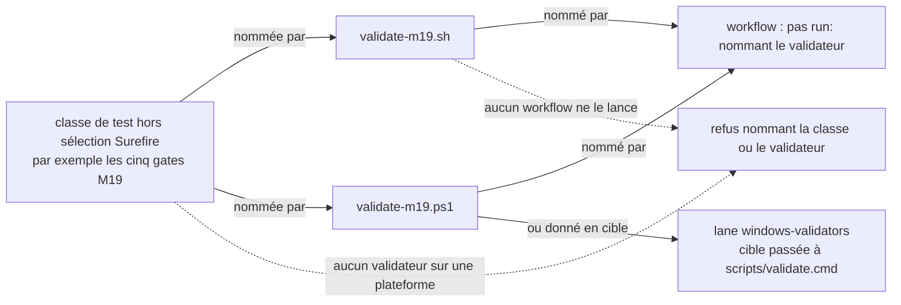
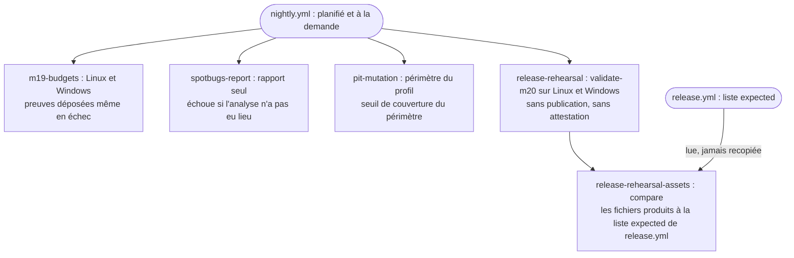

# Atteignabilité des gates et des validateurs (`gate-reachability`)

Spec de référence : [`openspec/specs/gate-reachability/spec.md`](../../../openspec/specs/gate-reachability/spec.md)
· Relevé du 2026-11-04 sur `2913fc30`.

## Objet et périmètre

Un gate, un validateur ou une commande de vérification que le dépôt déclare ne vaut que s'il est **atteignable** : lancé
par un vrai pipeline sur chaque plateforme qu'il revendique, présent sur les deux plateformes, et nommé par la
documentation sous une forme qui se résout. Sans cela, un contrôle existe sur le papier et ne tourne jamais.

- **Acteurs** : mainteneur qui ajoute un test, un validateur ou un profil Maven ; workflows `nightly.yml` et `ci.yml` ;
  suite d'architecture qui juge le tout.
- **Inclus** : classes de test que Surefire ne sélectionne pas (budgets M19) ; lanes planifiées de `nightly.yml`
  (budgets M19, SpotBugs, PIT, répétition de la release M20) ; profils Maven du POM racine ; parité `.ps1` / `.sh` des
  validateurs ; commandes citées par la documentation courante et par les relevés datés.
- **Exclus** : le contenu des budgets M19 (gelés, voir `docs/project/roadmap/M19_PERFORMANCE_BUDGETS.md`) ; la
  publication réelle d'une release ; la qualification des couvertures (voir
  [`coverage-qualification-evidence.md`](coverage-qualification-evidence.md)).

La spec compte 12 exigences et 37 scénarios. Le brief de relecture en annonçait 11 : la page suit la spec.

## Exigences

| Alias | Exigence (titre exact) | En bref | Nature |
|---|---|---|---|
| R1 | A test class that Surefire does not select SHALL be run by a validator that a workflow runs | toute classe hors sélection Surefire qui porte un test est nommée par un validateur de chaque plateforme, lui-même nommé par un workflow ; les commentaires ne comptent pas | `[EXIGENCE]` |
| R2 | The M19 budget gates SHALL run on a schedule on both platforms and a missed budget SHALL fail the run | `nightly.yml` lance M19 sur Linux et Windows, publie les preuves, échoue si un budget est manqué | `[EXIGENCE]` |
| R3 | Pinned analysis tooling SHALL be exercised on a schedule without gating on its findings | SpotBugs et PIT tournent en rapport seul ; l'analyse non faite échoue, une alerte non | `[EXIGENCE]` |
| R4 | Every Maven profile of the root POM SHALL be named by a workflow or excused with a reason | chaque profil est nommé par un workflow ou listé manuel avec sa raison | `[EXIGENCE]` |
| R5 | A validator SHALL exist on both platforms or on neither | `validate-<cible>.ps1` et `.sh` vont par paire ; `m15` à `m18` retirés | `[EXIGENCE]` |
| R6 | A validator SHALL check the checkout it is run from | aucun validateur ne bascule sur une branche littérale | `[EXIGENCE]` |
| R7 | Documentation that is current SHALL name only commands that resolve | pas de `validate-<cible>.cmd`, toute cible de `scripts\validate.cmd` existe | `[EXIGENCE]` |
| R8 | A dated record SHALL keep the command it recorded and be pointed to the supported form | les relevés gardent leur commande, une note datée renvoie à la forme prise en charge | `[EXIGENCE]` |
| R9 | The release build SHALL be rehearsed on a schedule on both platforms and a failed rehearsal SHALL fail the run | répétition M20 planifiée et à la demande, Linux et Windows | `[EXIGENCE]` |
| R10 | The rehearsal SHALL compare what the builds produce with what the release workflow requires | les noms attendus sont lus dans `release.yml`, jamais recopiés | `[EXIGENCE]` |
| R11 | A rehearsal MUST NOT publish, attest or produce qualification evidence | aucun `git push`, `gh release`, attestation ; dit ce qu'elle n'exerce pas | `[EXIGENCE]` |
| R12 | The M20 release validator SHALL be launched by a workflow on each platform it exists for | `validate-m20.sh` sur Linux, `validate-m20.ps1` sur Windows, dans un pas `run:` | `[EXIGENCE]` |

## Comportement détaillé

### Qui juge quoi

`[EXISTANT VÉRIFIÉ]` Les dix méthodes de [`GateReachabilityArchitectureTest`](../../../morpheus-architecture-tests/src/test/java/com/morpheus/architecture/GateReachabilityArchitectureTest.java)
(classe marquée `@CoherenceCheck`) portent R1, R4 à R8, R11 et R12 ; deux d'entre elles sont hors spec (voir Écarts).
R2, R3 et R10 n'ont aucune règle de cette classe (R9 n'y a que la présence de la lane sur les deux plateformes) : elles reposent sur les lanes et sur les tests Python. Chaque règle lit du texte **exécutable** (commentaires YAML et shell retirés) et affirme que la population lue
n'est pas vide, car une règle de fichier ne bénéficie pas de `archRule.failOnEmptyShould`.

| Règle (méthode) | Exigence |
|---|---|
| `everyTestClassOutsideSurefireSelectionIsNamedByAValidatorAWorkflowRuns` | R1 |
| `everyRootPomProfileIsNamedByAWorkflowOrExcusedWithAReason` | R4 |
| `everyValidatorExistsOnBothPlatforms` | R5 |
| `noValidatorSwitchesToANamedBranch` | R6 |
| `currentDocumentationNamesOnlyResolvingCommands` | R7 |
| `everyDatedRecordCitingARemovedWrapperSaysWhatReplacedIt` | R8 |
| `aReleaseRehearsalCannotPublishAttestOrPassForAQualification` | R11 |
| `theReleaseRehearsalValidatorIsLaunchedByAWorkflowOnEachPlatform` | R12 (et R9 pour les plateformes de la lane) |
| `everyValidatorIsLaunchedByAWorkflow` | hors spec (voir Écarts) |
| `theScriptTestsRunOnEachLegOfTheContinuousIntegrationWorkflow` | hors spec ; c'est une exigence de `validator-self-test` |

### R1 : sélection Surefire

`[EXISTANT VÉRIFIÉ]` La règle parcourt les `src/test/java` des modules du POM racine. Une classe est « sélectionnée »
si son nom suit les motifs par défaut de Surefire (`Test*`, `*Test`, `*Tests`, `*TestCase`) ou, quand le POM du module
déclare des `<include>`, si l'un d'eux la désigne. Une classe non sélectionnée qui déclare une méthode de test doit être
nommée dans le texte exécutable d'un validateur `.sh` **et** d'un validateur `.ps1`, et l'un d'eux au moins doit être
nommé par un workflow (limites de mot, extension écartée).

### R2, R3, R9 à R11 : les lanes de `nightly.yml`

`[EXISTANT VÉRIFIÉ]` Le workflow planifié [`nightly.yml`](../../../.github/workflows/nightly.yml) porte les jobs
`m19-budgets` (matrice `ubuntu-latest` et `windows-latest`, `validate-m19.sh` sous Linux, `validate-m19.ps1` sous
Windows, dépôt de `validation-output/m19/` par un pas `if: always()`), `spotbugs-report`, `pit-mutation`,
`release-rehearsal` (deux plateformes) et `release-rehearsal-assets`. Les permissions du workflow sont limitées à
`contents: read`. Le comparateur `scripts/check-release-rehearsal-assets.py` lit la liste `expected` de `release.yml`.

### R4 : profils Maven

`[EXISTANT VÉRIFIÉ]` La liste des exceptions manuelles est `MANUAL_ONLY_PROFILES`, vide dans le test. Un profil est
« nommé » par un argument `-P<profil>` du texte exécutable des workflows ; la lecture se fait par jeton exact.

### R5 à R8 : parité, branche, documentation

`[EXISTANT VÉRIFIÉ]` La parité est jugée par cible (nom entre `validate-` et l'extension). Le test de branche refuse
`git switch` / `git checkout` dans tout validateur et nomme `fichier:ligne`. La documentation courante est
`README.md`, `CONTRIBUTING.md`, `scripts/README.md`, `docs/README.md`, `distribution/README.md` et tous les
`docs/developer/*.md`. Pour R8, la note doit s'appeler `> Note du JJ/MM/AAAA`, se placer avant la première section, et
nommer `scripts\validate.cmd <cible>` quand la cible existe encore, ou la commande `git show <sha>:scripts/validate-<cible>.ps1`
quand le validateur est retiré. Les dossiers jugés sont `docs/project/roadmap`, `docs/project/validation` et
`docs/architecture/adr`.

## Diagrammes

### Comment une classe de test hors Surefire est-elle atteignable ?

Existant vérifié, lu dans `GateReachabilityArchitectureTest`. Organigramme (pas UML). Exigences R1, R5, R12.

Une classe n'est atteignable que si **chaque** plateforme la nomme et que l'un des deux validateurs est lancé (R1). La
lane `windows-validators` ne sert qu'aux `.ps1` que nul autre workflow ne lance : c'est une règle du test, absente de la
spec.

### Quelles lanes de `nightly.yml` tiennent les engagements planifiés ?

Existant vérifié, lecture de `nightly.yml`. Organigramme. Exigences R2, R3, R9, R10, R11, R12.

La répétition ne publie rien : ses deux validateurs, ses scripts de build et ses jobs ne contiennent aucune des chaînes
interdites par la règle de R11 (voir Traçabilité).

## Écarts et questions ouvertes

1. **Régression de lecture : le motif de méthode de test.** `[EXISTANT VÉRIFIÉ]` La règle R1 détecte une méthode de test
   par `TEST_METHOD = @(?:Test|ParameterizedTest|RepeatedTest)\b`. Une classe hors sélection qui ne porterait que des
   `@TestFactory` ou des `@TestTemplate` ne serait pas vue. La spec dit « declares a test method » sans restreindre.
2. **Prémisse périmée du scénario « A module that restricts its own includes is honoured ».** `[EXISTANT VÉRIFIÉ]` La
   spec dit que le POM de `morpheus-coverage-report` ne sélectionne que `**/AggregateCoverageGateTest.java`. Le POM
   (`morpheus-coverage-report/pom.xml`, section Surefire) déclare trois `<include>` : `AggregateCoverageGateTest`,
   `SkippedTestReasonGateTest` et `BorrowedCoverageGateTest`. Le comportement (les `<include>` du module remplacent les
   motifs par défaut) est inchangé ; seul l'exemple de la spec est en retard sur le POM.
3. **« Exactly the five M19 gates » n'est pas affirmé.** `[EXISTANT VÉRIFIÉ]` La règle ne calcule pas l'ensemble des
   classes non sélectionnées pour le comparer aux cinq noms : elle exige que **chacune** soit atteignable. Une sixième
   classe correctement nommée par les validateurs passerait ; une cinquième disparue aussi.
4. **Aucun test ne plante la violation.** `[EXISTANT VÉRIFIÉ]` Les règles ne sont exécutées que sur le dépôt réel. Les
   scénarios « refused » de R1, R4, R5, R6, R7, R12 (classe `M19ExampleGate`, profil `audit-example`, cible `m99`,
   `-Pd2-security-tests` seul, retrait de la lane) décrivent le comportement de la règle sans qu'un test fabrique le
   dépôt fautif. Seul le refus des `.cmd` retirés (R7, R8) est exercé indirectement par l'état courant du dépôt.
   Preuve manquante pour ces refus plantés.
5. **Preuve des lanes planifiées.** Les scénarios de R2, R3 et R9 décrivent l'exécution d'une lane réelle (artefacts,
   échec d'un budget, plateforme sous la référence). Aucun test de la suite ne lit la matrice du job `m19-budgets` ni ne
   rejoue un dépassement de budget ; la lane est elle-même la preuve, à lire dans le run planifié. Pour R3, le
   comportement du script est prouvé par ses tests Python (voir Traçabilité), pas l'enchaînement du job.
6. **Hors spec, vérifié.** `[EXISTANT VÉRIFIÉ]` Deux règles du test n'appartiennent à aucune exigence de cette
   capacité : `everyValidatorIsLaunchedByAWorkflow` (chaque variante de validateur est lancée, directement, par un autre
   validateur ou par la lane `windows-validators`) et `theScriptTestsRunOnEachLegOfTheContinuousIntegrationWorkflow`
   (relève de l'exigence « The script tests SHALL run on Linux and on Windows in CI and MUST NOT pass by skipping » de
   [`validator-self-test.md`](validator-self-test.md)). Elles ne sont pas des exigences ici.
7. **Forme de commande citée par un relevé d'audit.** `[EXISTANT VÉRIFIÉ]` Le relevé daté
   `docs/project/audits/2026-10-09/findings.md` recommande `scripts\validate.cmd m19 -Version 1.2.1`, forme que la spec
   déclare documentée nulle part. C'est un relevé daté (R8 : sa prose n'est pas réécrite), pas une surface courante. La
   règle R7 vérifie qu'une **cible** existe, pas qu'aucun `-Version` n'est donné à `m19` : preuve manquante pour la
   moitié « documented nowhere ».
8. **Numéro de version en littéral.** Les validateurs sont lancés « avec la version courante » ; la source est le POM
   racine (le comparateur Python `check-release-rehearsal-assets.py version` la lit). Aucune version n'est recopiée ici.

## Traçabilité

Les scénarios sont groupés par exigence et nommés **tous** par leur titre exact. « Fichier de test » abrège le lien vers
[`GateReachabilityArchitectureTest.java`](../../../morpheus-architecture-tests/src/test/java/com/morpheus/architecture/GateReachabilityArchitectureTest.java).

| Exigence | Scénarios (titres exacts) | Conception ou diagramme | Changement | Preuve |
|---|---|---|---|---|
| R1 | The five M19 budget gates are all accounted for | organigramme 1 | archive `2026-10-10-make-declared-gates-reachable` | `GateReachabilityArchitectureTest#everyTestClassOutsideSurefireSelectionIsNamedByAValidatorAWorkflowRuns` (chacune atteignable ; l'ensemble exact des cinq n'est pas comparé) |
| R1 | A sixth gate that no validator names is refused | idem | idem | même règle ; **preuve manquante** du refus planté |
| R1 | A validator that no workflow runs is refused | idem | idem | même règle ; **preuve manquante** du refus planté |
| R1 | A comment is not an invocation | idem | idem | même règle (`executableText`) ; **preuve manquante** du refus planté |
| R1 | A module that restricts its own includes is honoured | idem | idem | même règle (`surefireIncludes`) ; prémisse du scénario en retard sur le POM (Écart 2) |
| R2 | A nightly run produces the evidence on both platforms | organigramme 2 | idem | lane `m19-budgets` de [`nightly.yml`](../../../.github/workflows/nightly.yml) ; **preuve manquante** dans la suite (aucune lecture de la matrice ni de l'artefact) |
| R2 | A budget miss fails the lane | idem | idem | [`validate-m19.sh`](../../../scripts/validate-m19.sh) et [`validate-m19.ps1`](../../../scripts/validate-m19.ps1) nomment l'étape `M19 performance gates` ; **preuve manquante** du dépassement rejoué |
| R2 | A runner below the reference environment gives no verdict | idem | idem | seuils lus dans les deux validateurs (4 processeurs logiques, 8 GiB) ; **preuve manquante** : aucun test ne simule une machine plus petite |
| R3 | Alerts do not fail the run | organigramme 2 | idem | [`test_check_spotbugs_reports.py`](../../../scripts/tests/test_check_spotbugs_reports.py)`#test_alerts_alone_never_fail_the_run_and_are_counted_per_module` |
| R3 | An analysis that did not happen fails the run | idem | idem | `#test_a_module_with_classes_and_no_report_fails_naming_the_module`, `#test_missing_classes_make_the_analysis_partial`, `#test_analysis_errors_make_the_analysis_partial`, `#test_a_tree_where_nothing_was_built_fails` |
| R3 | A PIT scope that mutates nothing fails the run | idem | idem | seuil `pit.coverageThreshold` du profil `audit-mutation` dans [`pom.xml`](../../../pom.xml) ; **preuve manquante** (aucun test ne lance PIT sur un périmètre vide) |
| R4 | A profile that stops being run is refused | sans diagramme | idem | `GateReachabilityArchitectureTest#everyRootPomProfileIsNamedByAWorkflowOrExcusedWithAReason` ; refus planté : **preuve manquante** |
| R4 | A profile whose name is a prefix of another is not hidden by it | idem | idem | même règle (jeton exact `-P`) ; refus planté : **preuve manquante** |
| R4 | A new profile that nothing runs is refused | idem | idem | même règle ; refus planté : **preuve manquante** |
| R5 | A lone PowerShell validator is refused | sans diagramme | idem | `GateReachabilityArchitectureTest#everyValidatorExistsOnBothPlatforms` ; refus planté : **preuve manquante** |
| R5 | A lone shell validator is refused | idem | idem | même règle ; refus planté : **preuve manquante** |
| R5 | The dispatcher offers only runnable targets | idem | idem | [`test_validate_dispatcher.py`](../../../scripts/tests/test_validate_dispatcher.py)`#test_the_real_dispatcher_lists_every_validator_of_the_repository_and_nothing_else` |
| R5 | The retired validators remain recoverable | idem | idem | [`docs/project/validation/README.md`](../../project/validation/README.md) (commits des quatre scripts) ; **preuve manquante** pour la liste de commits elle-même ; l'immuabilité de `VALIDATION_M15.md` à `VALIDATION_M18.md` n'est pas testée |
| R6 | A validator that pins a branch is refused | sans diagramme | idem | `GateReachabilityArchitectureTest#noValidatorSwitchesToANamedBranch` (nomme `fichier:ligne`) |
| R7 | A current guide cites the removed wrapper | sans diagramme | idem | `GateReachabilityArchitectureTest#currentDocumentationNamesOnlyResolvingCommands` |
| R7 | The M19 replay command is the one that works | idem | idem | [`test_validate_dispatcher.py`](../../../scripts/tests/test_validate_dispatcher.py)`#test_the_documented_m19_command_reaches_the_validator` ; moitié « `-Version 1.2.1` documenté nulle part » : **preuve manquante** (Écart 7) |
| R7 | A guide that calls a block historical still has to resolve | idem | idem | même règle de `currentDocumentationNamesOnlyResolvingCommands` sur `docs/developer/REMOTE_SERVER_PLATFORM.md` |
| R8 | A dated record is annotated, not rewritten | sans diagramme | idem | `GateReachabilityArchitectureTest#everyDatedRecordCitingARemovedWrapperSaysWhatReplacedIt` (note datée avant la première section) ; « la commande d'origine reste » : **preuve manquante** |
| R9 | Both platforms rehearse the release build | organigramme 2 | archive `2026-10-16-rehearse-the-release-chain-before-the-tag` | `GateReachabilityArchitectureTest#theReleaseRehearsalValidatorIsLaunchedByAWorkflowOnEachPlatform` (lane sur les deux plateformes) ; archive, somme de contrôle et manifeste : **preuve manquante** dans la suite |
| R9 | A broken Linux packaging is found without a tag | idem | idem | par construction de la lane ; **preuve manquante** |
| R9 | A rehearsal can be run on a branch before a merge | idem | idem | déclencheur `workflow_dispatch` de `nightly.yml` ; **preuve manquante** |
| R9 | The validator is given the current version | idem | idem | [`test_validator_entry_refusals.py`](../../../scripts/tests/test_validator_entry_refusals.py)`#test_a_version_the_pom_does_not_carry_is_refused_before_the_build` et `#test_without_a_version_the_dated_default_is_refused_before_the_build` |
| R10 | The produced files match the expected names | organigramme 2 | idem | [`test_check_release_rehearsal_assets.py`](../../../scripts/tests/test_check_release_rehearsal_assets.py)`#test_a_complete_rehearsal_passes_without_the_attestation_bundles` |
| R10 | An expected asset nobody builds fails the rehearsal | idem | idem | `#test_an_expected_name_nobody_built_fails_and_is_named`, `#test_an_empty_file_fails_and_is_named` |
| R10 | The list is read, not restated | idem | idem | `#test_the_script_holds_no_asset_name_of_its_own`, `#test_the_workflow_list_is_read_and_carries_the_version` |
| R11 | The lane has no step that could publish | organigramme 2 | idem | `GateReachabilityArchitectureTest#aReleaseRehearsalCannotPublishAttestOrPassForAQualification` (chaînes interdites dont `git push`, `gh release`, `actions/attest`, permissions d'écriture) ; la suppression du tag de validation sur toute sortie : [`test_validator_entry_refusals.py`](../../../scripts/tests/test_validator_entry_refusals.py)`#test_a_build_that_fails_is_refused_and_no_rehearsal_tag_is_left` |
| R11 | The rehearsal names what it did not exercise | idem | idem | quatre lignes `Not exercised by a rehearsal: …` dans [`validate-m20.sh`](../../../scripts/validate-m20.sh) ; **preuve manquante** (aucun test ne lit le résumé) |
| R11 | A rehearsal cannot be recorded as a qualification | idem | idem | même règle (`RELEASE QUALIFICATION PASS` interdit) ; la mention dans la procédure de qualification : [`RELEASE_QUALIFICATION.md`](../../project/validation/RELEASE_QUALIFICATION.md) ; **preuve manquante** pour cette seconde moitié |
| R11 | The lane holds no publishing permission | idem | idem | même règle (`id-token: write`, `attestations: write`, `contents: write` interdits) |
| R12 | Both variants are launched | organigramme 1 | idem | `GateReachabilityArchitectureTest#theReleaseRehearsalValidatorIsLaunchedByAWorkflowOnEachPlatform` (un seul pas, `if: runner.os == '<OS>'`) |
| R12 | Removing the lane fails the build | idem | idem | même règle ; refus planté : **preuve manquante** |
| R12 | One platform is not enough | idem | idem | même règle (la variante est jugée par extension) ; refus planté : **preuve manquante** |

## Sources

- Règles du dépôt : `.claude/rules/governance.md` (parité `.ps1` / `.sh`), `.claude/rules/tooling.md` (lancer les
  validateurs), `.claude/rules/testing.md` (budgets M19, lane nocturne).
- Plan et budgets M19 : [`M19_PERFORMANCE_BUDGETS.md`](../../project/roadmap/M19_PERFORMANCE_BUDGETS.md).
- Qualification de release : [`RELEASE_QUALIFICATION.md`](../../project/validation/RELEASE_QUALIFICATION.md) ;
  validateurs retirés : [`docs/project/validation/README.md`](../../project/validation/README.md).
- Pages liées : [`validator-self-test.md`](validator-self-test.md) (tests des validateurs et inventaire de `scripts/`),
  [`gate-verdict-currency.md`](gate-verdict-currency.md).
- Archives OpenSpec : `2026-10-10-make-declared-gates-reachable`, `2026-10-16-rehearse-the-release-chain-before-the-tag`.
