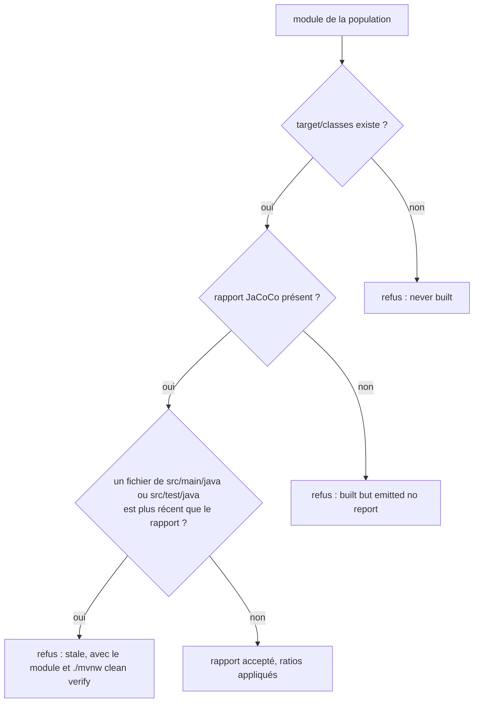
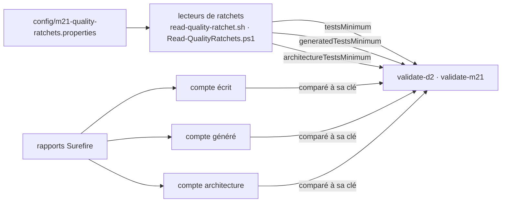

# Actualité du verdict d'un gate (`gate-verdict-currency`)

Spec de référence : [`openspec/specs/gate-verdict-currency/spec.md`](../../../openspec/specs/gate-verdict-currency/spec.md)
· Relevé du 2026-11-04 sur `2913fc30`.

## Objet et périmètre

Un validateur ou un gate ne rend jamais PASS sur une valeur plus ancienne que sa source de vérité, ni sur une mesure
plus ancienne que le code qu'elle prétend mesurer ; et un refus dit laquelle de ses causes il a touchée.

- **Acteurs** : validateurs `scripts/validate-m21.*` et `scripts/validate-d2.*` (et les validateurs de milestone qui lisent
  les mêmes minimums) ; gates de couverture `CoverageQualityGateTest` et `AggregateCoverageGateTest` ; suite d'architecture.
- **Inclus** : lecture des minimums de présence dans `config/m21-quality-ratchets.properties` ; refus d'un rapport JaCoCo
  plus vieux que les sources ; comptage séparé des exécutions écrites et générées ; fabriques de tests qui ne génèrent rien.
- **Exclus** : les valeurs des seuils (cf. le fichier de ratchets, jamais recopié ici) ; la qualification des plafonds
  (voir [`coverage-qualification-evidence.md`](coverage-qualification-evidence.md)) ; le crédit emprunté (voir
  [`coverage-attribution-gap.md`](coverage-attribution-gap.md)).

## Exigences

| Alias | Exigence (titre exact) | En bref | Nature |
|---|---|---|---|
| R1 | A validator SHALL read the presence ratchets from the living file and MUST NOT compare an observed count to a literal | minimums lus dans le fichier, clé nommée au refus, jamais de littéral | `[EXIGENCE]` |
| R2 | A coverage gate SHALL refuse a JaCoCo report older than the sources it measures | rapport par module et agrégé comparés aux sources et tests | `[EXIGENCE]` |
| R3 | A stale report SHALL be refused under its own named cause, measured against the sources | cause `stale` distincte, comparaison stricte, jamais le répertoire de classes | `[EXIGENCE]` |
| R4 | A validator SHALL count the executions of declared test methods apart from generated executions | deux comptes, imprimés et écrits, de somme égale au total Surefire | `[EXIGENCE]` |
| R5 | Each of the two counts SHALL have its own minimum in the living ratchet file | deux clés, chaque compte refusé sous sa clé | `[EXIGENCE]` |
| R6 | A test factory SHALL fail when it generates nothing | toute `@TestFactory` affirme que sa source n'est pas vide | `[EXIGENCE]` |

## Comportement détaillé

### Les minimums de présence (R1, R5)

`[EXISTANT VÉRIFIÉ]` Les clés vivantes de [`config/m21-quality-ratchets.properties`](../../../config/m21-quality-ratchets.properties)
pour la présence sont `testsMinimum`, `generatedTestsMinimum` et `architectureTestsMinimum`. Les validateurs les lisent
par `scripts/lib/read-quality-ratchet.sh` et `scripts/lib/Read-QualityRatchets.ps1`, qui refusent par nom une clé absente,
un fichier absent, une valeur nulle, négative, fractionnaire ou non numérique, et qui ne laissent aucun retour chariot dans
la valeur lue d'un fichier en fins de ligne Windows. `validate-d2.*` compare l'écrit, le généré et l'architecture, chacun à
**sa** clé (jamais à la somme). Les valeurs ne sont pas citées ici : relire le fichier.

### La péremption d'un rapport (R2, R3)

`[EXISTANT VÉRIFIÉ]` `CoverageQualityGateTest` compare le rapport JaCoCo de chaque module à la date de modification
**la plus récente** d'un fichier régulier de `src/main/java` ou `src/test/java` du module ; la comparaison est stricte
(un fichier de même date n'est pas plus récent). `AggregateCoverageGateTest` fait de même pour
`jacoco-aggregate/jacoco.xml` contre tous les modules de sa population et `morpheus-architecture-tests`. Le message de
refus nomme le module, la cause `older than the sources it measures` et `./mvnw clean verify`, apart de `never built` et de
`built but emitted no report`. Dans le gate agrégé, le contrôle précède l'écriture du résumé
`m21-aggregate-coverage-summary.txt`.

### Le double compte (R4)

`[EXISTANT VÉRIFIÉ]` Une exécution **écrite** est l'unique exécution d'une méthode (nom nu dans le rapport Surefire) ; une
exécution **générée** vient d'une fabrique ou de toute source à plusieurs invocations par méthode et porte le nom
`méthode()[N]`. Les deux comptes sont écrits dans `validation-summary.txt` ; leur somme égale le total Surefire. Détail
dans `.claude/rules/testing.md` (« Deux mesures de présence »).

### Les fabriques vides (R6)

`[EXISTANT VÉRIFIÉ]` Les fabriques de `morpheus-cli` passent leur flux par `GeneratedCases.nonEmpty`. Les autres portent un
`assertFalse(….isEmpty())`. La règle reconnaît les deux formes et refuse aussi `allowZeroInvocations = true` sur un test
générateur.

## Diagrammes

### Que fait un gate de couverture d'un rapport qu'il ne peut pas croire ?

Existant vérifié (`CoverageQualityGateTest` et `AggregateCoverageGateTest`). Organigramme. Exigences R2, R3.

Trois causes, trois messages, dans un même refus quand plusieurs modules sont en cause. La référence est la date des
sources, jamais celle de `target/classes` (R3).

### D'où vient chaque minimum qu'un validateur applique ?

Existant vérifié (`validate-d2.*`, `validate-m21.*`, `read-quality-ratchet.sh`). Organigramme. Exigences R1, R4, R5.

Aucun compte n'est comparé à l'autre clé ni à la somme ; une clé absente ou invalide arrête le validateur avant le build.

## Écarts et questions ouvertes

1. **« A removed … test also makes the report stale ».** `[EXISTANT VÉRIFIÉ]` Le titre du scénario dit « removed or
   edited », mais la comparaison porte sur la date des fichiers réguliers : un fichier de test **supprimé** ne laisse
   aucune date à comparer, et la date du répertoire n'est pas lue. Le test fabrique une édition (`Files.setLastModifiedTime`),
   pas une suppression. Une suppression seule n'est pas détectée ; preuve manquante pour la suppression.
2. **Même règle, trois copies.** `[EXISTANT VÉRIFIÉ]` La comparaison « rapport plus récent que les sources » est écrite
   dans `CoverageQualityGateTest`, dans `AggregateCoverageGateTest` et dans `BorrowedCoverageGateTest` (module
   `morpheus-coverage-report`, voir [`coverage-attribution-gap.md`](coverage-attribution-gap.md)). La spec ne parle
   que des deux premières ; la troisième est hors de cette capacité.
3. **« The tests set the times explicitly ».** `[EXISTANT VÉRIFIÉ]` Les deux tests de péremption fabriquent leurs dates
   par `Files.setLastModifiedTime`. Aucun test n'interdit un `sleep` dans ces tests : la propriété tient par écriture, pas
   par une règle.
4. **Version en littéral dans le test D2.** `[EXISTANT VÉRIFIÉ]` `D2RepositoryHardeningArchitectureTest#d2ScriptsReadThePresenceMinimumsFromTheLivingRatchetsAndKeepTheProductVersion`
   écrit le numéro de version du produit comme littéral du test (pas via `ProductMetadata`) : elle doit être mise à jour
   à chaque passage de version (règle de gouvernance : passage de version = lot indivisible).
5. **Refus planté des minimums littéraux.** Les scénarios « A literal minimum is refused… » et « A literal updated to the
   correct value is still refused » sont tenus par une règle qui lit les **vrais** scripts ; aucun test ne fabrique un
   script fautif. La règle porte sur la forme de l'opérande (`[0-9][0-9._]*`), donc la propriété « refuse le littéral
   et non un nombre précis » est vraie par construction. Preuve manquante pour le refus joué.
6. **Parité sur le partage.** « Both platforms agree on the split » : le contrat de verdicts est joué contre le `.sh` et le
   `.ps1` de chaque cible, mais aucun test ne compare **les deux comptes** que les deux plateformes impriment sur les
   mêmes rapports. Preuve partielle.

## Traçabilité

Les scénarios sont nommés par leur titre exact. Archives : `2026-10-10-make-gate-verdicts-follow-living-sources` (R1, R2,
R3) et `2026-10-21-count-written-tests-apart-from-generated-ones` (R4, R5, R6).

| Exigence | Scénario | Conception ou diagramme | Preuve |
|---|---|---|---|
| R1 | D2 refuses a repository that lost most of its tests | organigramme 2 | [`test_validator_verdicts.py`](../../../scripts/tests/test_validator_verdicts.py)`#test_a_test_count_below_the_minimum_is_refused_with_both_counts` (cible `d2` incluse) |
| R1 | A raised ratchet is followed without editing the script | idem | `#test_raising_the_tests_minimum_in_the_file_turns_the_passing_build_into_a_refusal`, `#test_raising_the_architecture_minimum_in_the_file_turns_the_passing_build_into_a_refusal`, `#test_lowering_the_minimums_in_the_file_lets_a_build_it_refused_pass` |
| R1 | A missing or invalid key is not replaced by a default | idem | `#test_a_missing_minimum_is_refused_by_its_key_before_the_build`, `#test_a_missing_ratchet_file_is_refused_before_the_build`, `#test_a_minimum_that_is_not_a_count_is_refused_by_its_key_before_the_build` |
| R1 | A properties file with Windows line endings is read correctly | idem | [`test_read_quality_ratchet.py`](../../../scripts/tests/test_read_quality_ratchet.py)`#test_every_shared_case` (cas « windows line endings … », exécuté contre le `.sh` et le `.ps1`) |
| R1 | A literal minimum is refused by the architecture suite | idem | [`D2RepositoryHardeningArchitectureTest`](../../../morpheus-architecture-tests/src/test/java/com/morpheus/architecture/d2/D2RepositoryHardeningArchitectureTest.java)`#d2ScriptsReadThePresenceMinimumsFromTheLivingRatchetsAndKeepTheProductVersion` ; refus joué : **preuve manquante** (Écart 5) |
| R1 | A literal updated to the correct value is still refused | idem | même méthode (l'opérande est refusé par sa forme) ; refus joué : **preuve manquante** |
| R1 | The version assertion survives the replacement | idem | même méthode (`script.contains("1.2.2")`, voir Écart 4) |
| R1 | The source and the keys must be present | idem | même méthode (chemin du fichier, `testsMinimum`, `generatedTestsMinimum`, `architectureTestsMinimum`) |
| R2 | A source edited after the report is refused | organigramme 1 | [`CoverageQualityGateTest`](../../../morpheus-architecture-tests/src/test/java/com/morpheus/architecture/m21/CoverageQualityGateTest.java)`#aReportOlderThanTheSourcesItMeasuresIsRefusedUnderItsOwnCause` (module `stale-main`) |
| R2 | A removed or edited test also makes the report stale | idem | même méthode (module `stale-test`, édition seule ; **preuve manquante** pour la suppression, Écart 1) |
| R2 | A fresh report is accepted | idem | même méthode (module `fresh`, puis retour à quatre rapports sommés) |
| R2 | A stale aggregate report is refused | idem | [`AggregateCoverageGateTest`](../../../morpheus-coverage-report/src/test/java/com/morpheus/coverage/AggregateCoverageGateTest.java)`#anAggregateReportOlderThanTheSourcesItMeasuresIsRefused` ; l'ordre « avant d'écrire le résumé » tient par l'ordre des appels de `aggregateCoverageIncludesCrossModuleExecutionAndMeetsRatchets`, aucun test ne l'affirme |
| R2 | The tests set the times explicitly | idem | écriture des deux tests ci-dessus (`Files.setLastModifiedTime`) ; aucune règle ne l'impose (Écart 3) |
| R3 | A nested edit is detected although the class directory did not move | organigramme 1 | `CoverageQualityGateTest#aReportOlderThanTheSourcesItMeasuresIsRefusedUnderItsOwnCause` (module `stale-nested`, `target/classes` plus ancien que le rapport) |
| R3 | The three causes stay distinguishable | idem | même méthode (`never built`, `built but emitted no report`, `older than the sources it measures` dans un même message) |
| R4 | The summary carries both counts | organigramme 2 | `test_validator_verdicts.py#test_the_summary_states_both_counts_and_their_sum_is_the_total` |
| R4 | A parameterised test introduced later is counted as generated | idem | `#test_a_parameterised_test_added_later_counts_as_generated_without_a_change_to_the_validators` |
| R4 | Both platforms agree on the split | idem | contrat de verdicts joué contre le `.sh` et le `.ps1` de chaque cible ; **preuve partielle** (Écart 6) |
| R5 | Removing an option is refused under the generated minimum only | organigramme 2 | `#test_a_shrunk_option_matrix_is_refused_under_the_generated_minimum_alone` |
| R5 | Deleting written tests is refused under the written minimum | idem | `#test_a_test_count_below_the_minimum_is_refused_with_both_counts` |
| R5 | Generated executions cannot make up for written ones | idem | `#test_generated_executions_do_not_make_up_for_written_ones` |
| R5 | A missing generated key is not replaced by a default | idem | `#test_a_generated_minimum_that_is_not_above_zero_is_refused_by_its_key_before_the_build` |
| R5 | The architecture minimum counts written executions | idem | `#test_the_architecture_minimum_counts_written_executions_and_a_factory_there_counts_as_generated`, `#test_a_factory_in_the_architecture_module_raises_the_generated_count_only` |
| R6 | A factory whose source returns nothing | sans diagramme | [`GeneratedCasesTest`](../../../morpheus-cli/src/test/java/com/morpheus/cli/GeneratedCasesTest.java)`#aFactoryThatBuiltNoTestFailsAndNamesItself` |
| R6 | A new factory without the assertion is refused | idem | [`TestFactoryAssertsItsSourceTest`](../../../morpheus-architecture-tests/src/test/java/com/morpheus/architecture/TestFactoryAssertsItsSourceTest.java)`#everyTestFactoryOfTheRepositoryAssertsItsSourceIsNotEmpty`, `#aFactoryThatDoesNotAssertItsSourceIsReportedByName`, `#noGeneratingTestAllowsZeroInvocations` |

## Sources

- Règles du dépôt : `.claude/rules/testing.md` (deux mesures de présence, deux échelles de couverture),
  `.claude/rules/meta.md` (chiffres périssables).
- Décision : [ADR-0166](../../architecture/adr/GEN-0166-deux-echelles-de-couverture-un-seuil-par-module-a-marge-proportionnelle-et-le-credit-emprunte.md) ; comptage
  écrit / généré : ADR-0089 (cité par `.claude/rules/testing.md`).
- Pages liées : [`validator-self-test.md`](validator-self-test.md), [`gate-reachability.md`](gate-reachability.md),
  [`coverage-qualification-evidence.md`](coverage-qualification-evidence.md).
- Archives OpenSpec : `2026-10-10-make-gate-verdicts-follow-living-sources`,
  `2026-10-21-count-written-tests-apart-from-generated-ones`.
