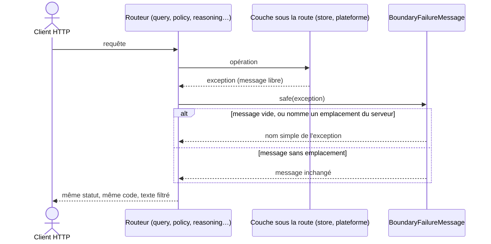

# Texte d'un échec rendu à un appelant HTTP (`http-failure-disclosure`)

Spec de référence : [`openspec/specs/http-failure-disclosure/spec.md`](../../../openspec/specs/http-failure-disclosure/spec.md)
· Relevé du 2026-11-03 sur `836fffa5`.

## Objet et périmètre

Le message d'une exception que MORPHEUS n'a pas écrite (plateforme, pilote JDBC, bibliothèque) est rédigé pour qui
lit les journaux du serveur, pas pour qui l'appelle. Il peut nommer un chemin du serveur. Cette capacité dit ce
qu'un tel message peut apprendre à un appelant HTTP, sur tous les routeurs de l'adaptateur.

- **Acteurs** : client du serveur local ; client distant, puisque la façade relaie les réponses du serveur local.
- **Inclus** : tout texte de réponse de `morpheus-api` tiré d'un `Throwable`.
- **Exclus** : les messages de refus que MORPHEUS rédige lui-même (validation, bornes), relayés tels quels ; la
  journalisation côté serveur ; les diagnostics des intégrations, régis par une autre capacité.

## Exigences

| Alias | Exigence (titre exact) | En bref | Nature |
|---|---|---|---|
| R1 | A router SHALL relay a failure message only through the boundary filter | le texte passe par `BoundaryFailureMessage.safe` ; un message qui nomme un emplacement du serveur devient le nom simple de l'exception | `[EXIGENCE]` |
| R2 | No class of the HTTP adapter SHALL turn a failure into response text by itself | hors du filtre, aucune classe ne lit `getMessage()` pour une réponse, sauf exception nommée avec sa raison | `[EXIGENCE]` |

## Comportement détaillé

`BoundaryFailureMessage.safe(failure)`
([source](../../../morpheus-api/src/main/java/com/morpheus/api/transport/BoundaryFailureMessage.java)) `[EXISTANT VÉRIFIÉ]` :

| Message de l'exception | Texte rendu |
|---|---|
| absent ou blanc | nom simple de la classe de l'exception |
| nomme un chemin POSIX ou Windows (prédicat partagé `ServerLocationDisclosure`) | nom simple de la classe de l'exception, sans tentative de nettoyage partiel |
| ne nomme aucun emplacement | le message, inchangé |

Le statut HTTP et le code d'erreur ne changent pas : seul le texte est remplacé. Aucun effet persisté.

## Diagrammes

### Que devient le message d'un échec avant d'atteindre l'appelant ?

Existant vérifié. Séquence UML ; l'alternative montre les deux issues du filtre.

Exigences : R1 pour le filtre, R2 pour l'absence de tout autre chemin entre l'exception et la réponse.

## Écarts et questions ouvertes

- Aucun écart constaté entre la spec et le code.
- `[EXISTANT VÉRIFIÉ]` Le scénario de R2 « The four private helpers are gone » se lit comme un interdit : aucune
  classe de l'adaptateur ne déclare de méthode `safeMessage`. Son titre nomme un retrait plutôt qu'une règle.
  `[PROPOSITION]` Le renommer en règle (par exemple « No router declares a message helper of its own ») relève d'un
  changement de spec, sans changer le comportement.

## Traçabilité

| Exigence | Scénario | Conception ou diagramme | Changement | Preuve |
|---|---|---|---|---|
| R1 | A storage failure under a query route names no path | séquence ci-dessus | archive `2026-10-30-filter-every-failure-message-at-the-http-boundary` | [`ExtensionRoutesFailureDisclosureTest`](../../../morpheus-api/src/test/java/com/morpheus/api/routes/owncontext/ExtensionRoutesFailureDisclosureTest.java)`#aQueryRefusalNamesNoLocationUnderEitherOfItsErrorCodes`, `#aStorageFailureUnderEachFamilyNamesNoLocation` |
| R1 | The same holds for policy, policy management and reasoning routes | idem | idem | même classe : `#aPolicyRefusalNamesNoLocation`, `#aPolicyManagementRefusalNamesNoLocation`, `#aReasoningRefusalNamesNoLocation` |
| R1 | A message MORPHEUS authored is unchanged | idem | idem | même classe : `#aRefusalThatNamesNoLocationKeepsItsMessage` ; [`BoundaryFailureMessageTest`](../../../morpheus-api/src/test/java/com/morpheus/api/transport/BoundaryFailureMessageTest.java)`#aMessageThatNamesNoLocationIsRelayedUnchanged` |
| R1 | A malformed body names no path either | idem | idem | **preuve manquante** : `MorpheusHttpRequestDecoder` appelle le filtre (lecture du code), mais aucune méthode de `MorpheusHttpRequestDecoderTest` n'exerce un corps dont l'échec nommerait un emplacement |
| R1 | (filtre lui-même) | — | — | `BoundaryFailureMessageTest#aMessageNamingAPosixPathnameIsReplacedByTheFailureType`, `#aMessageNamingAWindowsPathnameIsReplacedByTheFailureType`, `#anAbsentOrBlankMessageFallsBackToTheFailureType` |
| R2 | The four private helpers are gone | — | idem | [`HttpFailureDisclosureArchitectureTest`](../../../morpheus-architecture-tests/src/test/java/com/morpheus/architecture/HttpFailureDisclosureArchitectureTest.java)`#noSourceOfTheAdapterDeclaresAMessageHelperOfItsOwn` |
| R2 | A new router with its own helper fails the build | — | idem | `HttpFailureDisclosureArchitectureTest#onlyTheBoundaryFilterReadsTheMessageOfAFailureMorpheusDidNotAuthor` |
| R2 | An excused read carries its reason | — | idem | même test (liste nommée avec raisons) |

## Sources

- Prédicat partagé qui reconnaît un emplacement du serveur : `ServerLocationDisclosure` (`morpheus-application`).
- Page développeur : [`../API.md`](../API.md).
