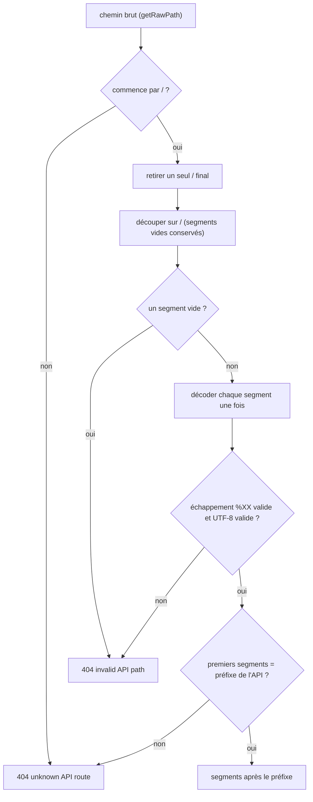
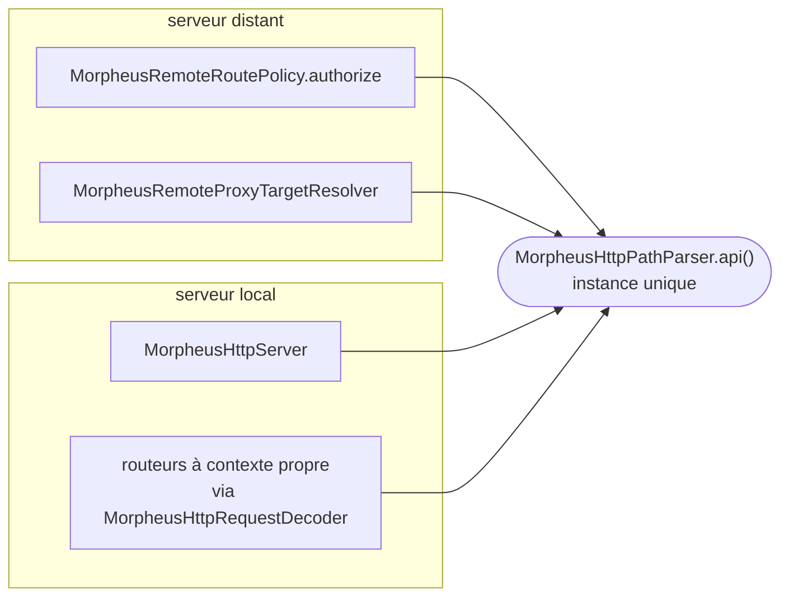

# Lecture du chemin d'une requête HTTP (`http-path-decoding`)

Spec de référence : [`openspec/specs/http-path-decoding/spec.md`](../../../openspec/specs/http-path-decoding/spec.md)
· Relevé du 2026-11-03 sur `836fffa5` ; preuves de R4 à R6 exécutées le 2026-11-04.

## Objet et périmètre

Un chemin de requête est lu d'une seule façon, par une seule fonction, que le serveur distant autorise la requête ou
que le serveur local la route. Un écart entre ces deux lectures permettrait d'obtenir l'autorisation d'une route et
d'en atteindre une autre.

- **Acteurs** : tout client HTTP du serveur local (loopback) ; tout client du serveur distant, dont la requête
  autorisée est relayée au serveur local.
- **Inclus** : découpage du chemin brut en segments, décodage des échappements `%XX`, refus d'un chemin mal formé,
  reconnaissance du préfixe de l'API.
- **Exclus** : les paramètres de requête (`?a=b`), décodés comme un formulaire par des classes nommées ; le corps de
  requête.

## Exigences

| Alias | Exigence (titre exact) | En bref | Nature |
|---|---|---|---|
| R1 | A path segment SHALL be percent-decoded exactly once and `+` SHALL stay `+` | découpe d'abord, décode chaque segment une fois, `+` reste `+`, segment vide ou échappement mal formé : 404 | `[EXIGENCE]` |
| R2 | Authorization and routing SHALL see the same segments | la politique de rôles distante et le routeur local obtiennent la même liste de segments, ou refusent tous deux | `[EXIGENCE]` |
| R3 | The adapter SHALL hold one path parser | aucune autre classe de `com.morpheus.api` ne découpe ni ne décode un chemin ; `URLDecoder` jamais sur un chemin | `[EXIGENCE]` |
| R4 | Un seul séparateur final est ignoré | un `/` final est ignoré ; deux `/` finaux : 404 `invalid API path` | `[EXIGENCE]` (changement `state-what-the-http-boundary-already-does`) |
| R5 | Le préfixe de l'API est reconnu segment par segment | préfixe comparé aux segments décodés, jamais au texte ; sinon 404 `unknown API route: <chemin brut>` | `[EXIGENCE]` (idem) |
| R6 | Un segment qui n'est pas de l'UTF-8 valide est refusé | UTF-8 strict, aucun octet remplacé ; 404 `invalid API path` | `[EXIGENCE]` (idem) |

## Comportement détaillé

Le seul lecteur est `MorpheusHttpPathParser.api()`
([source](../../../morpheus-api/src/main/java/com/morpheus/api/transport/MorpheusHttpPathParser.java)), appliqué au
chemin **tel qu'envoyé** (`getRawPath()`). `[EXISTANT VÉRIFIÉ]`

| Entrée (chemin brut, sous le préfixe) | Résultat | Nature |
|---|---|---|
| `a%2Fb` | un segment `a/b` | `[EXIGENCE]` R1 |
| `%252e%252e` | un segment `%2e%2e`, jamais `..` | `[EXIGENCE]` R1 |
| `a+b` | `a+b` | `[EXIGENCE]` R1 |
| échappement en minuscules ou majuscules (`%c3%a9`, `%C3%A9`) | même segment décodé en UTF-8 | `[EXIGENCE]` R6 |
| `%zz`, `%2`, octets non UTF-8 | 404, message `invalid API path` | `[EXIGENCE]` R1 (échappement mal formé) et R6 (octets non UTF-8) |
| segment vide (`a//b`) | 404, message `invalid API path` | `[EXIGENCE]` R1 |
| un `/` final | ignoré ; un second `/` final produit un segment vide, donc un 404 | `[EXIGENCE]` R4 |
| préfixe différent, ou préfixe partiel en texte (`/api/v1x`) | 404, message `unknown API route: <chemin brut>` | `[EXIGENCE]` R5 |

Aucun de ces refus ne laisse d'effet persisté : le chemin est lu avant toute opération.

## Diagrammes

### Comment un chemin brut devient-il une liste de segments, et où est-il refusé ?

Existant vérifié, lu dans `MorpheusHttpPathParser.segments`. Organigramme (pas un diagramme UML).

Le découpage précède le décodage : c'est ce qui garde `a%2Fb` en un seul segment (R1). La comparaison du préfixe se
fait par segments décodés, jamais par texte. Exigences : R1, R4 (séparateur final), R5 (préfixe), R6 (UTF-8 strict).

### Qui lit un chemin ?

Existant vérifié (`HttpPathReadingArchitectureTest#theLocalServerTheRoutersAndTheRemotePolicyObtainTheirSegmentsFromTheParser`).
Vue de composants simplifiée, pas un diagramme UML strict.

Les quatre lecteurs partagent l'instance unique ; c'est la condition de R2 et l'objet de R3.

## Écarts et questions ouvertes

- `[QUESTION]` Le message `unknown API route: <chemin brut>` renvoie à l'appelant le chemin qu'il a envoyé. Ce n'est pas
  une divulgation (le texte vient de l'appelant), mais aucune exigence ne dit si ce renvoi est voulu.
- `[QUESTION]` Le préfixe encodé (`/%61pi/v1/health`) est accepté par le code
  (`MorpheusHttpPathParserTest#thePrefixIsMatchedBySegmentNotByText`) et aucun scénario ne l'affirme : R5 dit seulement
  que la comparaison porte sur les segments décodés. Question ouverte D2 du changement ; un refus ouvrirait un
  changement de code distinct.
- `[EXISTANT VÉRIFIÉ]` Les scénarios de R4 à R6 disent « un serveur local démarré » ; leurs preuves exercent
  `MorpheusHttpPathParser` directement (le 404 est le contrat de `ApiFailure`). Que les serveurs passent tous par ce
  parseur est tenu par `HttpPathReadingArchitectureTest` et `RemoteAuthorizationLocalRoutingParityTest`. Aucun écart
  constaté entre la spec et le code sur R1 à R6 (exécution du 2026-11-04).

## Traçabilité

| Exigence | Scénario | Conception ou diagramme | Changement | Preuve |
|---|---|---|---|---|
| R1 | A doubly encoded dot is not a dot | organigramme ci-dessus | archive `2026-10-30-decode-http-path-segments-once` | [`MorpheusHttpPathParserTest`](../../../morpheus-api/src/test/java/com/morpheus/api/transport/MorpheusHttpPathParserTest.java)`#aDoublyEncodedCharacterIsDecodedOnce` |
| R1 | An encoded slash does not create a segment | organigramme | idem | `MorpheusHttpPathParserTest#anEncodedSlashStaysInsideItsSegment` |
| R1 | A plus sign is a plus sign | organigramme | idem | `MorpheusHttpPathParserTest#aPlusSignIsAPlusSign` ; [`HttpPathSegmentDecodingTest`](../../../morpheus-api/src/test/java/com/morpheus/api/HttpPathSegmentDecodingTest.java)`#aPathParameterIsDecodedOnceAndAPlusSignStaysAPlusSign` (serveur démarré) |
| R1 | A malformed escape is refused | organigramme | idem | `MorpheusHttpPathParserTest#aMalformedEscapeIsRefused`, `#emptySegmentInsidePathIsRejectedWithExistingNotFoundContract` |
| R2 | Hostile encodings are read identically | vue « Qui lit un chemin ? » | idem | [`RemoteAuthorizationLocalRoutingParityTest`](../../../morpheus-api/src/test/java/com/morpheus/api/remote/RemoteAuthorizationLocalRoutingParityTest.java)`#thePolicyAndTheLocalServerSelectTheSameRouteForEveryEncodingOfAPath` |
| R2 | A route the policy authorizes is the route that is served | idem | idem | même test (même route, mêmes paramètres) |
| R3 | The two copies are gone | idem | idem | [`HttpPathReadingArchitectureTest`](../../../morpheus-architecture-tests/src/test/java/com/morpheus/architecture/HttpPathReadingArchitectureTest.java)`#onlyTheParserSplitsARequestPath`, `#theAdapterHoldsOneParserInstance` |
| R3 | A new form decoding of a path fails the build | — | idem | `HttpPathReadingArchitectureTest#noClassOfTheAdapterFormDecodesAnythingButAQuery`, `#everyNamedFormDecoderStillDecodesAForm` |
| R4 | Un séparateur final ne change pas la route | organigramme | `state-what-the-http-boundary-already-does` | `MorpheusHttpPathParserTest#childPathsPreserveOrderAndIgnoreOneTrailingSlash` |
| R4 | Deux séparateurs finaux sont refusés | organigramme | idem | `MorpheusHttpPathParserTest#onlyOneTrailingSlashIsIgnored` |
| R5 | Un préfixe collé au segment suivant n'est pas le préfixe | organigramme | idem | `MorpheusHttpPathParserTest#thePrefixIsMatchedBySegmentNotByText` (`/api/v1health`) |
| R5 | Un séparateur encodé ne forme pas le préfixe | organigramme | idem | même test (`/api%2Fv1/health`) |
| R5 | Un préfixe étranger est nommé dans le refus | organigramme | idem | `MorpheusHttpPathParserTest#wrongPrefixIsRejectedWithExistingNotFoundContract` |
| R6 | Un octet isolé hors UTF-8 est refusé | organigramme | idem | `MorpheusHttpPathParserTest#aMalformedEscapeIsRefused` (`%ff`, `%C3`) |
| R6 | Un caractère encodé valide est lu quelle que soit la casse | organigramme | idem | `MorpheusHttpPathParserTest#anEscapeIsReadAsUtf8WhateverItsCase` |

## Sources

- Règle de sécurité du dépôt : `.claude/rules/security.md`, section « Chemin d'une requête HTTP — une seule lecture ».
- ADR : [ARCH-0065](../../architecture/adr/ARCH-0065-jdk-httpserver-local-api.md) (serveur HTTP du JDK).
- Page développeur : [`../API.md`](../API.md).
