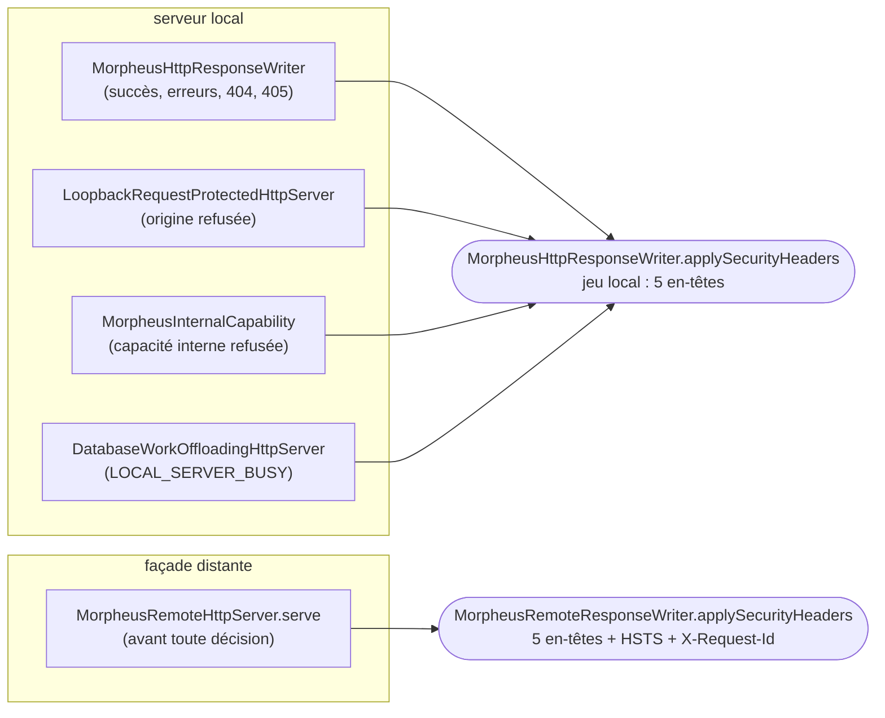

# En-têtes de sécurité des réponses HTTP (`http-response-headers`)

Spec de référence : [`openspec/specs/http-response-headers/spec.md`](../../../openspec/specs/http-response-headers/spec.md)
· Relevé du 2026-11-03 sur `836fffa5`.

## Objet et périmètre

Toute réponse HTTP de MORPHEUS porte le même jeu d'en-têtes de sécurité, quel que soit le code qui l'a écrite : une
réponse qui écrit ses en-têtes elle-même finit par en oublier un.

- **Acteurs** : navigateur ou client HTTP du serveur local ; client du serveur distant.
- **Inclus** : réponses de succès, d'erreur, de route inconnue, de méthode refusée, d'origine refusée, de capacité
  interne refusée, de refus d'admission, et réponses de la façade distante (relayées ou rendues par elle).
- **Exclus** : le contenu des enveloppes JSON ; `WWW-Authenticate` et `Allow`, posés par des réponses particulières.

## Exigences

| Alias | Exigence (titre exact) | En bref | Nature |
|---|---|---|---|
| R1 | Every response of the local server SHALL carry the same security headers | cinq en-têtes sur toute réponse locale ; jamais `Access-Control-Allow-Origin` ni `Strict-Transport-Security` | `[EXIGENCE]` |
| R2 | Every response of the remote facade SHALL add transport security | le jeu local, plus `X-Request-Id` et `Strict-Transport-Security: max-age=31536000` ; jamais de CORS | `[EXIGENCE]` |
| R3 | The header set SHALL be declared once per server | une déclaration par serveur, utilisée par chaque écrivain ; un test lit de vraies réponses | `[EXIGENCE]` |

## Comportement détaillé

| En-tête | Valeur | Local | Distant |
|---|---|---|---|
| `Cache-Control` | `no-store` | oui | oui |
| `X-Content-Type-Options` | `nosniff` | oui | oui |
| `X-Frame-Options` | `DENY` | oui | oui |
| `Referrer-Policy` | `no-referrer` | oui | oui |
| `Content-Security-Policy` | `default-src 'none'; frame-ancestors 'none'` | oui | oui |
| `Strict-Transport-Security` | `max-age=31536000` | **jamais** (HTTP sur loopback) | oui |
| `X-Request-Id` | UUID tiré par requête | non | oui |
| `Access-Control-Allow-Origin` | — | **jamais** | **jamais** |

`[EXISTANT VÉRIFIÉ]` La valeur HSTS ne porte pas `includeSubDomains` : MORPHEUS ne possède pas le domaine que
l'opérateur expose (commentaire de `MorpheusRemoteResponseWriter.applySecurityHeaders`).

## Diagrammes

### Par quel point chaque réponse reçoit-elle ses en-têtes ?

Existant vérifié par recherche des appels à `applySecurityHeaders` dans `morpheus-api`. Organigramme, pas UML.

Quatre écrivains locaux, un seul point d'application local (R1, R3). La façade pose ses en-têtes au début de
`serve`, avant l'authentification : un refus 401, 403 ou 429 les porte donc aussi (R2).

## Écarts et questions ouvertes

- `[EXISTANT VÉRIFIÉ]` La façade distante déclare sa propre copie des cinq en-têtes locaux au lieu d'appeler la
  déclaration locale. C'est conforme à R3 (« une fois par serveur ») ; deux déclarations des mêmes valeurs peuvent
  toutefois diverger. `MorpheusRemoteResponseWriterTest#securityHeadersRemainStrictRequestScopedAndCorsFree` fixe les
  valeurs distantes, `LocalResponseSecurityHeadersTest` les valeurs locales ; aucun test ne compare les deux jeux.
  `[QUESTION]` Faut-il exiger l'égalité des deux jeux ?
- `[EXISTANT VÉRIFIÉ]` Le refus d'admission `LOCAL_SERVER_BUSY` et le refus de capacité interne passent par le même
  point d'application, mais aucun test comportemental ne lit leurs en-têtes : `LocalResponseSecurityHeadersTest`
  exerce 200, 400, 403, 404, 405 et 409. Preuve manquante pour ces deux réponses. Le titre de R1 vise toute réponse
  du serveur local, mais l'énumération de sa description ne nomme pas ces deux refus.

## Traçabilité

| Exigence | Scénario | Conception ou diagramme | Changement | Preuve |
|---|---|---|---|---|
| R1 | A success and a refusal are protected alike | organigramme ci-dessus | archive `2026-10-30-set-the-same-security-headers-on-every-response` | [`LocalResponseSecurityHeadersTest`](../../../morpheus-api/src/test/java/com/morpheus/api/local/LocalResponseSecurityHeadersTest.java)`#aSuccessAnErrorAndARefusedOriginCarryTheSameSecurityHeaders` |
| R1 | An error is protected like a success | idem | idem | même test : 400, 404, 405 et 409 sur un serveur démarré ; **preuve manquante** pour `LOCAL_SERVER_BUSY` et le refus de capacité interne |
| R2 | A proxied response carries HSTS | idem | idem | [`MorpheusRemoteResponseWriterTest`](../../../morpheus-api/src/test/java/com/morpheus/api/remote/MorpheusRemoteResponseWriterTest.java)`#securityHeadersRemainStrictRequestScopedAndCorsFree` ; `MorpheusRemoteHttpServerTest#remoteFacadeRequiresBearerEnforcesRolesAndBoundsConcurrency` |
| R2 | A refusal of the facade carries it too | idem | idem | `MorpheusRemoteHttpServerTest#remoteFacadeRequiresBearerEnforcesRolesAndBoundsConcurrency` (assertion `assertFacadeSecurityHeaders`) |
| R3 | The origin refusal uses the shared set | idem | idem | [`LocalHttpResponseWriterArchitectureTest`](../../../morpheus-architecture-tests/src/test/java/com/morpheus/architecture/LocalHttpResponseWriterArchitectureTest.java)`#localHttpResponseWritingStaysExtractedCanonicalAndHardened` |
| R3 | A new response path is caught | — | idem | `LocalResponseSecurityHeadersTest` (lecture de vraies réponses) |

## Sources

- Règle de sécurité du dépôt : `.claude/rules/security.md`, sections « Serveur local » et « Serveur remote ».
- Page développeur : [`../REMOTE_SERVER_PLATFORM.md`](../REMOTE_SERVER_PLATFORM.md).
- Séquence de la façade : [`remote-access-journal.md`](remote-access-journal.md#séquence-de-la-façade-distante).
