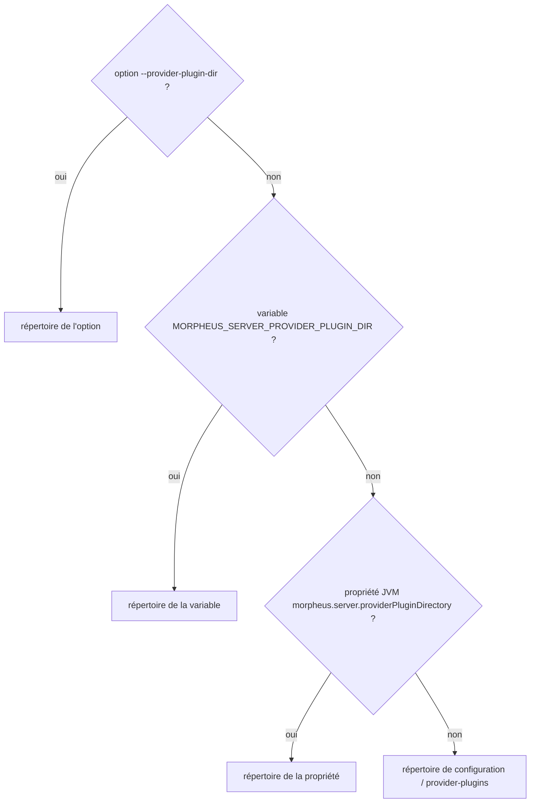

# Variables d'environnement documentées (`launch-environment-disclosure`)

Spec de référence : [`openspec/specs/launch-environment-disclosure/spec.md`](../../../openspec/specs/launch-environment-disclosure/spec.md)
· Relevé du 2026-11-03 sur `ef006fb7`.

## Objet et périmètre

Toute variable d'environnement que le produit lit est nommée là où un opérateur la cherche, avec sa priorité quand une
autre source peut fixer la même valeur ; le build refuse une variable non documentée.

- **Acteurs** : opérateur qui installe et lance MORPHEUS ; mainteneur qui ajoute un réglage.
- **Inclus** : littéraux `MORPHEUS_<NOM>` des sources principales ; documentation opérateur ; priorité des sources
  du répertoire de plugins du serveur distant.
- **Exclus** : les propriétés JVM et options qui n'ont pas de variable ; les variables lues par les pairs MINOS et
  NEXUS eux-mêmes.

## Exigences

| Alias | Exigence (titre exact) | En bref | Nature |
|---|---|---|---|
| R1 | Every MORPHEUS environment variable the product mentions SHALL be named in the operator documentation | chaque littéral `MORPHEUS_<NOM>` apparaît en mot entier dans la documentation opérateur, sauf exception nommée avec raison | `[EXIGENCE]` — écart sur le périmètre |
| R2 | The remote server guide SHALL document the provider-plugin directory variable and its precedence | `MORPHEUS_SERVER_PROVIDER_PLUGIN_DIR` et l'ordre option, variable, propriété, défaut dans le guide du serveur distant | `[EXIGENCE]` |

## Comportement détaillé

`[EXISTANT VÉRIFIÉ]` :

- **Balayage** (`LaunchEnvironmentDisclosureTest`) : littéraux entre guillemets de la forme `"MORPHEUS_[A-Z0-9_]+"`
  dans `<module>/src/main/java/**/*.java` ; un nom construit par concaténation y échappe. Recherche en mot entier
  (`(?<![A-Z0-9_])NOM(?![A-Z0-9_])`) dans les pages de `docs/user` seulement (`OPERATOR_DOCUMENTATION`).
- **Exceptions** (`NOT_AN_ENVIRONMENT_VARIABLE`) : littéraux qui ne sont pas des variables (codes de refus), chacun
  avec sa raison ; une exception sans raison, ou que plus aucune source ne mentionne, fait échouer le test.
- **Priorité du répertoire de plugins distant** (`RemoteApiLaunchOptions.parse`, `morpheus-cli/.../launch/`) :
  option `--provider-plugin-dir`, puis variable `MORPHEUS_SERVER_PROVIDER_PLUGIN_DIR`, puis propriété JVM
  `morpheus.server.providerPluginDirectory`, puis `<répertoire de configuration>/provider-plugins`.

## Diagrammes

### D'où vient le répertoire des plugins du serveur distant ?

Existant vérifié (`RemoteApiLaunchOptions.parse`). Organigramme (pas UML).

Le client distant ne choisit jamais ce répertoire : il vient de la configuration de lancement du serveur. Exigence :
R2, scénario « The stated precedence is the implemented one ».

## Écarts et questions ouvertes

- `[EXISTANT VÉRIFIÉ]` **Écart avec R1.** La spec accepte une mention sous `docs/user` ou `docs/developer` ; le test ne
  lit que `docs/user`, choix plus strict documenté dans sa javadoc (une variable n'était nommée que sur une page
  développeur). `[QUESTION]` Aligner la spec sur le test (documentation utilisateur seulement) ?
- `[EXISTANT VÉRIFIÉ]` Les scénarios « A new variable without documentation fails the build » et « A mention outside
  the operator documentation does not count » n'ont pas de test à rebours (fixture négative) : ils tiennent par la
  construction du test. Le changement d'origine consigne une vérification manuelle par cassure volontaire.
- `[EXISTANT VÉRIFIÉ]` Pour R2, aucun test ne lit la ligne du tableau du guide ni le paragraphe sur la source unique ;
  la priorité est prouvée dans le code (`RemoteApiLaunchOptionsTest`), pas contre le texte du guide.
- `[EXISTANT VÉRIFIÉ]` Les scénarios « after this change » et « The guide no longer says… » sont rédigés au passé.

## Traçabilité

| Exigence | Scénario | Diagramme | Changement | Preuve |
|---|---|---|---|---|
| R1 | The current variables are all documented | — | archive `2026-10-16-document-every-environment-setting-the-product-reads` | [`LaunchEnvironmentDisclosureTest`](../../../morpheus-architecture-tests/src/test/java/com/morpheus/architecture/LaunchEnvironmentDisclosureTest.java)`#everyMorpheusEnvironmentVariableTheMainSourcesMentionIsNamedInTheOperatorDocumentation` |
| R1 | A new variable without documentation fails the build | — | idem | même méthode (message `<NOM> (mentioned by <fichier>)`) ; **pas de fixture négative** |
| R1 | A mention outside the operator documentation does not count | — | idem | même méthode, par construction ; **pas de fixture négative** |
| R1 | A name that is not a variable is excused by name | — | idem | `LaunchEnvironmentDisclosureTest#everyExcusedLiteralStillExistsAndCarriesAReason` |
| R1 | A longer name does not satisfy a shorter one | — | idem | `LaunchEnvironmentDisclosureTest#aLongerNameDoesNotDocumentAShorterOne` (sur des chaînes, pas sur les pages) |
| R2 | The variable is in the table with its alternative | — | idem | **preuve manquante** (texte du guide non testé) |
| R2 | The stated precedence is the implemented one | organigramme | idem | [`RemoteApiLaunchOptionsTest`](../../../morpheus-cli/src/test/java/com/morpheus/cli/launch/RemoteApiLaunchOptionsTest.java)`#remotePluginDirectoryIsTakenFromTheOptionThenTheEnvironmentThenTheJvmProperty`, `#remotePluginDirectoryDefaultsToServerConfigDirectory` |
| R2 | The guide no longer says the option is the only source | — | idem | **preuve manquante** (texte du guide non testé) |

## Sources

- Guide opérateur : [`../../user/TEAM_REMOTE_SERVER.md`](../../user/TEAM_REMOTE_SERVER.md).
- Règle de sécurité du dépôt : `.claude/rules/security.md`, section « Secrets ».
