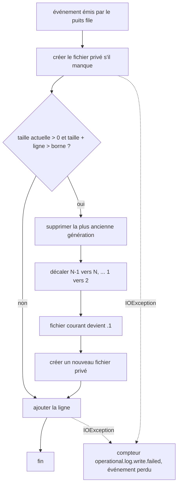
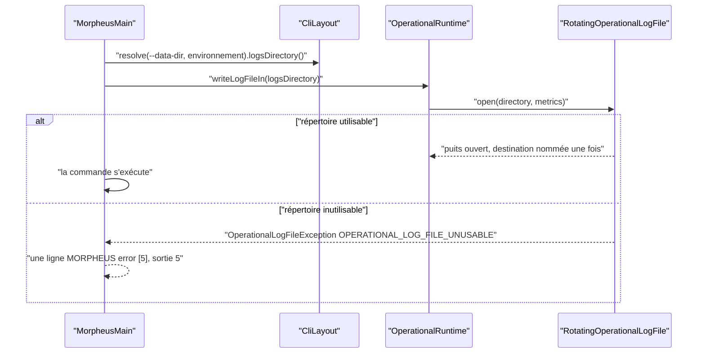

# Répertoire de logs annoncé et journal écrit (`logs-directory-truth`)

Spec de référence : [`openspec/specs/logs-directory-truth/spec.md`](../../../openspec/specs/logs-directory-truth/spec.md)
· Relevé du 2026-11-04 sur `2913fc30`.

## Objet et périmètre

Le produit annonce un répertoire de logs (disposition du processus, commande `paths`, `MORPHEUS_LOGS_DIR`, pages
utilisateur). Cette capacité exige qu'un mode du journal opérationnel écrive réellement là, ou que le répertoire ne
soit pas annoncé.

- **Acteurs** : opérateur d'un service ; lanceur `MorpheusMain`.
- **Inclus** : mode `file`, fichier JSON-lines, rotation, permissions privées, refus d'un répertoire inutilisable.
- **Exclus** : choix du mode ([`operational-log-mode.md`](operational-log-mode.md)) ; sortie d'erreur des utilisateurs
  de `System.Logger`, qui ne passent pas par le fichier (BE-0146, décision 9).

## Exigences

| Alias | Exigence (titre exact) | En bref | Nature |
|---|---|---|---|
| R1 | An announced logs directory SHALL have a writer | le mode `file` écrit sous le répertoire que `paths` imprime ; borné, privé ; répertoire inutilisable = refus nommé | `[EXIGENCE]` |

## Comportement détaillé

`[EXISTANT VÉRIFIÉ]` (`RotatingOperationalLogFile`, `OperationalRuntime`, `MorpheusMain`, ADR BE-0146) :

- **Destination** : `morpheus-operational.jsonl` (`FILE_NAME`) sous le répertoire de logs. Le lanceur le résout comme la
  commande `paths` pour les mêmes arguments (environnement, ou `logs` à côté d'un `--data-dir`) et le nomme une seule
  fois au runtime (`writeLogFileIn`, puits différé `DeferredOperationalEventSink`). Une seconde destination est refusée.
- **Borne** : `MAX_FILE_BYTES` par fichier ; l'événement qui franchirait la borne ouvre un nouveau fichier ; les
  générations précédentes sont `.1` (la plus récente) à `.<KEPT_GENERATIONS>` ; la plus ancienne est supprimée. Un
  événement plus grand que la borne est écrit seul. Les valeurs sont dans les constantes, pas recopiées ici.
- **Privé** : répertoire et fichiers passent par `LocalWritePermissionHardener`.
- **Refus** : répertoire non créable, non privé ou fichier non écrivable : `OperationalLogFileException` dont le message
  commence par `OPERATIONAL_LOG_FILE_UNUSABLE` (`REFUSAL`) et nomme `MORPHEUS_LOGS_DIR` ; le lanceur sort avec
  `CliExitCode.IO_ERROR` avant toute action, sans repli sur la sortie d'erreur.
- **Écriture perdue après ouverture** : comptée dans `operational.log.write.failed`, l'événement est abandonné.
- Rien n'est tenu ouvert : la taille est relue à chaque événement, plusieurs processus d'un même compte peuvent écrire.

## Diagrammes

### Comment un événement arrive-t-il dans le fichier, et quand tourne-t-il ?

Existant vérifié (`RotatingOperationalLogFile.write`, `rotate`). Exigence : R1, scénarios « The file is bounded » et
« The file is private ».

### Que se passe-t-il au lancement en mode `file` ?

Existant vérifié (`MorpheusMain.main`, `refusedOperationalLogFile`). Exigence : R1, scénario « A directory that cannot be
written is refused by name ».

## Écarts et questions ouvertes

- `[EXISTANT VÉRIFIÉ]` « The file is private » : le test des permissions
  (`theDirectoryAndTheFilesArePrivateToTheAccount`) est `@EnabledOnOs({LINUX, MAC})`. Preuve manquante sous Windows
  pour la valeur des permissions (la classe `LocalWritePermissionHardener` a ses propres tests, hors de cette page).
- `[EXISTANT VÉRIFIÉ]` La moitié négative de l'exigence (« otherwise the directory MUST NOT be resolved, printed or
  documented ») n'a pas de test propre : la commande `paths` imprime `logs=` dans tous les modes, et l'exigence est
  tenue parce qu'un mode, `file`, écrit là.
- `[EXISTANT VÉRIFIÉ]` En mode `file`, tout lancement crée le répertoire de logs, y compris une commande qui n'émet
  rien (conséquence négative écrite dans BE-0146).
- `[EXISTANT VÉRIFIÉ]` Comportement absent de la spec : une écriture qui échoue après l'ouverture est comptée et
  abandonnée, sans arrêt du processus (`RotatingOperationalLogFileTest#anEventThatCannotBeWrittenIsCountedAndTheNextOneIsStillTried`).

## Traçabilité

| Exigence | Scénario | Conception ou diagramme | Changement | Preuve |
|---|---|---|---|---|
| R1 | The file mode writes where the layout says | séquence de lancement | archive `2026-10-16-leave-a-trace-when-a-failure-is-swallowed` | [`OperationalLogFileLaunchTest`](../../../morpheus-cli/src/test/java/com/morpheus/cli/OperationalLogFileLaunchTest.java)`#theDirectoryNamedIsTheOneThePathsCommandPrintsForTheSameArguments` ; `#aProcessAskedForAFileRunsAndLeavesItInTheLogsDirectory` |
| R1 | The file is bounded | organigramme de rotation | idem | [`RotatingOperationalLogFileTest`](../../../morpheus-application/src/test/java/com/morpheus/application/operability/RotatingOperationalLogFileTest.java)`#theEventThatWouldCrossTheBoundStartsANewFileAndOnlyTheKeptGenerationsRemain` ; `#anEventLargerThanTheBoundIsWrittenAloneRatherThanLost` |
| R1 | The file is private | idem | idem | `RotatingOperationalLogFileTest#theDirectoryAndTheFilesArePrivateToTheAccount` (Linux et macOS seulement ; preuve manquante sous Windows) |
| R1 | A directory that cannot be written is refused by name | séquence de lancement | idem | `RotatingOperationalLogFileTest#aDirectoryThatCannotBeOneIsRefusedByNameWithWhatToDo` ; `OperationalLogFileLaunchTest#aProcessWhoseLogsDirectoryCannotBeOneStopsWithOneNamedLineBeforeAnythingRuns` |

## Sources

- ADR : [BE-0146](../../architecture/adr/BE-0146-journal-operationnel-slf4j-et-fichier-borne.md).
- Pages : [`../OPERABILITY.md`](../OPERABILITY.md), [`../../user/INSTALLATION.md`](../../user/INSTALLATION.md) (section « Journal opérationnel »).
- Pages liées : [`operational-log-mode.md`](operational-log-mode.md), [`third-party-log-capture.md`](third-party-log-capture.md).
