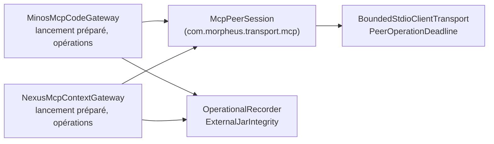
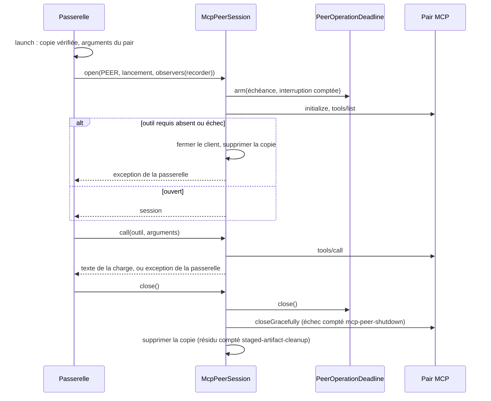

# Cycle de vie d'un client de pair MCP (`mcp-peer-gateway-lifecycle`)

Spec de référence : spec delta du changement `share-one-lifecycle-between-the-two-mcp-gateways`, qui devient
`openspec/specs/mcp-peer-gateway-lifecycle/spec.md` à son archivage · Relevé du 2026-11-06 sur `8c038add`.

## Objet et périmètre

Comment une passerelle MORPHEUS ouvre un pair MCP externe (MINOS, NEXUS), l'interroge et le ferme, et ce qui empêche
ce cycle de vie d'exister en deux copies.

- **Acteurs** : `MinosMcpCodeGateway` (`morpheus-integration-minos`), `NexusMcpContextGateway`
  (`morpheus-integration-nexus`), mainteneur et CI.
- **Inclus** : démarrage du client borné, échéance d'opération, vérification des outils requis, appel d'un outil,
  fermeture, suppression de la copie vérifiée du JAR, comptage de ce qui échoue sans faire échouer l'opération.
- **Exclus** : réglages des pairs et lanceur (voir [commande de lancement d'un pair MCP](mcp-peer-launch-command.md)),
  opérations des pairs et lecture de leurs charges, runtimes et fournisseurs des intégrations, environnement transmis
  au pair (`.claude/rules/security.md`, « Processus MCP externes »).

## Exigences

| Alias | Exigence (titre exact) | En bref | Nature |
|---|---|---|---|
| R1 | Le cycle de vie d'un client de pair MCP existe une fois | une seule implémentation, dans `morpheus-mcp-transport`, paramétrée par le pair | `[EXIGENCE]` |
| R2 | Le socle du cycle de vie ne connaît aucun type MORPHEUS | nom, outils, borne, fabrique d'exception et observateurs remis par la passerelle | `[EXIGENCE]` |
| R3 | Le comportement observable des deux passerelles est conservé | mêmes messages, types d'exception, familles comptées, échéances et commandes | `[EXIGENCE]` |
| R4 | Une passerelle ne refait pas le cycle de vie | règle d'architecture qui nomme la classe fautive | `[EXIGENCE]` |

## Comportement détaillé

`[EXISTANT VÉRIFIÉ]` `McpPeerSession` (`morpheus-mcp-transport/src/main/java/com/morpheus/transport/mcp/`) :

- **Ouverture** (`open(Peer, Launch, Observers)`) : construit `BoundedStdioClientTransport` sur le `McpPeerLaunch` de
  la passerelle, avec la borne de réponse du pair et l'observateur des processus ; arme `PeerOperationDeadline` avec
  une interruption qui ferme le client et compte son propre échec ; appelle `initialize` puis `tools/list`. Un échec
  ferme le client, supprime la copie (leurs échecs attachés à l'échec primaire par `addSuppressed`) et lève
  `<PAIR> MCP operation exceeded its <n> ms deadline` si l'échéance a expiré, sinon
  `cannot start or initialize <PAIR> MCP server`. Un outil requis absent lève
  `<PAIR> MCP server is incompatible; required tools missing: [<outils triés>]`, après le même nettoyage.
- **Appel** (`call(outil, arguments)`) : un échec du SDK devient l'échéance si elle a expiré, sinon
  `<PAIR> MCP call failed: <outil>` ; la réponse doit tenir un seul `TextContent`
  (`<PAIR> MCP response must contain exactly one TextContent item`), ne pas dépasser la borne en caractères ni en
  octets UTF-8 (`<PAIR> MCP response exceeds <borne> bytes: <outil>`), ne pas être marquée en erreur
  (`<PAIR> tool failed: <outil>: <contenu>`) ni vide (`<PAIR> tool returned an empty payload: <outil>`).
- **Fermeture** (`close()`) : désarme l'échéance, ferme le client (un échec compté sur l'observateur des fermetures),
  puis supprime la copie (un résidu compté sur l'observateur des copies, sans échec).
- **Exceptions** : toutes sont construites par `Peer.failure`, la fabrique de la passerelle
  (`MinosIntegrationException::new`, `NexusIntegrationException::new`) ; la session n'en définit aucune.

`[EXISTANT VÉRIFIÉ]` Chaque passerelle garde : ses constantes d'outils, `REQUESTS_PER_OPERATION`, les bornes de ses
charges, son `JsonMapper`, ses constructeurs, ses opérations et records de charge, `launch` (copie vérifiée par
`ExternalJarIntegrity.stageVerifiedCopy`, forme `-cp` ou `-jar`, propriété du répertoire de travail), sa constante
`PEER` et `observers(recorder)`, qui construit les trois observateurs sur `OperationalRecorder.suppressing` pour
`MCP_PEER_SHUTDOWN`, `STAGED_ARTIFACT_CLEANUP` et `MCP_PEER_PROCESS_TREE` (ce dernier par `processTreeFailures`).

## Diagrammes

Quelles classes portent le cycle de vie, et quelles dépendances chacune garde-t-elle ? (existant ; R1, R2)

La session ne dépend que du transport et du SDK MCP ; seules les passerelles voient l'application.

Comment une opération traverse-t-elle la session, et qui compte quoi ? (existant ; R1, R2, R3)

## Écarts et questions ouvertes

- `[EXISTANT VÉRIFIÉ]` La préparation de la copie vérifiée (une dizaine de lignes) reste écrite dans chaque
  passerelle : elle appelle `ExternalJarIntegrity`, un type de l'application que le transport ne peut pas voir, et son
  invariant `Path launchJar = staged.orElseThrow();` est épinglé par passerelle
  (`UnreachableSecurityBranchArchitectureTest#anMcpPeerIsLaunchedFromItsVerifiedCopyOrNotAtAll`).
- `[EXISTANT VÉRIFIÉ]` Une commande nulle remise à un constructeur de paquet d'une passerelle est refusée par
  `McpPeerLaunch` (`NullPointerException` « command ») ; une commande blanche garde son refus
  `IllegalArgumentException` « command must not be blank ». Le constructeur public ne reçoit jamais de commande nulle :
  elle vient de `PeerLaunchSettings`.
- `[EXISTANT VÉRIFIÉ]` L'interdit de `Throwable.addSuppressed` ne vise que les classes qui décrivent un lancement de
  pair : `javac` compile chaque try-with-resources en un appel de `addSuppressed`, et les runtimes et fournisseurs des
  intégrations ferment leur passerelle ainsi.
- `[QUESTION]` Un module dédié aux clients de pairs, qui verrait `morpheus-application`, plutôt que la session dans le
  transport : écarté par la conception du changement pour son coût (entrée de réacteur, de règles et de population de
  couverture pour une classe).

## Traçabilité

| Exigence | Scénario | Conception ou diagramme | Changement ou tâche | Preuve |
|---|---|---|---|---|
| R1 | Les deux passerelles ouvrent leur pair par le même socle | D1, D3, diagramme des classes | `share-one-lifecycle-between-the-two-mcp-gateways` 2.1, 2.2 | `McpPeerGatewayLifecycleArchitectureTest#everyClassThatDescribesAPeerLaunchOpensItThroughTheSession` ; `McpPeerSessionTest#aSessionCallsAToolAndDeletesItsVerifiedCopyWhenItCloses` ; `MinosMcpTransportIntegrationTest`, `NexusMcpTransportIntegrationTest` |
| R1 | Un pair auquel il manque un outil requis | D1, séquence | 1.3, 2.1 | `McpPeerSessionTest#aPeerWithoutARequiredToolIsRefusedInThePeersTypeAndItsCopyIsDeleted` |
| R2 | Un abandon qui échoue est compté par la passerelle qui l'a remis | D2 | 2.1, 2.3 | `McpPeerSessionTest#anAbortThatFailsIsToldToItsObserverAndStillFails` ; `MinosSuppressedFailureTraceTest#anAbortThatFailsIsCountedAndStillFailsForTheDeadlineThatAskedForIt` et son jumeau NEXUS ; `AdapterCompositionRootArchitectureTest#theMcpTransportDependsOnNoOtherMorpheusPackage` |
| R2 | Une copie vérifiée qui ne peut être supprimée | D2 | 2.1, 2.3 | `McpPeerSessionTest#aCopyThatCannotBeDeletedIsToldToItsObserverAndOneThatCanIsNot` ; `MinosSuppressedFailureTraceTest#aVerifiedCopyThatCannotBeDeletedIsCountedAndOneThatCanIsNot` et son jumeau NEXUS |
| R3 | Une opération qui dépasse son échéance | D2, D4 | 2.2 | `McpPeerSessionTest#anOperationPastItsDeadlineEndsWithTheDeadlineInThePeersType` ; `MinosMcpOperationDeadlineTest`, `NexusMcpOperationDeadlineTest` |
| R3 | Un outil qui rend une erreur ou une charge vide | D2, D4 | 1.3, 2.2 | `McpPeerSessionTest#anErrorResultAnEmptyPayloadAndMoreThanOneContentAreRefusedWithTheirMessage` |
| R4 | Une passerelle qui reconstruit son client | D5 | 1.2, 2.5 | `McpPeerGatewayLifecycleArchitectureTest#noIntegrationBuildsItsOwnPeerClientArmsItsDeadlineOrCleansItsCopy` |
| R4 | Une passerelle qui nettoie sa copie elle-même | D5 | 1.2, 2.5 | idem ; `McpPeerGatewayLifecycleArchitectureTest#noGatewayAttachesACleanUpFailureToThePrimaryOneItself` |

Toutes les classes de test citées vivent sous `morpheus-mcp-transport/src/test/java/com/morpheus/transport/mcp/`,
`morpheus-integration-<pair>/src/test/java/com/morpheus/integration/<pair>/` et
`morpheus-architecture-tests/src/test/java/com/morpheus/architecture/`.

## Sources

- [ADR-0128](../../architecture/adr/ARCH-0128-pairs-minos-et-nexus-par-mcp-stdio.md) : pairs MINOS et NEXUS par MCP
  STDIO, outils requis de chaque pair.
- [ADR-0156](../../architecture/adr/ARCH-0156-racines-de-composition-nommees-paquets-sans-cycle-et-decisions-dans-le-domaine.md), décision 3 : le
  transport ne connaît aucun type MORPHEUS.
- [Trace d'un échec écarté](suppressed-failure-trace.md) : les familles comptées.
- [Échec d'un outil MCP et borne d'un appel](mcp-tool-failure-contract.md) : l'échéance d'une opération déléguée.
