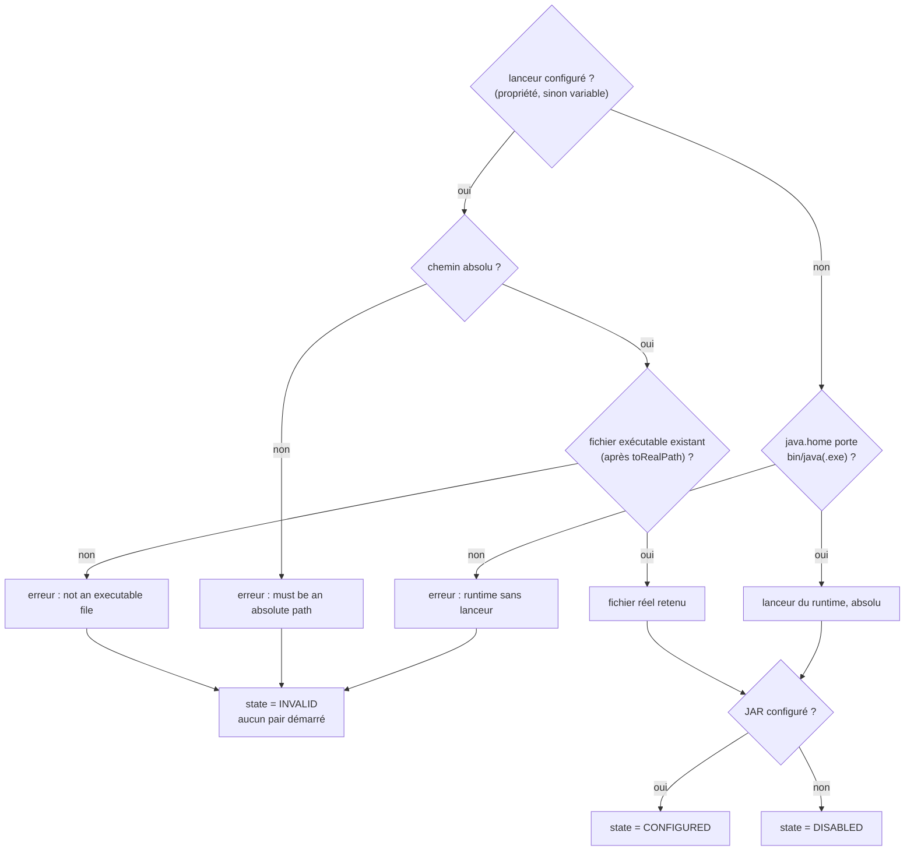

# Commande de lancement d'un pair MCP (`mcp-peer-launch-command`)

Spec de référence : [`openspec/specs/mcp-peer-launch-command/spec.md`](../../../openspec/specs/mcp-peer-launch-command/spec.md)
· Relevé du 2026-11-03 sur `ef006fb7`.

## Objet et périmètre

Quel exécutable démarre un pair MCP (MINOS, NEXUS), et ce qu'un lanceur configuré doit être pour être accepté, afin
que le lancement ne dépende jamais du chemin de recherche (`PATH`) du processus MORPHEUS.

- **Acteurs** : opérateur qui configure une intégration ; MORPHEUS qui lance le pair.
- **Inclus** : lanceur par défaut, validation d'un lanceur configuré, exposition du chemin du lanceur.
- **Exclus** : l'empreinte du JAR du pair, l'environnement transmis, le cycle de vie du processus (voir
  `.claude/rules/security.md`, « Processus MCP externes »).

## Exigences

| Alias | Exigence (titre exact) | En bref | Nature |
|---|---|---|---|
| R1 | Without a configured launcher, a peer SHALL be started with the runtime MORPHEUS runs on | lanceur absolu sous `java.home` de la JVM courante | `[EXIGENCE]` |
| R2 | A configured launcher SHALL be an absolute path to an existing regular file | chemin absolu vers un fichier exécutable existant, sinon erreur de configuration et intégration non démarrée | `[EXIGENCE]` |
| R3 | The launcher path SHALL follow the existing disclosure boundary | visible dans les vues locales, jamais relayé par la projection distante | `[EXIGENCE]` — écart de libellé |

## Comportement détaillé

`[EXISTANT VÉRIFIÉ]` (`morpheus-application/src/main/java/com/morpheus/application/security/`) :

- **Résolution unique** : `PeerLaunchSettingsResolver.resolve(Peer, environnement, propriétés)` pour les deux pairs ;
  `MinosIntegrationSettings` et `NexusIntegrationSettings` délèguent et ne résolvent rien eux-mêmes. Une propriété JVM
  l'emporte sur la variable d'environnement.
- **Lanceur par défaut** : `<java.home>/bin/java.exe` s'il existe, sinon `<java.home>/bin/java`, absolu et normalisé.
- **Refus** (le nom est celui du pair, `MINOS` ou `NEXUS`, joints par `; ` quand il y en a plusieurs) :
  `<PAIR> Java command must be an absolute path` ; `<PAIR> Java command is not an executable file` ;
  `<PAIR> Java command is not configured and the MORPHEUS runtime carries no launcher`.
- **État** (`PeerLaunchSettings.state()`) : `INVALID` dès qu'une erreur de configuration existe, sinon `CONFIGURED`
  si un JAR est configuré, sinon `DISABLED`. Le constructeur compact refuse un lanceur non absolu
  (`javaCommand must be an absolute path`) : un réglage refusé garde le lanceur du runtime.
- **Lien symbolique** : résolu par `toRealPath()` ; le lanceur retenu et affiché est le fichier réel.
- **Exposition** : la vue locale porte `javaCommand` ; `IntegrationStatusDisclosure` (`application.context`) remplace,
  pour les surfaces distantes et tournées vers un modèle, les clés de chemin (`LOCATION_KEYS`) par
  `<clé>Configured` et écarte toute valeur qui nomme un emplacement du serveur.

## Diagrammes

### Quel lanceur est retenu, et dans quel état le réglage se trouve-t-il ?

Existant vérifié (`PeerLaunchSettingsResolver`, `PeerLaunchSettings.state`). Organigramme (pas UML).

Exigences : R1 (branche sans lanceur), R2 (branches de refus). Simplifications : l'erreur « runtime sans lanceur »
n'est levée que si un JAR est configuré, et d'autres erreurs (JAR, délai) mènent aussi à `INVALID`.

## Écarts et questions ouvertes

- `[EXISTANT VÉRIFIÉ]` **Écart de libellé, R3.** Le scénario « The remote view gains nothing » parle de
  « l'allowlist of remote-safe detail keys » ; cette liste (`REMOTE_SAFE_DETAIL_KEYS`) appartient aux vues des plugins
  providers (`ProviderPluginViews`), pas au statut des intégrations. Le mécanisme réel est
  `IntegrationStatusDisclosure.LOCATION_KEYS`. Aucun test n'affirme que cette liste « reste inchangée ».
  `[PROPOSITION]` Reformuler le scénario par un changement de spec.
- `[EXISTANT VÉRIFIÉ]` R2 dit que l'erreur « names the setting » ; les messages nomment le pair, pas la propriété ni
  la variable.
- `[EXISTANT VÉRIFIÉ]` Comportements testés absents de la spec : un lanceur écrit sans `.exe` est accepté sous Windows
  si le fichier `.exe` voisin existe ; toutes les erreurs sont rapportées, pas seulement la dernière ; un lanceur
  configuré sans JAR rend l'intégration `INVALID`.
- `[EXISTANT VÉRIFIÉ]` Le scénario du lien symbolique n'est prouvé qu'hors Windows (`@EnabledOnOs({LINUX, MAC})`) ;
  « no process is started » n'a pas de test direct (l'intégration n'est pas activée, et la passerelle refuse de
  démarrer une intégration non activée).
- `[EXISTANT VÉRIFIÉ]` Le changement actif `resolve-both-mcp-peers-through-one-settings-resolver` décrit la résolution
  commune, déjà présente dans le code ; il n'est pas archivé.

## Traçabilité

Abréviations : `M` = `MinosPeerLauncherResolutionTest`, `N` = `NexusPeerLauncherResolutionTest` (mêmes noms de
méthodes), `R` = `PeerLaunchSettingsResolverTest`.

| Exigence | Scénario | Diagramme | Changement | Preuve |
|---|---|---|---|---|
| R1 | The default names no bare command | organigramme | archive `2026-10-30-resolve-the-peer-java-command-without-the-path` | [`M`](../../../morpheus-integration-minos/src/test/java/com/morpheus/integration/minos/MinosPeerLauncherResolutionTest.java), [`N`](../../../morpheus-integration-nexus/src/test/java/com/morpheus/integration/nexus/NexusPeerLauncherResolutionTest.java)`#withoutAConfiguredLauncherThePeerRunsOnTheRuntimeOfThisJvm` ; [`PeerLauncherArchitectureTest`](../../../morpheus-architecture-tests/src/test/java/com/morpheus/architecture/PeerLauncherArchitectureTest.java)`#theOnlyBareLauncherNamesAreTheTwoFilesLookedForUnderTheRuntime` |
| R1 | A manipulated PATH changes nothing | organigramme | idem | `M`, `N#aSearchPathThatNamesAnotherJavaFirstChangesNothing` |
| R2 | A bare name is refused | organigramme | idem | `M`, `N#aBareCommandIsRefusedBecauseItWouldBeLookedUpOnTheSearchPath` ; [`R`](../../../morpheus-application/src/test/java/com/morpheus/application/security/PeerLaunchSettingsResolverTest.java)`#aLauncherTheSearchPathWouldResolveIsRefused` |
| R2 | A relative path is refused | organigramme | idem | `M`, `N#aRelativePathIsRefused` |
| R2 | A missing file or a directory is refused | organigramme | idem | `M`, `N#aMissingFileAndADirectoryAreRefused` |
| R2 | A link is resolved, and the real file is what runs | organigramme | idem | `M`, `N#aLinkIsResolvedAndTheRealFileIsWhatWouldRun` (Linux et macOS seulement) ; `R#aConfiguredLauncherIsLaunchedFromItsRealFile` |
| R2 | (parité des deux pairs) | — | changement actif `resolve-both-mcp-peers-through-one-settings-resolver` | [`McpPeerSettingsResolutionArchitectureTest`](../../../morpheus-architecture-tests/src/test/java/com/morpheus/architecture/McpPeerSettingsResolutionArchitectureTest.java)`#bothPeersResolveTheSameInputsAlike` |
| R3 | The remote view gains nothing | — | archive ci-dessus | [`IntegrationStatusDisclosureTest`](../../../morpheus-application/src/test/java/com/morpheus/application/context/IntegrationStatusDisclosureTest.java)`#noValueOfAProjectedStatusNamesAServerLocation` ; [`IntegrationStatusViewsTest`](../../../morpheus-api/src/test/java/com/morpheus/api/IntegrationStatusViewsTest.java)`#serverLaunchLocationsAreReportedAsConfiguredWithoutBeingNamed` ; vue locale : `MinosIntegrationRuntimeTest#anAbsentConfigurationIsReportedDisabledAndRegistersNoResolver` (équivalent NEXUS non trouvé) |

## Sources

- Règle de sécurité du dépôt : `.claude/rules/security.md`, section « Processus MCP externes ».
- Page développeur : [`../INTEGRATIONS.md`](../INTEGRATIONS.md).
