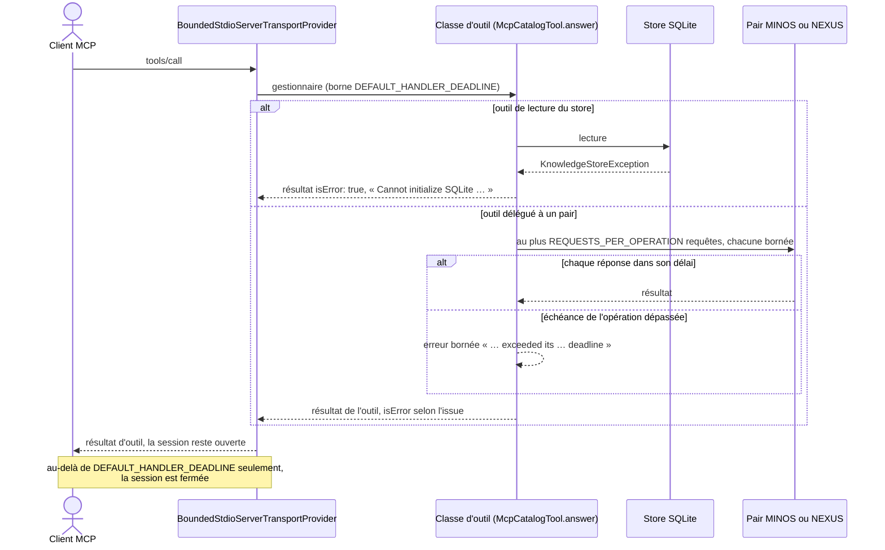

# Échec d'un outil MCP et borne d'un appel (`mcp-tool-failure-contract`)

Spec de référence : [`openspec/specs/mcp-tool-failure-contract/spec.md`](../../../openspec/specs/mcp-tool-failure-contract/spec.md)
· Relevé du 2026-11-03 sur `ef006fb7`.

## Objet et périmètre

Ce que reçoit un client MCP quand un outil de MORPHEUS ne peut pas aboutir, et la borne au-delà de laquelle un appel
d'outil ne peut plus durer.

- **Acteurs** : client MCP (assistant, IDE) ; pairs MCP externes MINOS et NEXUS auxquels certains outils délèguent.
- **Inclus** : échec d'un outil rendu comme résultat d'outil ; échéance d'une opération déléguée à un pair ; borne de
  sûreté du gestionnaire.
- **Exclus** : le lancement des pairs (voir [`mcp-peer-launch-command`](mcp-peer-launch-command.md)) ; les refus
  ordinaires de validation, figés par les transcriptions de `McpToolTranscriptTest`.

## Exigences

| Alias | Exigence (titre exact) | En bref | Nature |
|---|---|---|---|
| R1 | Tool failures are tool results | un échec atteignable devient un résultat `isError` dont le message ne nomme aucun chemin du serveur ; jamais une erreur JSON-RPC | `[EXIGENCE]` |
| R2 | A peer operation within its configured bound never closes the session | une opération de pair dans ses délais rend son résultat ou son erreur bornée ; la borne du gestionnaire dépasse l'opération la plus longue | `[EXIGENCE]` |

## Comportement détaillé

`[EXISTANT VÉRIFIÉ]` :

- **Échec → résultat d'outil** : `McpCatalogTool.answer(...)` (`morpheus-mcp/src/main/java/com/morpheus/mcp/`) attrape
  `IllegalArgumentException` et `KnowledgeStoreException` et rend `McpToolFailure.result(e)` ; quatre classes
  d'outils portent la même capture. `McpToolFailure.refusal` est le seul endroit qui pose `isError: true` ; un message
  absent ou blanc devient le nom simple de l'exception.
- **Texte d'un store indisponible** : commence par `Cannot initialize SQLite ` (base réservée par une maintenance
  hors ligne, ou fichier illisible), sans chaîne `Caused by` ni chemin du répertoire de données.
- **Bornes** (constantes lues dans le code, non recopiées comme seuils) :
  - `PeerLaunchSettings.MAX_TIMEOUT_SECONDS` : délai maximal configurable d'une requête à un pair ;
  - `PeerOperationDeadline` (`morpheus-mcp-transport`) : `MAX_REQUEST_TIMEOUT`, `MAX_SEQUENTIAL_REQUESTS`,
    `START_UP_ALLOWANCE`, `CLOSE_ALLOWANCE` et `LONGEST_OPERATION = of(MAX_REQUEST_TIMEOUT, MAX_SEQUENTIAL_REQUESTS)` ;
  - `REQUESTS_PER_OPERATION` de `MinosMcpCodeGateway` et de `NexusMcpContextGateway` ;
  - `BoundedStdioServerTransportProvider.DEFAULT_HANDLER_DEADLINE = LONGEST_OPERATION + CLOSE_ALLOWANCE +
    HANDLER_LOCAL_WORK_MARGIN`. Un gestionnaire qui la dépasse ferme la session : c'est une borne de sûreté, pas un
    délai de service.
- **Erreur bornée d'un pair** : `MINOS MCP operation exceeded its <n> ms deadline` (même forme pour NEXUS) ; un pair
  qui sort ou meurt est signalé comme échec de démarrage ou d'appel, jamais comme dépassement d'échéance.

## Diagrammes

### Que reçoit le client quand un outil échoue, et quand la session se ferme-t-elle ?

Existant vérifié. Séquence UML.

Exigences : R1 pour la branche du store, R2 pour la branche du pair et la note finale.

## Écarts et questions ouvertes

- `[QUESTION]` R1 dit « names no server path », mais `McpToolFailure.result` rend le texte de `FailureText.of` sans
  filtre : un refus de l'application qui nomme un chemin (`workspace root must be a real directory: <chemin>`) arrive
  tel quel, ce que fige
  [`McpToolFailureTest`](../../../morpheus-mcp/src/test/java/com/morpheus/mcp/McpToolFailureTest.java)`#aRefusalThatNamesAPathReachesTheClientUnfiltered`.
  Le serveur MCP est local (STDIO, même compte) et ce chemin est en général celui que l'appelant a fourni ;
  `ServerLocationDisclosure.relayableText` le remplacerait par le nom du type. Restreindre R1 aux chemins que
  l'appelant n'a pas fournis, ou filtrer : à trancher par le mainteneur.
- `[EXISTANT VÉRIFIÉ]` Le scénario « The database is reserved by an offline maintenance » attend un message disant que
  le store est indisponible ; le code et le test ne garantissent que le préfixe `Cannot initialize SQLite `.
- `[EXISTANT VÉRIFIÉ]` « Names no server path » est vérifié pour le répertoire temporaire du test (deux séparateurs) et
  l'absence de `Caused by`, pas pour tout chemin possible.
- `[EXISTANT VÉRIFIÉ]` Aucun test ne joue le scénario de R2 à l'échelle réelle (délai maximal, pair qui répond juste à
  temps) : la preuve combine un calcul (`ProductionIntegrityContractTest`), des pairs factices à délai court et un test
  de la borne du gestionnaire.
- `[EXISTANT VÉRIFIÉ]` `PeerLaunchSettings.MAX_TIMEOUT_SECONDS` et `PeerOperationDeadline.MAX_REQUEST_TIMEOUT` sont deux
  déclarations distinctes (le transport ne dépend pas de l'application), tenues égales par la plage refusée de `of`.
- `[EXISTANT VÉRIFIÉ]` Comportements testés absents de la spec : la fermeture de session au-delà de la borne, et la
  distinction entre échéance dépassée et pair mort.

## Traçabilité

| Exigence | Scénario | Diagramme | Changement | Preuve |
|---|---|---|---|---|
| R1 | The database is reserved by an offline maintenance | séquence | archive `2026-10-09-unify-mcp-tool-failure-contract` | [`McpStoreFailureInjectionTest`](../../../morpheus-mcp/src/test/java/com/morpheus/mcp/McpStoreFailureInjectionTest.java)`#aDatabaseReservedForExclusiveMaintenanceIsRefusedByEveryHandlerThatReachesTheStore` (tous les outils publiés) |
| R1 | The database cannot be opened | séquence | idem | même classe : `#aDatabaseTheDriverCannotReadIsRefusedByEveryHandlerThatReachesTheStore` ; `MorpheusMcpRuntimeConnectionTest#aDatabaseThatCannotBeOpenedIsTheStoreFailureEveryToolHandlerAnswers` |
| R1 | (liste d'outils couverte) | — | idem | `McpStoreFailureInjectionTest#theInjectedClassesAreExactlyTheServedOnes` |
| R2 | A slow peer at its maximum timeout | séquence | idem | **composée** : [`ProductionIntegrityContractTest`](../../../morpheus-architecture-tests/src/test/java/com/morpheus/architecture/m21/ProductionIntegrityContractTest.java)`#theHandlerSafetyBoundOutlastsTheLongestPeerOperation` ; `MinosMcpOperationDeadlineTest` et `NexusMcpOperationDeadlineTest#aPeerAnsweringEachCallJustUnderItsTimeoutCompletesTheOperation` ; [`BoundedStdioServerTransportProviderHandlerDeadlineTest`](../../../morpheus-mcp-transport/src/test/java/com/morpheus/transport/mcp/BoundedStdioServerTransportProviderHandlerDeadlineTest.java)`#aHandlerWithinItsDeadlineIsServedNormally`, `#aHandlerThatNeverCompletesDoesNotBlockTheReaderForever` |

## Sources

- Décision : [ARCH-0062](../../architecture/adr/ARCH-0062-official-java-mcp-sdk-and-native-stdio.md).
- Page développeur : [`../MCP.md`](../MCP.md).
