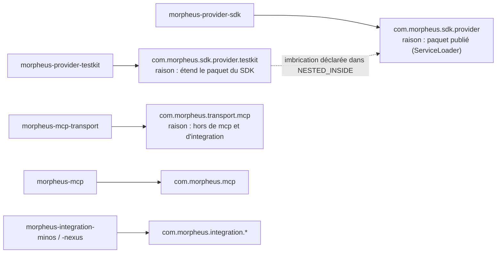
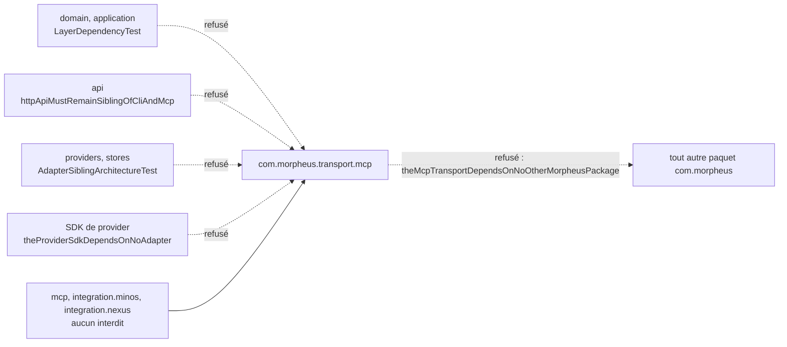

# Correspondance entre modules et paquets (`module-package-correspondence`)

Spec de référence : [`openspec/specs/module-package-correspondence/spec.md`](../../../openspec/specs/module-package-correspondence/spec.md)
· Relevé du 2026-11-04 sur `2913fc30`.

## Objet et périmètre

Les règles d'architecture choisissent des classes par paquet, alors que le réacteur, les POM et la documentation
parlent de modules. Cette capacité fixe le paquet racine que chaque module possède, la façon dont le build tient
module et paquet ensemble, et l'emplacement du transport MCP partagé, hors des paquets des intégrations et de
l'adaptateur MCP.

- **Acteurs** : mainteneur qui ajoute, retire ou déplace un module ou un paquet ; auteur d'une règle de dépendance.
- **Inclus** : la table `ROOTS` de `ModulePackageCorrespondenceTest` ; le paquet `com.morpheus.transport.mcp` du module
  `morpheus-mcp-transport` ; les interdits qui nomment ce paquet ; la page de règles et l'ADR qui le citent.
- **Exclus** : le contenu du transport (borne de taille, délai, fils), voir
  [`mcp-tool-failure-contract.md`](mcp-tool-failure-contract.md) ; la correspondance des modules sans source principale
  (`morpheus-architecture-tests`, `morpheus-coverage-report`), que la table ignore.

## Exigences

| Alias | Exigence (titre exact) | En bref | Nature |
|---|---|---|---|
| R1 | Every module with production sources SHALL own one declared root package | une entrée par module à sources principales, tous ses paquets sous la racine ; échec dans les deux sens | `[EXIGENCE]` |
| R2 | Two modules SHALL NOT share or nest a root package without saying so | pas d'égalité ni d'imbrication sans déclaration ; un écart au nom du module porte sa raison | `[EXIGENCE]` |
| R3 | The shared MCP transport SHALL live outside the integrations' and the MCP adapter's packages | racine hors de `com.morpheus.integration..` et de `com.morpheus.mcp..`, sans dépendance vers un autre paquet MORPHEUS | `[EXIGENCE]` |
| R4 | Moving the transport SHALL relax no prohibition | tout module qui ne pouvait pas dépendre du transport en reste refusé par une règle qui nomme son paquet | `[EXIGENCE]` |
| R5 | The rule page and the decision record SHALL name the package the rule judges | la page de règles et ARCH-0162 écrivent le paquet tel que les sources le déclarent | `[EXIGENCE]` |

## Comportement détaillé

### Table des racines (R1, R2)

`[EXISTANT VÉRIFIÉ]` `ModulePackageCorrespondenceTest.ROOTS` associe chaque module à un `ModuleRoot(rootPackage, reason)`.
La liste des modules est lue dans les `<module>` du `pom.xml` racine, les paquets dans les répertoires
`src/main/java`. Les propriétés testées sont :

- tout module à sources principales a une entrée, et toute entrée a un module à sources principales ;
- tout paquet de production est sous la racine de **son** module, et sous aucune racine plus spécifique d'un autre ;
- une racine n'égale ni n'est contenue dans la racine d'un autre module, sauf si `NESTED_INSIDE` le déclare ;
- une entrée porte une raison exactement quand sa racine n'est pas le nom du module lu mécaniquement
  (`morpheus-store-sqlite` donne `com.morpheus.store.sqlite`) : une raison sur une entrée mécanique échoue aussi.

Les écarts actuels au nom mécanique sont le transport MCP, le SDK de provider et son testkit, chacun avec sa raison
dans la table.

### Transport MCP partagé (R3, R4)

`[EXISTANT VÉRIFIÉ]` `morpheus-mcp-transport` livre `com.morpheus.transport.mcp`. Le nom mécanique
`com.morpheus.mcp.transport` serait sous le paquet de l'adaptateur MCP, que les intégrations MINOS et NEXUS, clientes du
transport, n'ont pas le droit d'atteindre. Les interdits qui visent les modules refusés s'écrivent
`com.morpheus.transport..` :

- domaine et application : `LayerDependencyTest#domainMustNotDependOnAdapters`, `#applicationMustNotDependOnAdapters` ;
- adaptateur HTTP : `LayerDependencyTest#httpApiMustRemainSiblingOfCliAndMcp` ;
- providers et stores : `AdapterSiblingArchitectureTest` (`PROVIDERS_DEPEND_INWARD`, `STORES_DEPEND_INWARD`) ;
- SDK de provider : `SDK_DEPENDS_ON_NO_ADAPTER`, qui nomme aussi `com.morpheus.transport..`.

Le sujet du transport lui-même est borné par `AdapterCompositionRootArchitectureTest#theMcpTransportDependsOnNoOtherMorpheusPackage`
(aucune dépendance vers un autre paquet `com.morpheus..`). `AdapterSiblingArchitectureTest#everyPackageTheseRulesNameResolvesToImportedClasses`
exige que chaque motif de paquet que ces règles nomment, `com.morpheus.transport..` compris, résolve des classes
importées.

### Documentation (R5)

`[EXISTANT VÉRIFIÉ]` Relu à la main le 2026-11-04 : `.claude/rules/architecture.md` dit « `morpheus-mcp-transport` livre
`com.morpheus.transport.mcp` » et consacre une section à ce paquet ; ARCH-0162 écrit « `com.morpheus.transport.mcp` ne
dépend d'aucun autre paquet MORPHEUS ».

### Comportement vérifié absent de la spec

- `[EXISTANT VÉRIFIÉ]` `ImportedClasspathCompletenessTest` exige que chaque paquet de source de chaque module du
  réacteur soit importé par la suite, hors absences déclarées : une règle de paquet ne juge pas un sous-ensemble silencieux
  (`everySourcePackageOfEveryReactorModuleIsImported`).
- `[EXISTANT VÉRIFIÉ]` Aucune règle n'interdit à `morpheus-cli` ni à `morpheus-mcp` de dépendre du transport ; seuls
  les modules cités ci-dessus le sont.

## Diagrammes

### Quel module possède quel paquet racine, et où se trouvent les imbrications ?

Existant vérifié (table `ROOTS`, `NESTED_INSIDE`). Organigramme : une flèche pleine est « possède » ; la flèche
pointillée est l'imbrication déclarée. Seules les entrées qui portent une raison sont détaillées. Exigences : R1, R2, R3.

### Qui est refusé de dépendre du transport, et par quelle règle ?

Existant vérifié. Organigramme : la flèche barrée est un interdit exécutable ; le transport ne dépend lui-même d'aucun
autre paquet MORPHEUS. Exigences : R3, R4.

## Écarts et questions ouvertes

- **Rejeu absent des refus de R1 (scénarios 1 à 3).** Les tests comparent la table et l'arbre réels
  (`assertEquals(Set.of(), …)`) ; aucun test ne plante un module sans entrée ni une entrée sans module pour constater
  l'échec nommé. Les messages nomment bien le module ou l'entrée, mais la preuve par rejeu est manquante.
- **Raison de l'imbrication (R2).** La spec veut que la table déclare l'imbrication « avec sa raison ». `NESTED_INSIDE`
  est une carte `module interne -> module externe` sans raison propre ; la raison est celle de l'entrée du testkit dans
  `ROOTS`, et le test `everyRootThatIsNotTheModuleNameReadMechanicallyStatesWhy` l'impose. Conforme au sens, pas à la lettre.
- **R4 n'a pas de test qui lie « avant » et « après ».** Les modules qui ne pouvaient pas dépendre du transport avant le
  déplacement ne sont listés nulle part ; les interdits actuels sont exécutables, mais aucun test ne vérifie qu'il ne
  manque aucun module. Preuve manquante pour l'exhaustivité.
- **Documentation (R5).** Aucun test ne lit la page de règles ni ARCH-0162 pour y chercher `com.morpheus.transport.mcp`.
  Preuve automatique manquante, relu à la main.

## Traçabilité

| Exigence | Scénario | Conception ou diagramme | Changement | Preuve |
|---|---|---|---|---|
| R1 | A new module without an entry fails the build | table des racines | archive `2026-10-29-give-the-shared-mcp-transport-its-own-package` | [`ModulePackageCorrespondenceTest`](../../../morpheus-architecture-tests/src/test/java/com/morpheus/architecture/ModulePackageCorrespondenceTest.java)`#everyReactorModuleWithProductionSourcesDeclaresItsRootPackage` (texte : POM et sources) ; rejeu : preuve manquante |
| R1 | A class outside its module's package fails the build | idem | idem | `ModulePackageCorrespondenceTest#everyProductionPackageSitsUnderTheRootOfItsOwnModule` (texte) |
| R1 | An entry for a module that no longer exists fails the build | idem | idem | `ModulePackageCorrespondenceTest#everyDeclaredRootBelongsToAReactorModuleWithProductionSources` (texte) |
| R2 | An undeclared nesting fails the build | organigramme des propriétaires | idem | `ModulePackageCorrespondenceTest#noRootEqualsOrLiesInsideAnotherModulesRootUnlessDeclared` (texte) |
| R2 | The known departures are explained | idem | idem | `ModulePackageCorrespondenceTest#everyRootThatIsNotTheModuleNameReadMechanicallyStatesWhy` (texte) |
| R3 | A rule about integrations no longer reaches the transport | organigramme des interdits | idem | `ModulePackageCorrespondenceTest#theSharedMcpTransportResidesOutsideTheIntegrationsAndTheMcpAdapter` (ArchUnit) |
| R3 | The transport rule still judges the transport | idem | idem | [`AdapterCompositionRootArchitectureTest`](../../../morpheus-architecture-tests/src/test/java/com/morpheus/architecture/AdapterCompositionRootArchitectureTest.java)`#theMcpTransportDependsOnNoOtherMorpheusPackage` (ArchUnit ; sujet non vide : `archRule.failOnEmptyShould`, prouvé par [`AnEmptyArchitectureRuleFailsTest`](../../../morpheus-architecture-tests/src/test/java/com/morpheus/architecture/AnEmptyArchitectureRuleFailsTest.java)`#aRuleThatSelectsNoClassFailsForHavingCheckedNone`) |
| R4 | The HTTP adapter still cannot use the transport | organigramme des interdits | idem | [`LayerDependencyTest`](../../../morpheus-architecture-tests/src/test/java/com/morpheus/architecture/LayerDependencyTest.java)`#httpApiMustRemainSiblingOfCliAndMcp` (ArchUnit) |
| R4 | Providers and stores still cannot use the transport | idem | idem | [`AdapterSiblingArchitectureTest`](../../../morpheus-architecture-tests/src/test/java/com/morpheus/architecture/AdapterSiblingArchitectureTest.java)`#providersDoNotDependOnStoresTransportsOrIntegrations` et `#storesDoNotDependOnProvidersTransportsOrIntegrations` (ArchUnit) |
| R5 | A reader looking for the transport finds it | — | idem | revue seule : `.claude/rules/architecture.md`, [ARCH-0162](../../architecture/adr/ARCH-0162-racines-de-composition-nommees-paquets-sans-cycle-hors-une-paire-bornee-et-decisions-dans-le-domaine.md) ; preuve automatique manquante |

## Sources

- ADR : [ARCH-0162](../../architecture/adr/ARCH-0162-racines-de-composition-nommees-paquets-sans-cycle-hors-une-paire-bornee-et-decisions-dans-le-domaine.md)
  (décision 3), [ARCH-0155](../../architecture/adr/ARCH-0155-un-role-est-un-paquet-et-une-liste-de-classes-declare-sa-sorte.md).
- Règles du dépôt : `.claude/rules/architecture.md` (section « Une règle choisit des classes par paquet, jamais par module »,
  section `com.morpheus.transport.mcp`).
- Archive : `2026-10-21-list-the-reactor-modules-from-the-pom` (capacité `reactor-module-documentation`, liste des modules lue du POM).
- Pages liées : [`provider-sdk-dependency-boundary.md`](provider-sdk-dependency-boundary.md),
  [`adapter-internal-boundaries.md`](adapter-internal-boundaries.md).
