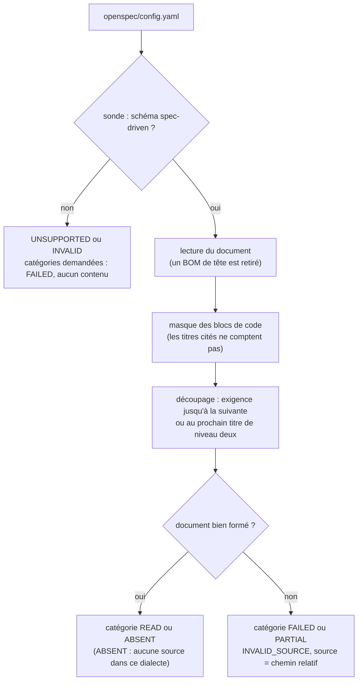
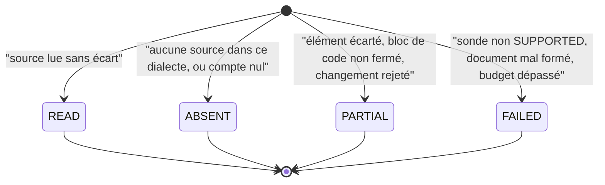

# Lecture des espaces OpenSpec par le provider (`openspec-provider-reading`)

Spec de référence : [`openspec/specs/openspec-provider-reading/spec.md`](../../../openspec/specs/openspec-provider-reading/spec.md)
· Relevé du 2026-11-04 sur `2913fc30`.

## Objet et périmètre

Le provider OpenSpec (`morpheus-provider-openspec`) lit un espace de travail OpenSpec et dit ce qu'il a pu lire, ce
qu'il n'a pas pu lire et à quel fichier chaque échec est imputé. La capacité fixe quatre propriétés : la sonde ne
promet pas plus que le lecteur ne sait lire, un document mal formé échoue sous son propre nom sans lever d'exception,
les variantes d'encodage courantes sont acceptées, et les sections Markdown se découpent comme le fait OpenSpec.

- **Acteurs** : `OpenSpecSpecificationProvider` (sonde), `OpenSpecSpecificationContentReader` (lecture par
  catégorie), `OpenSpecCurrentSpecificationReader`, `OpenSpecChangeMetadataReader`, `OpenSpecRequirementDeltaReader`.
- **Inclus** : le schéma déclaré par `openspec/config.yaml`, le statut de chaque catégorie lue, le diagnostic
  `INVALID_SOURCE` et sa source, le BOM UTF-8, le scalaire YAML entre guillemets, la frontière de section.
- **Exclus** : le budget d'ingestion (`OpenSpecIngestionBudgets`), le confinement dans l'espace de travail (voir
  [`workspace-boundary-scan-cost`](workspace-boundary-scan-cost.md)), la diffusion du texte d'un échec à un appelant HTTP
  (voir [`http-failure-disclosure`](http-failure-disclosure.md)).

## Exigences

| Alias | Exigence (titre exact) | En bref | Nature |
|---|---|---|---|
| R1 | The probe only claims what the reader can read | un schéma n'est SUPPORTED que si ses modèles par défaut sont lus sans catégorie FAILED ; une catégorie sans source est ABSENT | `[EXIGENCE]` |
| R2 | Failures are attributed and contained | document mal formé : catégorie FAILED, diagnostic `INVALID_SOURCE` dont la source est le chemin relatif du document, aucune exception | `[EXIGENCE]` |
| R3 | Encoding variants are accepted | BOM UTF-8 en tête de tout fichier lu, `schema:` écrit en scalaire YAML entre guillemets | `[EXIGENCE]` |
| R4 | Section boundaries follow Markdown structure | une exigence finit à la prochaine exigence ou au prochain titre de niveau deux ; un titre dans un bloc de code ne compte pas | `[EXIGENCE]` |

## Comportement détaillé

### Sonde et schéma (R1, R3)

- `[EXISTANT VÉRIFIÉ]` La sonde (`OpenSpecSpecificationProvider.probe`) lit `openspec/config.yaml` et ne retient que le
  schéma `SUPPORTED_SCHEMA` (`spec-driven`). Un autre schéma donne `UNSUPPORTED` et le diagnostic
  `UNSUPPORTED_PROVIDER_SCHEMA` ; une configuration illisible ou sans schéma donne `INVALID` et `INVALID_SOURCE`. Un
  espace sans `openspec/` ou sans `config.yaml` est `UNSUPPORTED` sans diagnostic.
- `[EXISTANT VÉRIFIÉ]` La déclaration du schéma est reconnue entre guillemets doubles, simples ou nue, avec un
  commentaire de fin de ligne (`SCHEMA_PATTERN`). Des guillemets dépareillés ne la reconnaissent pas.
- `[EXISTANT VÉRIFIÉ]` Le BOM est retiré une seule fois, à la lecture, par `SafeWorkspaceFileResolver` (un second BOM
  est conservé). Tout document passé par la session du budget d'ingestion en bénéficie : configuration, spec courante,
  proposition, deltas, tâches.
- `[EXISTANT VÉRIFIÉ]` Les trois lecteurs et le lecteur de contenu appellent la sonde avant de lire. Si elle n'est pas
  `SUPPORTED`, chaque catégorie demandée est `FAILED` avec la raison « provider probe did not support the requested
  source », sans contenu.
- `[EXISTANT VÉRIFIÉ]` Les catégories `CONSTRAINTS` et `DESIGN_DECISIONS` d'un espace écrit avec les modèles de la CLI
  sont `ABSENT` : ce dialecte ne les structure pas (`OpenSpecSpecificationContentReaderTest#aWorkspaceProducedByTheOpenSpecCliIsRead`).
  Le dialecte des propositions est décrit dans [`../OPENSPEC_PROVIDER.md`](../OPENSPEC_PROVIDER.md#proposals--deux-dialectes).

### Échecs attribués (R2)

- `[EXISTANT VÉRIFIÉ]` Un échec de contenu est rattaché au fichier lu par `OpenSpecSourceAttribution`, au point où le
  fichier est connu : le nom est relatif à l'espace de travail et ne relaie jamais un chemin absolu de la plateforme.
  Seuls trois types d'échec (`IllegalArgumentException`, `IllegalStateException`, `UncheckedIOException`) sont
  attribués, chacun gardant sa catégorie.
- `[EXISTANT VÉRIFIÉ]` Une exigence ou un scénario dupliqué, une proposition sans intention, une décision sans corps, un
  titre manquant font passer la catégorie à `FAILED` avec `INVALID_SOURCE` portant le chemin du fichier fautif ; un
  changement mal formé parmi des changements valides laisse les autres lus et la catégorie `PARTIAL`.
- `[EXISTANT VÉRIFIÉ]` Un échec qui n'est pas celui d'un fichier (défaut, collaborateur comme le résolveur d'identités)
  n'est pas attribué et traverse `read` inchangé : aucun fichier innocent n'est accusé
  (`#aFailureThatIsNotTheFilesLeavesTheReadUnchangedAndFailsNoCategory`). R2 vise « le contenu qu'il lit », ce cas
  est hors de sa portée.
- `[EXISTANT VÉRIFIÉ]` Un dépassement du budget d'ingestion produit un `INVALID_SOURCE` de source `ingestion-budget` et
  fait échouer toutes les catégories demandées.

### Sections (R4)

- `[EXISTANT VÉRIFIÉ]` `OpenSpecCodeFences` marque les lignes de blocs de code selon les règles de `buildCodeFenceMask`
  d'OpenSpec amont (ouverture par trois caractères ou plus, fermeture par un trait au moins aussi long, du même
  caractère, sans texte après). Les lecteurs de spec courante et de deltas ignorent les titres de ces lignes.
- `[EXISTANT VÉRIFIÉ]` Une exigence se termine à la prochaine exigence ou à la prochaine ligne `## ` hors bloc de code
  (`OpenSpecCurrentSpecificationReader.requirementEnd`). Un bloc de code jamais refermé est nommé par un diagnostic et
  rend les catégories `PARTIAL`.

## Diagrammes

### Que devient un fichier de l'espace de travail entre le disque et le diagnostic ?

Existant vérifié par lecture des lecteurs. Organigramme, pas UML. Exigences R1 à R4.

La sonde décide avant toute lecture de contenu (R1) ; le BOM et le masque agissent avant le découpage (R3, R4) ; un
échec garde le nom du fichier fautif (R2).

### Quels statuts une catégorie peut-elle prendre ?

Existant vérifié dans `OpenSpecSpecificationContentReader.report` et ses variantes. Exigences R1 et R2.

## Écarts et questions ouvertes

- `[EXISTANT VÉRIFIÉ]` **La sonde ne regarde que le schéma.** `OpenSpecSpecificationProvider.probe` ne lit ni
  proposition ni spec : elle répond `SUPPORTED` dès que `config.yaml` déclare `spec-driven`. Le scénario « An
  unreadable dialect is not reported as supported » (propositions dans un dialecte illisible) n'est donc pas tenu par
  la sonde ; le diagnostic apparaît à la lecture (`INVALID_SOURCE` sur la proposition). Aucun test ne pose ce scénario
  tel que la spec l'énonce : **preuve manquante** pour son énoncé exact. `[QUESTION]` La sonde doit-elle inspecter les
  propositions, ou la spec viser la lecture ?
- `[EXISTANT VÉRIFIÉ]` R3 dit « every file it reads » ; les tests ne posent un BOM que sur `config.yaml` et sur un
  `spec.md`. Le retrait est unique et commun (`SafeWorkspaceFileResolverTest#stripsOneLeadingByteOrderMarkAndKeepsAnyOther`),
  mais **preuve manquante** pour une proposition, un delta et un fichier de tâches précédés d'un BOM.
- `[EXISTANT VÉRIFIÉ]` Le scénario « A requirement example inside a fenced code block of its Purpose section » est
  couvert par un test dont l'exemple est dans la section Purpose (`aRequirementHeadingInsideACodeFenceIsNotARequirement`).
- Un échec hors fichier traverse `read` (voir R2 ci-dessus) : comportement vérifié, absent de la spec.

## Traçabilité

| Exigence | Scénario | Conception ou diagramme | Changement | Preuve |
|---|---|---|---|---|
| R1 | A workspace produced by the OpenSpec CLI is read | organigramme | archive `2026-10-09-align-openspec-provider-with-upstream-format` | [`OpenSpecSpecificationContentReaderTest`](../../../morpheus-provider-openspec/src/test/java/com/morpheus/provider/openspec/OpenSpecSpecificationContentReaderTest.java)`#aWorkspaceProducedByTheOpenSpecCliIsRead` |
| R1 | An unreadable dialect is not reported as supported | organigramme | idem | **preuve manquante** pour l'énoncé exact (voir Écarts) ; voisins : [`OpenSpecSpecificationProviderTest`](../../../morpheus-provider-openspec/src/test/java/com/morpheus/provider/openspec/OpenSpecSpecificationProviderTest.java)`#rejectsUnknownOpenSpecSchemaExplicitly`, `OpenSpecSpecificationContentReaderTest#aProposalWithoutIntentIsNamedAsTheFileAtFault` |
| R2 | A requirement duplicated in a delta | organigramme, statuts | idem | `OpenSpecSpecificationContentReaderTest#aRequirementDuplicatedInADeltaFailsItsCategoryAndNamesTheFileWithoutThrowing` |
| R2 | One malformed change among valid ones | statuts | idem | `OpenSpecSpecificationContentReaderTest#oneMalformedChangeNamesItsProposalAndLeavesTheValidChangeReadAsPartial` |
| R3 | A BOM before the schema declaration | organigramme | idem | `OpenSpecSpecificationContentReaderTest#aByteOrderMarkBeforeTheSchemaIsAccepted` ; `OpenSpecSpecificationProviderTest#aSchemaWrittenAsAQuotedScalarIsTheSameSchema` (volet guillemets) |
| R3 | A BOM before a specification title | organigramme | idem | `OpenSpecSpecificationContentReaderTest#aByteOrderMarkBeforeASpecificationTitleIsAccepted` |
| R4 | A requirement example inside a code fence | organigramme | idem | [`OpenSpecCurrentSpecificationReaderTest`](../../../morpheus-provider-openspec/src/test/java/com/morpheus/provider/openspec/OpenSpecCurrentSpecificationReaderTest.java)`#aRequirementHeadingInsideACodeFenceIsNotARequirement` ; deltas : [`OpenSpecRequirementDeltaReaderTest`](../../../morpheus-provider-openspec/src/test/java/com/morpheus/provider/openspec/OpenSpecRequirementDeltaReaderTest.java)`#aLevelTwoLineInsideACodeFenceNeitherEndsTheSectionNorWarns` |
| R4 | Notes after the last requirement | organigramme | idem | `OpenSpecCurrentSpecificationReaderTest#aLevelTwoSectionAfterTheLastRequirementIsNotPartOfIt` |

## Sources

- ADR : [ADR-0028](../../architecture/adr/BE-0028-unified-provider-read-contract.md), contrat de lecture provider
  unifié et résultats partiels explicites ; page développeur [`../OPENSPEC_PROVIDER.md`](../OPENSPEC_PROVIDER.md).
- Archive OpenSpec : `2026-10-09-align-openspec-provider-with-upstream-format`.
- Pages liées : [`http-failure-disclosure.md`](http-failure-disclosure.md), [`workspace-boundary-scan-cost.md`](workspace-boundary-scan-cost.md).
