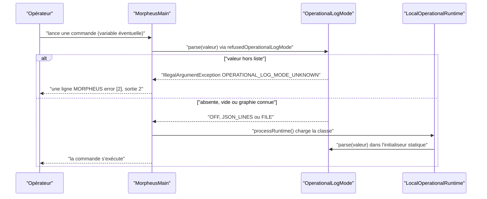

# Mode du journal opérationnel (`operational-log-mode`)

Spec de référence : [`openspec/specs/operational-log-mode/spec.md`](../../../openspec/specs/operational-log-mode/spec.md)
· Relevé du 2026-11-04 sur `2913fc30`.

## Objet et périmètre

La variable d'environnement `MORPHEUS_OPERATIONAL_LOGS` choisit ce que fait le journal opérationnel. Une valeur hors
d'une liste fermée est un refus du lanceur, jamais un repli silencieux sur « aucun journal ».

- **Acteurs** : opérateur qui lance MORPHEUS (CLI, MCP STDIO, serveur local ou distant) ; mainteneur qui ajoute un mode.
- **Inclus** : analyse de la valeur, refus au lancement, documentation opérateur de la variable.
- **Exclus** : l'écriture dans le fichier ([`logs-directory-truth.md`](logs-directory-truth.md)), la capture des
  bibliothèques ([`third-party-log-capture.md`](third-party-log-capture.md)), les traces d'échecs écartés
  ([`suppressed-failure-trace.md`](suppressed-failure-trace.md)).

## Exigences

| Alias | Exigence (titre exact) | En bref | Nature |
|---|---|---|---|
| R1 | The operational log mode SHALL be one of a closed list or a refusal | liste fermée comparée après `trim` et mise en minuscules ; toute autre valeur non vide est refusée ; absente ou vide = aucun journal | `[EXIGENCE]` |
| R2 | The refusal SHALL come from the launcher | validation par le point d'entrée avant toute autre classe du produit | `[EXIGENCE]` |
| R3 | The variable SHALL be documented for the user | nom, valeurs et défaut dans la documentation utilisateur ; le gate voit une variable lue par constante | `[EXIGENCE]` |

## Comportement détaillé

`[EXISTANT VÉRIFIÉ]` (`OperationalLogMode`, `MorpheusMain`) :

- Les graphies acceptées sont celles de l'énumération : `off`, `none` (OFF) ; `json`, `jsonl`, `structured`
  (JSON_LINES) ; `file` (FILE). `OperationalLogMode.acceptedSpellings()` les rend dans l'ordre où le refus les liste.
- Une valeur `null` ou blanche donne `OFF`. Le trim et la casse ne sont pas une erreur (` JSONL ` choisit JSON_LINES).
- Le refus est une `IllegalArgumentException` dont le message commence par `OPERATIONAL_LOG_MODE_UNKNOWN`
  (`OperationalLogMode.REFUSAL`), nomme la variable, liste les graphies et cite la valeur reçue. Un booléen
  (`true`, `1`, `yes`, `on`, `false`, `0`) n'est pas un mode.
- `MorpheusMain.main` appelle `refusedOperationalLogMode(System.getenv())` en premier, avant `processRuntime()`. En cas
  de refus il sort par `CliErrorLine.refuse(..., CliExitCode.USAGE, ...)` : une ligne `MORPHEUS error [2]: ...` sur la
  sortie d'erreur, code de sortie 2.
- `LocalOperationalRuntime` choisit son puits dans un initialiseur statique (`OperationalLogMode.parse(System.getenv(...))`) :
  c'est la raison de la validation anticipée, sans quoi le refus serait une `ExceptionInInitializerError`.
- Documentation : `docs/user/INSTALLATION.md` (section « Journal opérationnel ») donne la variable, les valeurs et le
  défaut ; `docs/developer/OPERABILITY.md` la reprend.

## Diagrammes

### Que fait le lanceur d'une valeur de `MORPHEUS_OPERATIONAL_LOGS` ?

Existant vérifié (`MorpheusMain.main`, `OperationalLogMode.parse`). Exigences : R1, R2.

Le refus précède le chargement de `LocalOperationalRuntime` : aucune trace d'initialiseur n'apparaît (R2).

## Écarts et questions ouvertes

- `[EXISTANT VÉRIFIÉ]` Le scénario « The refusal is not an initialization error » dit « any command is run » ; le test
  de processus n'exerce que `version`. Le chemin est commun à toutes les commandes (premier appel de `main`), mais la
  preuve par commande manque.
- `[EXISTANT VÉRIFIÉ]` R3 : aucun test ne vise `MORPHEUS_OPERATIONAL_LOGS` nommément ; le gate
  `LaunchEnvironmentDisclosureTest` balaie tout littéral `"MORPHEUS_*"` des sources principales (la constante
  `ENVIRONMENT_VARIABLE` en est un) et exige sa présence dans `docs/user`. Il est plus strict que la spec, qui admet
  « the user documentation » sans le circonscrire à `docs/user` (voir [`launch-environment-disclosure.md`](launch-environment-disclosure.md)).
- `[EXISTANT VÉRIFIÉ]` `openspec validate --specs --strict`, relancé sur ce relevé, passe pour cette spec.

## Traçabilité

| Exigence | Scénario | Conception ou diagramme | Changement | Preuve |
|---|---|---|---|---|
| R1 | A mistyped mode is refused | séquence ci-dessus | archive `2026-10-16-refuse-an-unknown-operational-log-mode` | [`OperationalLogModeTest`](../../../morpheus-application/src/test/java/com/morpheus/application/operability/OperationalLogModeTest.java)`#aMistypedModeIsRefusedWithTheVariableAndTheAcceptedValues` ; [`OperationalLogModeLaunchTest`](../../../morpheus-cli/src/test/java/com/morpheus/cli/OperationalLogModeLaunchTest.java)`#aProcessStartedWithAnUnknownModeExitsWithTheUsageCodeAndOneNamedLine` |
| R1 | A boolean is not a mode | idem | idem | `OperationalLogModeTest#aBooleanIsNotAMode` |
| R1 | Case and surrounding spaces are not an error | idem | idem | `OperationalLogModeTest#everyAcceptedSpellingSelectsItsModeWhateverItsCaseAndSurroundingSpaces` ; `OperationalLogModeLaunchTest#theLauncherNamesAnUnknownModeAndAcceptsTheKnownOnes` |
| R1 | An absent variable is the default | idem | idem | `OperationalLogModeTest#anAbsentOrBlankValueMeansNoOperationalLog` ; `OperationalLogModeLaunchTest#aProcessStartedWithAKnownModeOrNoneRuns` |
| R2 | The refusal is not an initialization error | idem | idem | `OperationalLogModeLaunchTest#aProcessStartedWithAnUnknownModeExitsWithTheUsageCodeAndOneNamedLine` (absence de `ExceptionInInitializerError`, une seule ligne) ; preuve limitée à la commande `version` |
| R3 | The gate sees it | — | idem | [`LaunchEnvironmentDisclosureTest`](../../../morpheus-architecture-tests/src/test/java/com/morpheus/architecture/LaunchEnvironmentDisclosureTest.java)`#everyMorpheusEnvironmentVariableTheMainSourcesMentionIsNamedInTheOperatorDocumentation` (preuve générique, voir Écarts) |

## Sources

- ADR : [BE-0146](../../architecture/adr/BE-0146-journal-operationnel-slf4j-et-fichier-borne.md),
  [ARCH-0115](../../architecture/adr/ARCH-0115-the-operational-runtime-is-a-value-the-launcher-hands-on.md).
- Pages développeur et utilisateur : [`../OPERABILITY.md`](../OPERABILITY.md), [`../../user/INSTALLATION.md`](../../user/INSTALLATION.md).
- Pages liées : [`logs-directory-truth.md`](logs-directory-truth.md), [`launch-environment-disclosure.md`](launch-environment-disclosure.md).
