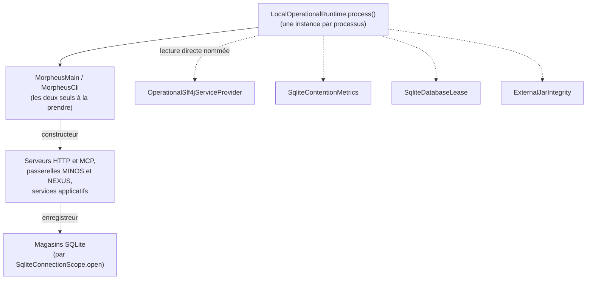
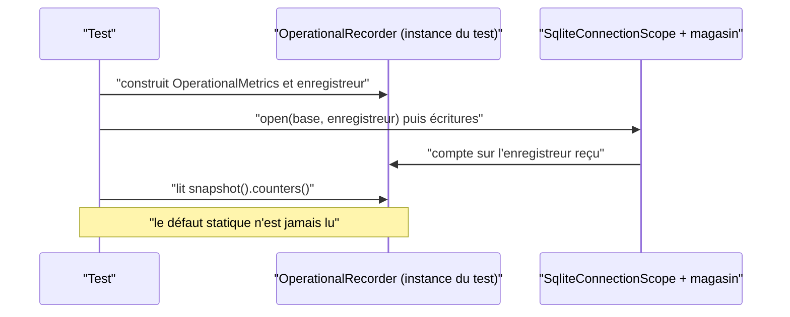

# Injection du runtime opérationnel (`operational-runtime-injection`)

Spec de référence : [`openspec/specs/operational-runtime-injection/spec.md`](../../../openspec/specs/operational-runtime-injection/spec.md)
· Relevé du 2026-11-04 sur `2913fc30`.

## Objet et périmètre

Les compteurs, la destination des événements et l'enregistreur d'un processus forment une valeur, `OperationalRuntime`,
construite par le point d'entrée du processus et remise par constructeur aux composants qui enregistrent ou observent.
Le défaut statique du processus (`LocalOperationalRuntime`) n'existe que pour ce qui ne peut pas recevoir de valeur.

- **Acteurs** : le lanceur (`MorpheusMain`, `MorpheusCli`) ; les serveurs HTTP local et distant ; les magasins SQLite ;
  un test qui observe des compteurs.
- **Inclus** : `OperationalRuntime`, `LocalOperationalRuntime`, la liste nommée des classes qui lisent encore le défaut
  statique, l'interdit pour les tests, la portée de connexion SQLite sans compteur de processus.
- **Exclus** : le choix du mode de journal ([`operational-log-mode.md`](operational-log-mode.md)) ; le format des
  événements.

## Exigences

| Alias | Exigence (titre exact) | En bref | Nature |
|---|---|---|---|
| R1 | The operational runtime SHALL be built by the process and handed to its users | métriques, destination et enregistreur sont des instances construites par le point d'entrée et passées aux composants ; aucun composant n'exige le défaut statique pour fonctionner | `[EXIGENCE]` |
| R2 | A test SHALL NOT read process-wide operational state | aucun test ne lit le défaut statique ; un test qui assert des métriques assert une instance qu'il a construite | `[EXIGENCE]` |
| R3 | The users of the static default SHALL only decrease | l'ensemble des classes de produit qui atteignent le défaut statique est une liste nommée qui ne fait que rétrécir | `[EXIGENCE]` |

## Comportement détaillé

### Les types

`[EXISTANT VÉRIFIÉ]` `OperationalRuntime` (module application) est une classe `final` qui porte `OperationalMetrics`,
la destination `OperationalEventSink` (selon le mode : `noop`, lignes JSON sur l'erreur standard, ou fichier différé) et
l'`OperationalRecorder`. Deux instances ne partagent aucun compteur. `LocalOperationalRuntime` tient la seule instance
du processus, créée à la lecture du mode d'environnement, et la donne par `process()` ; ses accesseurs statiques
(`metrics()`, `sink()`, `recorder()`, `writesEvents()`) existent pour la liaison de journalisation et les classes
qui ne reçoivent pas encore d'enregistreur.

### Les classes qui lisent encore le défaut statique (R3)

`[EXISTANT VÉRIFIÉ]` `StaticOperationalRuntimeUsersArchitectureTest.MAIN_USERS` nomme exactement six fichiers
principaux : `ExternalJarIntegrity`, `MorpheusCli`, `MorpheusMain`, `OperationalSlf4jServiceProvider`,
`SqliteContentionMetrics`, `SqliteDatabaseLease`. Chacun a sa raison dans la Javadoc du test (points d'entrée,
instanciation par le chargeur de services, connexion ouverte hors portée, bail unique par base, JAR épinglé préparé
pour des consommateurs sans runtime). `process()` n'est pris que par `MorpheusMain` et `MorpheusCli`
(`PROCESS_RUNTIME_TAKERS`).

### Les serveurs et les magasins (R1)

`[EXISTANT VÉRIFIÉ]` `MorpheusHttpServer.start(base, hôte, port)` crée son propre runtime (mode `OFF`) dans
`MorpheusLocalHttpServerBootstrap` ; `start(…, runtime)` en accepte un. La route `metrics` sert le runtime du serveur.
La portée de connexion SQLite (`SqliteConnectionScope`) ne garde aucun compteur de processus : elle compte sur
l'enregistreur de celui qui l'ouvre.

## Diagrammes

### Qui construit le runtime, et qui le reçoit ?

Existant vérifié. Il répond à R1 et R3 : une flèche pleine est un passage par constructeur ; les flèches pointillées
sont les six lectures directes du défaut statique.

### Comment un test observe-t-il des compteurs ?

Existant vérifié (R2). Le test construit son instance ; il ne touche jamais au défaut statique.

## Écarts et questions ouvertes

- `[EXISTANT VÉRIFIÉ]` **« Ne fait que rétrécir » sans cliquet.** `MAIN_USERS` est déclarée « table de faits » dans
  `ProductionClassListsArchitectureTest` (`Kind.TABLE_OF_FACTS`), pas « compteur de dette » : elle n'a ni ADR qui la
  nomme ni clé dans `config/debt-counter-ratchets.properties`. Le test impose l'égalité exacte avec l'ensemble mesuré (un
  ajout comme un retrait fait échouer le build) ; l'ajout d'un nom reste possible en éditant le test, et seul le texte de
  la Javadoc le déconseille. R3 promet une liste qui ne fait que rétrécir ; la règle `architecture.md` dit qu'une table de
  faits « ne promet pas de rétrécir ». `[QUESTION]` Faut-il convertir `MAIN_USERS` en compteur de dette (ADR et cliquet) ?
- `[EXISTANT VÉRIFIÉ]` **Portée de R2.** `noTestReadsTheStaticRuntime` parcourt les sources de test de tous les
  modules `morpheus-*` **sauf** `morpheus-architecture-tests`, et détecte la mention textuelle du nom
  `LocalOperationalRuntime`. Les deux fichiers de ce module qui la mentionnent
  (`ApplicationTechnologyBoundaryArchitectureTest`, `DispatchersHoldNoUseCaseArchitectureTest`) la nomment dans une liste de
  classes, sans la lire.
- `[EXISTANT VÉRIFIÉ]` **« Exact value » du test de contention.** La spec dit que
  `SqliteContentionObservabilityTest` assert « the exact value of counters on its own instance ». Le test assert des
  relations (`TRANSACTIONS_STARTED` égal à `TRANSACTIONS_COMMITTED`, ensemble exact des clés de compteurs, `Map.of()` pour
  l'instance étrangère) et des bornes (`> 0`) sur une instance à lui ; il ne fige pas de valeur numérique absolue. Pas
  d'écart de fond : aucune différence sur un compteur partagé.
- `[EXISTANT VÉRIFIÉ]` Le test « served metrics » du serveur local compare un compteur avant et après sur le runtime
  **propre** du serveur ; la route servie du processus réel (`MorpheusMain`) n'est pas démarrée par un test d'API.
- Les mêmes tests prouvent R1 pour le magasin ; pour les passerelles MINOS et NEXUS et les services applicatifs la preuve
  est l'absence de leur nom dans `MAIN_USERS`, pas un test comportemental.

## Traçabilité

| Exigence | Scénario | Conception ou diagramme | Changement | Preuve |
|---|---|---|---|---|
| R1 | Two stores, two sets of counters | diagramme de flux | archive `2026-10-16-inject-the-operational-runtime` | [`SqliteContentionObservabilityTest`](../../../morpheus-store-sqlite/src/test/java/com/morpheus/store/sqlite/runtime/SqliteContentionObservabilityTest.java)`#twoStoresOpenedWithTwoRecordersMoveTwoSetsOfCounters` ; [`OperationalRuntimeTest`](../../../morpheus-application/src/test/java/com/morpheus/application/operability/OperationalRuntimeTest.java)`#twoRuntimesShareNoCounter` |
| R1 | The served metrics are the process's | diagramme de flux | idem | [`MorpheusRootHttpRoutesContractTest`](../../../morpheus-api/src/test/java/com/morpheus/api/MorpheusRootHttpRoutesContractTest.java)`#theServedMetricsCarryTheTransactionsOfTheStoresTheServerOpens` (runtime du serveur de test, voir Écarts) |
| R2 | The contention test asserts absolute values | séquence | idem | `SqliteContentionObservabilityTest#aCommittedTransactionIsCountedAndTimed` (relations et clés exactes, voir Écarts) |
| R2 | A test reading the default fails the build | séquence | idem | [`StaticOperationalRuntimeUsersArchitectureTest`](../../../morpheus-architecture-tests/src/test/java/com/morpheus/architecture/StaticOperationalRuntimeUsersArchitectureTest.java)`#noTestReadsTheStaticRuntime` ; compteurs de portée : `#noTestReadsProcessWideCountersOfTheConnectionScope`, `#theConnectionScopeKeepsNoCounterOfTheProcess` |
| R3 | A new static user is refused | diagramme de flux | idem | `StaticOperationalRuntimeUsersArchitectureTest#noMainClassStartsToReadTheStaticRuntime` ; `#onlyAnEntryPointTakesTheRuntimeOfTheProcessAsAValue` |

## Sources

- ADR : `BE-0146` ([journal opérationnel](../../architecture/adr/BE-0146-journal-operationnel-slf4j-et-fichier-borne.md)), `ARCH-0115` ([le runtime opérationnel est une valeur que le lanceur remet](../../architecture/adr/ARCH-0115-the-operational-runtime-is-a-value-the-launcher-hands-on.md)).
- Page développeur : [`../OPERABILITY.md`](../OPERABILITY.md).
- Pages liées : [`operational-log-mode.md`](operational-log-mode.md), [`sqlite-connection-policy.md`](sqlite-connection-policy.md).
