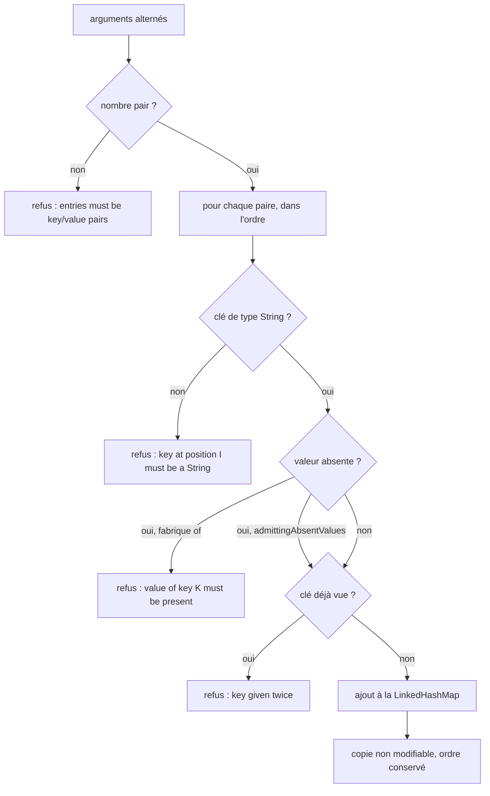

# Construction des cartes de réponse (`payload-map-construction`)

Spec de référence : [`openspec/specs/payload-map-construction/spec.md`](../../../openspec/specs/payload-map-construction/spec.md)
· Relevé du 2026-11-03 sur `ef006fb7`.

## Objet et périmètre

Comment le produit construit une carte à clés textuelles à partir de clés et de valeurs alternées, ce que répond une
construction mal formée, et ce qui refuse un second constructeur.

- **Acteurs** : développeur d'un adaptateur HTTP ou MCP ; client qui lit une réponse publique.
- **Inclus** : `PayloadMap` (`com.morpheus.application.foundation`), ses deux fabriques, ses refus, l'interdit d'un
  second constructeur.
- **Exclus** : la forme des types partagés du domaine (`PublicPayloads`, capacité en cours
  `public-payload-convergence`).

## Exigences

| Alias | Exigence (titre exact) | En bref | Nature |
|---|---|---|---|
| R1 | A malformed payload map construction SHALL be refused by name | nombre impair, clé non textuelle, clé répétée : refus nommé | `[EXIGENCE]` |
| R2 | The caller SHALL state whether an absent value is admitted | l'appel dit s'il admet une valeur absente (écrite `null`) ou la refuse | `[EXIGENCE]` |
| R3 | A built payload map SHALL be unmodifiable and keep the order given | carte non modifiable, ordre d'insertion | `[EXIGENCE]` |
| R4 | The public answers SHALL NOT change | aucune réponse HTTP ni MCP ne change pour une construction bien formée | `[EXIGENCE]` — libellé de migration |
| R5 | A second payload map builder SHALL be refused | le build refuse toute autre méthode qui fait d'un tableau d'arguments une carte | `[EXIGENCE]` |

## Comportement détaillé

`[EXISTANT VÉRIFIÉ]` (`morpheus-application/src/main/java/com/morpheus/application/foundation/PayloadMap.java`) :

| Fabrique | Valeur absente | Refus (tous `IllegalArgumentException`) |
|---|---|---|
| `PayloadMap.of(Object...)` | refusée : `payload map value of key K must be present` | `payload map entries must be key/value pairs; received N arguments` ; `payload map key at position I must be a String; received <type ou null>` ; `payload map key given twice: K` |
| `PayloadMap.admittingAbsentValues(Object...)` | gardée sous sa clé | mêmes refus, sauf la valeur absente |

`I` est l'indice de l'argument (à partir de 0) : la clé de la deuxième paire est à la position 2. La carte rendue est
une copie non modifiable d'une `LinkedHashMap` ; elle ne suit pas le tableau d'origine.

## Diagrammes

### Dans quel ordre une construction est-elle vérifiée ?

Existant vérifié (`PayloadMap`). Organigramme (pas UML).

Conséquence de l'ordre : dans `of`, une clé répétée dont la seconde valeur est absente est refusée pour la valeur
absente, pas pour la répétition. Exigences : R1, R2, R3.

## Écarts et questions ouvertes

- `[EXISTANT VÉRIFIÉ]` Le scénario « An answer that carries an absent side » (réponse d'historique HTTP sans source,
  écrite `null`) n'a pas de test de bout en bout : `MorpheusHistoryApiServiceContractTest` ne vérifie que le cas
  `UNCHANGED`. La sérialisation en `null` n'est testée nulle part ; seule la conservation de la clé l'est.
- `[EXISTANT VÉRIFIÉ]` R4 et deux scénarios décrivent la migration des constructeurs privés (« Replacing the private
  builders », « after the replacement », « as it does today ») ; la règle permanente serait « une construction bien
  formée ne change aucune réponse ». Elle est tenue par les suites des adaptateurs et les transcriptions MCP, sans
  test dédié.
- `[EXISTANT VÉRIFIÉ]` La règle d'architecture vise une méthode à un seul paramètre `Object[]` qui rend une `Map` ; une
  méthode `(Map, Object...)` est admise (`theTextualTwinRecognisesARenamedCopyAndNoOtherSignature`). La spec dit « from
  an argument array, whatever the method is called », un peu plus large.
- `[EXISTANT VÉRIFIÉ]` « On every adapter » et « two separate runs » sont prouvés structurellement (un seul
  constructeur, `LinkedHashMap`), pas par un test par adaptateur ni entre deux exécutions.

## Traçabilité

Abréviations : `T` = `PayloadMapTest`, `AR` = `PayloadMapConstructionArchitectureTest`.

| Exigence | Scénario | Diagramme | Changement | Preuve |
|---|---|---|---|---|
| R1 | A key of the wrong type | organigramme | archive `2026-10-30-build-payload-maps-through-one-checked-builder` | [`T`](../../../morpheus-application/src/test/java/com/morpheus/application/foundation/PayloadMapTest.java)`#aKeyThatIsNotAStringIsRefusedWithItsPositionAndTypeRatherThanAClassCast`, `#anAbsentKeyIsRefusedWithItsPosition` |
| R1 | An odd number of arguments | organigramme | idem | `T#anOddNumberOfArgumentsIsRefusedByName`, `#anOddNumberOfArgumentsIsRefusedByNameWhenAbsentValuesAreAdmitted` ; « on every adapter » : `AR` |
| R1 | A key given twice | organigramme | idem | `T#aKeyGivenTwiceIsRefusedWithTheKeyAndNeitherValueIsKept` |
| R2 | An answer that carries an absent side | — | idem | **preuve manquante** de bout en bout ; partielle : `T#thePermissiveConstructionKeepsAnAbsentValueUnderItsKey` |
| R2 | A value that must be present | organigramme | idem | `T#theStrictConstructionRefusesAnAbsentValueWithItsKey` |
| R3 | Two runs of the product | organigramme | idem | `T#entriesIterateInTheOrderGiven`, `#theBuiltMapRefusesModification`, `#theBuiltMapDoesNotFollowTheArgumentArray` |
| R4 | The adapter suites | — | idem | suites des adaptateurs et `McpToolTranscriptTest` ; pas de test dédié |
| R5 | A pasted builder under a new name | — | idem | [`AR`](../../../morpheus-architecture-tests/src/test/java/com/morpheus/architecture/PayloadMapConstructionArchitectureTest.java)`#noTypeOtherThanTheOwnerDeclaresAMethodThatTurnsAnArgumentArrayIntoAMap`, `#noMainSourceOtherThanTheOwnerDeclaresAMethodThatTurnsAnArgumentArrayIntoAMap`, `#theTextualTwinRecognisesARenamedCopyAndNoOtherSignature` |
| R5 | The owner grows a dependency | — | idem | `AR#theOwnerOfThePayloadMapDependsOnNoOtherMorpheusPackage` (tout le paquet `foundation`) |

## Sources

- Règle du dépôt : `.claude/rules/code-style.md` (`PayloadMap`).
