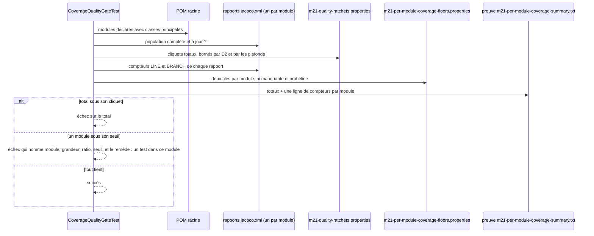
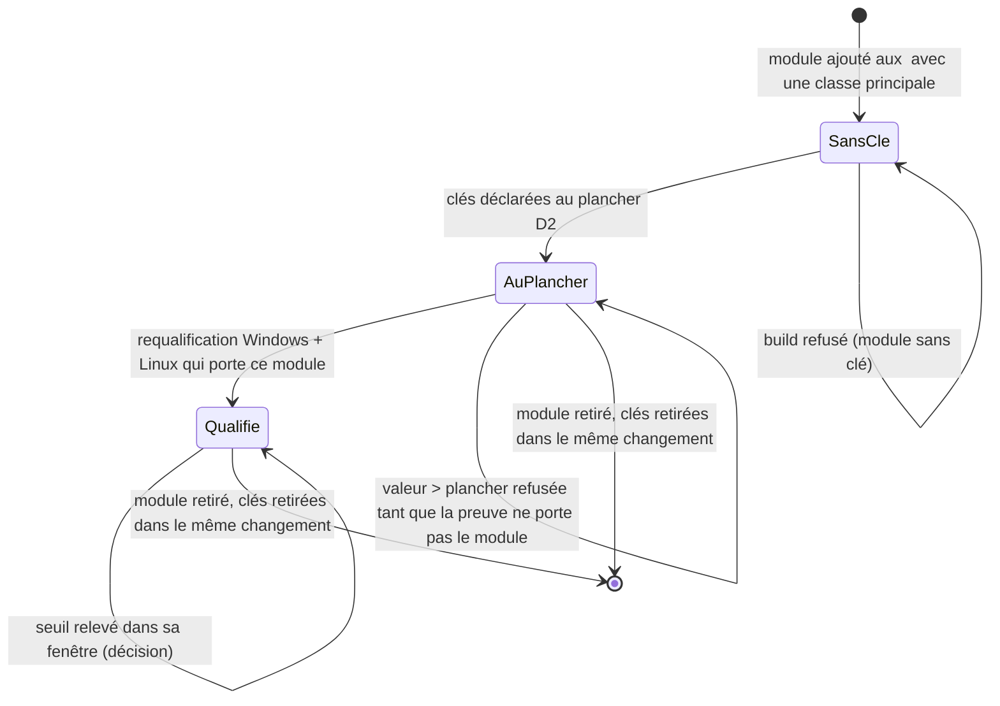

# Seuil de couverture propre à chaque module (`per-module-coverage-floor`)

Spec de référence : `openspec/specs/per-module-coverage-floor/spec.md`, issue du changement archivé
`thresh-every-module-coverage-on-its-own-floor` (`openspec/changes/archive/2026-11-07-thresh-every-module-coverage-on-its-own-floor/`)
· Relevé du 2026-11-06 sur `a7bc8571`.

## Objet et périmètre

Un module du réacteur qui cesse de se tester fait échouer le build **sous son nom**, au lieu de se diluer dans la
couverture des autres modules. L'échelle par module compare la somme des rapports à un cliquet total ; ce total seul
laisse passer un module dont la perte est compensée par les lignes couvertes des autres. Chaque module de la
population est donc aussi comparé, sur son propre rapport, à un seuil qui lui est propre.

- **Acteurs** : mainteneur qui ajoute, retire ou modifie un module, ou relève un seuil ;
  `CoverageQualityGateTest` qui applique les seuils ; `CoverageQualificationEvidenceTest` qui borne leur valeur ;
  `CoverageScaleSeparationTest` qui les tient hors des autres grandeurs ; CI (`ci.yml`, Linux et Windows) qui publie
  la preuve dans l'artefact `m21-integrity-<OS>`.
- **Déclencheurs** : `./mvnw clean verify` puis le gate de l'échelle par module ; toute modification de
  [`config/m21-per-module-coverage-floors.properties`](../../../config/m21-per-module-coverage-floors.properties), des
  `<modules>` du POM racine ou de la preuve conservée sous
  [`config/coverage-qualification/`](../../../config/coverage-qualification/evidence.tsv).
- **Inclus** : la déclaration des seuils (deux clés par module), leur application au rapport propre de chaque module,
  leur fenêtre (plancher D2, plus basse mesure conservée du module moins trois fois sa dispersion), le sort d'un
  module ajouté ou retiré, la séparation d'avec l'échelle agrégée et le crédit emprunté, le cliquet total qui reste
  en vigueur.
- **Exclus** : toute valeur de seuil (le fichier des seuils est la seule source ; elle n'est jamais recopiée ici) ;
  l'échelle agrégée, qui ne reçoit aucun seuil par module ; ce qu'un module doit aux tests des autres, tenu par le
  [crédit emprunté](coverage-attribution-gap.md) ; le format de la preuve conservée, décrit par la
  [preuve de qualification](coverage-qualification-evidence.md).

## Exigences

| Alias | Exigence (titre exact) | En bref | Nature |
|---|---|---|---|
| R1 | Chaque module de la population est tenu par un seuil qui lui est propre | le rapport propre de chaque module est comparé à ses deux seuils, même quand le total tient | `[EXIGENCE]` |
| R2 | Les seuils par module sont déclarés une fois, par module, dans la configuration de l'échelle par module | deux clés par module de la population, ni clé manquante ni clé orpheline | `[EXIGENCE]` |
| R3 | Un module absent de la preuve conservée ne déclare que le plancher D2 | sans compteurs conservés, seul le plancher D2 est admis | `[EXIGENCE]` |
| R4 | Le seuil d'un module reste dans sa fenêtre qualifiée | entre le plancher D2 et la plus basse mesure conservée moins trois fois la dispersion | `[EXIGENCE]` |
| R5 | Le seuil d'un module ne se baisse pas pour faire passer un build | le refus nomme le remède, un test écrit dans ce module | `[EXIGENCE]` |
| R6 | Les seuils par module ne gouvernent ni l'échelle agrégée ni le crédit emprunté | seul le gate par module lit le fichier des seuils | `[EXIGENCE]` |
| R7 | Le cliquet total de l'échelle par module reste en vigueur à côté des seuils | la paire `perModule*` et les plafonds `PER_MODULE_QUALIFIED_*` restent | `[EXIGENCE]` |

## Comportement détaillé

### La déclaration

`[EXISTANT VÉRIFIÉ]` [`config/m21-per-module-coverage-floors.properties`](../../../config/m21-per-module-coverage-floors.properties)
porte, pour chaque module, `<artifactId>.lineCoverageMinimum` et `<artifactId>.branchCoverageMinimum`, en ratio entre
0 et 1. Les modules attendus sont la population que `CoverageQualityGateTest.reportPopulation` dérive du POM racine :
tout `<module>` qui porte une classe sous `src/main/java`. Un module sans classe principale n'exige aucune clé, et une
clé qui le nommerait est refusée comme orpheline. Aucun seuil par défaut n'est appliqué à un module sans clé.

`theFloorFileDeclaresEveryModuleOfThePopulationAndNoOther` juge cette déclaration **sans build** : elle ne dépend que du
POM et des sources. Le refus nomme la clé manquante (« declares no `<module>.<clé>` ») et la clé orpheline (« names no
module of the population »).

### L'application

`[EXISTANT VÉRIFIÉ]` `everyModuleOfThePopulationHoldsItsOwnFloor` exige d'abord une population complète et à jour (même
contrôle que le cliquet total), puis compare le ratio de lignes et le ratio de branches du `target/site/jacoco/jacoco.xml`
de chaque module à `max(plancher D2, seuil du module)`. Le refus liste **tous** les modules en défaut en une fois, avec
la grandeur (`line` ou `branch`), le ratio mesuré, le seuil et le remède : écrire des tests dans ce module. Rien n'est
écrit dans la configuration ni dans la preuve conservée par un échec.

Le cliquet total (`perModuleCoverageDoesNotRegressBelowQualifiedBaseline`) reste une méthode à part : un échec du total
ne masque pas celui d'un module, et inversement.

### La preuve écrite par le gate

`[EXISTANT VÉRIFIÉ]` `morpheus-architecture-tests/target/m21-per-module-coverage-summary.txt` commence par
`coverageScope=per-module`, porte les totaux et, pour chaque module de la population, quatre lignes
`module.<artifactId>.lineCovered`, `.lineMissed`, `.branchCovered`, `.branchMissed`. C'est ce fichier, gardé tel quel
après une requalification, qui permet de poser un seuil au-dessus du plancher D2.

### La fenêtre d'un seuil

`[EXISTANT VÉRIFIÉ]` `CoverageQualificationEvidenceTest#everyModuleFloorStaysInsideItsQualifiedWindow` lit les seuils et
la preuve conservée de l'échelle par module :

- un seuil sous le plancher D2 de sa grandeur est refusé ;
- un seuil égal au plancher D2 est toujours admis : le gate l'applique de toute façon ;
- au-dessus du plancher, chaque résumé conservé doit porter les compteurs du module, et la plus basse mesure conservée
  du module, moins ce que le seuil exige de ses lignes ou de ses branches, doit garder trois fois la dispersion retenue.
  Cette dispersion est la plus grande de l'écart observé pour ce module entre les résumés et de la dispersion de
  référence de l'échelle (`REFERENCE_LINE_SPREAD`, `REFERENCE_BRANCH_SPREAD`) : jamais zéro, jamais saisie à la main.

Le refus nomme la clé, la valeur, la mesure et la marge exigée en lignes ou en branches.

### La séparation des grandeurs

`[EXISTANT VÉRIFIÉ]` `CoverageScaleSeparationTest` exige que la source de `CoverageQualityGateTest` nomme
`m21-per-module-coverage-floors.properties` et que celles d'`AggregateCoverageGateTest` et de `BorrowedCoverageGateTest`
ne le nomment pas.

## Diagrammes

### Que fait le gate d'un réacteur dont un module a cessé de se tester ?

Existant vérifié à `a7bc8571` (`CoverageQualityGateTest`). Diagramme de séquence UML. Exigences R1, R2, R5, R7.

Le total et les modules sont jugés par deux méthodes `@Test` distinctes ; la séquence les montre ensemble parce
qu'elles lisent la même population et les mêmes rapports.

### Comment un module entre dans le fichier des seuils, y monte et en sort ?

Existant vérifié à `a7bc8571` pour les refus ; l'état `Qualifie` n'est atteint par aucun module tant que la preuve
conservée ne porte pas de compteurs par module (voir Écarts). Diagramme d'états UML. Exigences R2, R3, R4.

La population reste dérivée du POM ; le fichier des seuils la suit, et toute divergence échoue en se nommant. Un module
renommé est un retrait plus un ajout.

## Écarts et questions ouvertes

1. **Seuils posés sur la qualification du 2026-11-07.** `[EXISTANT VÉRIFIÉ]` La preuve conservée sous
   `config/coverage-qualification/per-module/` porte les compteurs de chaque module, mesurés par deux runs CI par
   plateforme à `dbd65062`. Chaque seuil est au plus haut millième de sa fenêtre, lignes et branches séparément. Un
   module trop petit pour garder trois fois la dispersion de référence au-dessus du plancher y reste
   (`morpheus-provider-testkit`, `morpheus-provider-reference`, et les branches de `morpheus-integration-minos` et
   `morpheus-integration-nexus`) : cette dispersion est celle de l'échelle entière, ce que pose la question D4.
2. **Un seuil au plancher admis sous la marge.** `[DÉCISION]` Un seuil égal au plancher D2 passe même quand la mesure
   du module est à moins de trois fois sa dispersion au-dessus : le refuser rendrait la configuration impossible pour
   un module mesuré près du plancher. La fenêtre de R4 s'applique au-dessus du plancher.
3. **Une baisse dans la fenêtre n'est pas refusée.** `[DÉCISION]` Rien dans le build n'interdit de baisser une clé
   dans sa fenêtre ; la baisse reste visible dans le diff d'un fichier de gouvernance et se justifie dans la PR
   (`.claude/rules/governance.md`). Preuve par la revue.
4. **Le nom du fichier lu par le texte.** `[EXISTANT VÉRIFIÉ]` La séparation de R6 lit le texte des sources des gates ;
   un nom construit par concaténation y échapperait. La revue le tient.
5. **Dispersion de référence commune.** `[QUESTION]` Adopter une dispersion de référence par module quand assez de
   qualifications seront conservées (design du changement, D4) — peut attendre, sans changer la spec.

## Traçabilité

Changement : `thresh-every-module-coverage-on-its-own-floor`. Fichiers de test, sous
`morpheus-architecture-tests/src/test/java/com/morpheus/architecture/m21/` :
[`CoverageQualityGateTest`](../../../morpheus-architecture-tests/src/test/java/com/morpheus/architecture/m21/CoverageQualityGateTest.java),
[`CoverageQualificationEvidenceTest`](../../../morpheus-architecture-tests/src/test/java/com/morpheus/architecture/m21/CoverageQualificationEvidenceTest.java),
[`CoverageScaleSeparationTest`](../../../morpheus-architecture-tests/src/test/java/com/morpheus/architecture/m21/CoverageScaleSeparationTest.java).

| Exigence | Scénario | Conception ou diagramme | Changement ou tâche | Preuve |
|---|---|---|---|---|
| R1 | Un module cesse de se tester pendant que la somme tient | séquence ; design D2 | 2.1, 2.2 | `CoverageQualityGateTest#aModuleUnderItsOwnFloorIsRefusedWhileTheTotalStillHolds` (réacteur assemblé) |
| R1 | Les branches sont jugées à part des lignes | séquence ; design D2 | 2.1, 2.2 | même méthode (module `branch-gap`) |
| R1 | Tous les modules tiennent leur seuil | séquence | 2.3, 5.3 | `CoverageQualityGateTest#everyModuleOfThePopulationHoldsItsOwnFloor` ; vert sur le réacteur réel : `clean verify` Windows du 2026-11-07, CI Linux de la pull request de qualification |
| R2 | Un module ajouté au réacteur sans seuil | états ; design D1, D6 | 2.1, 2.2, 2.4 | `CoverageQualityGateTest#theFloorFileMustNameEveryModuleOfThePopulationAndNoOther` ; sur la vraie configuration : `#theFloorFileDeclaresEveryModuleOfThePopulationAndNoOther` |
| R2 | Un module retiré du réacteur dont la clé reste | états ; design D6 | 2.1, 2.4 | `CoverageQualityGateTest#theFloorFileMustNameEveryModuleOfThePopulationAndNoOther` |
| R2 | Un module sans classe principale n'a pas de seuil | états ; design D6 | 2.1 | même méthode (module `without-main-classes`) |
| R3 | Un nouveau module déclare un seuil sans qualification | états ; design D5, D6 | 3.1, 3.2 | `CoverageQualificationEvidenceTest#aModuleTheEvidenceDoesNotCarryMayDeclareTheD2FloorAndNothingAbove` |
| R3 | Un nouveau module au plancher | états | 3.1, 3.2 | même méthode |
| R4 | Un seuil posé sur la mesure | design D3, D4 | 3.1, 3.2 | `CoverageQualificationEvidenceTest#aModuleLessStableThanTheReferenceIsSizedAgainstItsOwnSpread`, `#aStableModuleIsSizedAgainstTheReferenceSpreadNeverAgainstZero` (preuve synthétique) ; sur la preuve réelle : **preuve manquante** jusqu'à la requalification (3.4, 3.5) |
| R4 | Un seuil sous le plancher D2 | design D3 | 3.1, 3.2 | `CoverageQualificationEvidenceTest#aModuleFloorUnderTheD2FloorIsRefusedAndNamesTheModuleAndTheKey` |
| R4 | Un seuil dans la fenêtre | design D3 | 3.2, 3.5 | `CoverageQualificationEvidenceTest#everyModuleFloorStaysInsideItsQualifiedWindow` (vraie configuration, seuils posés dans leur fenêtre) ; un millième de plus sur `morpheus-api` est refusé (71 lignes de marge pour 72 exigées) |
| R5 | Le message nomme le remède | séquence ; design D2 | 2.2 | `CoverageQualityGateTest#aModuleUnderItsOwnFloorIsRefusedWhileTheTotalStillHolds` (« write tests in … ») |
| R5 | Une baisse de seuil se justifie | Écart 3 ; design D3 | — | revue de PR (`.claude/rules/governance.md`) ; pas de preuve exécutable |
| R6 | Le gate agrégé lit les seuils par module | design D9 | 2.5 | `CoverageScaleSeparationTest#neitherCoverageGateReadsTheOtherScaleKeysReportOrEvidence`, `#theBorrowedCreditGateReadsNoCoverageKeyAndNeitherCoverageGateReadsIt` (violation plantée une fois, tâche 2.5) |
| R6 | Le gate par module ne lit que son échelle | design D9 | 2.5 | `CoverageScaleSeparationTest#neitherCoverageGateReadsTheOtherScaleKeysReportOrEvidence` |
| R7 | Le total passe sous son cliquet alors que chaque module tient son seuil | séquence ; design D8 | 2.6 | `CoverageQualityGateTest#ratchetRejectsARegressionThatTheOldD2FloorWouldHaveAccepted`, `#perModuleRatchetWindowRejectsAnUnqualifiedRaiseAndAReturnToTheD2Floor` |

## Sources

- Décision : [ADR-0163](../../architecture/adr/GEN-0163-deux-echelles-de-couverture-un-seuil-par-module-et-le-credit-emprunte.md).
- Règles du dépôt : `.claude/rules/testing.md` (« Deux échelles de couverture, deux jeux de seuils »), skill
  `coverage-ratchet`.
- Guide développeur : [`BUILD_AND_TEST.md`](../BUILD_AND_TEST.md) (section « Le seuil propre à chaque module »).
- Pages liées : [`coverage-qualification-evidence.md`](coverage-qualification-evidence.md),
  [`coverage-attribution-gap.md`](coverage-attribution-gap.md), [`gate-verdict-currency.md`](gate-verdict-currency.md).
