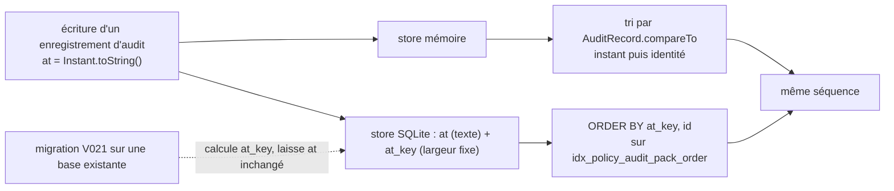

# Ordre de l'audit des policies (`policy-audit-order`)

Spec de référence : [`openspec/specs/policy-audit-order/spec.md`](../../../openspec/specs/policy-audit-order/spec.md)
· Relevé du 2026-11-04 sur `2913fc30`.

## Objet et périmètre

L'audit des écritures sur les packs de policies est rendu dans l'ordre chronologique de l'horodatage, les enregistrements
d'un même instant l'étant par identité, de sorte que l'ordre est le même à chaque lecture et sur les deux stores.

- **Acteurs** : tout lecteur de l'audit (HTTP, CLI, MCP) ; les stores mémoire et SQLite.
- **Inclus** : la clé d'ordre, la migration d'une base existante, l'ordre de l'audit public.
- **Exclus** : la pagination de l'audit ([`append-only-journal-reads.md`](append-only-journal-reads.md)).

## Exigences

| Alias | Exigence (titre exact) | En bref | Nature |
|---|---|---|---|
| R1 | The policy audit is returned by instant, then by identity | instant puis identité, mêmes résultats sur les deux stores et pour l'audit public | `[EXIGENCE]` |

## Comportement détaillé

`[EXISTANT VÉRIFIÉ]`

- Ordre naturel de `PolicyConfiguration.AuditRecord` : `at.compareTo`, puis `id.compareTo`
  ([source](../../../morpheus-application/src/main/java/com/morpheus/application/policy/PolicyConfiguration.java)). Le store
  mémoire trie par cet ordre à chaque lecture.
- Le store SQLite conserve `at` en texte `Instant.toString()` (inchangé), dont l'ordre lexicographique n'est pas chronologique
  quand la fraction de seconde varie en longueur (`:00.500100Z` avant `:00.500Z`, `:00Z` après les deux). La colonne `at_key`,
  ajoutée par la migration
  [`V021__policy_audit_order_key.sql`](../../../morpheus-store-sqlite/src/main/resources/db/migration/V021__policy_audit_order_key.sql),
  porte l'instant en texte de largeur fixe : treize chiffres de secondes d'époque, un point, neuf chiffres de nanosecondes.
  La requête de page (`AUDIT_PAGE_SQL`) trie `ORDER BY at_key, id`, sur l'index `idx_policy_audit_pack_order`
  `(pack_id, at_key, id)`.
- Le texte de l'identité (UUIDv7 en minuscules) se trie comme l'identité se compare (commentaire de `SqlitePolicyPackStore.listAudit`).
- La migration calcule `at_key` pour les lignes existantes ; elle n'écrit pas dans `at`.

## Diagrammes

### Comment l'ordre chronologique est-il obtenu sur chaque store ?

Existant. Exigence R1.

## Écarts et questions ouvertes

- `[EXISTANT VÉRIFIÉ]` L'identité est comparée par `UUID.compareTo` (mémoire) et par texte (SQLite) : les deux ordres
  coïncident parce que les identifiants d'audit sont des UUIDv7 (`DomainIdentity` le valide). La page
  [`requirement-page-reads.md`](requirement-page-reads.md) documente un cas où ils divergent (premier chiffre 8 ou plus) ;
  aucun test de l'audit n'exerce une identité dont le premier chiffre diffère de celui d'un UUIDv7 courant.
- `[EXISTANT VÉRIFIÉ]` `PolicyAuditOrderTest` documente que deux écritures ne reçoivent pas le même instant de l'horloge
  système : les départages par identité sont fabriqués par une horloge de test à instants répétés.

## Traçabilité

Archive : `2026-10-09-close-pit-survivor-gaps`. Preuves complémentaires de la migration : archive
`2026-10-17-read-an-append-only-journal-one-page-at-a-time`.

| Exigence | Scénario | Conception ou diagramme | Changement | Preuve |
|---|---|---|---|---|
| R1 | Timestamps whose text forms sort differently from time | organigramme | archive citée | [`PolicyAuditOrderTest`](../../../morpheus-architecture-tests/src/test/java/com/morpheus/architecture/m25/PolicyAuditOrderTest.java)`#bothStoresListTheAuditByInstantThenIdentity` ; [`SqlitePolicyAuditPageTest`](../../../morpheus-store-sqlite/src/test/java/com/morpheus/store/sqlite/adapter/SqlitePolicyAuditPageTest.java)`#theTextOfTheInstantDoesNotGiveTheOrderTheKeyDoes` |
| R1 | Records sharing one instant | organigramme | idem | `PolicyAuditOrderTest#bothStoresListTheAuditByInstantThenIdentity` (huit écritures au même instant, lues par pages de quatre) |
| R1 | (partie « the public audit SHALL return the order the store returns ») | organigramme | idem | `PolicyAuditOrderTest#thePublicAuditIsListedByInstantThenIdentity` ; [`GrowingCollectionToolsPagingTest`](../../../morpheus-mcp/src/test/java/com/morpheus/mcp/GrowingCollectionToolsPagingTest.java)`#theAuditJournalIsPagedInChronologicalOrderNotInTextOrder` |
| R1 | An existing database keeps its history | V021 | idem | [`SqlitePolicyAuditOrderKeyMigrationTest`](../../../morpheus-store-sqlite/src/test/java/com/morpheus/store/sqlite/adapter/SqlitePolicyAuditOrderKeyMigrationTest.java)`#theKeyOfARecordThatExistedBeforeTheMigrationIsTheKeyThisVersionWouldHaveWritten`, `#theKeysSortAsTheInstantsDo` (le texte `at` est relu par ce test : chaque instant d'origine retrouve sa clé) |

Complément : `SqlitePolicyAuditPageTest#theQueryFollowsTheOrderIndexAndSortsNothing` garde le plan de la requête.

## Sources

- ADR : [BE-0151](../../architecture/adr/BE-0151-pagination-des-collections-et-journaux.md) (option écartée `ORDER BY at, id`).
- Archives OpenSpec : `2026-10-09-close-pit-survivor-gaps`, `2026-10-17-read-an-append-only-journal-one-page-at-a-time`.
