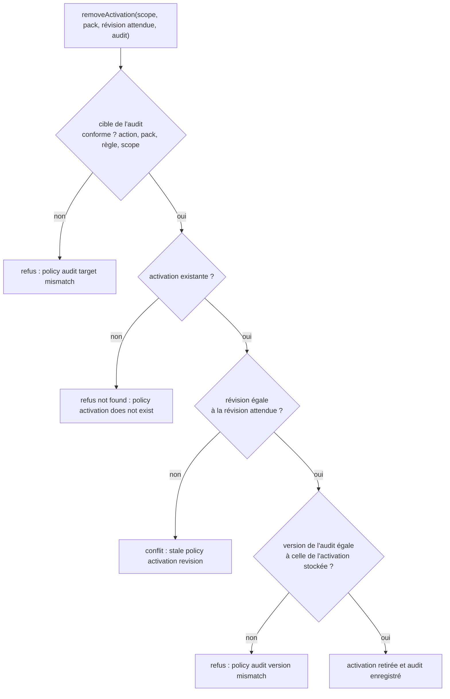

# Refus d'écriture du store de policies (`policy-store-refusals`)

Spec de référence : [`openspec/specs/policy-store-refusals/spec.md`](../../../openspec/specs/policy-store-refusals/spec.md)
· Relevé du 2026-11-04 sur `2913fc30`.

## Objet et périmètre

Une écriture invalide sur un pack de policies (ligne absente, révision périmée ou sautée, audit qui ne correspond pas) est
refusée de la même façon, avec le même type et le même message, par le store mémoire et par le store SQLite, sans rien écrire.

- **Acteur** : `PolicyPackService`, et tout appelant direct du port `PolicyPackStore`.
- **Inclus** : retrait d'une activation ou d'un override absent, ordre des contrôles, saut de révision.
- **Exclus** : l'ordre de lecture de l'audit ([`policy-audit-order.md`](policy-audit-order.md)), l'atomicité des écritures
  (tests d'atomicité propres à chaque store).

## Exigences

| Alias | Exigence (titre exact) | En bref | Nature |
|---|---|---|---|
| R1 | Removing a missing row is refused as not found | retrait d'une activation ou d'un override absent : refus « not found » nommant la ligne | `[EXIGENCE]` |
| R2 | A write is checked in one order | cible de l'audit, puis état stocké (existence avant révision), puis version de l'audit ; la version fournie par l'appelant est contrôlée avec la cible | `[EXIGENCE]` |
| R3 | A skipped revision step is refused before anything is written | un remplacement qui n'avance pas d'exactement un est refusé avant toute écriture | `[EXIGENCE]` |

## Comportement détaillé

`[EXISTANT VÉRIFIÉ]` Refus produits par les deux stores
([mémoire](../../../morpheus-store-memory/src/main/java/com/morpheus/store/memory/MemoryPolicyPackStore.java),
[SQLite](../../../morpheus-store-sqlite/src/main/java/com/morpheus/store/sqlite/adapter/SqlitePolicyPackStore.java)) :

| Cas | Type | Message |
|---|---|---|
| activation absente | `EntityNotFoundException` | `policy activation does not exist: <pack>` |
| override absent | `EntityNotFoundException` | `policy override does not exist: <règle>` |
| cible de l'audit incohérente | `IllegalArgumentException` | `policy audit target mismatch for <action>` |
| version de l'audit incohérente | `IllegalArgumentException` | `policy audit version mismatch for <action>` |
| révision périmée | `PolicyConflictException` | `stale policy <pack, activation ou override> revision: expected N but current is M` |
| saut de révision ou de version | `IllegalArgumentException` | `policy update must advance revision and version by exactly one` |

Ordre effectif des contrôles, identique dans les deux stores :

| Écriture | Ordre |
|---|---|
| mise à jour d'un pack (`compareAndSetDefinition`) | identité du remplacement ; cible de l'audit ; version de l'audit (la version nouvelle, fournie par l'appelant) ; pack existant ; révision attendue ; avance d'exactement un |
| retrait d'une activation | cible ; activation existante ; révision ; version de l'audit contre l'activation stockée |
| écriture d'un override | cohérence du remplacement ; cible ; pack actif (`EntityStateException`) ; version de l'audit contre l'activation ; révision de l'override ; budget d'overrides |
| retrait d'un override | cible ; version de l'audit (vide) ; override existant ; révision |

`[EXISTANT VÉRIFIÉ]` Dans le store SQLite, la révision de l'override écrit est constatée dans la transaction (zéro ligne
modifiée), après les contrôles ci-dessus ; l'ordre observable est le même.

## Diagrammes

### Dans quel ordre le retrait d'une activation est-il refusé ?

Existant, identique sur les deux stores. Exigences R1, R2.

## Écarts et questions ouvertes

- `[QUESTION]` La spec place la version de l'audit après l'état stocké « when it must match a stored row (deactivation,
  override write) ». Pour le retrait d'une activation c'est le cas. Pour l'écriture d'un override, les deux stores comparent
  la version de l'audit à l'activation avant de contrôler la révision de l'override ; la révision de l'override est un autre
  état stocké. La spec ne tranche pas laquelle des deux lectures est visée.
- `[EXISTANT VÉRIFIÉ]` Comportements vérifiés absents de la spec : refus d'un override sur un pack inactif
  (`EntityStateException`, test `anOverrideOnAnInactivePackIsRefusedByBothStores`), refus d'une activation périmée, budget
  d'overrides par scope, refus d'un remplacement dont l'identité diffère. Ce ne sont pas des exigences de cette capacité.
- `[EXISTANT VÉRIFIÉ]` Pour une mise à jour, la révision périmée est contrôlée avant l'avance d'exactement un : une écriture
  à la fois périmée et sautée est refusée comme conflit. La spec ne l'écrit pas.
- Preuve manquante : R2, « a version the caller supplies itself … checked with the target, before any state is read » :
  aucun test ne combine un audit de version incohérente avec une révision périmée ou un pack absent, donc l'ordre n'est
  pas discriminé.
- Preuve manquante : R2, troisième contrôle (version de l'audit contre la ligne stockée pour un retrait d'activation ou une
  écriture d'override) : aucun test n'exerce `policy audit version mismatch` sur ces deux écritures.
- Preuve partielle : R2, « existence before revision » n'est prouvée que pour l'activation et l'override absents avec une
  révision attendue égale à 1 (ligne absente de révision 0) ; la mise à jour d'un pack absent n'est pas exercée par cette suite.
- Preuve partielle : le scénario R1 « writes nothing » est vérifié par la révision et le nombre de versions du pack et le
  nombre d'enregistrements d'audit ; le nombre d'activations et d'overrides n'est pas relu après le refus.
- Preuve partielle : le scénario « mismatched audit on a missing row » n'est exercé que pour le retrait d'une activation,
  pas pour celui d'un override.

## Traçabilité

Archive : `2026-10-09-align-store-refusal-parity`. Tous les tests sont dans
[`PolicyPersistenceParityTest`](../../../morpheus-architecture-tests/src/test/java/com/morpheus/architecture/m25/PolicyPersistenceParityTest.java)
(chaque cas s'exécute sur les deux stores et compare les refus).

| Exigence | Scénario | Conception ou diagramme | Changement | Preuve |
|---|---|---|---|---|
| R1 | An activation that does not exist | organigramme | archive citée | `#removingAMissingActivationIsRefusedAsNotFoundByBothStores` |
| R1 | An override that does not exist | — | idem | `#removingAMissingOverrideIsRefusedAsNotFoundByBothStores` |
| R2 | A mismatched audit on a missing row | organigramme | idem | `#aMismatchedAuditIsRefusedBeforeTheMissingRowByBothStores` |
| R2 | A stale revision with a well-formed audit | organigramme | idem | `#aStaleRevisionIsAConflictInBothStores` ; aussi `#aStaleDefinitionRevisionIsAConflictInBothStores`, `#aStaleOverrideRevisionIsAConflictInBothStores` |
| R3 | An update that skips a revision | — | idem | `#anUpdateThatSkipsAStepIsRefusedBeforeAnythingIsWrittenByBothStores` (saut de révision, de version la plus récente et de numéro de version) |

Tests associés non rattachés à un scénario : `#reactivatingAPackThatIsNotActiveIsAConflictInBothStores`,
`#anOverrideOnAnInactivePackIsRefusedByBothStores`.

## Sources

- Archive OpenSpec : `2026-10-09-align-store-refusal-parity`.
- Port : [`PolicyPackStore`](../../../morpheus-application/src/main/java/com/morpheus/application/policy/PolicyPackStore.java).
- Page liée : [`policy-audit-order.md`](policy-audit-order.md).
