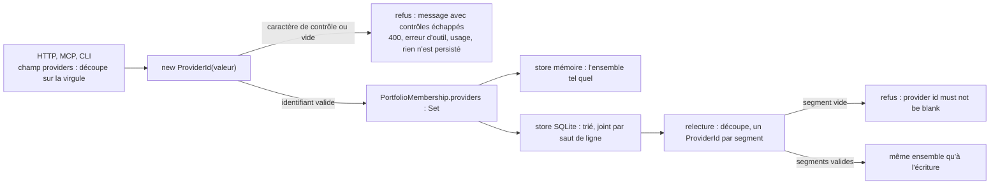

# Fournisseurs mémorisés par une appartenance de portefeuille (`portfolio-provider-identity`)

Spec de référence : [`openspec/specs/portfolio-provider-identity/spec.md`](../../../openspec/specs/portfolio-provider-identity/spec.md)
· Relevé du 2026-11-04 sur `2913fc30`.

## Objet et périmètre

Une appartenance de portefeuille (`PortfolioMembership`) garde l'ensemble des fournisseurs avec lesquels un projet a
été enregistré. La capacité exige que cet ensemble revienne tel quel de tout store, et qu'un identifiant contenant un
séparateur ne puisse jamais se lire comme deux fournisseurs.

- **Acteurs** : `ProviderId` (domaine), `PortfolioMembership`, `MemoryPortfolioStore`, `SqlitePortfolioStore`
  (colonne `provider_ids`, un fournisseur par ligne), et les trois transports qui enregistrent un projet (HTTP, MCP,
  CLI).
- **Inclus** : l'aller-retour de l'ensemble, le refus d'un identifiant à saut de ligne, la parité mémoire / SQLite.
- **Exclus** : le fournisseur d'une référence de portefeuille (`providerId` d'une référence) sauf là où il passe par
  le même type `ProviderId`, le contenu des autres colonnes de l'appartenance.

## Exigences

| Alias | Exigence (titre exact) | En bref | Nature |
|---|---|---|---|
| R1 | A membership reads back the providers it was registered with | un store rend exactement l'ensemble enregistré, même nombre, chaque identifiant égal ; mémoire et SQLite rendent le même ensemble | `[EXIGENCE]` |

## Comportement détaillé

- `[EXISTANT VÉRIFIÉ]` **Le refus est écrit sur le type.** `ProviderId` supprime les blancs de bord, refuse un
  identifiant vide (« provider id must not be blank ») et tout caractère de contrôle ISO. Le message nomme
  l'identifiant avec ses contrôles échappés (`[U+000A]`), jamais avec une barre oblique inverse, que les frontières HTTP
  liraient comme un chemin Windows. Un identifiant à saut de ligne n'existe donc pas : aucun store ne peut le recevoir.
- `[EXISTANT VÉRIFIÉ]` `SqlitePortfolioStore` encode l'ensemble trié, joint par un saut de ligne
  (`encodeProviders`), et le décode en reconstruisant chaque `ProviderId` (`decodeProviders`). Une ligne stockée
  contenant un segment vide (doublon de saut de ligne) est refusée par le même type à la lecture, au lieu d'être relue
  comme d'autres fournisseurs.
- `[EXISTANT VÉRIFIÉ]` Le store mémoire garde l'ensemble `Set<ProviderId>` du record tel quel (`Set.copyOf` dans le
  constructeur compact de `PortfolioMembership`) : il n'encode rien.
- `[EXISTANT VÉRIFIÉ]` Les trois transports découpent le champ `providers` sur la virgule, retirent les blancs et
  construisent des `ProviderId` (`MorpheusPortfolioApiService.providers`, `MorpheusPortfolioMcpTools.providers`,
  `MorpheusPortfolioCli.providers`). Le refus du domaine est rendu comme erreur de requête (HTTP 400), erreur d'outil
  (MCP) ou erreur d'usage (CLI), et rien n'est persisté.
- `[EXISTANT VÉRIFIÉ]` Limite de l'encodage hors spec : une ligne SQLite écrite avant le refus du type et contenant un
  seul saut de ligne (`a\nb`) se relit comme deux fournisseurs valides ; seule une ligne vide est détectable. Aucune
  migration ne la corrige.

## Diagrammes

### Où un identifiant à saut de ligne est-il arrêté, et que voit le store ?

Existant vérifié par lecture du type, des trois transports et du store SQLite. Exigence R1.

Le séparateur de l'encodage SQLite est exclu du vocabulaire des identifiants par le type, ce qui rend l'aller-retour
fidèle sans que le store ait à se défendre.

## Écarts et questions ouvertes

- `[EXISTANT VÉRIFIÉ]` **Le scénario « An identifier carrying a separator » est tenu par le domaine, pas par les
  stores.** `PortfolioPersistenceParityTest` écrit trois cas à saut de ligne ; chacun est refusé à la construction de
  `ProviderId`, avant tout appel de store, donc la parité mémoire / SQLite porte alors sur deux refus identiques du
  domaine. La spec admet cette issue (« refused with an explicit reason naming the identifier »). Le cas où un store
  recevrait lui-même l'identifiant n'existe pas par construction ; aucun test ne le fabrique.
- `[EXISTANT VÉRIFIÉ]` Le refus d'une ligne stockée à segment vide dit « provider id must not be blank » et ne nomme
  pas l'identifiant ; la spec ne vise que l'enregistrement.
- La limite des lignes historiques (ci-dessus) est un comportement vérifié, absent de la spec.

## Traçabilité

| Exigence | Scénario | Conception ou diagramme | Changement | Preuve |
|---|---|---|---|---|
| R1 | A membership with several providers round-trips through SQLite | organigramme | aucun changement archivé nommé (commits `803103d50`, `ea8a23e75`) | [`PortfolioPersistenceParityTest`](../../../morpheus-architecture-tests/src/test/java/com/morpheus/architecture/m23/PortfolioPersistenceParityTest.java)`#severalProvidersRoundTripInBothStores` |
| R1 | An identifier carrying a separator cannot become two providers | organigramme | idem | domaine : [`ProviderIdTest`](../../../morpheus-domain/src/test/java/com/morpheus/domain/provider/ProviderIdTest.java)`#anEmbeddedLineBreakIsRefusedAndNamedEscaped`, `#everyControlCharacterIsRefusedWhereverTrimmingDoesNotRemoveIt` ; stores : `PortfolioPersistenceParityTest#anIdentifierCarryingALineBreakIsNeverReadBackAsTwoProviders`, `#anIdentifierCarryingABlankLineIsNeverReadBackAsTwoProviders`, `#anIdentifierThatContainsAnotherOneDoesNotSwallowIt` ; HTTP : [`MorpheusPortfolioApiContractTest`](../../../morpheus-api/src/test/java/com/morpheus/api/MorpheusPortfolioApiContractTest.java)`#aProviderIdentifierCarryingALineBreakIsARequestErrorAndPersistsNothing` ; MCP : [`MorpheusPortfolioMcpToolsTest`](../../../morpheus-mcp/src/test/java/com/morpheus/mcp/MorpheusPortfolioMcpToolsTest.java)`#aProviderIdentifierCarryingALineBreakIsAToolErrorAndPersistsNothing` ; CLI : [`MorpheusPortfolioCliTest`](../../../morpheus-cli/src/test/java/com/morpheus/cli/command/MorpheusPortfolioCliTest.java)`#aProviderIdentifierCarryingALineBreakIsAUsageErrorAndPersistsNothing` ; relecture : [`SqlitePortfolioStorePersistenceTest`](../../../morpheus-store-sqlite/src/test/java/com/morpheus/store/sqlite/adapter/SqlitePortfolioStorePersistenceTest.java)`#aStoredProviderSetWithAnEmptySegmentIsRefusedRatherThanRecomposed` |
| R1 | The two stores agree | organigramme | idem | `PortfolioPersistenceParityTest` (méthode privée `assertSameFaithfulOutcome`, appelée par chacun des quatre cas) |

## Sources

- Code : `morpheus-domain/src/main/java/com/morpheus/domain/provider/ProviderId.java`,
  `morpheus-store-sqlite/src/main/java/com/morpheus/store/sqlite/adapter/SqlitePortfolioStore.java`.
- Historique Git : `803103d50` (refus des caractères de contrôle), `ea8a23e75` (refus à chaque transport).
- Règle de parité des stores : `.claude/rules/testing.md` (tests `*PersistenceParityTest`).
- Page liée : [`http-failure-disclosure.md`](http-failure-disclosure.md) (le message n'emploie pas de barre oblique inverse).
