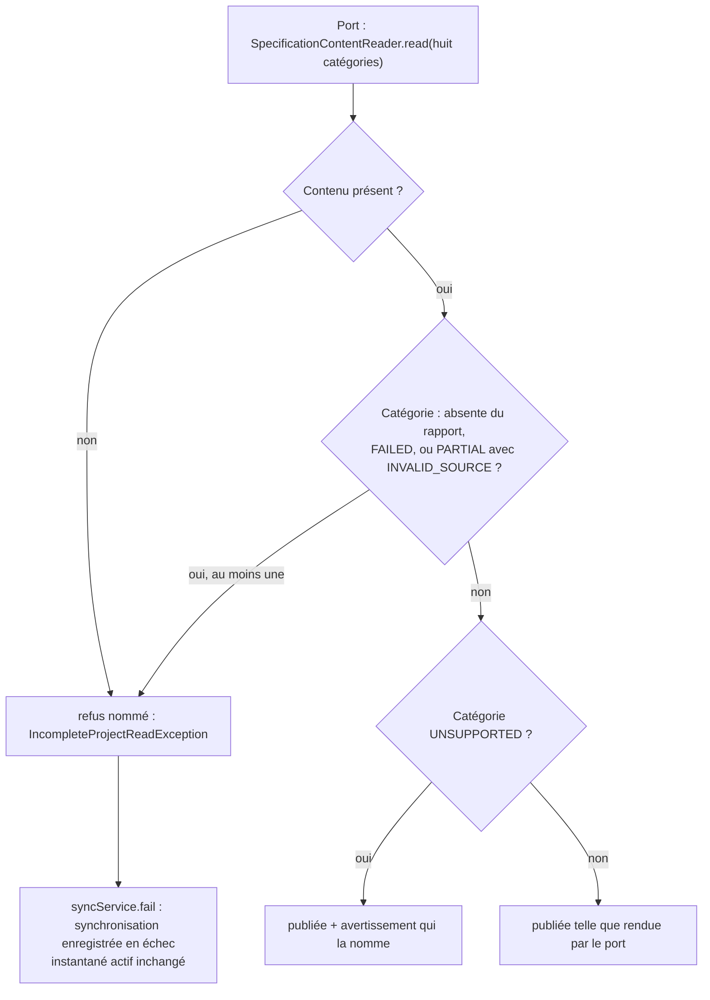
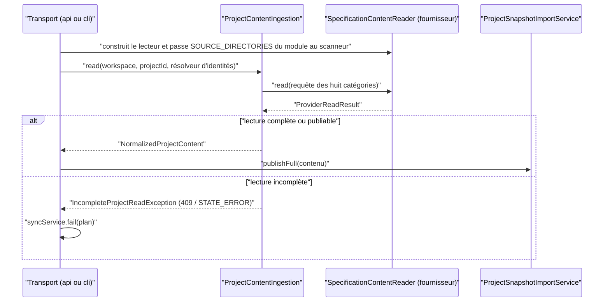

# Ingestion d'un projet par le port de fournisseur (`project-ingestion-port`)

Spec de référence : [`openspec/specs/project-ingestion-port/spec.md`](../../../openspec/specs/project-ingestion-port/spec.md)
· Relevé du 2026-11-04 sur `2913fc30`.

## Objet et périmètre

Le contenu d'un projet atteint un instantané publié par un seul chemin : le port `SpecificationContentReader`, enveloppé
par `ProjectContentIngestion`. Ce chemin refuse par son nom une lecture incomplète, publie telle quelle une lecture
complète, et laisse au module du fournisseur les répertoires qu'il lit.

- **Acteurs** : la synchronisation HTTP (`MorpheusProjectSyncApiService`), les commandes CLI `sync` et `analyze change`
  (`MorpheusProjectCli`, `MorpheusChangeCli`), les fournisseurs OpenSpec, Markdown structuré et synthétique.
- **Inclus** : `ProjectContentIngestion`, `IncompleteProjectReadException`, l'enregistrement de l'échec de synchronisation,
  les deux règles de la frontière des transports.
- **Exclus** : la publication d'un instantané (`ProjectSnapshotImportService`) ; la lecture du contenu d'OpenSpec
  ([`openspec-provider-reading.md`](openspec-provider-reading.md)) ; le serveur MCP, qui ne lit aucun projet.

## Exigences

| Alias | Exigence (titre exact) | En bref | Nature |
|---|---|---|---|
| R1 | The publication path SHALL read a project through the provider port | tout lecteur de contenu de projet passe par `SpecificationContentReader` ; un transport ne dépend d'aucun type de fournisseur hors des deux ports | `[EXIGENCE]` |
| R2 | An incomplete read SHALL NOT be published | refus nommé d'une lecture sans contenu, avec catégorie en échec ou rejetée, synchronisation enregistrée en échec, instantané actif inchangé ; autres cas publiés avec un diagnostic | `[EXIGENCE]` |
| R3 | A complete read SHALL be published as the port returned it | lecture complète publiée avec exactement le contenu rendu ; un re-synchronisation identique ne montre aucune différence | `[EXIGENCE]` |
| R4 | The scanned directories SHALL be stated by the provider module | les répertoires scannés sont énoncés une fois, dans le module du fournisseur ; un transport ne les nomme pas | `[EXIGENCE]` |

## Comportement détaillé

### Ce que `ProjectContentIngestion.read` décide (R2)

`[EXISTANT VÉRIFIÉ]` L'ingestion demande au port les huit catégories de `PUBLISHED_CATEGORIES` (spécifications courantes,
exigences, scénarios, changements, deltas d'exigences, contraintes, décisions de conception, tâches d'implémentation).
Pour chacune, selon le rapport de catégorie :

| Rapport de la catégorie | Effet |
|---|---|
| absent | non lue : refus |
| `FAILED` | refus |
| `PARTIAL` avec le code `INVALID_SOURCE` | refus (une source a été rejetée) |
| `PARTIAL` pour une autre raison | publiée, avec les diagnostics du fournisseur |
| `UNSUPPORTED` | publiée ; un avertissement `OPTIONAL_CAPABILITY_UNAVAILABLE` nomme la catégorie si le fournisseur ne l'a pas déjà fait |
| `READ` ou `ABSENT` | publiée (une catégorie simplement absente ne bloque pas) |

Un résultat sans contenu est refusé même si toutes les catégories sont rapportées. Le refus est
`IncompleteProjectReadException` (sous-classe de `IllegalStateException`) : message
`project read is incomplete, nothing was published: provider <id> …` suivi des catégories non lues avec leur statut
(`CATEGORIE=STATUT`, `UNREPORTED` si le fournisseur n'a rien rapporté), puis au plus cinq erreurs distinctes du
fournisseur (`MAX_RELAYED_ERRORS`) et le compte du reste. Chaque surface la rend comme un échec d'état : HTTP `409`
`STATE_CONFLICT`, CLI code de sortie `STATE_ERROR`.

### L'échec enregistré et l'instantané actif (R2)

`[EXISTANT VÉRIFIÉ]` Dans `MorpheusProjectSyncApiService` et `MorpheusProjectCli`, la lecture et la publication sont dans un
`try` ; toute `RuntimeException` appelle `syncService.fail(plan, …)` puis est relancée. La publication n'a pas eu lieu :
l'instantané actif est celui d'avant. Côté HTTP, les diagnostics relayés passent par `BoundedDiagnostics.remote`.

### Les répertoires et l'agrégateur (R1, R4)

`[EXISTANT VÉRIFIÉ]` `OpenSpecSpecificationProvider.SOURCE_DIRECTORIES` (`openspec`) est la seule déclaration ; les
transports la passent au scanneur. Les transports construisent `new OpenSpecSpecificationContentReader()` : un type de
fournisseur qui implémente le port, donc permis par la règle de dépendance. `analyze change` lit aussi par l'ingestion
mais n'enregistre aucune synchronisation.

## Diagrammes

### Que devient une lecture, catégorie par catégorie ?

Existant vérifié. Il répond à R2 et R3.

### Qui lit un projet, et par quel chemin ?

Existant vérifié. Il répond à R1 et R4 : les trois transports qui lisent passent par l'ingestion, jamais par un type
de fournisseur hors du port.

## Écarts et questions ouvertes

- **Preuve manquante : « the sync MUST be recorded as failed ».** Aucun test ne lit l'état de synchronisation après un
  refus : les tests vérifient le message, le code (`409`, `STATE_ERROR`) et l'instantané actif inchangé, pas la
  synchronisation enregistrée en échec. La preuve est le code (`syncService.fail`), relu le 2026-11-04.
- **Preuve manquante : refus par le serveur distant.** Le scénario « The refusal over HTTP discloses no server path »
  vise la requête passée par le serveur remote. Les tests asserts l'absence du chemin de l'espace de travail
  (`assertFalse(body.contains(workspace))`) sur le serveur **local**
  (`MorpheusHttpServer.start`) ; la route de synchronisation utilise la même projection `BoundedDiagnostics.remote`
  dans les deux cas, mais aucun test ne passe par `MorpheusRemoteHttpServer` pour ce refus.
- **Preuve manquante pour R3 (re-synchronisation).** Le scénario « A project is synced again without any source change »
  n'a pas de test durable qui compare les exigences, scénarios, changements et liens de traçabilité de deux
  synchronisations : le test d'équivalence des deux agrégateurs, écrit pour la tâche 1.1, a été supprimé avec
  l'agrégateur strict (tâche 3.5 archivée). Preuves voisines : la moitié « tel que rendu par le port » est tenue par
  `ProjectContentIngestionTest#aReadWhoseCategoriesAreReadOrAbsentIsPublishedAsTheProviderReturnedIt`, et une
  re-synchronisation sans changement de source ne republie rien
  (`MorpheusCliTest#firstSyncBootstrapsThenRepeatedSyncsStayIncrementalUntilForceIsRequested` : `published=false`,
  `requirements=0`) ; ce n'est pas la comparaison de deux publications complètes.
- `[EXISTANT VÉRIFIÉ]` **Le port n'est pas choisi par fournisseur dans les transports.** Les trois constructions de
  lecteur dans `api` et `cli` nomment le lecteur OpenSpec en dur. R1 l'autorise (le lecteur implémente le port) ; la
  sélection de fournisseur à la synchronisation n'est pas un comportement de cette capacité.
- `[EXISTANT VÉRIFIÉ]` Dans le code de production, seul le lecteur OpenSpec est construit (trois sites) ; les lecteurs
  Markdown et synthétique ne passent par l'ingestion que dans `ProviderAntiLockInTest`, où le Markdown lit la fixture
  `openspec-basic`.
- La règle de dépendance (R1, scénario 2) vise `api`, `cli` et `mcp` ; `mcp` ne lit aucun projet aujourd'hui.

## Traçabilité

| Exigence | Scénario | Conception ou diagramme | Changement | Preuve |
|---|---|---|---|---|
| R1 | A sync reads through the port | séquence | archive `2026-10-25-ingest-a-project-through-the-provider-port` | [`MorpheusApiProjectSyncIntegrationTest`](../../../morpheus-api/src/test/java/com/morpheus/api/MorpheusApiProjectSyncIntegrationTest.java)`#registersSyncsQueriesAndReopensEntireHeadlessSurface` ; [`ProjectContentIngestionTest`](../../../morpheus-application/src/test/java/com/morpheus/application/ingestion/ProjectContentIngestionTest.java)`#aReadWhoseCategoriesAreReadOrAbsentIsPublishedAsTheProviderReturnedIt` |
| R1 | A transport depends on a reader outside the port | séquence | idem | [`TransportsReadAProjectThroughTheProviderPortTest`](../../../morpheus-architecture-tests/src/test/java/com/morpheus/architecture/TransportsReadAProjectThroughTheProviderPortTest.java)`#aTransportReachesAProviderOnlyThroughThePort` |
| R1 | The same path with another provider | séquence | idem | [`ProviderAntiLockInTest`](../../../morpheus-architecture-tests/src/test/java/com/morpheus/architecture/ProviderAntiLockInTest.java)`#oneProviderNeutralPublicationPublishesEachOfTheThreeFormats` |
| R2 | One group of sources cannot be read | organigramme | idem | `MorpheusApiProjectSyncIntegrationTest#aSyncWhoseChangesCannotBeReadIsRefusedByNameAndLeavesTheActiveSnapshot` ; CLI : [`MorpheusCliTest`](../../../morpheus-cli/src/test/java/com/morpheus/cli/MorpheusCliTest.java)`#aSyncWhoseChangesCannotBeReadIsRefusedByNameAndLeavesTheActiveSnapshot` ; unitaire : `ProjectContentIngestionTest#aFailedCategoryRefusesThePublicationAndNamesIt` ; « enregistrée en échec » : **preuve manquante** |
| R2 | A category that is simply absent | organigramme | idem | `MorpheusApiProjectSyncIntegrationTest#aSyncOfAWorkspaceWithoutAnyChangePublishesItsSpecifications` |
| R2 | A requirement the provider could not normalize | organigramme | idem | `MorpheusApiProjectSyncIntegrationTest#aSyncNamesTheRequirementItSkippedWithoutNamingTheServerWorkspace` ; `MorpheusCliTest#aSyncNamesTheRequirementItSkippedAndTheFenceThatWasNeverClosed` ; `ProjectContentIngestionTest#aCategoryPartialForAnotherReasonIsPublishedWithItsDiagnostics` |
| R2 | A category the provider does not support | organigramme | idem | `ProjectContentIngestionTest#anUnsupportedCategoryIsPublishedAndNamedByAWarning` et `#anUnsupportedCategoryTheProviderAlreadyNamedIsNotNamedTwice` |
| R2 | The refusal over HTTP discloses no server path | séquence | idem | `MorpheusApiProjectSyncIntegrationTest#aSyncRefusedForInvalidContentIsTheDeclaredConflictThatNamesTheFileRelativeToTheWorkspace` (serveur local ; **preuve manquante** pour le serveur remote) |
| R3 | A project is synced again without any source change | organigramme | idem | **Preuve manquante** pour la comparaison de deux publications (voir Écarts) |
| R4 | A transport names the directory | séquence | idem | `TransportsReadAProjectThroughTheProviderPortTest#aTransportNamesNoDirectoryAProviderReads` |

Tests unitaires complémentaires de R2 : `ProjectContentIngestionTest` couvre aussi
`#aCategoryPartialBecauseASourceWasRejectedRefusesThePublicationAndRelaysTheProviderErrors`,
`#theRefusalRelaysAtMostFiveDistinctErrorsAndCountsTheRest`, `#aReadWithoutContentRefusesThePublicationEvenWhenEveryCategoryWasReported`,
`#aReadWithoutContentNamesTheCategoriesItFailed` et `#aCategoryTheProviderDidNotReportIsUnread`.

## Sources

- Changement archivé : `2026-10-25-ingest-a-project-through-the-provider-port` (tâches 1.1 à 1.3, 2.1 à 2.3, 3.1 à 3.5).
- Règle du dépôt : [`.claude/rules/architecture.md`](../../../.claude/rules/architecture.md), section ports et adaptateurs.
- Pages liées : [`openspec-provider-reading.md`](openspec-provider-reading.md), [`../OPENSPEC_PROVIDER.md`](../OPENSPEC_PROVIDER.md).
