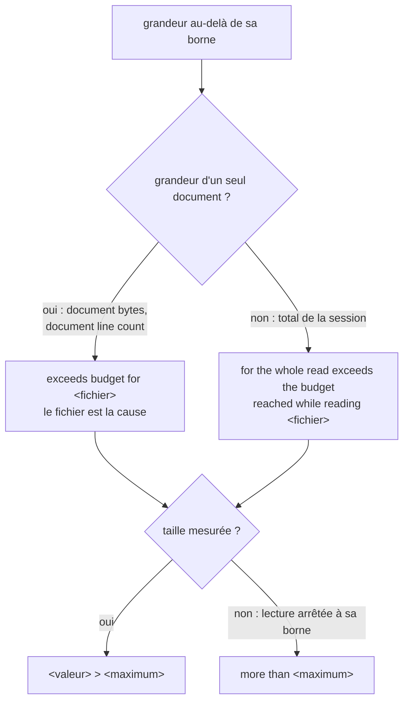
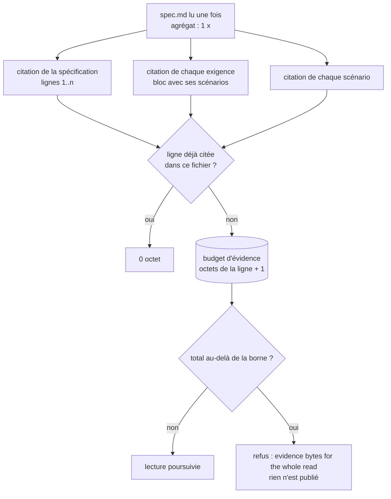

# Budget d'ingestion d'un provider (`provider-ingestion-budget`)

Spec de référence : [`openspec/specs/provider-ingestion-budget/spec.md`](../../../openspec/specs/provider-ingestion-budget/spec.md)
· Relevé du 2026-11-16 sur `968431af`.

## Objet et périmètre

Un provider qui lit un espace de travail le fait sous un budget fail-closed, `ProviderIngestionBudget`
(`morpheus-application`) : au-delà d'une borne, la lecture est refusée en bloc et rien n'est publié. La capacité fixe
le texte de ce refus, pour que l'opérateur sache quelle grandeur a dépassé sa borne et où la lecture s'est arrêtée,
sans qu'un fichier soit accusé d'un total auquel tous les fichiers lus ont contribué. Elle qualifie aussi la borne
d'évidence par défaut sur des corpus mesurés, et fixe la manière dont un lecteur OpenSpec compte un passage qu'il cite
plusieurs fois.

- **Acteurs** : `ProviderIngestionBudget` et sa `Session` (une par tentative d'ingestion), les lecteurs des providers
  OpenSpec et Markdown structuré, qui l'ouvrent et la chargent.
- **Inclus** : les deux familles de grandeurs, les deux formes de refus, le refus d'une lecture bornée qui s'arrête
  avant de connaître la taille du document, la borne d'évidence par défaut et le comptage des lignes citées.
- **Exclus** : la valeur des autres bornes de `ProviderIngestionBudget.DEFAULT` ; un budget réglable par l'opérateur ;
  une publication partielle ; la traduction du refus en diagnostic
  `INVALID_SOURCE` de source `ingestion-budget`, qui relève de chaque provider (voir
  [`openspec-provider-reading`](openspec-provider-reading.md)).

## Exigences

| Alias | Exigence (titre exact) | En bref | Nature |
|---|---|---|---|
| R1 | A cumulative budget refusal names the whole read, not the file being read | un total de session dépassé se dit « pour toute la lecture » et nomme le fichier comme l'endroit de l'arrêt ; une grandeur d'un seul document nomme ce document comme la cause | `[EXIGENCE]` |
| R2 | The default evidence budget is qualified on measured corpora | la borne d'évidence par défaut admet les corpus de qualification avec la marge déclarée et refuse toujours au-delà, sans rien publier | `[EXIGENCE]` |

## Comportement détaillé

### Deux familles de grandeurs (R1)

- `[EXISTANT VÉRIFIÉ]` **Par document** : `document bytes` (taille d'un document) et `document line count` (lignes
  d'un texte vérifié seul par `requireUtf8Document`). Le document nommé est la cause du refus.
- `[EXISTANT VÉRIFIÉ]` **Cumulatives**, comptées sur toute la session : `file count`, `aggregate bytes`, `line count`,
  `block count`, `entity count`, `evidence bytes`. Chaque fichier lu avant l'arrêt a contribué au total ; le fichier
  nommé est celui qu'on lisait quand le total a dépassé sa borne. Des lignes citées par
  `addEvidenceLines(lines, first, last)` sont rapportées au dernier document dont la session a commencé la lecture.

### Formes du refus (R1)

| Famille | Valeur mesurée | Lecture arrêtée par sa borne |
|---|---|---|
| par document | `provider ingestion <grandeur> exceeds budget for <fichier>: <valeur> > <maximum>` | `provider ingestion <grandeur> exceeds budget for <fichier>: more than <maximum>` |
| cumulative | `provider ingestion <grandeur> for the whole read exceeds the budget: <total> > <maximum>, reached while reading <fichier>` | `provider ingestion <grandeur> for the whole read exceeds the budget: more than <maximum>, reached while reading <fichier>` |

- `[EXISTANT VÉRIFIÉ]` Une lecture est bornée par ce qui reste du budget du document, de l'agrégat et, pour une lecture
  d'évidence, de l'évidence. Quand `SafeWorkspaceFileResolver` refuse le fichier à cette borne
  (`WorkspaceFileTooLargeException`), la taille du document n'est pas connue : le refus dit « more than » et n'imprime
  aucune valeur. Il en va de même quand le budget est déjà plein avant la lecture.
- `[EXISTANT VÉRIFIÉ]` La lecture bornée attribue le dépassement à l'agrégat si c'est lui qui la bornait, puis à
  l'évidence, puis au document ; le texte d'un refus nomme toujours le fichier tel qu'il existe
  (`WorkspaceRelativePathText`), ou l'étiquette de groupe que le lecteur a fournie (`openspec/changes`).
- `[EXISTANT VÉRIFIÉ]` Un refus ne fait avancer aucun compteur : la session reste dans l'état d'avant l'élément refusé.

### Borne d'évidence et comptage des lignes citées (R2)

- `[EXISTANT VÉRIFIÉ]` Les lecteurs OpenSpec citent la spécification entière, puis chaque exigence avec ses scénarios,
  puis chaque scénario, et comptent leurs lignes par `addEvidenceLines` : la session garde les lignes déjà citées du
  dernier fichier lu, et une ligne coûte ses octets UTF-8 plus un octet de fin de ligne, **une fois par fichier lu**,
  quel que soit le nombre de citations qui la couvrent. Un refus ne compte rien et ne retient aucune ligne. Le Markdown
  structuré et le provider synthétique comptent un fichier d'évidence entier (`readEvidence`) ou un bloc
  (`addEvidenceFragment(fragment, source)`).
- `[EXISTANT VÉRIFIÉ]` La borne d'évidence de `DEFAULT` vaut 4 Mio, commune aux trois providers. Son commentaire écrit
  la mesure qui la fonde, sa date et la marge déclarée : **la moitié de la borne**. Un corpus qui cite plus de la moitié
  de la borne sort de ce qui a été qualifié ; au-delà de la borne, la lecture est refusée comme pour toute grandeur
  cumulative. La lecture d'évidence d'un fichier entier reste bornée par la borne par document : un fichier d'évidence
  du Markdown structuré ou du provider synthétique est lu jusqu'au plus petit de `maxDocumentBytes` et de la borne
  d'évidence, soit 1 Mio avec `DEFAULT`.
- `[EXISTANT VÉRIFIÉ]` Mesure du 2026-11-16 (`OpenSpecEvidenceMeasurement`, outil de test ; arbres de travail lus en
  lecture seule, borne hors d'atteinte pour lire chaque corpus en entier) :

  | Corpus | specs (o) | évidence par extrait (o) | évidence une fois par ligne (o) | dont changements actifs (o) | exigences | médiane / max par exigence (o) | rapport au texte, médian / max |
  |---|---|---|---|---|---|---|---|
  | `morpheus-engine` | 408 613 | 1 027 637 | 427 285 | 26 619 (3) | 361 | 1 486 / 5 391 | 1,62 / 1,83 |
  | `nexus-context-engine` | 163 850 | 462 533 | 214 502 | 53 180 (2) | 168 | 1 249 / 5 210 | 1,63 / 1,84 |
  | `minos-code-intelligence` | 531 513 | 2 077 195 | 1 241 544 | 717 443 (33) | 441 | 1 817 / 5 423 | 1,63 / 1,83 |

  « Par exigence » compte le bloc de l'exigence et les blocs de ses scénarios, rapportés au texte du bloc. Une ligne par
  fichier, le plus gros corpus occupe moins d'un tiers de la borne ; il occupait 237 % de l'ancienne borne de 512 Kio,
  que le comptage fusionné seul ne suffisait donc pas à qualifier.
- `[EXISTANT VÉRIFIÉ]` La qualification se rejoue sans les projets mesurés :
  `OpenSpecEvidenceBudgetQualificationTest` génère un espace de travail dont les spécifications dépassent le quart de la
  borne et les fichiers cités en entier les deux cinquièmes, au-dessus du plus gros corpus mesuré ; il le lit avec
  `DEFAULT` et exige que tout soit lu sous la marge. Un second espace, au-delà de la borne, est refusé sans rien
  publier.

## Diagrammes

### Quelle forme prend un refus ?

Existant vérifié dans `ProviderIngestionBudget`. Organigramme, pas UML. Exigence R1.

La famille de la grandeur choisit le sujet de la phrase ; la lecture, mesurée ou arrêtée, choisit la quantité.

### Combien coûte au budget un passage cité plusieurs fois ?

Existant vérifié dans les lecteurs OpenSpec et `ProviderIngestionBudget.Session#addEvidenceLines`. Organigramme, pas
UML. Exigence R2.

Une ligne de scénario, citée trois fois, coûte une fois ses octets : la borne mesure le texte cité, pas la profondeur
d'imbrication des citations.

## Écarts et questions ouvertes

- Le corpus `openspec/` de ce dépôt (scénario « The specification corpus of this repository ») n'est lu par aucun test
  tant que la sonde refuse son schéma déclaré, `detailed-uml` ; le changement `accept-a-declared-derived-openspec-schema`
  le permet.
- Les autres bornes de `DEFAULT` (fichiers, agrégat, lignes, blocs, entités) n'ont pas été qualifiées sur ces corpus ;
  elles y tiennent.

## Traçabilité

| Exigence | Scénario | Conception ou diagramme | Changement | Preuve |
|---|---|---|---|---|
| R1 | Evidence accumulated over many small files | organigramme | archive `2026-11-15-name-a-cumulative-budget-refusal-as-a-session-total` | [`OpenSpecRefusedFileNameTest`](../../../morpheus-provider-openspec/src/test/java/com/morpheus/provider/openspec/OpenSpecRefusedFileNameTest.java)`#anEvidenceTotalReachedOnASmallFileDoesNotAccuseIt` |
| R1 | One document larger than the per-document budget | organigramme | idem | [`ProviderIngestionBudgetPrecisionTest`](../../../morpheus-application/src/test/java/com/morpheus/application/read/ProviderIngestionBudgetPrecisionTest.java)`#aDocumentReadIsNeverAttributedToTheEvidenceBudget`, `#aWholeDocumentIsCheckedForItsEncodedBytesAndItsLines` |
| R1 | A bounded read that stops before the total is known | organigramme | idem | `ProviderIngestionBudgetPrecisionTest#aBoundedReadThatStopsEarlySaysMoreThanTheMaximum` |
| R1 | (les six grandeurs cumulatives) | organigramme | idem | [`ProviderIngestionBudgetTest`](../../../morpheus-application/src/test/java/com/morpheus/application/read/ProviderIngestionBudgetTest.java)`#everyCumulativeQuantityIsRefusedForTheWholeRead` |
| R2 | The qualification corpus larger than the largest measured project | organigramme du comptage | `qualify-the-evidence-budget-on-real-corpora` | [`OpenSpecEvidenceBudgetQualificationTest`](../../../morpheus-provider-openspec/src/test/java/com/morpheus/provider/openspec/OpenSpecEvidenceBudgetQualificationTest.java)`#aCorpusLargerThanTheLargestMeasuredProjectIsRead` ; `ProviderIngestionBudgetTest#aLineCitedSeveralTimesFromTheSameDocumentIsCountedOnce` |
| R2 | A corpus beyond the limit | organigramme du comptage | idem | `OpenSpecEvidenceBudgetQualificationTest#aCorpusBeyondTheLimitIsRefusedAndPublishesNothing` |
| R2 | The specification corpus of this repository | — | idem | à écrire après `accept-a-declared-derived-openspec-schema` |

## Sources

- ADR : [ADR-0028](../../architecture/adr/BE-0028-unified-provider-read-contract.md), contrat de lecture provider
  unifié et résultats partiels explicites.
- Pages liées : [`openspec-provider-reading.md`](openspec-provider-reading.md),
  [`workspace-boundary-scan-cost.md`](workspace-boundary-scan-cost.md).
