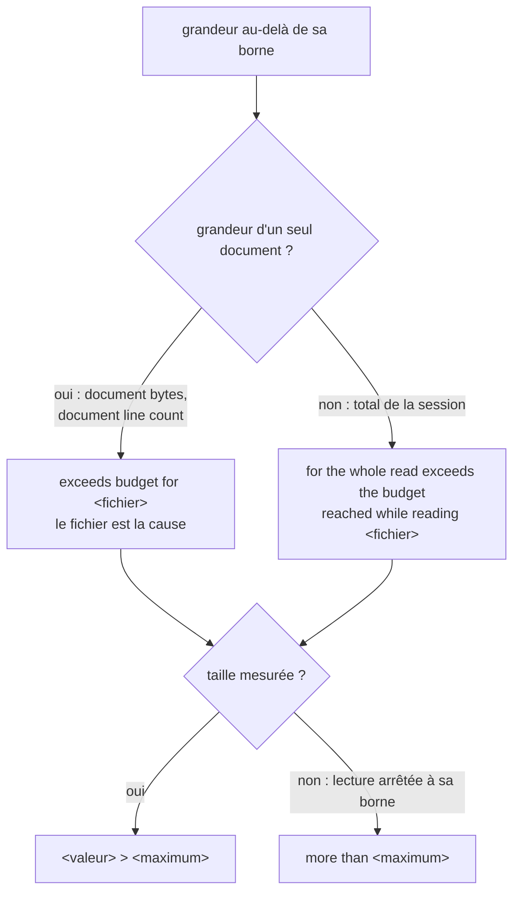

# Budget d'ingestion d'un provider (`provider-ingestion-budget`)

Spec de référence : [`openspec/specs/provider-ingestion-budget/spec.md`](../../../openspec/specs/provider-ingestion-budget/spec.md)
· Relevé du 2026-11-15 sur `02760e01`.

## Objet et périmètre

Un provider qui lit un espace de travail le fait sous un budget fail-closed, `ProviderIngestionBudget`
(`morpheus-application`) : au-delà d'une borne, la lecture est refusée en bloc et rien n'est publié. La capacité fixe
le texte de ce refus, pour que l'opérateur sache quelle grandeur a dépassé sa borne et où la lecture s'est arrêtée,
sans qu'un fichier soit accusé d'un total auquel tous les fichiers lus ont contribué.

- **Acteurs** : `ProviderIngestionBudget` et sa `Session` (une par tentative d'ingestion), les lecteurs des providers
  OpenSpec et Markdown structuré, qui l'ouvrent et la chargent.
- **Inclus** : les deux familles de grandeurs, les deux formes de refus, le refus d'une lecture bornée qui s'arrête
  avant de connaître la taille du document.
- **Exclus** : la valeur des bornes de `ProviderIngestionBudget.DEFAULT` ; la traduction du refus en diagnostic
  `INVALID_SOURCE` de source `ingestion-budget`, qui relève de chaque provider (voir
  [`openspec-provider-reading`](openspec-provider-reading.md)).

## Exigences

| Alias | Exigence (titre exact) | En bref | Nature |
|---|---|---|---|
| R1 | A cumulative budget refusal names the whole read, not the file being read | un total de session dépassé se dit « pour toute la lecture » et nomme le fichier comme l'endroit de l'arrêt ; une grandeur d'un seul document nomme ce document comme la cause | `[EXIGENCE]` |

## Comportement détaillé

### Deux familles de grandeurs (R1)

- `[EXISTANT VÉRIFIÉ]` **Par document** : `document bytes` (taille d'un document) et `document line count` (lignes
  d'un texte vérifié seul par `requireUtf8Document`). Le document nommé est la cause du refus.
- `[EXISTANT VÉRIFIÉ]` **Cumulatives**, comptées sur toute la session : `file count`, `aggregate bytes`, `line count`,
  `block count`, `entity count`, `evidence bytes`. Chaque fichier lu avant l'arrêt a contribué au total ; le fichier
  nommé est celui qu'on lisait quand le total a dépassé sa borne. Un fragment d'évidence cité par
  `addEvidenceFragment(String)` est rapporté au dernier document dont la session a commencé la lecture.

### Formes du refus (R1)

| Famille | Valeur mesurée | Lecture arrêtée par sa borne |
|---|---|---|
| par document | `provider ingestion <grandeur> exceeds budget for <fichier>: <valeur> > <maximum>` | `provider ingestion <grandeur> exceeds budget for <fichier>: more than <maximum>` |
| cumulative | `provider ingestion <grandeur> for the whole read exceeds the budget: <total> > <maximum>, reached while reading <fichier>` | `provider ingestion <grandeur> for the whole read exceeds the budget: more than <maximum>, reached while reading <fichier>` |

- `[EXISTANT VÉRIFIÉ]` Une lecture est bornée par ce qui reste du budget du document, de l'agrégat et, pour une lecture
  d'évidence, de l'évidence. Quand `SafeWorkspaceFileResolver` refuse le fichier à cette borne
  (`WorkspaceFileTooLargeException`), la taille du document n'est pas connue : le refus dit « more than » et n'imprime
  aucune valeur. Il en va de même quand le budget est déjà plein avant la lecture.
- `[EXISTANT VÉRIFIÉ]` La lecture bornée attribue le dépassement à l'agrégat si c'est lui qui la bornait, puis à
  l'évidence, puis au document ; le texte d'un refus nomme toujours le fichier tel qu'il existe
  (`WorkspaceRelativePathText`), ou l'étiquette de groupe que le lecteur a fournie (`openspec/changes`).
- `[EXISTANT VÉRIFIÉ]` Un refus ne fait avancer aucun compteur : la session reste dans l'état d'avant l'élément refusé.

## Diagrammes

### Quelle forme prend un refus ?

Existant vérifié dans `ProviderIngestionBudget`. Organigramme, pas UML. Exigence R1.

La famille de la grandeur choisit le sujet de la phrase ; la lecture, mesurée ou arrêtée, choisit la quantité.

## Écarts et questions ouvertes

- La borne d'évidence par défaut et la manière dont les lecteurs OpenSpec comptent un passage cité plusieurs fois sont
  traitées par le changement `qualify-the-evidence-budget-on-real-corpora`.

## Traçabilité

| Exigence | Scénario | Conception ou diagramme | Changement | Preuve |
|---|---|---|---|---|
| R1 | Evidence accumulated over many small files | organigramme | archive `2026-11-15-name-a-cumulative-budget-refusal-as-a-session-total` | [`OpenSpecRefusedFileNameTest`](../../../morpheus-provider-openspec/src/test/java/com/morpheus/provider/openspec/OpenSpecRefusedFileNameTest.java)`#anEvidenceTotalReachedOnASmallFileDoesNotAccuseIt` |
| R1 | One document larger than the per-document budget | organigramme | idem | [`ProviderIngestionBudgetPrecisionTest`](../../../morpheus-application/src/test/java/com/morpheus/application/read/ProviderIngestionBudgetPrecisionTest.java)`#aDocumentReadIsNeverAttributedToTheEvidenceBudget`, `#aWholeDocumentIsCheckedForItsEncodedBytesAndItsLines` |
| R1 | A bounded read that stops before the total is known | organigramme | idem | `ProviderIngestionBudgetPrecisionTest#aBoundedReadThatStopsEarlySaysMoreThanTheMaximum` |
| R1 | (les six grandeurs cumulatives) | organigramme | idem | [`ProviderIngestionBudgetTest`](../../../morpheus-application/src/test/java/com/morpheus/application/read/ProviderIngestionBudgetTest.java)`#everyCumulativeQuantityIsRefusedForTheWholeRead` |

## Sources

- ADR : [ADR-0028](../../architecture/adr/BE-0028-unified-provider-read-contract.md), contrat de lecture provider
  unifié et résultats partiels explicites.
- Pages liées : [`openspec-provider-reading.md`](openspec-provider-reading.md),
  [`workspace-boundary-scan-cost.md`](workspace-boundary-scan-cost.md).
